# 第 1 章　LLM 怎麼運作：一個跑成迴圈的詞表分類器

**本章結論**：大型語言模型（Large Language Model，LLM）是一個輸出類別等於整個詞表的 softmax 分類器，生成文字就是把這個分類器跑成迴圈，一次猜一個 token。從這個定義可以直接推出三個工程後果：計費與 context 上限都按 token 算；attention 讓 context 的成本隨長度平方成長；模型是無狀態的純函數，「記得對話」靠的是每次重送整段歷史。溫度只控制抽樣的隨機性，不控制對錯，所以幻覺要靠提供資料與驗證來壓，不是調參數。部署上，開放權重與商業 API 的差別只在參數檔放在誰那裡，兩者都能用同一個 OpenAI 相容介面呼叫。

---

## 1.1 模型缺三樣東西，Agent 是用迴圈和工具把它們補上

學 Agent 之前要先承認一件事：模型本身是一顆很強、但被關在盒子裡的大腦。它只吃文字、只吐文字，沒有長期記憶，碰不到外部系統，知識停在訓練截止那一天。Agent 不修改這顆大腦，而是把它放進一個「想、做、看」的迴圈裡，配上記憶與工具，讓它一輪一輪地決定下一步。

你已經熟悉的神經網路是 `y = f(x)`：輸入一張圖，輸出一個類別，呼叫一次就結束。Agent 做的事情，可以用一句話描述：**把 f 放進迴圈，這一輪的輸出決定下一輪要呼叫哪個工具。** 這個定義也給了一個判斷產品是不是 Agent 的簡單方法：問「下一步由誰決定」。一般聊天機器人沒有下一步，呼叫一次就結束；Dify、n8n 這類畫好的流程（workflow），下一步由工程師寫死；Claude Code、Deep Research 這類產品，下一步由模型看完上一輪結果後自己決定（本課轉述 Anthropic 2024 年〈Building effective agents〉對 workflow 與 agent 的區分）。

這門課的四根支柱就是對應模型的三個缺口加上大腦本身。記憶負責把狀態存到模型外面；工具分兩種，一種讓它動手（跑 SQL、寄信、重啟服務），一種讓它查資料（RAG、GraphRAG）；規劃是 Thought → Action → Observation 的迴圈，高風險動作在這裡停下來問人。大腦是模型本身，它不補缺口，負責理解與決定。

**圖 1-1　Agent 不改模型，而是把模型放進迴圈**

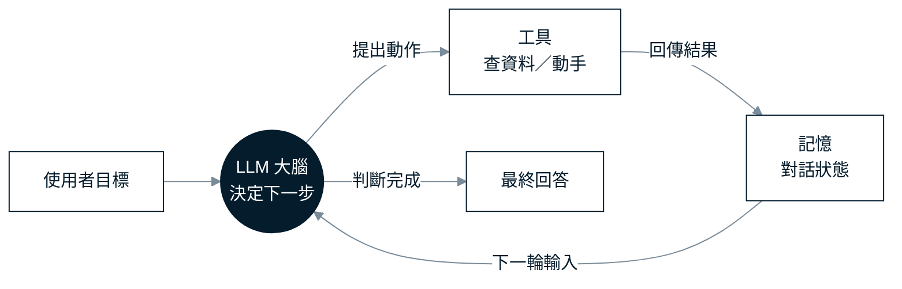

<sub>資料來源：本課整理；改繪自投影片「Agent＝模型＋迴圈」「模型缺三樣，四根支柱來補」。</sub>

這一章只處理迴圈正中央那顆圓：模型本身。後面每一個 Agent 機制，不論是 RAG 把文件塞進輸入、checkpoint 把狀態存進資料庫，還是 human-in-the-loop 在執行前停下來，都是在補這顆圓的某個結構性限制。先把限制看清楚，後面的設計才不會像是任意的規定。

下表是整門課的「搭橋地圖」：左邊是你在深度學習已經會的概念，右邊是它在這門課長成的樣子。幾乎每個新名詞都有一個你熟悉的原型，唯一的例外是 MCP，它只是工具的標準接口，沒有 DL 對應。

| 你已經會的 | 這門課補的 | 兩者的關係 |
|---|---|---|
| softmax 分類器 | LLM | 類別換成詞表上的每個 token |
| RNN／LSTM | attention | 不再逐步傳遞，改成每個位置直接看全部 |
| embedding 層 | token embedding、RAG 的向量檢索 | 查表；向量近鄰＝找相關文件 |
| 遷移學習 | 指令微調、LoRA | 凍結 W，只學 ΔW |
| 訓練迴圈 | Agent 迴圈 | 把 f(x) 放進迴圈 |
| （沒有對應） | MCP | 工具的標準接口 |

<sub>資料來源：投影片「從深度學習到 Agent 的地圖」，本課整理。</sub>

---

## 1.2 文字進模型前要先切成 token，計費與 context 上限都按 token 算

模型的輸入不是字，而是一串整數。**token** 是模型讀寫文字的最小單位，可能是一個詞、半個詞或一個字，例如 `unbelievable` 可能被切成 `un`、`believ`、`able` 三塊。每個 token 對應一個整數 id，文字到 id 的對照表叫**詞表**（vocabulary），負責切分的程式叫 **tokenizer**。模型自始至終只看得到 id。

**圖 1-2　同一個意思，中文常比英文多切出幾格 token**

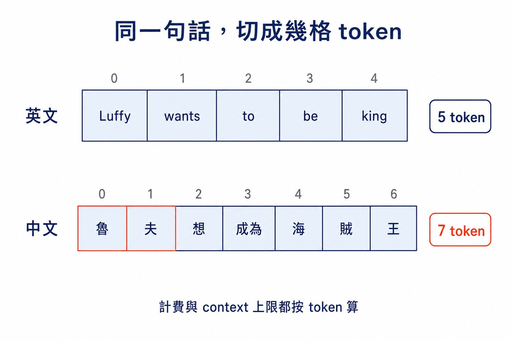

<sub>資料來源：模組一 `images/token_strip.jpg`；對應投影片「文字進模型前，先切成 token」。</sub>

為什麼不直接用「字」或「單字」當單位？這是一個詞表大小與序列長度的取捨。一個 byte 一格，詞表只有 256 個（1 byte 是 8 個 bit，每個 bit 只能是 0 或 1，所以只有 2⁸ = 256 種值，也就是整數 0 到 255；任何文字編成 UTF-8 後都只由這 256 種 byte 組成），但一個中文字在 UTF-8 裡就是 3 個 byte，序列長得驚人，算力全花在長度上。一個單字一格，詞表會膨脹到幾百萬，而且沒看過的新名詞、錯字完全無法表示。業界取中間：**subword**，常見片段一格、罕見字退回 byte。實務上的詞表大小約 5 萬到 15 萬個 token。對你來說最好記的搭橋是：**詞表大小就是最後一層 softmax 的類別數**，這個伏筆在 1.4 節會用到。

最常見的 subword 演算法叫 **BPE**（Byte Pair Encoding）。它的想法很樸素：統計語料裡哪兩個相鄰片段最常黏在一起，就把它們合併成一個新 token、記進詞表，重複幾萬到十幾萬次。

**圖 1-3　BPE 每一輪把最常相鄰的一對合併成新 token**

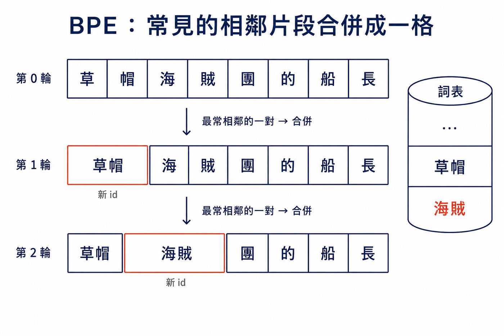

<sub>資料來源：模組一 `images/bpe_merge_flow.jpg`。為了好讀，圖中一個中文字畫成一格；實際上中文字一開始是 3 個 byte，要先合併成字，再往上合併成詞。</sub>

有兩個細節容易誤會。第一，**合併出來的新 token 不是「一個 byte」，而是一個新編號**。前 256 個 id（0 到 255）就是那 256 種 byte 本身，合併出來的 token 從 256 往上編號，一個 id 背後可以代表好幾個 byte。合併之後就不再是「一個 byte 一格」，而是「一個 token id 一格」。第二，**每次合併只把兩個已經在詞表裡的 token 合成一個**，所以長 token 是一輪一輪疊出來的。以英文 `the` 為例：

```text
初始詞表：t = 116　h = 104　e = 101          （byte 值，同時也是 token id）

第 1 次合併：(116, 104) → 256   "th"
第 2 次合併：(256, 101) → 257   "the"        ← 拿上一輪合出來的 256 再合併

展開：257 → (256, 101) → (116, 104, 101) → t h e
```

tokenizer 存的就是這張「兩個 id → 新 id」的合併規則表，任何 token 往回拆，最後都會拆回 byte。中文字也一樣：「中」的 UTF-8 是 228、184、173 三個 byte，要先經過兩次合併變成一個「中」token，才有機會再跟別的字合成詞。模型本身完全不看 byte，它只拿 token id 去 embedding 表查向量，所以 embedding 表的大小是「詞表大小 × 向量維度」。

BPE 有三個性質，直接決定了你會遇到的怪現象。第一，**詞表大小是人定的，詞表內容是統計出來的**。合併要做幾次是事先設好的超參數，跟 hidden size 一樣是取捨；例如 GPT-2 的詞表 50,257 = 256 個 byte + 50,000 次合併 + 1 個特殊 token `<|endoftext|>`。至於這五萬次各自合併了哪一對，才是從語料統計出來的。訓練語料裡英文多，所以英文常見單字幾乎都是一格，中文則常常一字一格，罕見字甚至拆成兩格。第二，它永遠切得了，最差就是一個 byte 一格，所以沒有「未知字」，代價是罕見字很貴。第三，模型看不到字母：`strawberry` 被切成幾個片段後，「裡面有幾個 r」就變成模型很難直接回答的問題。數字也被切得很碎，這是模型算術不穩的原因之一。

這些性質落到工程上就是四條規則。**計費與 context 上限都按 token 算**，同一段文字在不同模型上 token 數不同，估費用要用該模型自己的 tokenizer 數，不能用字數。同樣的意思，中文常比英文多兩到五成 token。**要數字母、做大數運算，交給程式或工具**，不要交給模型。最後，對話格式本身也吃 token：messages 會被 chat template 攤平成一段帶特殊 token 的文字（1.8 節與第 3 章會再看到）。

[Lab 1-01](../../modules/module-01-llm-local/01_tokens.ipynb) 會把 Qwen tokenizer 裡存的合併規則直接印出來（十五萬多條），並比較中英文的 token 數。

---

## 1.3 embedding 就是查表，和你用過的 nn.Embedding 是同一個東西

token id 只是編號，本身沒有「意思」。模型的第一層要把它變成向量，這一步叫 **embedding**：一張「詞表大小 V × 向量寬度 d」的權重矩陣，token id 是幾號，就取第幾列。這就是你寫過的 `nn.Embedding(V, d)`，沒有任何新東西。

數學上可以把它寫成 one-hot 乘權重矩陣：one-hot 向量只有一格是 1，乘上矩陣 E 剛好挑出 E 的某一列。因為 V 很大（5 萬到 15 萬），實作時不會真的做矩陣乘法，而是直接按 id 取列。這張表的數字和 CNN 的 filter 一樣，是反向傳播學出來的；學完之後，意思相近的 token 向量也會相近，這是第二部向量檢索能運作的基礎。

**圖 1-4　token id 經過查表變成向量，再進入模型主體**


<sub>資料來源：本課整理；改繪自投影片「embedding：id 變向量，就是查表」。</sub>

要注意的是，查表得到的向量只代表「這個 token 本身」，還不知道它在句子裡的位置，也不知道上下文。「蘋果」在「吃蘋果」與「蘋果發表會」裡查到的是同一列向量。模型後面的 Transformer 層要做的，就是讓每個 token 的向量吸收上下文、變成依情境而定的表示。這也是為什麼 Transformer 在查表之後還要加入位置資訊。

---

## 1.4 語言模型是詞表上的 softmax 分類器，生成是把它跑成迴圈

這一節是整章的核心。一次前向傳播的流程，和你熟悉的影像分類幾乎逐格對應：

**圖 1-5　語言模型和影像分類逐格對應，差別只在類別數**

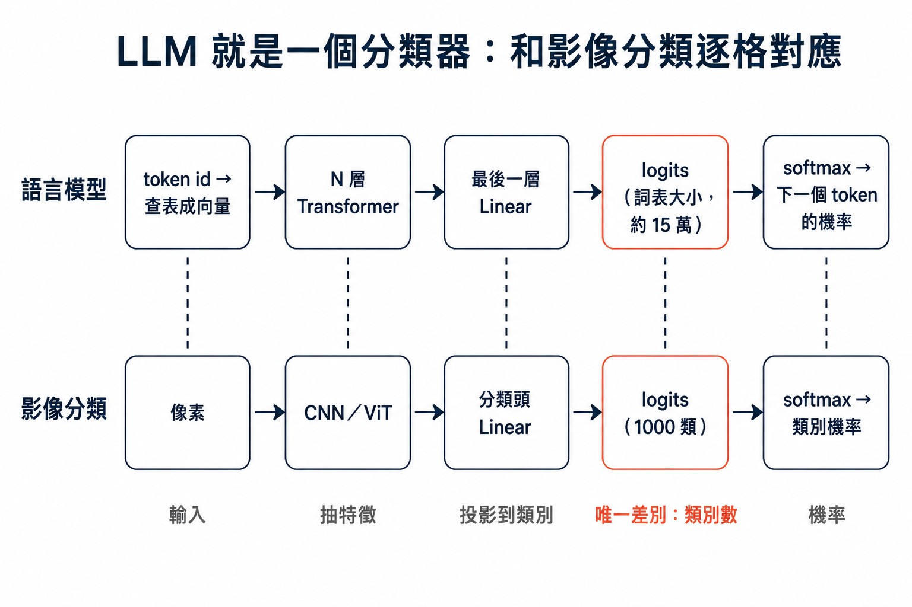

<sub>資料來源：本課整理，模組一 `images/llm_vs_image_classifier.jpg`。「約 15 萬」以 Qwen 系列的詞表為例。</sub>

模型對序列的每個位置都輸出一個長度等於詞表大小的分數向量（**logits**），softmax 之後就是「下一個 token 是詞表裡每一個的機率」。訓練目標就是分類的交叉熵。差別只在兩處：類別數從 1000 變成十幾萬；標籤不需要人標。

**logits 不是機率**，這點常被混用。logits 是最後一層 Linear 直接吐出的原始分數，可以是任意實數、可正可負、加起來也不等於 1，只有「誰比誰高」有意義。softmax 做兩件事把它變成機率：先對每個分數取 e 的次方，全部變成正數；再除以總和，讓加總剛好等於 1。

```text
p_i = e^(z_i) / Σ_j e^(z_j)

假設詞表只有三個 token，接在「魯夫想成為」後面：

           logits z    e^z      機率 p
海賊王        5.0      148.4     0.867
英雄          3.0       20.1     0.117
廚師          1.0        2.7     0.016
                     總和 171.2   總和 1.000
```

分數差 2，機率卻差了 7 倍多，因為 e 的次方會放大差距。這跟你在 PyTorch 的經驗一致：`nn.CrossEntropyLoss` 吃的是 logits 而不是機率，因為它內部會自己做 softmax。分清這兩者，1.5 節的溫度才講得通：溫度是先調 logits、再做 softmax。

標籤不需要人標，是 LLM 讀得了海量文字的原因。影像分類的每張圖都要有人看過、標過，標註是最貴、最慢的一步。語言模型則把每一句話切成好幾道考題：「魯夫」的下一個字是「想」，「魯夫想」的下一個是「成為」，「魯夫想成為」的下一個是「海賊王」。答案直接從原文取，所以叫**自監督**（self-supervised）。網路上每一句話都能這樣出題，這就是**預訓練**（pre-training）。

生成時，把這個分類器放進迴圈：猜一個 token，接到輸入尾巴，再猜下一個，直到抽到結束符號或碰到長度上限。

**圖 1-6　生成是一個迴圈：模型只負責算機率，抽樣決定挑哪一個**

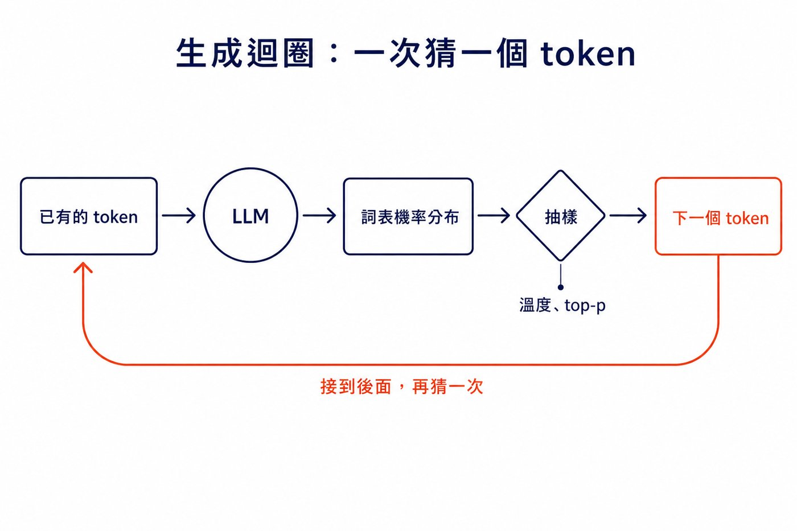

<sub>資料來源：模組一 `images/generation_loop.jpg`；對應投影片「生成＝把分類器跑成迴圈」。</sub>

`transformers` 的 `model.generate()`、Ollama、各家 API 背後都是這個迴圈，只是多了快取（KV cache，不必每一步從頭算前面的 token）和抽樣策略。你在聊天介面看到文字一個一個冒出來，不是動畫效果，而是模型真的一個一個生成。這也解釋了 API 的串流（streaming）為什麼存在：每生成一小片就送回來，使用者不必等整段完成。

這個定義帶來一個常被忽略的後果：**模型每一步都一定會輸出一個機率分佈，結構上沒有「我不知道」這個選項。** 問它一間小公司去年的營收，每個候選數字的分數都很低，它還是會挑一個，接出一句通順的「去年營收約 5 億元」。這就是**幻覺**（hallucination）：講得很順，內容不實。它的目標是「最像下一句」，不是「真的」。你可能已經見過它的典型樣子：引用不存在的論文或網址、編出套件裡沒有的函式參數。常見來源包括訓練資料裡本來就沒有（小眾主題、公司內部文件、截止日之後的事）、問題本身有錯誤前提、小模型容量不夠、被要求精確的數字或出處。

壓下幻覺的方法都不在模型內部：把正確資料查來放進輸入（RAG，第二部）、在提示詞裡給它說「不知道」的合法出口（第 2 章）、讓模型呼叫工具查證（第三部）、上線前用評估集抓出來（第四部）。這一節的觀念也串起了課程的大地圖：以前每個 NLP 任務都要重新標註、從頭訓練一個模型；現在先用生文本練出一個底座，任務只在最後一步分岔成三條路：直接下指令（Prompt）、把資料塞進輸入（RAG）、少量標註再微調（LoRA）。

**圖 1-7　從「一任務一模型」變成「一個底座，三條分岔」**

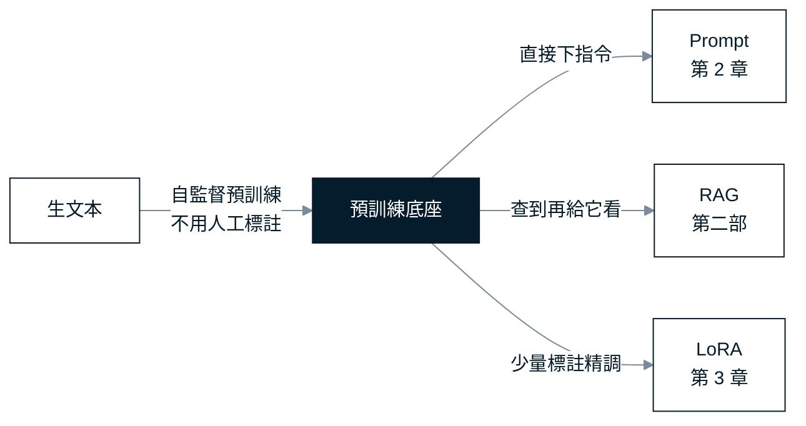

<sub>資料來源：本課整理；改繪自投影片「從『一任務一模型』到『一個底座』」。</sub>

---

## 1.5 溫度只管抽樣的隨機性，不管答案對錯

模型給出的是機率分佈，接下來要「挑一個」。挑法由幾個抽樣參數控制，它們全部作用在 softmax 那一步，**模型本身完全沒變**。最常調的是**溫度**（temperature）：抽樣前把 logits 除以 T 再做 softmax。T 小於 1 時分佈變尖，幾乎只挑第一名；T 大於 1 時分佈變平，長尾的 token 也常被抽中。這就是知識蒸餾裡 `softmax(z / T)` 的那個 T。

**圖 1-8　抽樣參數都只作用在 softmax 之後，模型權重不動**

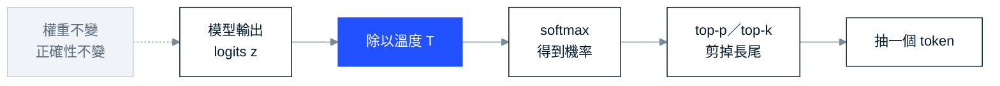

<sub>資料來源：本課整理；改繪自投影片「溫度：同一個分佈，調尖或調平」。</sub>

| 參數 | 做什麼 | 效果 |
|---|---|---|
| greedy（溫度 0） | 永遠挑機率最高的 | 穩定、可重現，但容易重複 |
| 溫度 T | logits 先除以 T | T 小更保守，T 大更隨機 |
| top-p | 只留累積機率到 p 為止的 token | 依分佈形狀剪掉長尾；分佈尖時只留兩三個，平時留很多 |
| top-k | 只留前 k 名 | 和 top-p 類似，但不看分佈形狀 |
| max tokens | 最多生成幾個 token | 控制長度與費用；碰到上限輸出會被截斷 |

<sub>資料來源：模組一 `00_concepts.md` §3；投影片「生成＝把分類器跑成迴圈」。</sub>

最常見的誤解是「溫度設 0 就不會幻覺」。這是錯的。溫度只決定要不要常挑第二、第三名；T 再低，抽到的也只是模型「最有把握」的那個答案，而它可以很有把握地答錯。正確性要靠提供資料與驗證，不是靠調低溫度。另一個陷阱是溫度 0 並不總是最穩：DeepSeek-R1 distill 這類推理模型的官方建議是溫度 0.5 到 0.7（建議 0.6），設 0 反而容易陷入無限重複。

所以實務規則有兩條。第一，**照模型官方建議值**設溫度，不要一律設 0。第二，需要可重現、格式穩定的輸出（JSON、SQL、分類）時調低溫度；要發想、寫文案時才調高；溫度和 top-p 通常只調一個。至於「可重現」，溫度大於 0 時同一個提示詞每次輸出都可能不同，所以評估提示詞不能只看一次輸出，這一點會在第 2 章變成具體的評估方法。

---

## 1.6 attention 用「依內容決定權重的加權平均」取代 RNN 的單一向量

Transformer 中間那一大段，最核心的元件是 **attention**。要理解它為什麼存在，先看它要解決的問題：RNN 一個字一個字讀，把前面所有內容壓進一個固定大小的隱藏狀態，一路往後傳。句子一長，前面的細節就被後面的內容覆寫掉；交給下游的只有最後那一個向量，這叫**瓶頸**。你在 DL 課學過的另外兩個毛病也在這裡：梯度要穿過每個時間步才有梯度消失，而且第 t 步要等第 t−1 步算完，無法平行。

attention 的做法是不再把一切壓進一個向量。處理某個字時，直接回頭看句子裡所有的字，依相關程度決定看誰、看多重。例如處理「牠」時，模型可能把一半的權重放在「動物」、兩成放在「馬路」，新的「牠」向量就是這些字的向量依權重相加。和全連接層對比，差別在一句話：**全連接層的權重訓練完就固定了，attention 的權重每次都依輸入內容重新算。**

**圖 1-9　RNN 把整句擠進一個向量；attention 讓每個位置直接看全部**

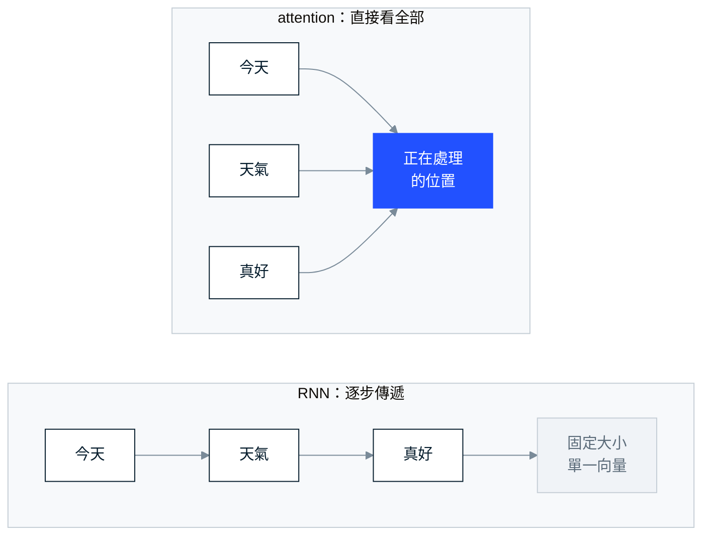

<sub>資料來源：本課整理；改繪自投影片「RNN 的瓶頸」「attention：每個位置，加權看所有位置」。</sub>

具體怎麼算「誰該看誰」？每個 token 的向量乘上三個學出來的矩陣，得到三種角色。**Q**（query）是「我在找什麼」，**K**（key）是「我身上有什麼標籤可以被找」，**V**（value）是「被選中時我要交出去的內容」。三個權重矩陣 W_Q、W_K、W_V 就是三個 Linear 層。整個 attention 只有四行：

```python
Q, K, V = X @ Wq, X @ Wk, X @ Wv
scores  = Q @ K.T / sqrt(d_k)     # 每個 token 對每個 token 打分；再把「未來」設成 -inf
weights = softmax(scores)         # 每一列加起來是 1
out     = weights @ V             # 按權重把 V 加起來
```

**圖 1-10　因果 attention：每一列是一個 token 把注意力分給前面的誰**

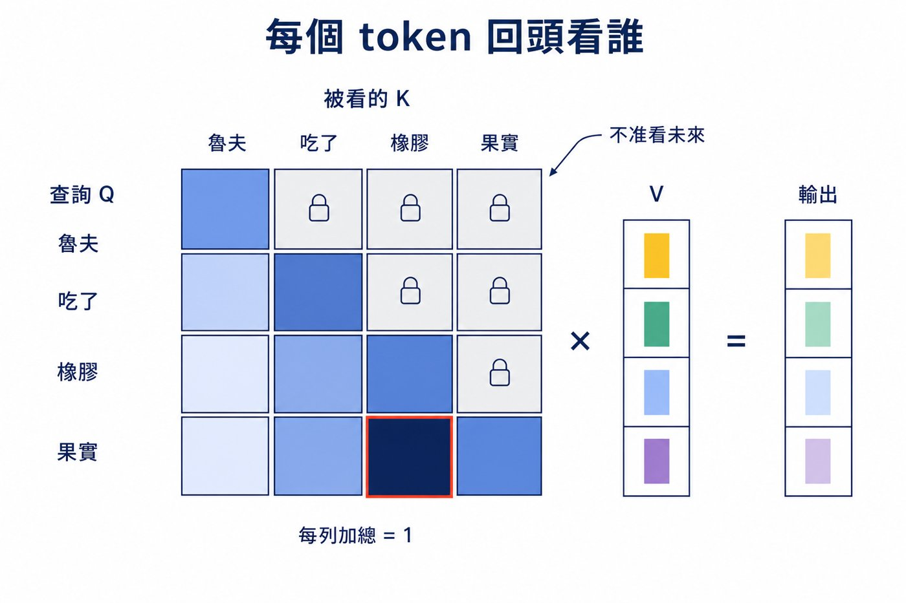

<sub>資料來源：模組一 `images/attention_flow.jpg`；對應投影片「Q、K、V：同一組向量算出三種角色」。</sub>

這四行裡有三個細節值得記住。**除以 √d_k** 是為了讓 softmax 不飽和：Q·K 是 d_k 項乘積相加，d_k 越大分數越分散（標準差約 √d_k 倍），softmax 一飽和就近乎 one-hot，梯度 p(1−p) 趨近 0，和 sigmoid 飽和是同一個問題（Vaswani et al. 2017，§3.2.1）。**因果遮罩**（causal mask）把每個 token 對「未來」的分數設成 −∞，生成時後面的字還不存在，所以只准看自己和前面；BERT 這類不生成的模型不用遮罩，叫雙向 attention。記住「把不想要的位置設成 −∞ 再 softmax」這一招，第 2 章的約束解碼會原封不動地再用一次。**多頭**（multi-head）是同時做好幾組 Q/K/V，各自學不同的看法，有的抓語法、有的抓指代，最後接起來。

[Lab 1-03](../../modules/module-01-llm-local/03_next_token.ipynb) 會用 `output_attentions=True` 畫出真實模型某一層的權重表。你會看到右上角全白（遮罩），也會看到很多 token 都在看第一個 token；這叫 attention sink，是模型「沒什麼要看時」的預設去處。

---

## 1.7 Transformer 一層只多了 attention，代價是 context 越長成本平方成長

一層 Transformer 由兩個子層組成：attention 讓 token 之間交換資訊，MLP 讓每個 token 各自「想一想」；兩者都加上殘差連接與 LayerNorm，然後把同樣的結構疊 N 層（Qwen2.5-0.5B 疊了 24 層）。對你來說新的東西只有 attention：殘差就是 ResNet 的 skip connection，LayerNorm 是 BatchNorm 的近親，MLP 就是全連接網路。今天的 LLM 用的是只看前面 token 的 decoder 版本，原始論文那套 encoder-decoder 翻譯架構只留了一半。

**圖 1-11　整個 LLM 的每個積木都對應一個你已經會的元件**

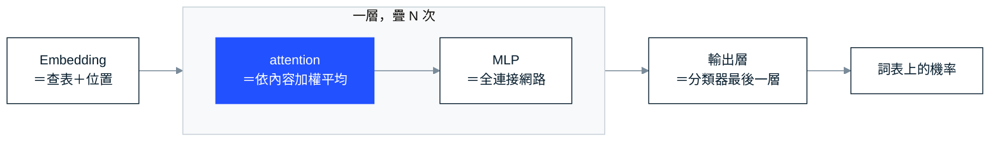

<sub>資料來源：本課整理；改繪自投影片「Transformer 一層：attention＋MLP」。殘差與 LayerNorm 省略未畫。</sub>

attention 的代價寫在它的形狀裡：權重表是 N × N。token 數變 2 倍，表就變 4 倍。下表是一層、一個頭的權重表在 fp16 下的大小，只是為了讓數量級有感：

| context 長度 | 一層一個頭的權重表（fp16） |
|---|---|
| 1,000 token | 2 MB |
| 8,000 token | 128 MB |
| 32,000 token | 2 GB |
| 128,000 token | 33 GB |

<sub>資料來源：模組一 `00_concepts.md` §4。</sub>

實際的推論引擎用 FlashAttention 之類的技巧避免把整張表存下來，但計算量仍然隨 N² 成長。所以模型標稱的 context 長度（例如 Qwen3.5 標稱 256K token）是**上限，不是免費額度**：沒超過上限，也是越長越慢、越貴。這和 CNN 的固定輸入尺寸是同一個觀念，放不進窗口的內容，模型就看不到。

更麻煩的是，放進去了也不保證看得到。Liu et al.（2023）〈Lost in the Middle〉做了一個乾淨的實驗：給模型 20 份文件（約 4K token），只改「含答案的那份」排第幾。結果準確率兩頭高、中間低。GPT-3.5-Turbo 在答案排第一篇時是 75.8%，排在最差的中間位置時掉到 53.8%，比完全不給文件、憑記憶作答的 56.1% 還低。

| 模型 | 答案在第 1 篇 | 五個位置中最低 | 答案在末篇 | 不給文件 |
|---|---|---|---|---|
| GPT-3.5-Turbo | 75.8 | 53.8 | 63.2 | 56.1 |
| Claude-1.3 | 59.9 | 55.9 | 60.1 | 48.3 |
| LongChat-13B | 68.6 | 52.5 | 55.0 | 35.0 |
| MPT-30B | 53.7 | 51.8 | 56.3 | 31.5 |

<sub>資料來源：Liu et al.（2023）arXiv:2307.03172，Table 1、Table 6，依表內數字重繪（準確率 %）；這是 2023 年的模型，數字用來說明現象，不代表現行模型的表現。</sub>

這一節的工程後果很直接。把一大堆文件塞進 context，既貴又慢，中間的內容還容易被漏看。所以第二部的 RAG 要先檢索、只放最相關的幾段；重排後把最相關的片段放在最前面或最後面，不要埋在中間。這也是 Agent 架構裡「context 傳遞成本」會成為核心設計問題的根源（第三部）。

---

## 1.8 模型是無狀態的函數，「記得對話」靠每次重送整段歷史

模型是一個純函數：輸入一段 token 序列，輸出下一個 token 的分佈。推論時沒有梯度更新，權重不會變；兩次呼叫之間也沒有任何地方存「上一輪」。ChatGPT 看起來記得你，是因為 App 每次都把整段對話歷史一起送出去。**記憶全在輸入端。**

先看實物。本地 Ollama 與多數雲端 API 都吃同一種格式，一次請求長這樣：

```json
POST http://localhost:11434/v1/chat/completions
{
  "model": "qwen3.5:9b",
  "messages": [
    {"role": "system", "content": "你是簡潔的助理。"},
    {"role": "user",   "content": "用一句話解釋 token。"}
  ],
  "temperature": 0.6,
  "stream": true
}
```

`messages` 是一個陣列，每個元素有角色與內容。`system` 放整段對話都要遵守的規則，`user` 是使用者這一輪說的話，`assistant` 是模型之前的回答，**由你重送**。送進模型之前，這個陣列會被 **chat template**（對話模板）攤平成一條帶特殊 token 的字串，例如 Qwen 系列用 `<|im_start|>user … <|im_end|>` 標出角色。模型看到的永遠只是一條 token 序列，role 只是序列裡的幾個特殊 token。

**圖 1-12　兩次呼叫之間模型什麼都不留，第二次請求要把整段歷史一起送**

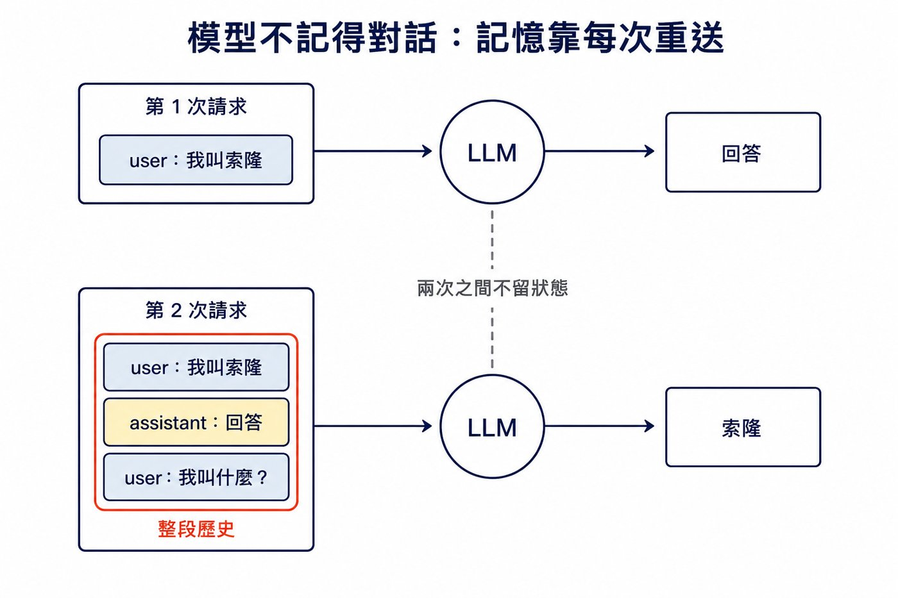

<sub>資料來源：模組一 `images/stateless_requests.jpg`；對應投影片「為什麼記不住對話：每次都重送」。</sub>

無狀態帶來三個工程後果。第一，**對話越長，每次送出的 token 越多**，第 N 輪的輸入包含前 N−1 輪，成本和延遲一起上升，累計費用約隨輪數平方成長。OpenAI 的 Responses API 可以用 `previous_response_id` 讓伺服器代存歷史，但官方明講舊輪次的 token 仍照算輸入費用；伺服器代存只是省了你自己搬運，不是讓模型記住。第二，**歷史超過 context 上限就看不到**，必須取捨：只留最近幾輪、把舊對話摘要、或把重要事實存到外部（第三部的 Agent 記憶）。第三，本地部署有一個新手必踩的坑：Ollama 預設 `num_ctx` 是 4096，即使模型本身支援更長的 context，超過的部分照樣被截斷。症狀是「聊著聊著模型像失憶」或「長文件後半被忽略」，修法是設環境變數 `OLLAMA_CONTEXT_LENGTH`，或在請求帶 `num_ctx`。

**圖 1-13　每輪請求比上一輪長，最舊的內容最先掉出窗口**

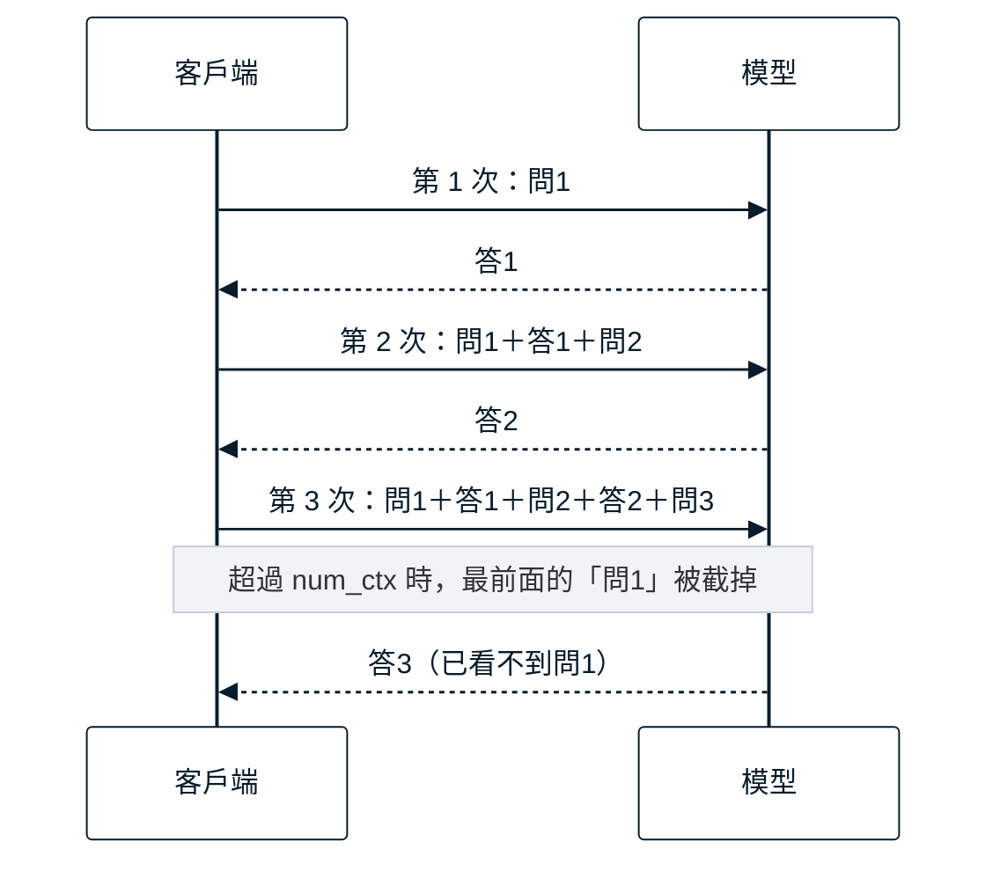

<sub>資料來源：本課整理；改繪自投影片「為什麼記不住對話：每次都重送」。</sub>

這一節是後面好幾章的地基。第二部的 RAG 之所以有效，是因為「改輸入」就能改變模型的行為；第三部的 checkpoint 之所以必要，是因為狀態本來就不在模型裡，必須有人存；第 2 章的 prompt injection 之所以擋不乾淨，是因為 system、user、文件最後都攤平成同一條序列。面試時被問「為什麼 LLM 記不住對話」，標準答案的骨架就是這三句：權重不變，模型只是 f(序列) → 機率；沒有「上一輪」，記憶在輸入端；每次重送 messages，受窗口限制，所以要摘要或外部記憶。

---

## 1.9 聊天模型是遷移學習的產物：先學接龍，再學聽話

預訓練完的模型叫 **base model**（基座模型），它很會接龍，但不一定聽指令。你問它「法國的首都是哪裡？」，它可能接出另外三個問題，因為網路上的考卷就長那樣。要變成能直接聊天的模型，還要再經過兩個階段。這個流程你其實很熟：ImageNet 預訓練一個特徵提取器，再用少量你的標註 fine-tune。LLM 是同一套路，只是多了一步。

**圖 1-14　LLM 的訓練階段和 CV 遷移學習一一對應**

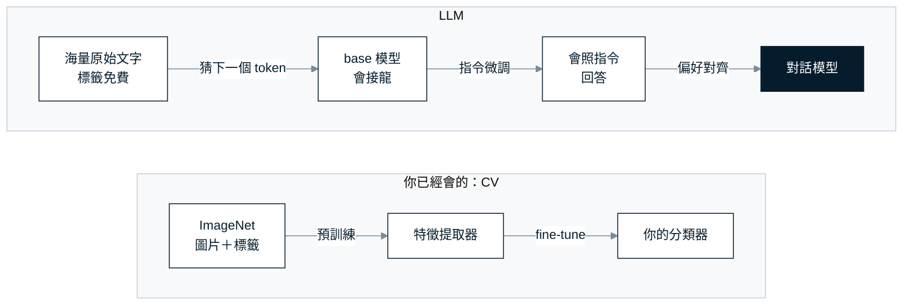

<sub>資料來源：本課整理；改繪自投影片「預訓練 → 指令微調：遷移學習的老套路」。</sub>

三個階段的資料量差了好幾個數量級。預訓練吃兆級 token 的原始文字，標籤是下一個字，免費；**指令微調**（Supervised Fine-Tuning，SFT）用的是一萬到十萬對「指令 → 回答」的人工示範，是標準的監督學習；**偏好對齊**再用人類對兩個回答的偏好比較調一次（RLHF 是其中最有名的做法），讓輸出更有幫助、更安全。這門課不展開強化學習的細節，只要記住：你平常用的「instruct」或「chat」版本模型，就是走完這三步的產物，而第 3 章的 LoRA，是在第二步的位置再疊一次你自己的小規模監督學習。

<sub>資料量級出處：Chip Huyen〈RLHF: Reinforcement Learning from Human Feedback〉（2023），見模組一素材地圖。</sub>

這個框架也解釋了兩個實務現象。第一，同一個基座的不同微調版本，chat template 可能不同，因為它是在指令微調階段被「教進去」的格式；用錯模板，模型看到的是分布外的輸入。第二，推理模型（例如 DeepSeek-R1 系列、Qwen3 的 thinking 模式）是在後訓練階段用強化學習練出「先寫一長段思考再回答」的行為，這會改變你寫提示詞的方式，第 2 章會回來談。

---

## 1.10 開放權重與商業 API 的差別，只在參數檔放在誰那裡

一個 LLM 說穿了就是兩樣東西：一個參數檔，加一段跑它的程式。**開放權重**（open weights）是參數檔可以下載到你自己的機器；**商業 API** 是參數檔留在供應商那邊，你按 token 付費呼叫。兩者的取捨落在三個維度：隱私、成本、可客製。

| 維度 | 開放權重（本地或自架） | 商業 API |
|---|---|---|
| 隱私 | 資料不出你的機器或內網，適合不能外傳的資料 | 請求送到供應商，要看合約與合規 |
| 成本 | 先付硬體，之後不按量計費；用量越大越划算 | 不用買硬體，按 token 計費；用量小、想先試很方便 |
| 可客製 | 可以微調、量化，自己決定怎麼部署（第 3 章） | 主要靠提示詞；能調什麼由供應商決定 |

<sub>資料來源：投影片「開放權重，還是商業 API？」。</sub>

「開源」不等於隨便商用。同一家族不同尺寸的授權可能不同：Qwen 中小尺寸是 Apache-2.0，最大旗艦另有自訂授權；Llama 是自訂社群授權，有用戶數門檻與標示要求；gpt-oss 是 Apache-2.0，但必須用 harmony 格式，自己拼提示詞會出錯。要商用或對外提供服務，授權要看到「你用的那個尺寸」的 LICENSE 原文。商業 API 那邊，型號大約每季換一次，所以要記家族、看官方型號頁，不要背型號；例如 GPT-4o 曾是課綱裡的商業 API 代表，但 `gpt-4o-2024-05-13` 已在 2026-10-23 關閉，其餘 4o 版本與 4o-mini 將在 2027-01-14 關閉，舊的 Assistants API 也已在 2026-08-26 關閉。本課 notebook 的雲端文字模型一律用 `gpt-5.4-nano`（推理模型，要寫 `max_completion_tokens` 而不是 `max_tokens`）。

**圖 1-15　選本地還是 API，先看資料能不能出門，再看用量**

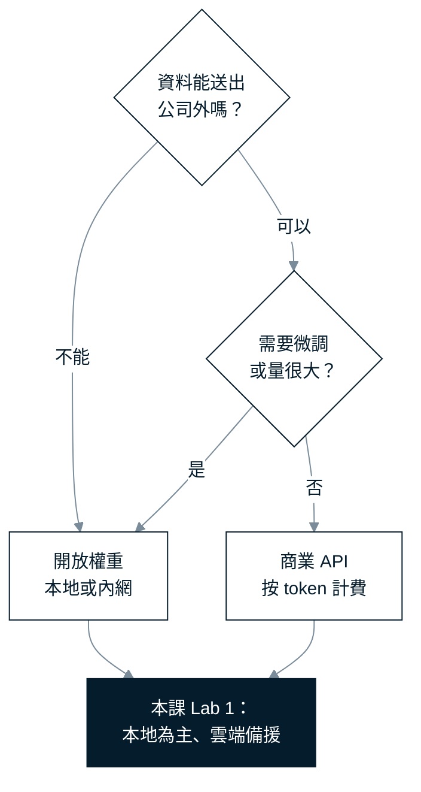

<sub>資料來源：本課整理；判斷順序改寫自投影片「開放權重，還是商業 API？」。</sub>

走本地路線時，第一個問題是「我的卡跑得動哪個模型」。模型檔要放得進顯存，而且要**遠小於**顯存，因為 context（KV cache）也要佔位置。本地版的預設是 4-bit 量化：每個權重從 16 bit 壓成 4 bit，檔案大約變成四分之一，品質略降。以 16GB 單卡為例，可以這樣拉：

```bash
ollama pull qwen3.5:9b          # 對話模型，約 6.6–7.6GB，16GB 顯存可跑
ollama pull deepseek-r1:8b      # 現在指向 R1-0528-Qwen3-8B
# 要原版 Llama distill：deepseek-r1:8b-llama-distill-q4_K_M
ollama pull nomic-embed-text    # 英文 embedding 模型；中文語料改用 bge-m3
```

這裡有兩個容易混淆的地方。Ollama 的 `deepseek-r1:8b` 標籤已經改指向基於 Qwen3-8B 的 R1-0528 版本，不再是早期教材寫的 Llama distill，要原版得指定完整 tag。Qwen2.5 的 3B、7B 仍可拉，但已兩年未更新，新專案建議改用 `qwen3.5` 的小尺寸（Ollama 上有 0.8b 到 122b，context 256K，支援看圖、工具與思考模式）。本課 notebook 的驗證環境用的是 `qwen2.5:3b`，它對海賊王的知識很弱、常答錯，這正好成了第二部 RAG 的教材。

想看模型內部（logits、attention）或要微調時，就要離開 Ollama，走 Hugging Face。它對開放模型的角色就像 GitHub 對程式碼：Hub 放權重和資料集，一組 Python 函式庫負責下載、切 token、跑模型與微調。`from_pretrained()` 和你載入預訓練 ResNet 做遷移學習是同一件事。

**圖 1-16　Hugging Face：上層函式庫各管一件事，經由 huggingface_hub 從 Hub 下載**

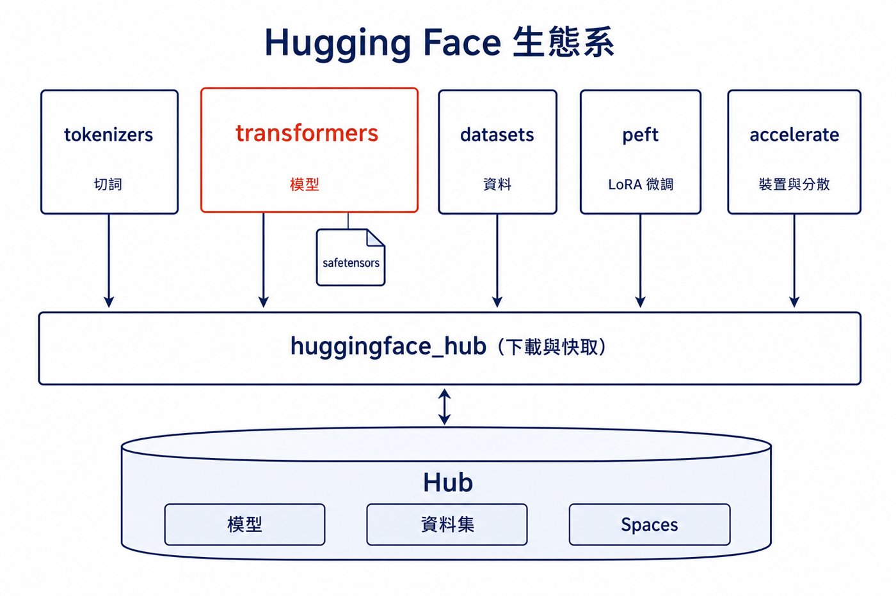

<sub>資料來源：模組一 `images/hf_ecosystem.jpg`；對應投影片「Hugging Face：模型倉庫＋一組函式庫」。</sub>

用 Hugging Face 有四件事要先知道。授權各不相同，用前讀 model card。gated 模型要先在網頁同意授權，再用個人 Access Token（環境變數 `HF_TOKEN`）下載，token 和 API 金鑰一樣不能寫進程式碼。快取預設在 `~/.cache/huggingface`，很快會吃光磁碟，可以用 `HF_HOME` 搬家。最重要的是安全性：舊的 `.bin` 權重是 pickle 格式，載入時能執行任意程式碼，優先選 `safetensors`，來路不明的 `.bin` 不要載。

| | `transformers`（原始權重） | Ollama（GGUF 量化檔） |
|---|---|---|
| 權重 | safetensors，原始精度（bf16） | GGUF，通常 4-bit，約 1/4 大小 |
| 看得到 | logits、attention、每一層 | 只有 API 回來的文字 |
| 訓練 | 可以（LoRA） | 不行 |
| 適合 | 研究模型內部、微調 | 當服務給程式和 Agent 呼叫 |

<sub>資料來源：模組一 `00_concepts.md` §7。</sub>

第 3 章會把兩條路串起來：用 `transformers` 加 `peft` 微調，合併後轉成 GGUF，交給 Ollama 服務。

---

## 1.11 一個 OpenAI 相容客戶端接所有後端，帳單一律是 token 乘單價

不論模型在本地還是雲端，呼叫介面幾乎都收斂到同一種格式：OpenAI 相容的 chat completions。Ollama 在本機提供 `http://localhost:11434/v1`，OpenRouter、DeepSeek 也都吃這個格式。所以換供應商通常只換三樣東西：`base_url`、金鑰、模型名。這和 PyTorch 換 device（cpu／cuda）而程式碼不變是同一個概念。

```python
URLS = {"Ollama": "http://localhost:11434/v1",
        "OpenRouter": "https://openrouter.ai/api/v1",
        "DeepSeek": "https://api.deepseek.com/v1"}
client = OpenAI(base_url=URLS[name], api_key=os.getenv(KEY_ENV[name]))
r = client.chat.completions.create(model=MODEL[name], messages=messages)
# Ollama 不檢查金鑰，但 SDK 要求非空字串
```

**圖 1-17　同一個客戶端換 base_url 就能連四家；Anthropic 格式要先經過轉換函式**

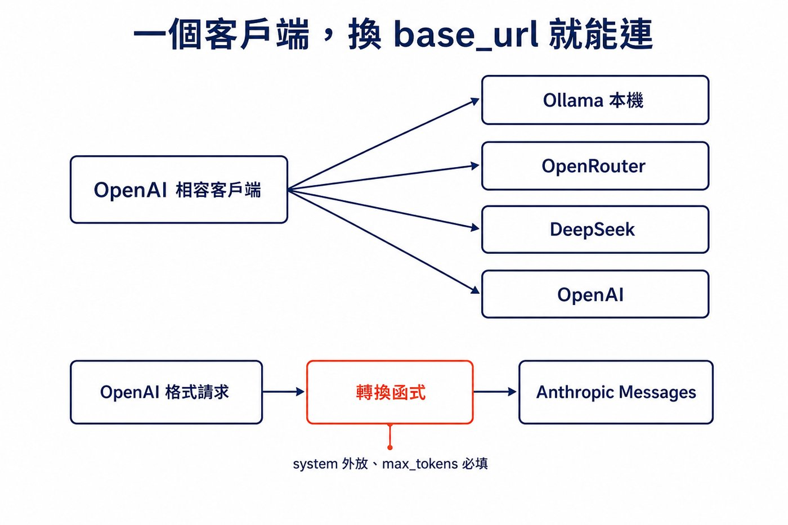

<sub>資料來源：模組一 `images/provider_switch.jpg`；對應投影片「換供應商：通常只換 base_url」。</sub>

Anthropic 的 Messages API 是主要例外，有三個不同：`system` 放在請求最外層，不是 messages 裡的一個角色；`content` 是區塊陣列，回應也是，要挑 `type` 為 `text` 的區塊；`max_tokens` 必填，金鑰放在 `x-api-key` 標頭。實務上的做法是把差異收進自己包的一層客戶端，或交給 **LiteLLM** 這類函式庫：一個 `completion()` 用模型名前綴（`ollama/`、`openai/`、`anthropic/`…）決定送去哪家，回應一律轉成 OpenAI 格式，`Router` 還能設定失敗時換下一個後端。DeepSeek 雲端目前定價頁列的模型名是 `deepseek-flash` 與 `deepseek-v4-pro`，舊名 `deepseek-chat` 是否仍可用未經核實，接之前要再查一次。

本課 Lab 1 用的就是這個模式：雙軌客戶端。messages 先送本地 Ollama；連不上或逾時，才切到雲端 API；兩邊都失敗就列出每個錯誤。輸出用 Python generator 串流，`yield` 一次交出一小片，呼叫端拿到就立刻顯示。這裡有一個真實的坑：如果切換發生在串流中途，已經顯示給使用者的字收不回來，要另外處理。

**圖 1-18　Lab 1 雙軌客戶端：本地失敗才切雲端**

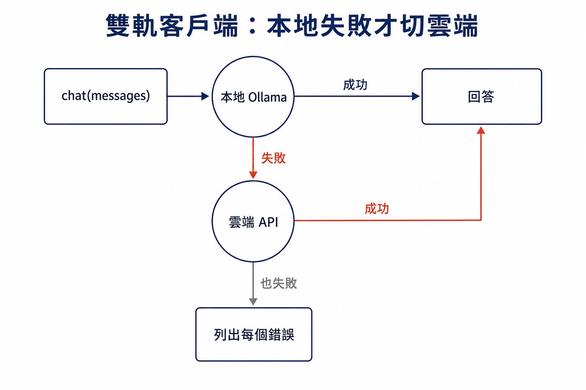

<sub>資料來源：模組一 `images/dual_track_client.jpg`；對應投影片「Lab 1 架構：本地為主，雲端備援」。</sub>

同一個 client 也能處理圖片與聲音。看圖最簡單：messages 裡的 `content` 從字串變成陣列，圖片是其中一塊（本機檔案用 base64，公開圖片直接給網址）。生成圖片、文字轉語音、語音轉文字則是另外三個端點，共用同一個 client 與金鑰。模型看圖的方式和 ViT 一樣，把圖切成 patch，每塊變成若干 token，所以**圖越大，token 越多、越貴**。第 3 章會看到多模態模型在本地怎麼跑。

**圖 1-19　多模態 API 是四個端點，共用一個 client**

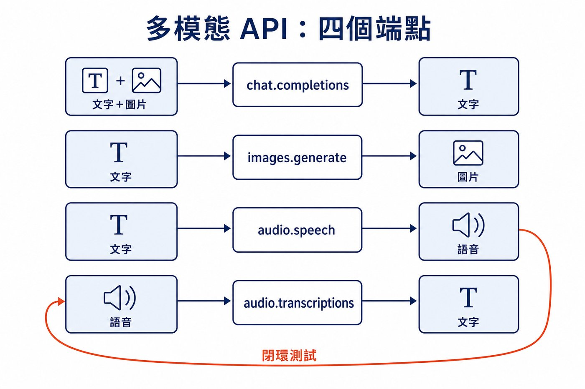

<sub>資料來源：模組一 `images/multimodal_endpoints.jpg`；對應投影片「圖片、聲音也走同一個 client」。</sub>

最後是帳單。雲端模型幾乎都按 token 計費，**輸入和輸出分開計價**，輸出單價通常是輸入的 4 到 8 倍，因為輸出要一個一個生成。和之前請求相同的開頭可能命中快取、打折計價；OpenAI 是自動快取（prompt 超過 1024 token 才有），Anthropic 要在請求裡標記。圖片、語音也先換算成 token 或按秒計價。

**圖 1-20　一次呼叫的費用＝輸入 token 數 × 輸入單價＋輸出 token 數 × 輸出單價**

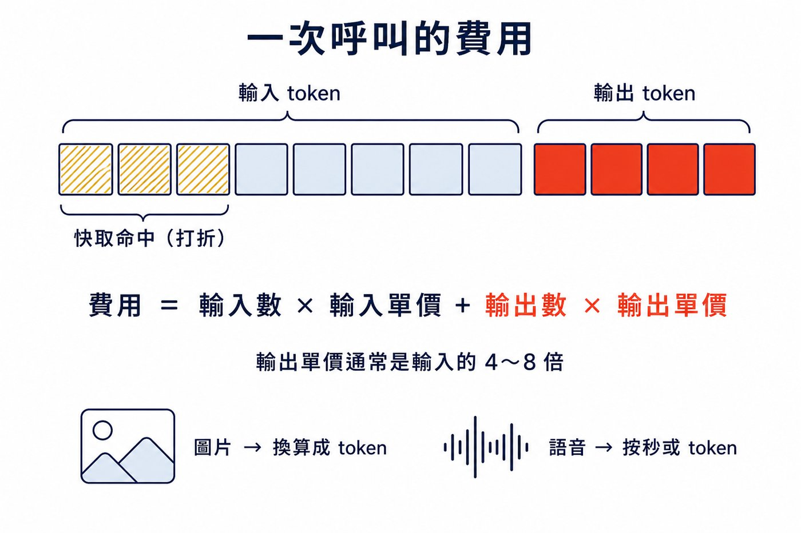

<sub>資料來源：模組一 `images/api_cost_formula.jpg`；對應投影片「一個介面接所有家，帳單都算 token」。</sub>

費用最常從四個地方漏出去，四個都和本章前面的機制有關。長對話每輪重付歷史，累計費用約隨輪數平方成長（1.8 節）；中文比英文多 token（1.2 節）；工具說明和 system prompt 每輪都送，十幾個工具的 JSON schema 可能就上千 token；Agent 迴圈卡住時，沒有上限就一直燒錢（第三部的 `recursion_limit`）。另外，推理模型「想」的過程你看不到，但按輸出計費，同一題可能比非推理模型貴很多。

對應的省錢方法也是從機制推出來的：要求簡短並設長度上限；分類、抽取、路由這類步驟改用小模型；固定不變的內容（system prompt、工具說明、範例）放在最前面讓快取命中，會變的放後面；只留最近幾輪、舊對話摘要；文件先檢索再放，不整份塞；每次呼叫記帳、設預算上限，供應商後台也設每月上限；不急的離線工作用批次 API，通常半價。估價一律用該模型的 tokenizer 數 token，LiteLLM 的 `completion_cost()` 可以直接查價算錢。單價每幾個月就變，以各家定價頁為準。

---

## 本章重點

LLM 是一個類別數等於詞表大小的 softmax 分類器，生成就是把它跑成迴圈；訓練標籤是下一個 token，所以不需要人工標註，讀得了海量文字。它的輸入是 tokenizer 切出來的 token id，經查表變成向量，再經過 N 層「attention＋MLP」；attention 用依內容決定的加權平均取代 RNN 的單一向量，代價是 N×N 的成本，所以 context 越長越慢越貴，中間的內容還容易被漏看。模型是無狀態的純函數，對話記憶全靠客戶端重送 messages，超出窗口（Ollama 預設 `num_ctx` 4096）就看不到。溫度只改抽樣的隨機性，不改對錯，幻覺要靠提供資料、工具查證與評估來壓。部署上，開放權重與商業 API 只差在參數檔放在誰那裡，兩邊都能用 OpenAI 相容介面接，帳單一律是 token 數乘單價。

## 對應實作與延伸閱讀

**Notebook（模組一）**

- [01_tokens.ipynb](../../modules/module-01-llm-local/01_tokens.ipynb)：tiktoken 與 Qwen tokenizer 切分、BPE 合併規則、中英文 token 數與費用估算
- [02_huggingface.ipynb](../../modules/module-01-llm-local/02_huggingface.ipynb)：Hub、model card、gated 模型、快取、`pipeline`、`safetensors`、`datasets`
- [03_next_token.ipynb](../../modules/module-01-llm-local/03_next_token.ipynb)：Qwen2.5-0.5B 的 logits 與 top-k 機率、溫度與 top-p、真實 attention 熱圖、幻覺
- [04_chat_api.ipynb](../../modules/module-01-llm-local/04_chat_api.ipynb)：原始 JSON、記不住對話與越聊越貴、`finish_reason`、串流
- [05_dual_track.ipynb](../../modules/module-01-llm-local/05_dual_track.ipynb)：Lab 1 雙軌客戶端，成品是 `course_utils/llm.py`
- [06_multimodal_api.ipynb](../../modules/module-01-llm-local/06_multimodal_api.ipynb)、[07_providers.ipynb](../../modules/module-01-llm-local/07_providers.ipynb)、[08_litellm_and_cost.ipynb](../../modules/module-01-llm-local/08_litellm_and_cost.ipynb)：多模態、換供應商、LiteLLM 與成本對帳
- 原理紀要：[模組一 00_concepts.md](../../modules/module-01-llm-local/00_concepts.md)

**投影片**：[deck.pdf](../slides/deck/deck.pdf) 模組一（LLM 是什麼 → 模組 1 小結）。

**論文與延伸閱讀**

- Vaswani et al.（2017）〈Attention Is All You Need〉，arXiv:1706.03762
- Liu et al.（2023）〈Lost in the Middle: How Language Models Use Long Contexts〉，arXiv:2307.03172
- Jay Alammar〈The Illustrated Transformer〉與〈Visualizing A Neural Machine Translation Model〉：Q/K/V 與 RNN 瓶頸的經典圖解
- 3Blue1Brown Deep Learning 第 5、6 章（Transformers、Attention）：從 embedding 矩陣講到溫度公式
- Hugging Face LLM Course 第 2 章 Tokenizers；Andrej Karpathy〈Let's build the GPT Tokenizer〉
- Polo Club〈Transformer Explainer〉：在瀏覽器裡逐層展開 GPT-2 small
