# 第 3 章　微調與 LoRA：缺行為才改權重

**本章結論**：決定要不要微調之前，先問模型缺的是「知道什麼」還是「怎麼回答」。缺知識改輸入（RAG），缺行為才改權重；而且要先用提示詞試過、仍不穩或太長太貴，才輪到微調。LoRA 凍結原本的權重 W，只在旁邊學一個低秩的更新量 ΔW = B·A，可訓練參數通常不到 1%，省下的主要是梯度與優化器狀態的記憶體；它在中小型指令資料、且加在所有層時可以接近全量微調，資料量大或做繼續預訓練時會落後，代價換來的是忘得比較少。微調資料本質上是套完 chat template 的監督標籤，模板對不上時 loss 照樣下降，問題要到推理時才看得出來。訓練完把 B·A 加回 W 就是一個普通模型，推理零額外延遲；QLoRA 訓練出的 adapter 必須合併回原精度基座。

---

## 3.1 先判斷缺知識還是缺行為：微調教的是「怎麼說」，不是「知道什麼」

**微調**（fine-tuning）是拿少量範例再訓練一下，把口吻、格式、術語練進權重裡。用第 2 章的交辦單比喻，教一位新同事有三種方法：給交辦單（Prompt），每次交代清楚，人沒變；給參考資料夾（RAG），要用時再翻，人也沒變；送去受訓（微調），練到變成習慣，人變了，權重被改過。你可能見過微調的成果：客服機器人永遠用同一種口吻和格式、醫療或法律領域滿口行內術語的專用模型、帶著公司寫法的內部小模型。

判斷該走哪一條，關鍵是兩個維度。**知識維度**：模型缺的資訊是否缺失、過時或私有。**行為維度**：輸出的格式、語氣、術語是否穩定。缺知識走 RAG，它改的是輸入的內容；缺行為走微調，它改的是權重；兩者都缺就疊加，各補各的。兩者都不缺、只是寫法要調，就留在左下角的 Prompt 工程，它最便宜，永遠先試。

**圖 3-1　先判斷「不知道」還是「不會說」，再選 prompt、RAG 或微調**

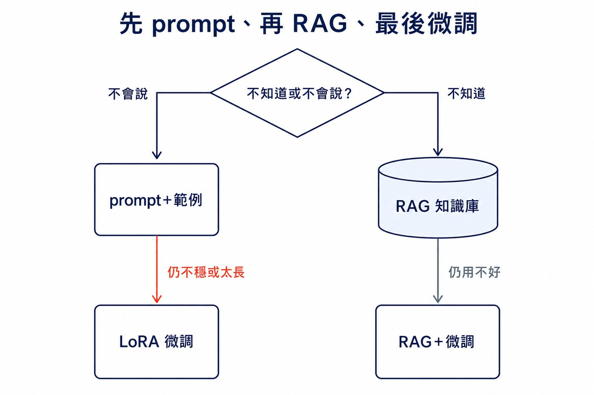

<sub>資料來源：模組六 `images/prompt_rag_finetune.jpg`；對應投影片「缺知識用 RAG，缺行為才微調」。</sub>

| 情況 | 先選 | 理由 |
|---|---|---|
| 知識常變（工單、文件、價格） | RAG | 改資料不用重訓，回答可以附出處 |
| 輸出格式、語氣要固定 | Prompt，不夠再微調 | 先試最便宜的 |
| 每次都要帶一大段固定說明 | 微調 | 把說明燒進權重，每次請求省下幾百個 token |
| 要換成更小、更便宜的模型 | 微調 | 小模型照長 prompt 做事的能力弱 |
| 需要可追溯、可稽核的答案 | RAG | 微調後的知識藏在權重裡，說不出來源 |

<sub>資料來源：模組六 `00_concepts.md` §7。</sub>

這張表最容易被誤用的是第一列。對「行為問題」硬加 RAG 沒用，對「知識問題」硬做微調也沒用：OpenAI 的〈Optimizing LLM Accuracy〉指南舉過一個反例，對行為問題加 RAG，BLEU 反而掉了 4 分。這和你在 ML 裡判斷「欠擬合還是缺資料」是同一種診斷：先找錯誤來源，再決定改輸入還是改權重。

本課的 Lab 6-03 用數字驗證了這件事。同一個 IT 維運問診任務（看到服務症狀，用固定兩行回答「可能原因」與「第一步檢查指令」），同一份 30 題測試集，四種做法：

| 做法 | 格式正確 | 指令正確 | 平均 prompt 長度 |
|---|---|---|---|
| A　0.5B＋格式要求 | 77% | 0% | 79 token |
| B　0.5B＋值班手冊＋範例 | 43% | 10% | 619 token |
| C　3B＋值班手冊＋範例 | 100% | 90% | 619 token |
| D　0.5B＋LoRA，不給 prompt | 100% | 83% | 50 token |

<sub>資料來源：本課實測，`modules/module-06-lora/03_when_not_to_finetune.ipynb` Step 6；跑一次的結果，重跑數字會有些不同。</sub>

讀這張表有三個結論。B 證明小模型照長提示詞做事的能力很弱：知識給了，分數沒變好，格式還更差。C 證明這個任務只要負擔得起 3B 模型、提示詞長度也沒問題，**根本不需要微調**。D 說明微調真正買到的東西：格式全對、指令八成多，而 prompt 不到 C 的十分之一、模型只有 C 的六分之一。**微調買到的主要是成本（更小的模型、更短的 prompt、更低的延遲），不是正確率。**

---

## 3.2 LLM 微調就是你做過的遷移學習，LoRA 是視覺裡沒有的第四種做法

你在影像分類做過遷移學習：拿 ImageNet 預訓練的骨幹，決定凍結誰、更新誰。LLM 微調是同一件事，只是選擇題的形狀變了。視覺裡常見三種做法：特徵提取（凍結整個骨幹，只拿特徵給外接分類器）、只換 FC 頭（凍結骨幹，訓練新的輸出層）、解凍全部層。它們在 LLM 裡各有對應，但第二種在 LLM 裡不太管用：格式與語氣分散在每一層，只訓練最後一層改不動；LLM 的輸出頭本來就是詞表 softmax，也沒有「換頭」這回事。

**圖 3-2　四種做法的差別只在「動哪些權重、每層動多少」**

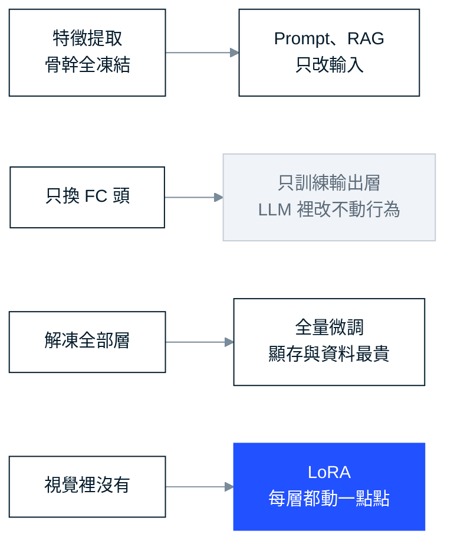

<sub>資料來源：本課整理；改繪自投影片「遷移學習你做過，微調是同一件事」。</sub>

全量微調的問題是貴。以本課 Lab 用的 0.5B 模型為例，全部參數一起訓練就要十幾 GB 的梯度與優化器狀態；到了 7B、8B，單張消費級顯卡就放不下。LoRA 的定位因此很清楚：**全部層都動，但每層只動一點點。** 它屬於 **PEFT**（Parameter-Efficient Fine-Tuning，參數高效微調）這個大類，PEFT 同時也是 Hugging Face 實作這類方法的套件名。

---

## 3.3 LoRA 凍結 W，只學一個低秩的更新量 ΔW = B·A

一個 Linear 層做的事是 `h = W·x`，W 是 d_out × d_in 的大矩陣。微調等於要找一個改變量 ΔW，讓 `h = (W + ΔW)·x`。**LoRA**（Low-Rank Adaptation）的假設是：微調需要的 ΔW 是低秩的。新任務和原本的能力只差少數幾個方向，不需要重寫整個矩陣。所以它不直接學 ΔW，而是把 ΔW 拆成兩個細長矩陣相乘：A 是 r × d_in（先把輸入壓到 r 維），B 是 d_out × r（再展開回來），r 遠小於 d。

**圖 3-3　W 凍結不動，旁邊加兩個細長矩陣 B 與 A，它們相乘得到和 W 同形狀的 ΔW**

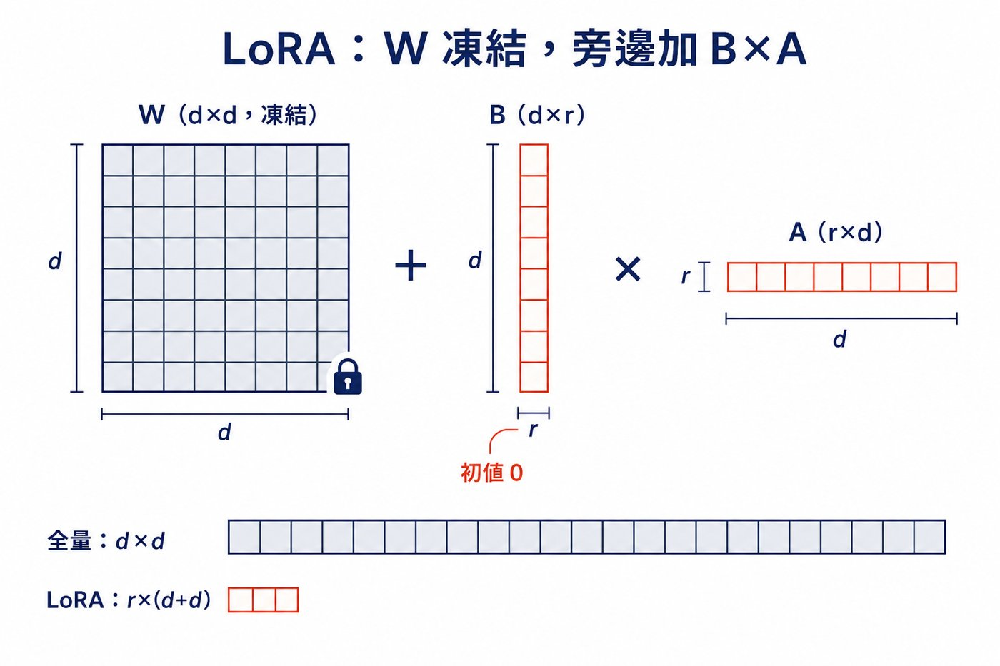

<sub>資料來源：模組六 `images/lora_matrices.jpg`；對應投影片「LoRA：凍結 W，旁邊多一條窄路」。</sub>

前向傳播變成兩條路相加：主路過凍結的 W，旁路先過 A、再過 B，乘上縮放係數後和主路相加。

```python
h = x @ W.T + (x @ A.T @ B.T) * (alpha / r)   # W 不給梯度，只有 A、B 會更新
```

**圖 3-4　LoRA 的前向傳播：主路凍結，旁路是一個 r 維的窄腰**

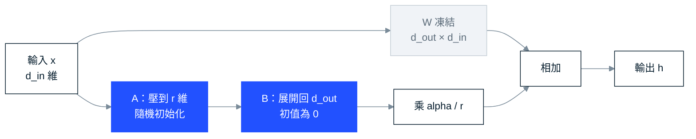

<sub>資料來源：本課整理；改繪自投影片「LoRA：凍結 W，旁邊多一條窄路」與模組六 `00_concepts.md` §2。</sub>

對你來說每個零件都有熟悉的原型。A 壓成 r 維、B 再展開，就是 autoencoder 的瓶頸；W 不更新，就是凍結骨幹時的 `requires_grad=False`；任何 d × d 矩陣都可以用 d × r 乘 r × d 近似，就是 SVD 截斷的低秩分解。三個設計細節則決定了它好不好用。

第一，**B 初始化為 0，A 隨機初始化**（PEFT 用 Kaiming-uniform）。一開始旁路輸出 0，所以包上 LoRA 的模型和原模型完全一樣，微調從原模型出發，而不是從被隨機雜訊破壞過的模型出發；這和 ResNet 殘差分支初始化成接近恆等是同一個想法。A 不能也是 0，否則兩者的梯度永遠是 0。

第二，**r（rank）決定容量**。旁路最多只能表達秩為 r 的改變；如果任務需要的改變超過 r，loss 會卡在一個降不下去的高度，這不是訓練不夠久，是裝不下。r 就是旁路的容量旋鈕。

第三，**alpha / r 是縮放係數**。換 r 的時候，旁路輸出的量級不會跟著亂跳，學習率不用重調。常見起點是 r = 8、alpha = 16（scaling = 2）；LLaMA-Factory 的 `lora_rank` 預設 8，`lora_alpha` 文件註明一般取 rank × 2。但這不是所有工具的預設：Hugging Face PEFT 的 `LoraConfig` 預設是 r = 8、`lora_alpha` = 8，Unsloth 則建議 r = 16 或 32、alpha 取 r 或 2r。alpha = 2r 是經驗起點，不是定律。

---

## 3.4 可訓練參數通常不到 1%，真正省下的是梯度與優化器狀態的記憶體

LoRA 的參數量算式只有一行：一個 d_out × d_in 的矩陣，全量微調要訓練 `d_out × d_in` 個參數，LoRA 只要 `r × (d_in + d_out)`。矩陣大小從「乘」變成「加」，d 越大、r 越小，比例越接近 0。以 Qwen2.5-0.5B 的 attention 投影層（896 × 896）為例：

| r | LoRA 參數 | 佔全量（802,816）的比例 |
|---|---|---|
| 1 | 1,792 | 0.22% |
| 8 | 14,336 | 1.79% |
| 16 | 28,672 | 3.57% |
| 64 | 114,688 | 14.29% |

<sub>資料來源：模組六 `00_concepts.md` §3。</sub>

單一層看起來不到 2%，整個模型更低，因為不是每個參數都在被 LoRA 包住的 Linear 裡。Lab 6-01 把 LoRA 套在 attention 的 q/k/v/o 與 MLP 的 gate/up/down 七種投影上，r = 8，PEFT 印出的可訓練參數是 4,399,104 / 498,431,872，約 0.88%（本課實測，`01_peft_finetune.ipynb` Step 5）。更大的模型比例更低：Raschka 的實驗裡，Llama 2 7B（6.74B 參數）全部層都加 LoRA 是 20.28M，約 0.3%；只加在 q、v 投影是 4.19M，約 0.06%。原始 LoRA 論文在 GPT-3 175B 上報告的是可訓練參數少 10,000 倍、GPU 記憶體少 3 倍，checkpoint 從 350GB 降到 35MB。

**圖 3-5　省下的主要不是參數，而是只有可訓練參數才需要的梯度與 Adam 狀態**

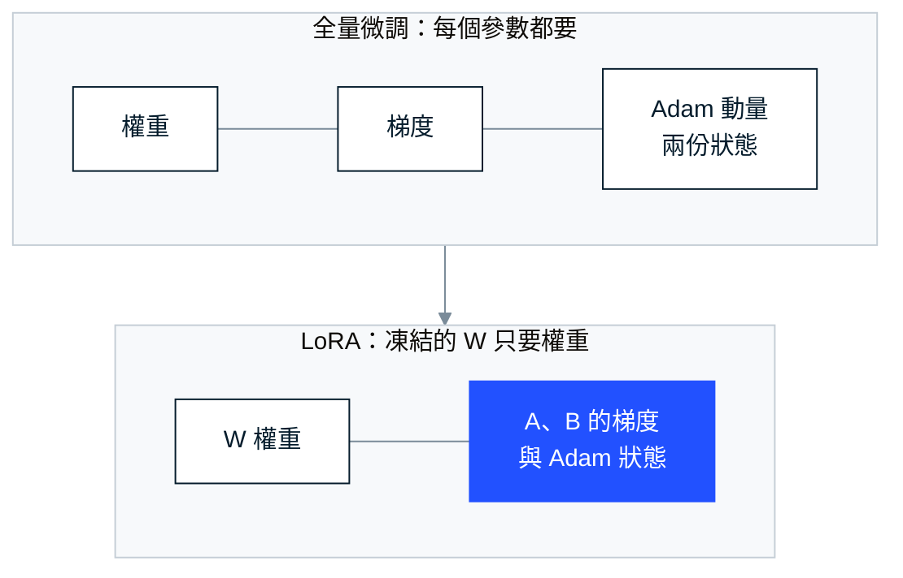

<sub>資料來源：本課整理；依模組六 `00_concepts.md` §3「Adam 對每個可訓練參數要多存兩份狀態，還要存梯度」。</sub>

這是 LoRA 能在單張消費級顯卡上微調 LLM 的真正原因。Adam 要為每個可訓練參數另存兩份狀態，再加上梯度；凍結的參數這些都不用。參數量少，梯度和優化器狀態就跟著少。附帶的好處是產物很小：Lab 6-01 存下的 adapter 不到 20MB（PEFT 預設以 fp32 存），基座模型約 1GB；同一個基座可以準備很多個 adapter，各管一種任務，需要時再換。

---

## 3.5 LoRA 追得上全量微調，但有條件；它學得少，也忘得少

「LoRA 用不到 1% 參數達到全量微調效果」這句話，前半句對，後半句要加條件。2024 到 2025 年有兩份實證研究把條件講清楚了。Thinking Machines（2025）〈LoRA Without Regret〉的結論是：在**中小型的指令或推理資料集**、且 **LoRA 加在所有層（含 MLP）**、r 大到容量裝得下資料量時，LoRA 與全量微調相當；資料量超過旁路容量時，低 r 的 LoRA 會在訓練中段「掉隊」，loss 停在比全量高的地方。這和你熟悉的模型容量對資料量是同一件事：小模型擬合大資料集會欠擬合。

Biderman et al.（2024）〈LoRA Learns Less and Forgets Less〉則用 Llama-2-7B 學寫程式與數學，把「學了多少」和「忘了多少」放在同一張圖上。

**圖 3-6　學習與遺忘的取捨：全量微調（黑線）學得多也忘得多，LoRA 的點停在右邊**

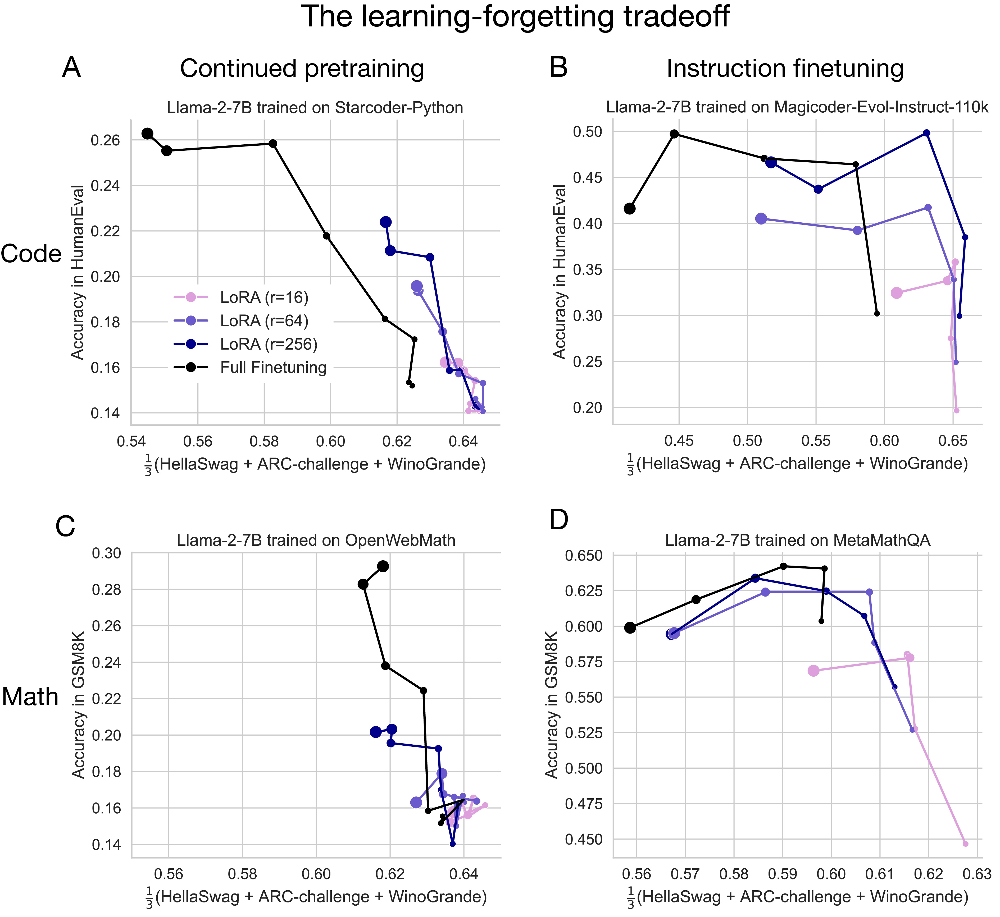

<sub>資料來源：Biderman et al.（2024）〈LoRA Learns Less and Forgets Less〉Fig. 3，arXiv:2405.09673，CC BY 4.0；原圖未改動。</sub>

圖裡的三組數字值得記住。**繼續預訓練、資料量大時 LoRA 落後**：用 200 億 token 的 Python 程式碼繼續預訓練後，HumanEval 全量微調是 0.263，LoRA r = 256 只有 0.224。**指令微調要 r 夠大才追得上**：最好的一輪 r = 256 是 0.498、全量 0.497，幾乎一樣；但 r = 16 只有 0.358。**LoRA 忘得少**：指令微調到第 16 輪時，全量微調的原能力保留分數掉到 0.414，LoRA r = 16 還有 0.609。

<sub>數字出處：Biderman et al.（2024）附錄 D Table S1、S5、S6，依投影片「LoRA 學得少，但忘得也少」重繪的讀數。</sub>

所以面試時被問「LoRA 效果等於全量微調嗎」，正確答案是條件句：中小資料集、加在所有層、r 夠大時成立；程式碼、繼續預訓練這類大資料情境不成立；換來的是忘得比較少。從 DL 的角度看，限制更新的秩本身就是一種正則化，這也解釋了為什麼它「學得少也忘得少」。

---

## 3.6 QLoRA 把凍結的 W 壓成 4-bit，讓 24GB 單卡也能微調 7B 等級的模型

LoRA 把梯度和優化器狀態縮小了，但凍結的 W 本身仍然要放在顯存裡。**QLoRA** 再往前一步：既然 W 不需要梯度，就可以存得更省，把它量化成 4-bit 存放（這種 4-bit 編碼叫 NF4），前向計算時再臨時還原成高精度；要訓練的 A、B 仍用 16-bit。記憶體的算式你一看就懂：7B 參數 × 2 bytes（16-bit）約 14GB，× 0.5 byte（4-bit）約 3.5GB。

**圖 3-7　全量微調、LoRA、QLoRA：優化器狀態縮小，基座再從 16-bit 壓成 4-bit**

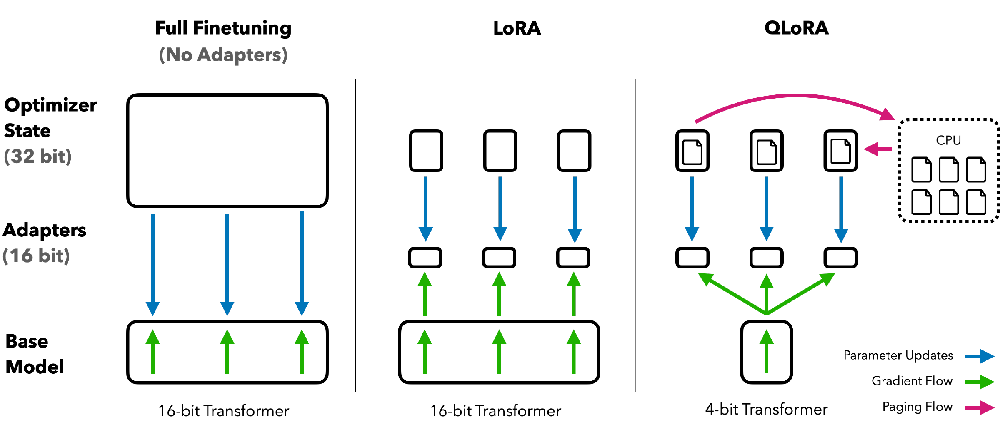

<sub>資料來源：Dettmers et al.（2023）〈QLoRA: Efficient Finetuning of Quantized LLMs〉Fig. 1，arXiv:2305.14314，CC BY 4.0；原圖未改動。</sub>

這張圖由左到右讀：全量微調要放一大塊 32-bit 的優化器狀態；LoRA 把它縮成幾個小方塊；QLoRA 再把底座壓成 4-bit，並讓優化器狀態在顯存吃緊時暫存到 CPU（粉紅箭頭，paged optimizer）。論文摘要給的極端例子是 65B 模型的微調記憶體需求從超過 780GB 降到 48GB 以內，一張 48GB 卡就能跑。

對實際選卡更有用的是 LLaMA-Factory 文件的估算表。以 7B 模型為例：

| 方法 | 顯存估算 |
|---|---|
| LoRA（16-bit） | 16GB |
| QLoRA 8-bit | 10GB |
| QLoRA 4-bit | 6GB |
| QLoRA 2-bit | 4GB |

<sub>資料來源：LLaMA-Factory README 硬體需求表（模組六素材地圖核實 2026-11-12）。</sub>

所以一張 RTX 4090（24GB）跑 7B、8B 的 LoRA 是可行的，QLoRA 更有餘裕。代價有兩個：速度慢一點（Raschka 的實測是 QLoRA 省約 33% 顯存、訓練時間多約 39%），以及多一點量化誤差。本課 notebook 的 0.5B 模型用 bf16 就放得下，所以不用 4-bit；QLoRA 在 3.9 節還有一個合併時的陷阱。

---

## 3.7 微調資料是對話格式的監督標籤，chat template 必須和基座一字不差

沒學過 NLP 的人最常卡在這裡：對話要怎麼變成訓練資料？答案是每一筆資料都是「示範一次該怎麼回答」，也就是監督學習的 (x, y)。存檔格式常見兩種，**Alpaca** 以一問一答為主，**ShareGPT** 把整段多輪對話排成陣列：

```json
// Alpaca
{"instruction": "根據症狀回答原因與指令", "input": "<症狀>", "output": "可能原因：…"}
// ShareGPT
{"conversations": [{"from": "human", "value": "最近一直頭痛"},
                   {"from": "gpt",   "value": "頭痛大概持續幾天了？"}],
 "system": "你是安心診所的問診助理"}
```

在 LLaMA-Factory 裡，兩種格式都要在 `dataset_info.json` 登記，`formatting` 欄填 `alpaca` 或 `sharegpt`；資料有 system 欄就要在 `columns` 列出，否則會被略過。但這兩種 JSON 都只是存檔格式，就像 CV 的 ImageFolder 與 COCO 標註：存法不同，最後都轉成 (x, y) 張量。**真正餵進模型的，是套完 chat template 之後的 token 序列。**

第 1 章提過，模型不認得 role，它只看一長串文字。**chat template**（對話模板）規定角色標記與結束符怎麼擺。Qwen 系列長這樣，而且會自動補一段預設 system prompt：

```
<|im_start|>system
You are Qwen, created by Alibaba Cloud. You are a helpful assistant.<|im_end|>
<|im_start|>user
user-api 的監控面板整個沒資料，curl 本機 5432 也被拒絕<|im_end|>
<|im_start|>assistant
可能原因：user-api 沒有在執行
第一步檢查：`systemctl status user-api`<|im_end|>
```

各家的模板不同（Mistral 用 `[INST]`，Zephyr 用 `<|user|>`），不能混用。訓練目標仍然是「猜下一個 token」，但只對**回答**算 loss：題目部分的 label 設成 `-100`，PyTorch 的 cross entropy 會跳過這些位置，就像語意分割裡忽略 `ignore_index=255` 的像素。

**圖 3-8　從 messages 到 loss：只有回答與結束符參與訓練**

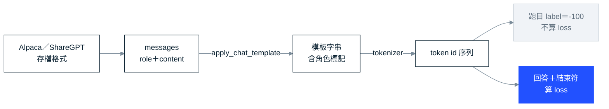

<sub>資料來源：本課整理；改繪自投影片「chat template：把對話排成 token 序列」。</sub>

**圖 3-9　loss 遮罩：灰色題目不算 loss，朱紅回答（含 `<|im_end|>`）才算**

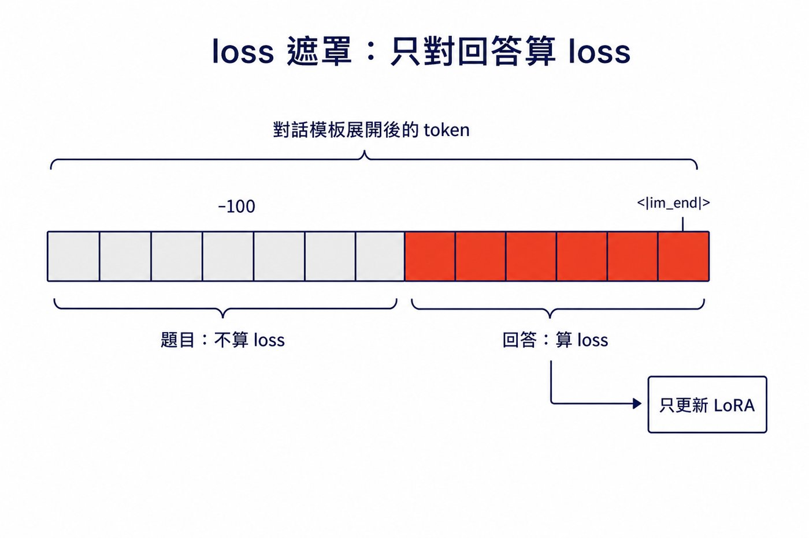

<sub>資料來源：模組六 `images/loss_mask_tokens.jpg`。Lab 6-01 的一筆範例總長 75 個 token，其中 24 個算 loss（本課實測，`01_peft_finetune.ipynb` Step 4）。</sub>

結尾的 `<|im_end|>` 一定要算 loss，模型要學會**什麼時候停**。少了它，微調後的模型會一直講下去。這也引出本章最隱蔽的一個坑：**模板和基座對不上時，症狀不是「無法收斂」**。loss 照樣正常下降，看不出任何問題；要到推理時才發現模型停不下來、重複輸出、角色錯亂。官方文件描述的後果是「控制 token 錯誤會讓模型表現大幅變差」。預防方法是一律用基座官方 tokenizer 的 `apply_chat_template`，開訓前先 decode 一筆看清楚；LLaMA-Factory 的 `template` 參數要設成基座對應的名稱（例如 Qwen3 是 `qwen3`）；推論時用的模板也必須和訓練時一模一樣，包括那段預設 system prompt。

---

## 3.8 看驗證 loss 挑 checkpoint；LLM 特有的風險是災難性遺忘

訓練監控沿用你熟悉的 DL 老功夫。訓練 loss 一路往下，只代表模型越來越會背訓練集；驗證 loss 降到某處就停住，之後開始往上，過擬合就開始了。要存下來的是**驗證 loss 最低的那個 checkpoint**，不是最後一步。

**圖 3-10　一次完整微調：資料、設定、訓練、評估、合併，過擬合就退回設定**

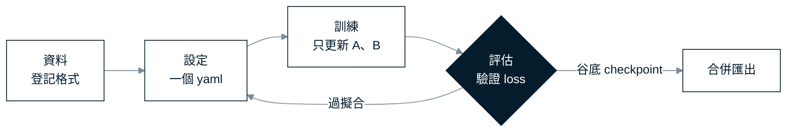

<sub>資料來源：本課整理；改繪自投影片「LLaMA-Factory：一個 yaml 走完整個流程」。</sub>

LLaMA-Factory 把這整個流程收進一個 yaml，和你寫過的訓練迴圈一一對應：

```yaml
model_name_or_path: Qwen/Qwen3-8B
finetuning_type: lora
lora_rank: 8              # r
lora_alpha: 16            # 一般取 rank × 2
lora_target: all          # 所有線性層都加
dataset: clinic_sharegpt  # 先在 dataset_info.json 註冊
template: qwen3           # 必須和基座對應
learning_rate: 1.0e-4
num_train_epochs: 3.0
val_size: 0.1
eval_strategy: epoch
```

<sub>資料來源：投影片「Lab 6：用 LLaMA-Factory 做問診風格 LoRA」；訓練用 `llamafactory-cli train`，合併用 `llamafactory-cli export`。</sub>

判讀 loss 有兩組處方。**過擬合**（驗證 loss 回升，輸出像在背訓練集）：降學習率、減 epoch、早停、加 weight decay、擴充資料、降 alpha。**欠擬合**（訓練 loss 自己也降不下去）：提高學習率、增加 epoch、加大 r 與 alpha。Unsloth 的經驗值是多數情況 1 到 3 個 epoch、起點學習率 2e-4，訓練 loss 低於 0.2 多半已經過擬合。驗證集還要真的「沒看過」：本課 Lab 6-01 的訓練 320 筆、驗證 28 筆、測試 30 筆，症狀說法與服務名稱彼此都不重疊；否則驗證 loss 量到的只是背誦能力。

Lab 6-01 的結果是一個很好的警示。訓練 160 步、52 秒，最佳 checkpoint 在第 140 步；測試集上格式正確率從 0% 升到 100%，指令正確率 83%（本課實測，`01_peft_finetune.ipynb` Step 6、8）。答錯的那些題目格式完全正確，內容卻是錯的：症狀裡沒有訓練集常見的關鍵字，模型就猜到字面相近的類別，例如把「拒絕存取」當成磁碟滿；或冒出訓練集沒有的指令、把主機名稱抄錯。**格式對、內容錯，是最危險的錯，因為程式解析得過。**這也是為什麼第三部的值班 Agent 在執行任何指令之前，一定要經過人工審批。

LLM 特有的風險是**災難性遺忘**（catastrophic forgetting）：只用單一任務資料訓練，通用能力被拉偏。Lab 6-01 問了一題和維運無關的 TCP 三次握手，掛上 LoRA 後的回答又短又不可靠，有時還會套用「第一步檢查」的句型。LoRA 忘得比全量少，但不是不忘。好消息是 LoRA 沒動到原本的權重，卸下 adapter 就回到原模型。

| 坑 | 症狀 | 原因 | 修法 |
|---|---|---|---|
| 災難性遺忘 | 任務學會了，一般常識與推理反而變差 | 過度微調單一領域，更新蓋掉通用能力 | 減 epoch、降學習率；混入通用指令資料（約 15%，經驗值，依任務調整）；或推論時卸下 adapter |
| 模板不符 | loss 照樣下降，推理停不下來、重複、角色錯亂 | 訓練用的 template 和基座不一致 | template 設成基座對應名稱；開訓前用官方 tokenizer 看編碼結果 |
| 停不下來 | 微調後回答講個不停 | 結束符沒算 loss，或推論沒設 stop | 檢查 loss 遮罩；Modelfile 加 `PARAMETER stop` |
| 驗證漂亮、上線不準 | 驗證 loss 很低，實際不準 | 驗證集與訓練集太像，量到的是背誦 | 驗證與測試集換說法、換實體名稱 |

<sub>資料來源：投影片「微調三個坑」、模組六 `00_concepts.md` §8；「約 15%」找不到權威出處，屬經驗值。</sub>

---

## 3.9 合併就是把 B·A 加回 W，推理零延遲；QLoRA 必須合併回原精度基座

訓練完之後，LoRA 還有一個漂亮的性質：根據矩陣乘法的分配律，`(W + B·A)x = Wx + B(Ax)`。訓練時分開算，部署時可以先把旁路加回去：

```
W' = W + (alpha / r) · B · A
```

得到的 W' 和原模型同形狀、同大小，就是一個普通的 Linear。不認識 LoRA 的推論引擎（llama.cpp、Ollama）也能直接用，而且推理時不再多算一條旁路，沒有額外延遲。PEFT 的 `merge_and_unload()` 就是對每一層做這件事。不合併也有好處：基座只載一份，幾 MB 到幾十 MB 的 adapter 可以依任務隨時切換，例如同一個基座掛客服版和問診版。

**圖 3-11　從 adapter 到 Ollama：合併、轉 GGUF、量化，Modelfile 模板要和訓練一致**

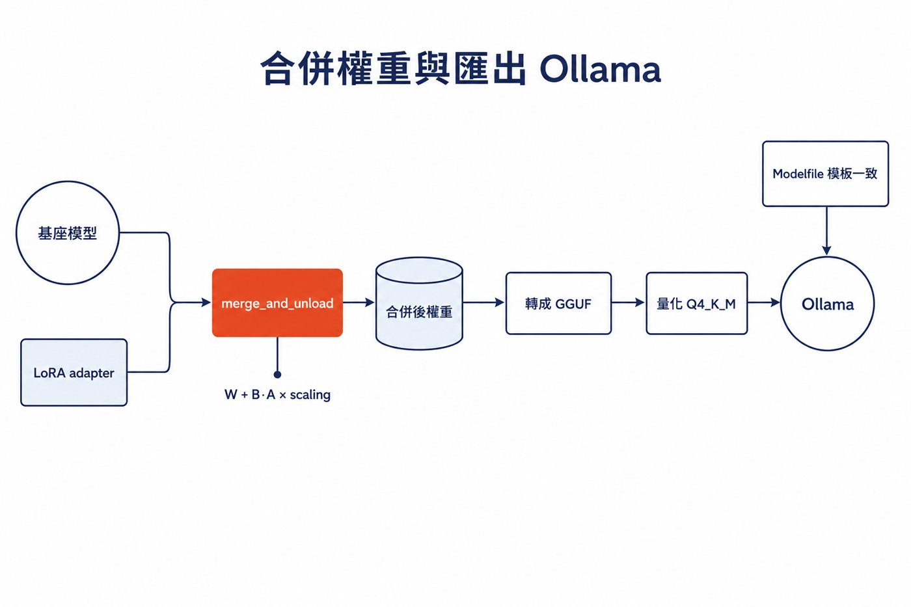

<sub>資料來源：模組六 `images/merge_export.jpg`；對應 `02_merge_and_serve.ipynb`。</sub>

這條路上有兩個陷阱。第一個是 QLoRA 專屬的：訓練時用的是 4-bit 基座，但**合併必須回到原精度（16-bit）基座**。合併是矩陣加法，量化基座本身已經是壓縮過的近似值，ΔW 加上去不精確，合併後的表現會和訓練時看到的對不上；LLaMA-Factory 文件明確警告不可合併到量化基座。第二個是匯出到 Ollama 後效果變差：Modelfile 的 TEMPLATE、SYSTEM 和訓練時不同（又是 3.7 節的模板問題），或量化帶來的誤差。修法是從訓練用的模板推出 Modelfile，量化後用同一份測試集再測一次。

**圖 3-12　QLoRA 匯出：adapter 要和原精度基座合併，不能合到 4-bit 基座**

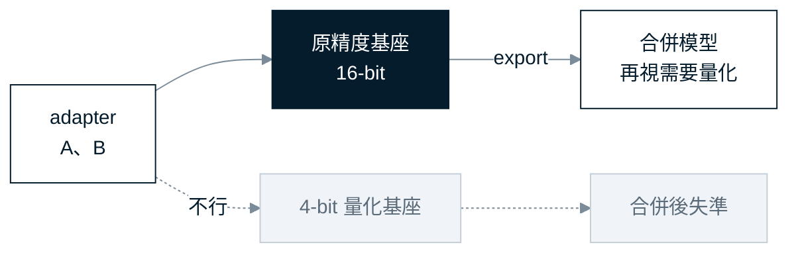

<sub>資料來源：本課整理；改繪自投影片「合併：把旁路加回 W，推理零延遲」。</sub>

---

## 3.10 多模態模型走同一條本地路線；工具選型看你要寫多少程式、服務多少人

多模態模型看圖的方式，對你來說一點都不陌生。視覺 encoder（就是你熟悉的 ViT 或 CNN）把影像變成一串向量，這些「影像 token」接在文字 token 前面，一起送進語言模型。影像也被當成 token，所以第 1 章說的「圖越大、token 越多、越貴」在這裡同樣成立。

**圖 3-13　多模態：影像經視覺 encoder 變成 token，和文字 token 排成一列進 LLM**

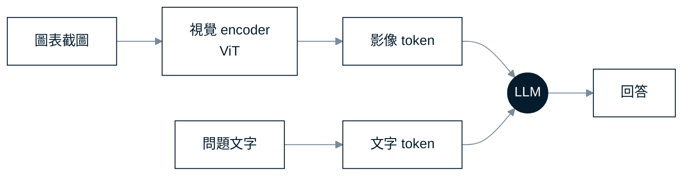

<sub>資料來源：本課整理；改繪自投影片「多模態：影像也被切成 token」。</sub>

本地最低門檻的做法是 `ollama run qwen3-vl:8b`。Ollama 上的 qwen3-vl 有 2b（1.9GB）、4b（3.3GB）、8b（6.2GB）、30b（20GB）、32b（21GB）、235b（143GB）幾種尺寸，需要 Ollama 0.12.7 以上。新一代的 Qwen3.5 自 2026 年 2 月起原生支援看圖（內建 vision encoder），不再需要獨立的 VL 模型，LLaMA-Factory v0.9.5（2026-05-30）已經支援；課程 Lab 維持 Qwen3／Qwen3-VL 是為了教材穩定。

最後是工具選型。微調工具的差別在你想寫多少程式：從設定檔就能跑的，到自己寫訓練迴圈的。

| 工具 | 定位 | 什麼時候選它 | 狀態（2026-11） |
|---|---|---|---|
| LLaMA-Factory（本課投影片 Lab） | 零程式碼 YAML／WebUI | 教學、Lab、想快速換模型 | Apache-2.0；repo 已改名 `hiyouga/LlamaFactory`，舊網址會轉址 |
| Unsloth | 單卡省顯存的快速微調 | 單張消費級 GPU、Colab、QLoRA | 核心 Apache-2.0，Studio UI 為 AGPL-3.0 |
| TRL＋PEFT（本課 notebook） | Hugging Face 官方底層庫 | 自己寫訓練流程：SFT、DPO、GRPO | Apache-2.0 |
| Axolotl | YAML 驅動的多卡微調 | 多 GPU、多節點、要可重現設定 | Apache-2.0 |
| torchtune | PyTorch 原生後訓練庫 | 不建議新專案採用 | 2025 年起停止積極維護 |

<sub>資料來源：投影片「選型：微調工具」、tool-selection.md 表 2a（核實 2026-11-17）。</sub>

推理服務則分成兩種需求：個人跑模型求方便，給一群人用求吞吐量。上半偏「自己用」：Ollama（一行指令、OpenAI 相容 `/v1`）、llama.cpp（C/C++ 推理與 GGUF 量化，Ollama 的底層；2026-11-13 發布 v1.0.0，移除了舊的 public API）、LM Studio（圖形介面）。下半偏「給很多人用」：vLLM（高吞吐 GPU 服務）、SGLang（多輪、共用前綴多、大型 MoE）。TGI 的 repo 已封存，官方建議改用 vLLM 或 SGLang，舊教學看到要換掉。

**圖 3-14　開發用 Ollama，上線換高吞吐引擎，程式只改 base_url**

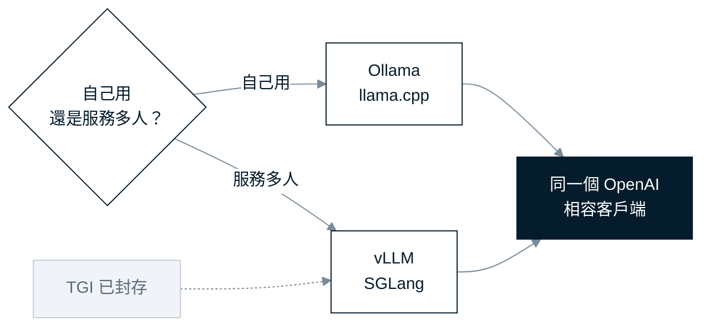

<sub>資料來源：本課整理；依投影片「選型：本地推理與服務」與 tool-selection.md 表 2b。</sub>

這張圖也把第一部收了尾：不論模型是 API、本地 Ollama，還是你自己微調、合併、量化後的版本，對上層程式來說都是同一個 OpenAI 相容介面。第二部開始，我們不再改模型本身，而是去改它的輸入：把它不知道的知識查來給它看。

---

## 本章重點

先判斷缺知識還是缺行為：缺知識走 RAG，缺行為先寫提示詞，仍不穩或太長太貴才微調；微調買到的主要是成本，不是正確率。LoRA 凍結 W、只學 ΔW = B·A，B 初始化為 0 所以從原模型出發，r 是容量旋鈕，可訓練參數通常不到 1%，省下的是梯度與優化器狀態；中小型指令資料、加在所有層、r 夠大時接近全量微調，大資料與繼續預訓練會落後，但忘得少。QLoRA 把凍結的 W 存成 4-bit，讓 24GB 單卡能跑 7B 等級，合併時必須回到原精度基座。微調資料是套完 chat template 的監督標籤，只對回答與結束符算 loss；模板不符時 loss 看不出問題，要到推理才露餡；挑 checkpoint 看驗證 loss 的谷底，並提防格式對、內容錯。

## 對應實作與延伸閱讀

**Notebook（模組六）**

- [01_peft_finetune.ipynb](../../modules/module-06-lora/01_peft_finetune.ipynb)：Lab 6，用 PEFT 微調 Qwen2.5-0.5B-Instruct；印可訓練參數、loss 遮罩、依驗證 loss 挑 checkpoint、微調前後對比、災難性遺忘
- [02_merge_and_serve.ipynb](../../modules/module-06-lora/02_merge_and_serve.ipynb)：載入 adapter、`merge_and_unload`、驗證 `W + B·A × scaling`、GGUF 與 Modelfile 步驟
- [03_when_not_to_finetune.ipynb](../../modules/module-06-lora/03_when_not_to_finetune.ipynb)：同一任務改用 prompt＋值班手冊（0.5B、3B）對比 LoRA
- 原理紀要：[模組六 00_concepts.md](../../modules/module-06-lora/00_concepts.md)

**投影片**：[deck.pdf](../slides/deck/deck.pdf) 模組六（微調是什麼 → 模組 6 小結）；投影片的 Lab 6 走 LLaMA-Factory＋Qwen3-8B＋RTX 4090 路線，repo 內 notebook 走 PEFT＋Qwen2.5-0.5B 路線，原理相同。

**論文與延伸閱讀**

- Hu et al.（2021）〈LoRA: Low-Rank Adaptation of Large Language Models〉，arXiv:2106.09685
- Dettmers et al.（2023）〈QLoRA: Efficient Finetuning of Quantized LLMs〉，arXiv:2305.14314
- Biderman et al.（2024）〈LoRA Learns Less and Forgets Less〉，arXiv:2405.09673
- Thinking Machines（2025）〈LoRA Without Regret〉
- Sebastian Raschka〈Finetuning Large Language Models〉〈Practical Tips for Finetuning LLMs Using LoRA〉
- OpenAI〈Optimizing LLM Accuracy〉；Hugging Face PEFT〈LoRA conceptual guide〉與 Transformers〈Chat templates〉文件
- LLaMA-Factory 官方文件：資料格式、SFT、模型合併與量化
