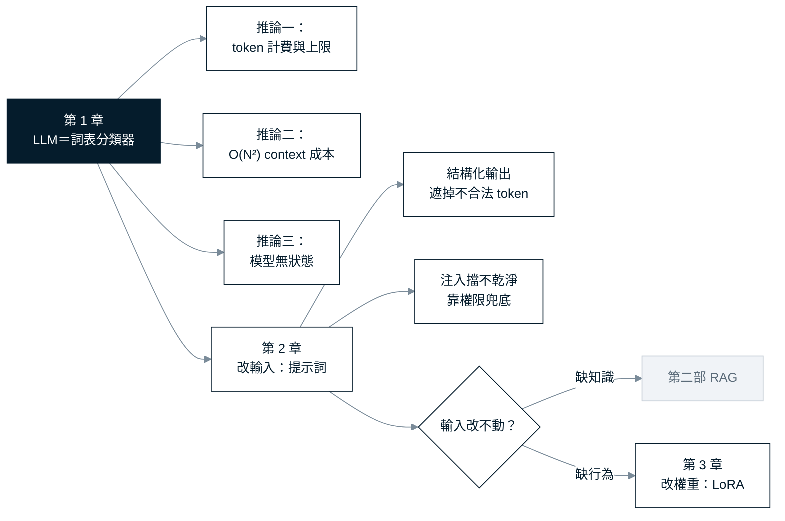

# 第一部　模型層：先弄懂模型能做什麼、做不到什麼

Agent 的每一個零件，最後都會回到同一個問題：模型這顆「大腦」本身到底在算什麼。這一部回答三件事：LLM 為什麼會生成文字、為什麼記不住對話、為什麼會一本正經地答錯（第 1 章）；怎麼只改輸入就讓它照規格交出程式能直接收下的結果（第 2 章）；什麼時候輸入改不動了，才值得動權重（第 3 章）。讀完這一部，你應該能用「這是改輸入還是改權重」這一句話，判斷後面每一章的技術落在哪裡。

## 本部要回答的核心問題

一個訓練好的神經網路是 `y = f(x)`：呼叫一次就結束。Agent 並不換掉這個 f，而是把它放進「想、做、看」的迴圈，再配上記憶和工具。所以要設計 Agent，第一步是看清楚 f 的邊界：它吃什麼、吐什麼、哪些限制是結構性的（不論模型多大都存在），哪些只是工程上的取捨。

模型單獨使用時有三個結構性缺口。第一，它沒有長期記憶，每次呼叫都從零開始，「記得上一輪」是因為客戶端把整段歷史重送一次。第二，它不能動手，只會輸出文字，碰不到資料庫、檔案、API。第三，它的知識有截止日，訓練之後的新資訊與公司內部文件，它一概不知道。後面三部課程（知識層、行動層、上線層）就是分別去補這三個缺口；而這一部只處理大腦本身。

## 論證主線

主線只有一條：**LLM 是詞表上的 softmax 分類器，生成是把這個分類器跑成迴圈。** 從這句話出發，第 1 章推出三個工程後果：計費與 context 上限都按 token 算；attention 讓 context 的成本隨長度平方成長；模型是無狀態的純函數，所有「記憶」都在輸入端。第 2 章順著「輸入就是條件」往下走：提示詞是改變條件分佈的輸入規格，結構化輸出是在 softmax 前把不合法 token 遮掉；同一個「指令和資料在同一條 token 序列」的事實，也解釋了為什麼 prompt injection 擋不乾淨。第 3 章處理輸入改不動的情況：缺知識就去改輸入的內容來源（RAG，第二部），缺行為才改權重，而 LoRA 讓「改權重」便宜到單張消費級 GPU 做得到。

**圖 一-0　第一部的三章沿著「改輸入 → 改權重」排開**

資料來源：本課整理；改繪自投影片「從深度學習到 Agent 的地圖」「從一任務一模型到一個底座」。

## 這一部在整門課的位置

整門課 20 小時、八個模組，這一部對應模組一（大模型底層與本地運行，2 小時）、模組二（提示詞與結構化輸出，2 小時）、模組六（LoRA 微調與私有化部署，2 小時）。模組六在課表上排在 Agent 之後，但教科書把它提前到這裡：它回答的是「模型本身能不能被改」，和提示詞屬於同一層的選擇題，放在一起讀，判斷「改輸入還是改權重」才有完整的對照組。

| 部 | 補的缺口 | 對應模組 | 學時 |
|---|---|---|---|
| 第一部 模型層 | 無（理解大腦本身） | 一、二、六 | 6 |
| 第二部 知識層 | 知識有截止日 | 三、四 | 6 |
| 第三部 行動層 | 不能動手、沒有記憶 | 五 | 5 |
| 第四部 上線層 | 工具接口、評估、可觀測 | 七、八 | 3 |

學時數字取自投影片「八個模組，二十小時」的課綱學時表；四部的分法為本課整理。

## 各章導覽

- [第 1 章　LLM 怎麼運作：一個跑成迴圈的詞表分類器](01-how-llms-work.md)：從 token、embedding、next-token 預測講到 attention 與 Transformer，再推出 context 的平方成本、模型為什麼記不住對話、為什麼溫度設 0 也會幻覺；最後落到工程選擇：開放權重還是商業 API、本地模型怎麼依顯存挑、怎麼用同一個介面切換供應商並算清楚帳單。
- [第 2 章　提示詞與結構化輸出：把輸入寫成規格，把輸出變成物件](02-prompts-and-structured-output.md)：四段式提示詞、few-shot、推理模型時代的 CoT 與 ToT、prompt injection 為什麼擋不乾淨、內容審核放哪一層、結構化輸出的三層保障，以及把它們全部用上的 Text2SQL。
- [第 3 章　微調與 LoRA：缺行為才改權重](03-finetuning-and-lora.md)：先判斷缺知識還是缺行為，再講 LoRA 為什麼只訓練不到 1% 參數就夠用、什麼條件下追不上全量微調、QLoRA 怎麼省顯存、資料格式與 chat template 怎麼對齊、看 loss 挑 checkpoint、合併與部署。

## 先備知識

這一部假設你懂深度學習，但沒學過 NLP。下面五項只要求到右邊這個程度：

| 項目 | 需要的程度 |
|---|---|
| softmax | 說得出它把分數變成加總為 1 的機率，除以溫度 T 會讓分佈變尖或變平 |
| embedding 層 | 知道 `nn.Embedding` 就是查表：整數 id 換成一列可訓練的向量 |
| 反向傳播 | 看得懂訓練迴圈：算 loss、梯度往回傳、更新權重 |
| 遷移學習 | 做過或聽過：拿預訓練骨幹，凍結一部分，用少量資料微調 |
| Python | 能讀寫函式、類別、dict 與 JSON，會裝套件、跑腳本 |

不需要先會 NLP、Transformer 或任何 LLM 框架，這些都從第 1 章從零講起。

## 怎麼讀這一部

每一節的第一段就是結論，後面的段落是支撐它的論據；趕時間時只讀每節第一段，也能拿到主線。術語第一次出現時會給一句白話、一個例子和英文原名，之後直接使用。

書中有幾種固定標記。「本課整理」表示這是課程自己歸納的框架，不是業界共識；「示意」表示數字或曲線只為說明，不是實測；「本課實測」會註明來源 notebook。版本號、API 名稱與價格以 2026 年 11 月核實的狀態為準，模型型號大約每季更換一次，所以書裡刻意少寫死型號，多講「怎麼判斷」。

每章結尾有兩段固定內容：「本章重點」收斂成三到五句話，「對應實作與延伸閱讀」列出 notebook 與原始論文。建議的讀法是先讀完一章，再打開對應模組的 `00_concepts.md` 與 notebook，把書裡的每個論點在真實輸出上對一次。

## 對應模組與 notebook

| 章 | 模組 | 先讀 | notebook |
|---|---|---|---|
| 第 1 章 | [module-01-llm-local](../../modules/module-01-llm-local/) | [00_concepts.md](../../modules/module-01-llm-local/00_concepts.md) | `01_tokens`、`02_huggingface`、`03_next_token`、`04_chat_api`、`05_dual_track`（Lab 1）、`06_multimodal_api`、`07_providers`、`08_litellm_and_cost` |
| 第 2 章 | [module-02-prompt-structured](../../modules/module-02-prompt-structured/) | [00_concepts.md](../../modules/module-02-prompt-structured/00_concepts.md) | `01_prompt_basics`、`02_cot_and_chaining`、`03_structured_output`、`04_prompt_injection`、`05_text2sql`（Lab 2）、`06_eval_prompts` |
| 第 3 章 | [module-06-lora](../../modules/module-06-lora/) | [00_concepts.md](../../modules/module-06-lora/00_concepts.md) | `01_peft_finetune`（Lab 6）、`02_merge_and_serve`、`03_when_not_to_finetune` |

notebook 的套件版本與驗證日期寫在各模組的 `README.md`；投影片完整版見 [deck.pdf](../slides/deck/deck.pdf)。
