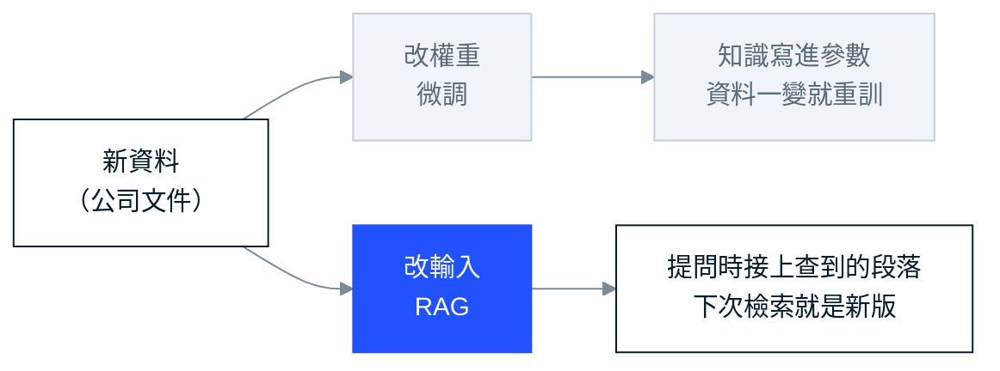
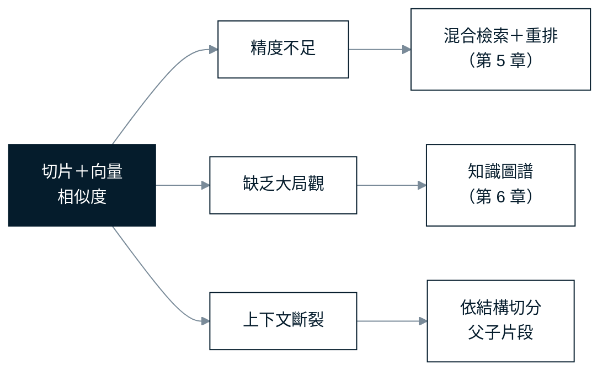
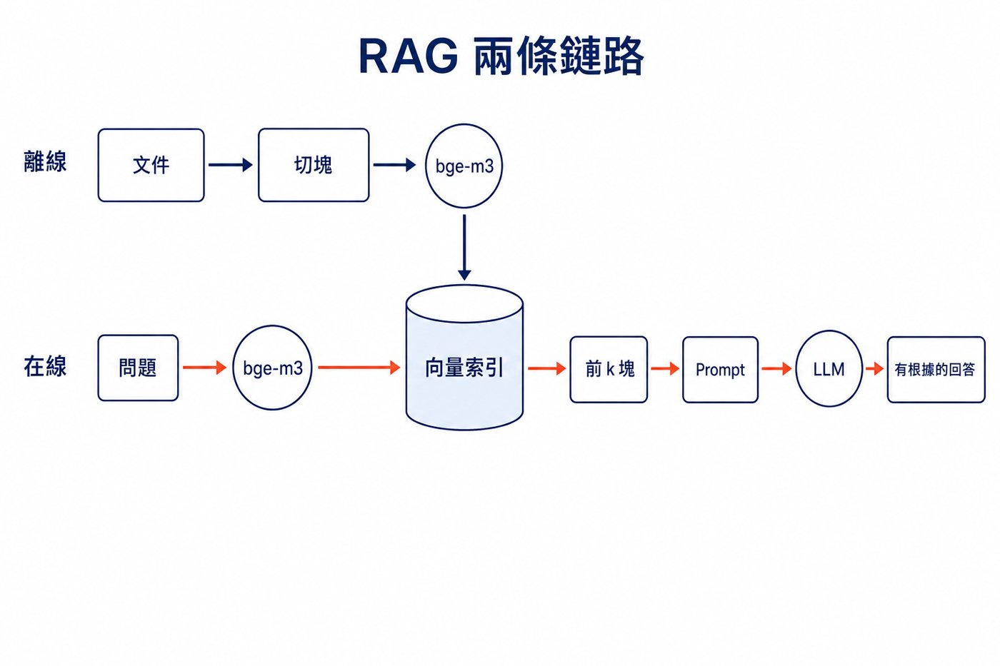
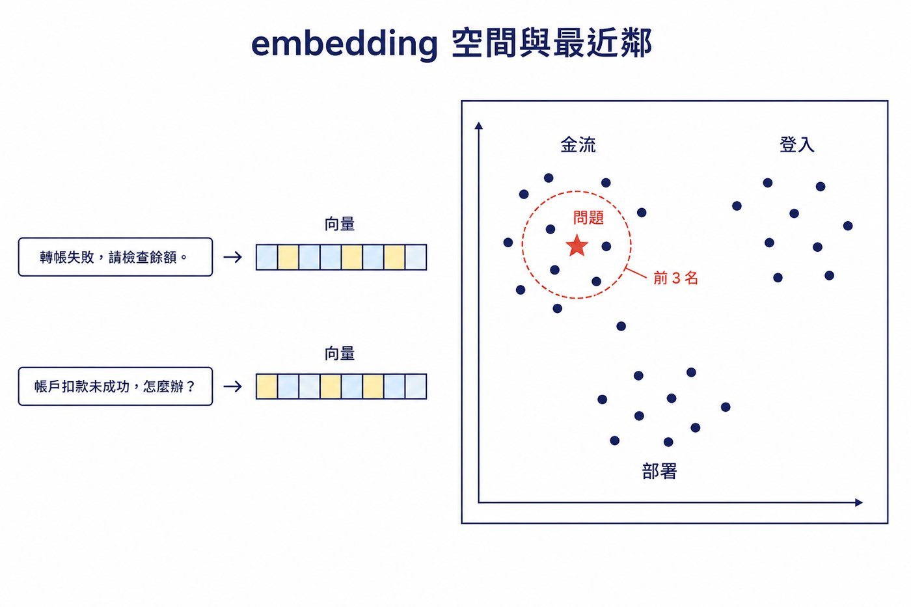
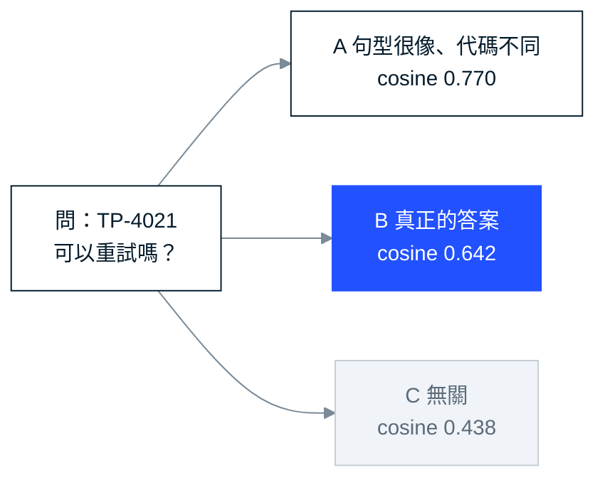
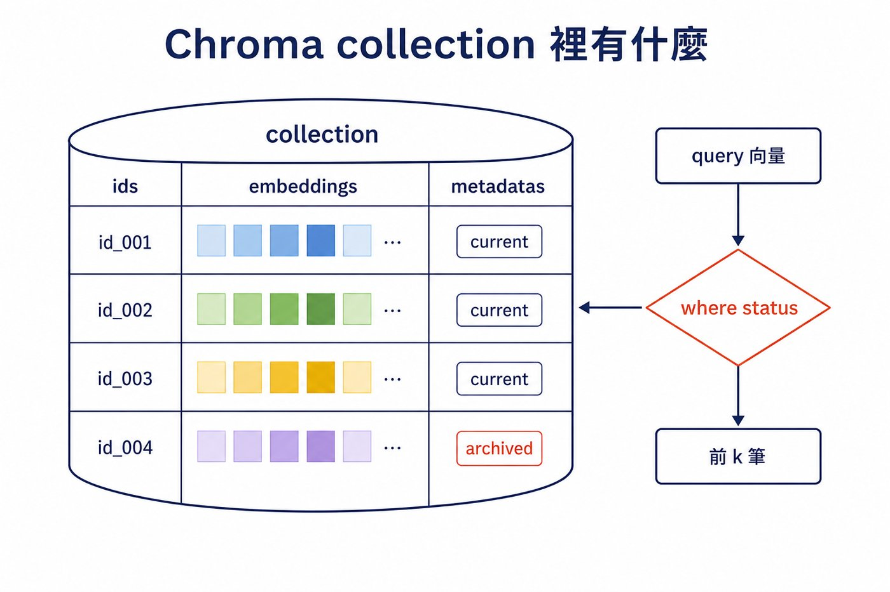
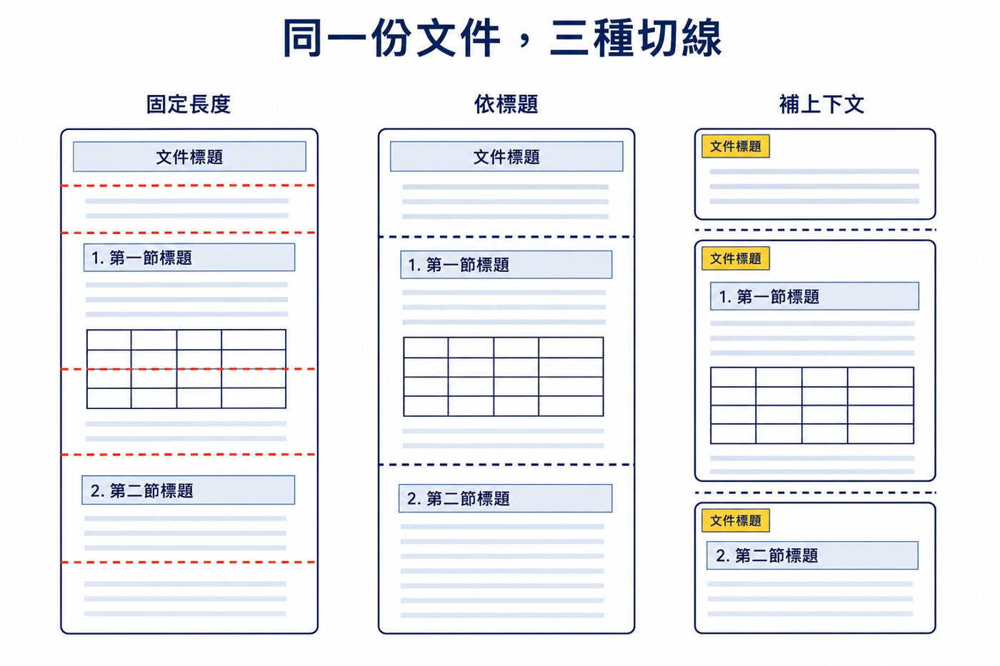
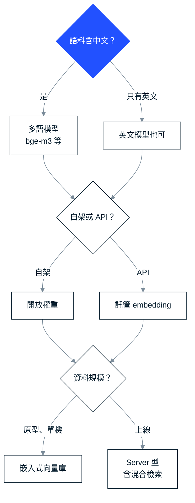

# 第 4 章　RAG 全鏈路：改輸入，不改權重

**本章結論**：大型語言模型的知識凍結在權重裡，公司內部文件、昨天才改的流程它都沒看過；檢索增強生成（RAG）的做法是權重不動，在提問當下把查到的文字接進輸入。整套系統拆成兩條鏈路：離線把文件切塊、轉成向量存進向量庫，在線把問題轉成向量去查、組成 prompt 再生成。這兩條鏈路裡，決定答案品質上限的不是生成模型，而是「切在哪裡」與「用什麼表示去找」；生成模型只能在檢索給它的材料裡發揮。讀完本章，你應該能畫出兩條鏈路、說清 embedding 與 metadata 過濾各自管什麼，並知道為什麼分塊是第一個要調的旋鈕。

---

## 4.1 RAG 讓模型在推論時「翻書」，而不是把書背進權重

RAG（Retrieval-Augmented Generation，檢索增強生成）是一句話就能講完的機制：先去資料庫查出相關段落，連同問題一起交給模型，讓它照著資料回答。這個詞出自 Patrick Lewis 等人 2020 年的論文；如今你在聊天機器人「附出處連結」的搜尋模式、公司內部的文件問答、上傳一份 PDF 再對它發問的功能裡都見過它。用考試來比喻，沒有 RAG 的模型在考閉書考試，只能憑印象作答；RAG 把它變成開書考試，先翻書，再照書作答並附上出處。

從深度學習的角度看，讓模型用上新資料只有兩條路。第一條是改權重，也就是你熟悉的遷移學習：拿預訓練網路加新資料繼續訓練，讓知識寫進參數裡，這是第 3 章的微調。第二條是改輸入：網路一個參數都不動，只是在前向傳播時多餵一段條件輸入，輸出就跟著變。RAG 走的是第二條。它的檢索部分也有你見過的影子：把整個資料集先過一次 backbone、存成特徵庫，之後只查表，這正是向量庫在做的事。

**圖 4-1　要讓模型知道新事實，改輸入比改權重便宜、可追溯、更新快**



<sub>資料來源：本課整理；改繪自投影片「搭橋：改輸入還是改權重」。</sub>

兩條路的取捨可以用一張表說完。微調適合改語氣、格式與領域用語，因為那些是「怎麼說」，本來就該內化；事實性、常變動、需要出處的知識則適合 RAG，因為文件更新後下次檢索就拿到新版，而且回答可以標出它根據哪份文件。

| | 改權重（微調，第 3 章） | 改輸入（RAG，本章） |
|---|---|---|
| 做法 | 用公司文件繼續訓練 | 提問時把相關文件塞進 prompt |
| 文件更新 | 要重訓 | 下次檢索就拿到新的 |
| 可追溯 | 不知道答案從哪來 | 可以標出來源文件 |
| 適合 | 語氣、格式、領域用語 | 事實性知識、常變動的資料 |

看一個實物會更具體。RAG 最後送給模型的，就是一則普通的對話訊息，只是使用者訊息裡多了幾段檢索結果，加上三條規則：只根據參考資料回答、找不到就說不知道、標出來源。

```json
[
  {"role": "system", "content": "只根據參考資料回答；資料裡沒有就說不知道；回答後標出來源 id。"},
  {"role": "user", "content": "參考資料：\n[svc-tidepay#3] | TP-4021 | 冪等鍵衝突 | 呼叫端程式錯誤，不可重試 |\n---\n[rb-tp-4012-3ds-timeout#3] TP-4012 和 TP-4021 長得很像但完全無關……\n\n問題：TP-4021 可以重試嗎？"}
]
```

這段 JSON 也說明了 RAG 的邊界：翻書救不了書裡沒有的東西，也救不了翻錯頁。前者是資料問題，後者是檢索問題，而本章與下一章大半篇幅都在處理「怎麼翻對頁」。

---

## 4.2 只做「切片加向量相似度」的 RAG，上線後會在三個地方失敗

最陽春的 RAG 只有兩步：把文件切成固定大小的片段，問題來時用向量相似度撈前幾名。這個版本在示範時通常很漂亮，上線後卻會反覆撞上三種失敗，每一種都對應一個後面要補上的修法。先把三個痛點講清楚，後面每一節在解決哪一個就有了座標。

第一種是**精度不足**：撈回五段，只有一段真正有用，其他都只是邊緣相關。雜訊混進提示詞，模型就容易被帶偏，甚至一本正經地亂編。修法是混合檢索加重排（第 5 章）。第二種是**缺乏大局觀**：「總結這個團隊去年的五大貢獻」需要看整份文件，切片檢索只能給出零散幾塊。修法是知識圖譜與社群摘要（第 6 章）。第三種是**上下文斷裂**：一段「偵測到過熱時，它會自動降頻」被攔腰切成兩塊，只撈到後半塊的模型不知道「它」是誰。修法是依結構切分與父子片段（本章 4.6 與第 5 章）。

**圖 4-2　三個痛點各有對應的修法，本部三章依序補上**



<sub>資料來源：本課整理；改繪自投影片「傳統 RAG 三痛點」。</sub>

這三個痛點有一個共同點：它們都發生在模型看到資料**之前**。換一個更大的生成模型，對第一種痛點略有幫助（較能忽略雜訊），對第二、三種幾乎沒有幫助，因為該給的資料根本沒進 prompt。這是本部的核心判斷：RAG 系統的品質問題，先假設是檢索問題，量過之後才歸給生成。

---

## 4.3 系統拆成離線建庫與在線問答兩條鏈路，向量庫是唯一的交會點

一套 RAG 由兩條節奏完全不同的鏈路組成。離線鏈路在文件更新時才跑一次：載入文件、切塊、把每塊轉成向量、存進向量庫，慢一點沒關係。在線鏈路每個問題都要跑一次：把問題轉成向量、在向量庫裡找最近的 k 塊、組成 prompt、交給 LLM 生成，所以要快。兩條鏈路唯一的交會點是向量庫：離線寫入，在線讀取。

**圖 4-3　離線鏈路把文件變成向量索引，在線鏈路每次提問都查它一次**



<sub>資料來源：本課模組三 `00_concepts.md` 第 2 節配圖。</sub>

這張圖有一個容易忽略的細節：上下兩排的 embedding 模型是**同一個**（本課用 bge-m3）。問題和文件必須在同一個向量空間裡才能比距離，所以換 embedding 模型等於整座向量庫要重建。這也是為什麼選型時 embedding 模型要先定，向量庫反而可以晚一點換。

兩條鏈路的分離還有一個工程後果：所有昂貴的前處理都應該往離線推。PDF 解析、請 LLM 為每塊寫摘要或假想問題、建 BM25 索引，這些都只需要做一次；放進在線路徑，每個使用者都要多等幾秒。第 5 章談到的大多數優化技巧，本質上都是「離線多花一點，在線少錯一點」。

| | 離線鏈路 | 在線鏈路 |
|---|---|---|
| 觸發 | 文件新增或更新 | 每一次提問 |
| 步驟 | 載入 → 切塊 → 轉向量 → 寫入 | 問題轉向量 → 找最近 k 塊 → 組 prompt → 生成 |
| 要求 | 正確、可重跑 | 快、穩定 |
| 適合放的昂貴步驟 | PDF 解析、補上下文、產生假想問題 | 只放必要的重排 |

---

## 4.4 Embedding 就是預訓練 encoder 的特徵向量，但「相似」不等於「相關」

檢索靠的是 embedding（嵌入向量）：一個模型把一段文字變成固定長度的向量，意思相近的文字，向量也相近。它跟 CNN 倒數第二層的特徵向量是同一個概念：拿 ImageNet 預訓練的 CNN 抽特徵再做最近鄰搜尋，你一定做過；把圖片換成句子，把 CNN 換成預訓練的語言 encoder，就是文字 embedding。本課用的 bge-m3 輸出 1024 維向量，最長可吃 8192 個 token，支援 100 多種語言。

**圖 4-4　意思相近的句子落在向量空間的同一區，檢索就是找問題附近的點**



<sub>資料來源：本課模組三 `00_concepts.md` 第 1 節配圖。</sub>

文字 embedding 怎麼從詞走到句子，也全是你熟悉的元件。詞向量就是 `nn.Embedding` 的查表取一列；句子經過 Transformer encoder 後，每個 token 都有一個向量，再做 pooling（類比 CNN 的 global average pooling）壓成一個句向量。訓練時常用 siamese 結構：兩句各自通過同一個共享權重的 encoder，再用對比式的目標拉近相關的句對、推遠無關的。這種「兩邊各自編碼」的架構叫雙塔（bi-encoder），它的關鍵好處是文件向量可以事先算好存起來，查詢時只要編碼問題一次。

相似度用 cosine（夾角）量。若向量先正規化成長度 1，cosine 就只剩內積；bge-m3 載入後已經正規化，所以 Chroma 預設的 l2 距離和 cosine 排出來的順序一樣，不必另外設定。

```
cosine(a, b) = a·b / (|a| |b|)      先把每個向量除以自己的長度，cosine 就只剩內積
```

Embedding 有一個一定要記住的盲區：**相似不等於相關**。`TP-4012 可以重試嗎？` 和 `TP-4021 可以重試嗎？` 只差兩個數字，向量幾乎一樣，卻是兩個完全不同的錯誤。本課在 `05_rerank_and_query.ipynb` 實測過一組三段候選：句型跟問題很像、但代碼不同的段落 cosine 0.770，真正的答案只有 0.642（本課實測，單次執行）。向量抓的是「整體長得像不像」，錯誤碼、型號、精確數字這種「差一個字就是另一件事」的資訊，它天生抓不準。這個盲區是第 5 章要加關鍵字檢索與重排的根本原因。

**圖 4-5　向量檢索把「長得像」排在「真正相關」前面，代碼類問題特別明顯**



<sub>資料來源：本課實測，`modules/module-03-rag/05_rerank_and_query.ipynb` Step 2；每次重跑數字會略有不同。</sub>

選 embedding 模型時，第一個問題是語言。本課語料是中文，所以用多語的 bge-m3；Ollama 上很方便的 `nomic-embed-text` v1.5 只支援英文，而且必須加 `search_query:`／`search_document:` 前綴，拿來處理中文效果會差。單語模型還會造成另一個常見症狀：用中文問英文文件撈不到東西，因為不同語言被放在向量空間的不同角落。

---

## 4.5 向量庫做三件事：存向量、找近鄰、先用 metadata 過濾

向量資料庫（vector database）的工作可以濃縮成三件事：存向量、找最近鄰、依 metadata 過濾。Metadata 是附在每個片段上的標籤，例如版本、模組名稱、章節路徑、文件狀態。本課用 Chroma，`pip install` 就能用，可以只放在記憶體或存成資料夾。

**圖 4-6　一個 collection 就是一張「id、向量、標籤」的表，查詢先過 where 再比距離**



<sub>資料來源：本課模組三 `02_first_rag.ipynb` 配圖。</sub>

為什麼過濾要在比距離之前？因為真實文件庫一定有舊版文件，而舊版跟新版「很像」，向量根本分不出來。本課語料刻意放了 2 份已封存的舊版說明，向量檢索會把舊版排第一；唯一可靠的做法是建索引時標上 `status`，查詢時用 `where` 排除。這等同於訓練資料上的 mask：先把不該參加比較的樣本遮掉，相似度才在對的子集合裡比。

```python
col.query(
    query_embeddings=q_vec,
    n_results=5,
    where={"status": "current"},   # 先過濾，再比距離
)
```

資料量大時，找最近鄰不會逐一比對，而是用近似演算法（例如 HNSW），用一點點準確度換大量速度。對單機 Lab 來說這是透明的，但上線時要知道：近似搜尋本來就不保證找回真正的前 k 名，所以評估要在接近真實資料量的條件下做，而不是只在幾十份文件的小庫上量完就上線。

有兩個 Chroma 的實務細節值得一提。第一，寫入時用 `upsert` 而不是 `add`：重跑建庫腳本時，`upsert` 會以相同 id 覆寫，`add` 遇到重複 id 則會略過，舊內容就殘留在庫裡。第二，Chroma 首頁雖然寫著支援 hybrid search，但 BM25／SPLADE 加 RRF 的 Search API 只在 Chroma Cloud 提供，本地版（本課用的 1.5.9）只做向量檢索。這個限制直接決定了第 5 章的 Lab 結構：關鍵字那一路與融合要自己做。

---

## 4.6 分塊決定檢索品質的上限，「最佳實踐」要用自己的題庫量過

整份文件太長、雜訊太多，必須切成小塊再檢索；而切在哪裡，決定了找不找得到。分塊（chunking）是 RAG 的第一個超參數，地位跟影像任務裡的輸入解析度差不多：之後所有步驟都只能在它切出來的單位上運作，切錯了，後面再精巧也救不回來。

**圖 4-7　同一份文件，切線位置不同，表格與小節的完整性就不同**



<sub>資料來源：本課模組三 `03_chunking.ipynb` 配圖。</sub>

**固定長度切分**是最簡單的做法：每 N 個 token 切一刀，相鄰兩塊重疊一小段。它的問題是刀口完全由字數決定，常落在句子或表格中間。投影片的例子很典型：問「ERR-4012 怎麼排除？」，向量庫撈到第一塊，它有錯誤碼，卻停在「請先」；解法在第二塊，沒被撈到，模型只能亂接。在本課的 notebook 裡，固定 128 token 會把錯誤碼表的表頭和後面幾列分到不同塊，拿到後一塊的人不知道每一欄的意思。

**依結構切分**用文件自己的標題層級當刀口。技術文件本來就有結構，`## 小節` 就是作者畫好的分界線，照著切，一塊就是一個完整主題，表格也不會被切開。LangChain 的 `MarkdownHeaderTextSplitter`（在 `langchain-text-splitters` 套件）會把章節路徑存進 metadata，可過濾、可標出處；但要注意它的 `strip_headers` 預設是 True，標題會從內文拿掉、只留在 metadata。想讓 embedding 讀到章節脈絡，要設成 False，或自己把標題拼回內文。本課 notebook 用的是 LlamaIndex 的 `MarkdownNodeParser`，原理相同。

**語義切分與代理切分**常被混為一談，其實是兩件事。語義切分（semantic chunking）不用 LLM：embedding 模型給每句一個向量，比較相鄰兩句的距離，高於門檻的峰值就是切點；這等於在序列上做變化點偵測（change-point detection），門檻用百分位數設，像調 threshold。LlamaIndex 的 `SemanticSplitterNodeParser` 取第 95 百分位；LangChain 的 `SemanticChunker` 所在的 `langchain-experimental` 已公告停止維護。代理切分（agentic chunking）才是讓 LLM 逐句判斷這句該歸入哪一塊或另開新塊，像請人邊讀邊分章節；它沒有任何主流框架的標準 API，而且每句都要呼叫 LLM，慢、貴、不穩定。

**圖 4-8　兩種「智慧切分」差在誰判斷切點：只有代理切分要付 LLM 的錢**


<sub>資料來源：本課整理；改繪自投影片「語義切分 vs 代理切分」，事實依素材地圖 M3 的核實紀錄。</sub>

**補上下文（contextual chunking）**在每塊前面補一兩句「這段出自哪份文件、講什麼」，讓孤立的小節有主詞。Anthropic 2024 年的 contextual retrieval 是這個想法最有名的版本，第 5 章會看它的數字。這裡先看一個反例，因為它比任何口訣都重要：在本課語料上，補標題沒有讓向量檢索變好。

| 切法（本課實測，向量檢索） | Hit@1 | Hit@3 | MRR |
|---|---|---|---|
| 固定 128 token | 0.89 | 1.00 | 0.94 |
| 依標題 | 0.89 | 1.00 | 0.95 |
| 依標題＋補標題 | 0.82 | 1.00 | 0.91 |
| 依標題＋補標題＋摘要 | 0.82 | 0.95 | 0.89 |

<sub>資料來源：本課實測，`modules/module-03-rag/03_chunking.ipynb` Step 10，38 題題庫；Hit@k 與 MRR 的定義見第 5 章 5.8 節。</sub>

原因看翻盤的題目就懂：新舊版文件的標題幾乎一樣，補上標題後兩份文件的每一塊都更像，舊文件反而搶到第一名；標題裡帶著 `TP-4012` 的 runbook，問 `TP-4021` 時被這個幾乎一樣的代碼拉上來。標題讓同一服務的文件互相靠近，區分度下降。但同一招對關鍵字檢索卻有幫助：每一塊帶著服務名稱後，BM25 在關鍵字題的 Hit@1 從 0.74 升到 0.83（同一本 notebook 實測）。所以後續 notebook 仍採「依標題＋補標題」，向量那一路的副作用用 metadata 過濾擋掉舊文件。

這個結果的教訓不是「補上下文沒用」，而是任何「最佳實踐」都是在別人的語料上量的。分塊策略的選擇可以總結成一張表，但最後一欄永遠要用自己的題庫填。

| 切法 | 做法 | 優點 | 缺點 |
|---|---|---|---|
| 固定長度 | 每 N 個 token 切一刀，相鄰重疊一點 | 最簡單 | 切斷句子與表格 |
| 依結構 | 依 Markdown 標題、段落切 | 一塊一個主題 | 長短不一 |
| 語義切分 | 相鄰句子向量差太多就切 | 適合沒結構的長文 | 多一輪 embedding |
| 代理切分 | 請 LLM 判斷每段是否獨立 | 最「懂內容」 | 慢、貴、不穩定、無標準 API |
| 補上下文 | 每塊前面補文件標題或摘要 | 孤立段落有主詞 | 同系列文件會更像 |

對已經有清楚標題的技術文件，依標題切通常就夠了；語義切分與代理切分留給沒有結構的長文，例如會議逐字稿、客服對話。

---

## 4.7 選型順序：先定 embedding 模型，再看要不要內建混合檢索的向量庫

選型的順序跟依賴關係一致。Embedding 模型決定向量空間，換了它整座庫要重建，所以最先定；向量庫的差異主要在「規模」與「有沒有內建混合檢索」，可以等原型跑通再換；框架最晚決定，因為核心邏輯（下一章的 BM25、RRF、重排）本來就可以自己寫。

**圖 4-9　Embedding 與向量庫的選型由語言、維運意願、資料規模三個問題決定**



<sub>資料來源：本課整理；改繪自投影片「選型：Embedding 與重排」「選型：向量庫」。</sub>

Embedding 與重排模型的選擇如下表（核實日 2026-11-17）。授權要特別看：Jina 的開放權重多為 CC-BY-NC-4.0，不能商用。

| 模型 | 用途 | 取得方式／授權 | 中文 | 什麼時候選它 |
|---|---|---|---|---|
| BAAI/bge-m3（本課用） | Embedding（稠密＋稀疏＋多向量） | 開放權重／MIT | 強 | 本地、多語；一個模型同時產出稠密與稀疏表示 |
| BAAI/bge-reranker-v2-m3 | 重排（cross-encoder） | 開放權重／Apache-2.0 | 支援 | 本地、多語精排；base／large 只支援中英 |
| Qwen3-Embedding／Qwen3-Reranker | 兩者都有 | 開放權重／Apache-2.0 | 強 | 有 GPU、要長文（32K）與更強精排 |
| nomic-embed-text v1.5 | Embedding | 開放權重／Apache-2.0 | 只有英文 | Ollama 跑英文語料；必須加前綴 |
| OpenAI text-embedding-3-small／-large | Embedding | API | 支援 | 已用 OpenAI；預設 1536／3072 維，可用 `dimensions` 截短 |
| Cohere embed-v5.0／rerank-v5.0 | 兩者都有 | API | 支援 | 要託管的多語重排 |

向量庫的關鍵欄位是「原生混合檢索」，因為第 5 章會說明檢索管線一定要有稠密加稀疏兩路。沒有內建的庫，那段融合邏輯要自己寫；有內建的，也要看清楚它預設用什麼融合法、要不要付費授權。

| 名稱 | 型態 | 原生混合檢索 | 什麼時候選它 | 授權 |
|---|---|---|---|---|
| Chroma（本課用） | 嵌入式／可自架／Cloud | 本地版沒有；Cloud 的 Search API 才有 | 教學、原型、單機 Lab | Apache-2.0 |
| Qdrant | Server（Rust） | 有，server 端 prefetch＋RRF | 要上線，又要重度 metadata 過濾 | Apache-2.0 |
| Milvus | 分散式 server | 有，內建 BM25＋RRFRanker | 資料量極大，要水平擴展 | Apache-2.0 |
| pgvector | Postgres 擴充 | 沒有，官方建議搭配全文檢索自行用 RRF 合併 | 已經在用 Postgres | PostgreSQL License |
| Weaviate | Server（Go） | 有，但預設融合是 relativeScoreFusion 而非 RRF | 想要開箱即用的混合檢索 | BSD-3；部分企業功能另授權 |
| OpenSearch | 搜尋引擎 | 有，2.19 起提供 RRF | 要 Elasticsearch 生態又要免費 RRF | Apache-2.0 |
| LanceDB | 嵌入式 | 有，預設 RRF | 嵌入式又要混合檢索 | Apache-2.0 |

另外兩點：FAISS 只是 ANN 演算法函式庫，沒有 BM25 也沒有資料庫功能；Elasticsearch 的 RRF retriever 需要 Enterprise 授權。

本章出現的術語，對照你已經會的深度學習概念：

| 術語 | 白話 | 你已經會的對應 |
|---|---|---|
| RAG（檢索增強生成） | 先查資料，連同問題交給模型 | 推論時多餵一段條件輸入 |
| embedding | 把一段文字變成固定長度的向量 | 預訓練 CNN 倒數第二層的特徵 |
| 雙塔（bi-encoder） | 問題與文件各自編碼再比距離 | 共享權重的 siamese network |
| cosine 相似度 | 兩個向量的夾角，正規化後就是內積 | 特徵比對常用的距離 |
| 向量庫 | 存向量、找近鄰、依標籤過濾的資料庫 | 預先算好的 feature bank |
| metadata 過濾 | 比距離前先用標籤擋掉不要的片段 | 對樣本套 mask |
| HNSW | 近似最近鄰演算法，犧牲一點準確換速度 | 近似搜尋的索引結構 |
| 分塊（chunking） | 把文件切成可檢索的小塊 | 決定輸入解析度的前處理 |

---

## 本章重點

RAG 是改輸入、不改權重：離線把文件切塊轉成向量存進向量庫，在線用同一個 embedding 模型把問題轉成向量去查，再把查到的段落接進 prompt。Embedding 是預訓練 encoder 的特徵向量，擅長語意相近，但分不清只差一兩個字元的代碼與數字，「相似不等於相關」是後續所有優化的起點。Metadata 過濾要在比距離之前做，舊版文件只能靠標籤擋掉。分塊決定檢索上限，依結構切通常是技術文件的最佳起點，而任何切法的效果都要用自己的題庫量，本課語料就量出了補標題讓向量檢索變差、讓關鍵字檢索變好的反直覺結果。

## 對應實作與延伸閱讀

- [Lab 3-01 embedding 與相似度](../../modules/module-03-rag/01_embeddings.ipynb)：bge-m3 向量、cosine、PCA 散點、相似不等於相關。
- [Lab 3-02 第一個 RAG](../../modules/module-03-rag/02_first_rag.ipynb)：沒有 RAG 時的幻覺、Chroma 建索引與查詢、metadata 過濾擋掉舊版。
- [Lab 3-03 分塊策略](../../modules/module-03-rag/03_chunking.ipynb)：固定長度、依標題、補上下文三種切法的命中率比較。
- [模組三原理紀要](../../modules/module-03-rag/00_concepts.md) 第 1–3 節。
- 投影片：[deck.pdf](../slides/deck/deck.pdf) 模組三「RAG 是什麼」到「向量空間與 metadata 過濾」。
- Lewis et al.（2020）〈Retrieval-Augmented Generation for Knowledge-Intensive NLP Tasks〉，arXiv:2005.11401。
- Greg Kamradt〈5 Levels Of Text Splitting〉notebook（FullStackRetrieval-com/RetrievalTutorials）。
