# 第 5 章　檢索優化：兩路撈、依名次融合、再精排

**本章結論**：關鍵字檢索（BM25）與向量檢索各有一塊看不見的地方，一方的強項正是另一方的盲區，所以正式的檢索管線一律兩路並行，用 RRF 依名次融合；這也是本課專案規則要求「任何檢索管線都要有 Dense＋Sparse 搭配 RRF 的 fallback」的原因。融合後的候選再交給 cross-encoder 精排，只讓 3–5 段進 prompt。其餘技巧（父子片段、文件轉問答、補上下文、表格轉 Markdown、檢索後自評）都在回答同一個問題：搜尋用的單位與餵給模型的單位，要不要分開。每一招都要用題庫量過才算數，本課就實測到 HyDE 讓語意題變差。

---

## 5.1 BM25 抓字面、向量抓語意，兩者的盲區剛好互補

BM25 是傳統搜尋引擎的關鍵字打分法，不需要訓練。它看三件事：查詢詞在這塊出現幾次、這個詞在全部文件裡多稀有（越稀有越值錢，即 IDF）、這塊多長（太長的打折）。詞頻的貢獻會飽和，常數 k1（Elasticsearch 預設 1.2）控制飽和速度，像 tanh 的壓縮；b（預設 0.75）控制長度正規化的力道。如果向量是學出來的特徵，BM25 就是 CNN 之前的 SIFT／HOG：手工設計、逐字比對，抓不到語意，但字面上絕不含糊。

兩者的分工可以用兩個問題說清楚。問「ERR-4012 怎麼排除？」，BM25 靠字面完全相同直接命中；向量卻可能撈成「ERR-4021：磁碟空間不足」，因為兩者長得像、語意分不開。問「程式老是自己關掉」，向量能撈到「應用程式發生 crash 並退出」，因為意思相近；BM25 則撈不到，因為兩句沒有任何共同的詞。

**圖 5-1　兩種檢索的強項與盲區剛好落在對角線上，所以要兩路一起用**

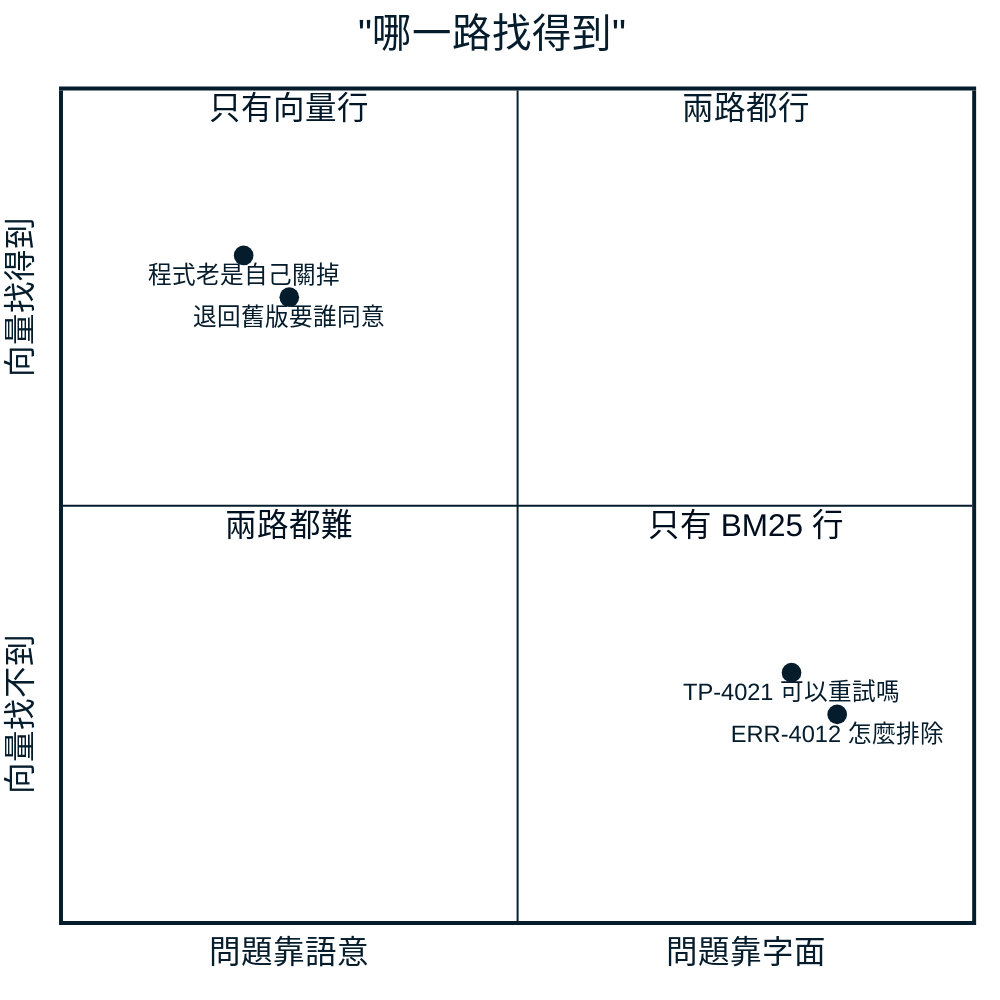

<sub>資料來源：本課整理；改繪自投影片「BM25 與向量的盲區」。點的位置為示意。</sub>

本課的題庫把這個直覺量成了數字。38 題分成 23 題關鍵字題（錯誤碼、指令、設定鍵）與 15 題語意題（口語描述），兩路分開算 Hit@1（第一名是否命中標準文件）：

| 方法（本課實測） | 關鍵字題 Hit@1 | 語意題 Hit@1 | 全部 Hit@1 | 全部 MRR |
|---|---|---|---|---|
| BM25 | 0.91 | 0.67 | 0.82 | 0.87 |
| 向量 | 0.83 | 1.00 | 0.89 | 0.95 |
| 混合 RRF | 0.96 | 0.87 | 0.92 | 0.95 |

<sub>資料來源：本課實測，`modules/module-03-rag/04_hybrid_rrf.ipynb` Step 6；bge-m3 向量、jieba 斷詞＋rank_bm25。</sub>

中文 BM25 有一個必過的關卡：斷詞。BM25 比的是「詞」，英文用空白切就好，中文沒有空白，直接 `split()` 整句會變成一個詞，和問題永遠對不上。本課用 jieba 斷詞，但 jieba 不認得 `TP-4021`，會把它拆成 `TP`、`-`、`4021`，這樣 TP-4012 和 TP-4021 就共用了 `TP` 這個詞。解法是先用正規表達式把英數代碼整段抓出來保留，只把中文部分交給 jieba。斷好之後，IDF 會自然把稀有的代碼抬高：在本課語料裡 `tp-4021` 的 idf 是 3.80，到處都有的「的」只有 0.96。

---

## 5.2 RRF 只看名次不看分數，所以融合不必校準，任一路失效也能退回另一路

兩路各撈一份名單之後，要怎麼合成一份？直覺是把分數相加，但兩路的尺度完全不同：BM25 沒有上界（本課語料約 0～30），cosine 落在 0～1。直接相加就像把沒標準化的特徵相加，大尺度的那一路會壓過另一路。RRF（Reciprocal Rank Fusion，倒數名次融合）乾脆不看分數，只看名次：每一路的第 r 名得 1/(k＋r) 分，各路加總後重新排序。

```
RRF(d) = Σ_每一路  1 / (k + d 在這一路的名次)      k 常見預設 60
```

**圖 5-2　兩份排名依名次合成一份：在兩路都靠前的文件勝出**

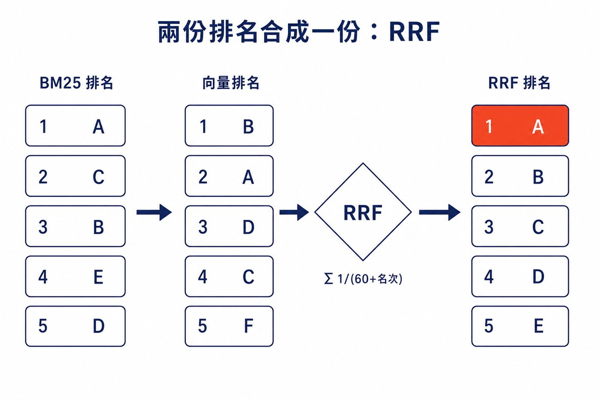

<sub>資料來源：本課模組三 `04_hybrid_rrf.ipynb` 配圖。</sub>

照圖手算一次就懂。A 在 BM25 排第 1、向量排第 2，得 1/61＋1/62 ≈ 0.0325；B 在 BM25 排第 3、向量排第 1，得 1/63＋1/61 ≈ 0.0323；只出現在一路的 F 也有分，但低一截。k 的作用像 label smoothing：k 越大，第 1 名和第 10 名的差距越小，避免單一路的第一名獨斷結果。只看名次也等於先做了 rank normalization。這個常數在各家實作幾乎一致：Elasticsearch 的 `rank_constant`、Chroma Cloud 的 RRF、Milvus 的 RRFRanker 都預設 60，LangChain 舊的 `EnsembleRetriever`（現在在 `langchain_classic`）也是加權 RRF、`c=60`。

RRF 的實作只有 5 行，本課就自己寫；LlamaIndex 的 `QueryFusionRetriever(mode="reciprocal_rerank")` 在 38 題上排出的前 10 名與手寫版完全相同（本課實測，差別只在名次從 0 還是 1 起算）。要注意的是它不保證每題都更好：兩路都排錯時它救不回來。看上一節的表，混合版在語意題輸給純向量（0.87 對 1.00），因為 BM25 那一路的雜訊把正確答案往下推了一點；它換來的是**比較少大翻車**，在關鍵字題與語意題上都不會掉到單一路的最差水準。

這也是本課專案規則的由來：**任何檢索管線都要實作 Dense＋Sparse 並以 RRF 融合的 fallback**。理由有三層。第一是盲區互補：只有向量，錯誤碼、型號、版本號這類查詢會大翻車；只有 BM25，使用者一換說法就找不到。運維類 agent 的查詢恰好兩種都多，一個管線要同時扛。第二是降級（fallback）：兩路是獨立的，embedding 服務逾時、向量索引重建到一半，BM25 那一路照樣回傳結果；反過來，查詢裡沒有任何詞對得上時，BM25 回傳 0 分（不進榜），向量那一路仍然給得出候選。系統在任何一路失效時都只是變差，而不是變空。第三是可維護性：RRF 只吃名次，新增一路（例如 bge-m3 自己就能產出稀疏權重，或者第 6 章的圖檢索）或拿掉一路都不需要重新校準分數尺度，這讓 fallback 成本幾乎為零。

**圖 5-3　兩路各自獨立召回，任一路失效時 RRF 仍能用剩下那一路排出結果**

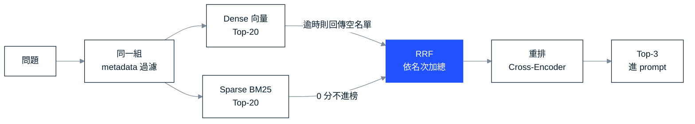

<sub>資料來源：本課整理；依專案 `AGENTS.md` 架構規則與投影片「混合檢索與重排」「Lab 3 架構」繪製。</sub>

圖上有一個容易漏的細節：metadata 過濾要對兩路**都**套用。本課 notebook 用一份「現行文件 chunk id」清單讓兩路都只在現行文件裡找，投影片版的 Lab 則在 Chroma 查詢與建 BM25 索引時套同一個 `version` 條件；如果只過濾一路，封存的舊文件會從另一路溜進融合結果。

---

## 5.3 兩階段檢索：便宜的雙塔撈一把，貴的 cross-encoder 只排那一把

混合檢索負責「撈得到」（召回），排序還不夠準。要排得準，得換一種讓問題和段落「一起讀」的模型。上一章的 embedding 是雙塔（bi-encoder）：問題與段落各自過模型、各出一個向量，最後才比距離，所以文件向量可以事先算好，查詢極快；代價是兩邊在壓成向量之前從未碰面，細節在壓縮時就丟了。Cross-encoder 把問題和段落拼成一個序列，一起過 Transformer，直接輸出一個相關分數；兩邊的每個字都能互相 attend，所以準，但每一對都要重跑一次模型，無法預先計算。

**圖 5-4　差別在問題和段落什麼時候碰面：雙塔最後才比，cross-encoder 一開始就一起讀**

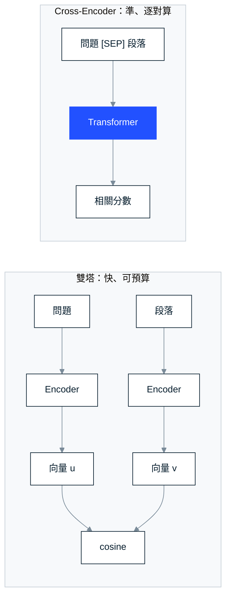

<sub>資料來源：本課整理；改繪自投影片「雙塔與 Cross-Encoder」。</sub>

用深度學習的語言說，雙塔就是 siamese network，共享權重各編一個向量；cross-encoder 則是把兩個輸入 concat 後進同一個網路（early fusion），接一個 sigmoid 輸出的二元分類器。差距有多大？Sentence Transformers 文件的例子是對 1 萬句做分群，cross-encoder 約 65 小時，bi-encoder 約 5 秒；Pinecone 的估算是小型 BERT reranker 對 4,000 萬筆逐一打分要 50 小時以上，向量搜尋則不到 100 毫秒。所以 cross-encoder 只能接在檢索後面，形成兩階段漏斗：先便宜地撈 10–50 段，再只對這一把逐段打分，留下 3–5 段。這跟兩階段物件偵測同一個套路：RPN 大量產生候選框（便宜、求全），再用分類頭精判（貴、求準）。

**圖 5-5　重排會把原本排第五的正確段落拉到第一**

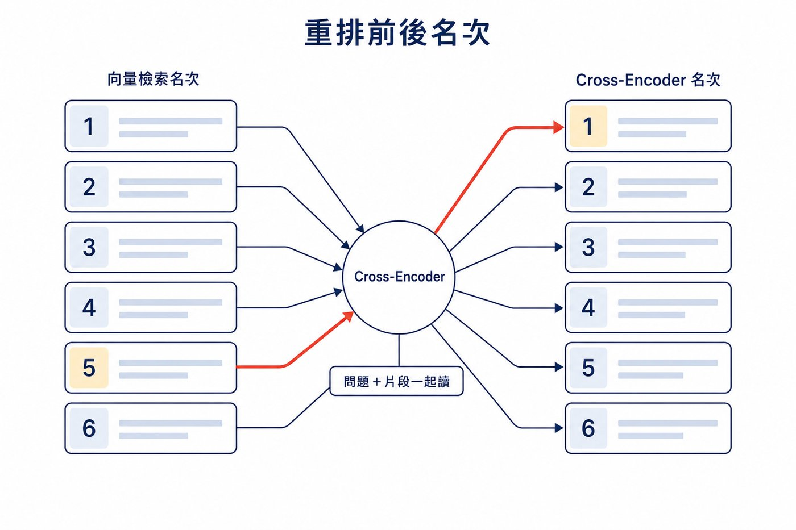

<sub>資料來源：本課模組三 `05_rerank_and_query.ipynb` 配圖。</sub>

回到上一章那組「長得像卻不相關」的例子：cosine 把句型相似、代碼不同的段落排第一（0.770 對 0.642）；同一組交給 cross-encoder，真正的答案得 10.31 分，句型相似的段落只有 4.44 分（本課實測）。拼在一起讀之後，模型看得到 `4021` 與 `4012` 這兩個 token 的差異。放到整份題庫：

| 方法（本課實測） | Hit@1 | Hit@3 | MRR | 秒／題 |
|---|---|---|---|---|
| 向量 | 0.89 | 1.00 | 0.95 | 0.02 |
| 混合 RRF | 0.92 | 0.97 | 0.95 | 0.02 |
| 混合＋重排（20 選前幾名） | 0.97 | 1.00 | 0.99 | 0.09 |

<sub>資料來源：本課實測，`modules/module-03-rag/05_rerank_and_query.ipynb` Step 6；重排模型 `cross-encoder/mmarco-mMiniLMv2-L12-H384-v1`。</sub>

本課 notebook 為了 CPU 可跑，用的是約 470MB 的多語 MiniLM cross-encoder；投影片的 Lab 組合與選型推薦是 `BAAI/bge-reranker-v2-m3`（以 bge-m3 為底、多語、Apache-2.0）。名字要寫完整：`BAAI/bge-reranker` 不是一個實際存在的模型 ID，而同家族的 base、large 只支援中英。重排分數還有第二個用途：設截斷門檻，把明顯無關的段落丟掉，避免「塞太多片段」這個最常見的踩坑：召回太多邊緣相關的片段塞滿上下文，模型的注意力被分散，答案夾雜不相干的內容。

```python
from sentence_transformers import CrossEncoder
reranker = CrossEncoder("BAAI/bge-reranker-v2-m3")
scores = reranker.predict([(q, text[d]) for d in fused])   # fused＝RRF 後的前 20
top3 = [d for _, d in sorted(zip(scores, fused), reverse=True)[:3]]
```

---

## 5.4 搜尋用的單位與餵給模型的單位可以不同

前三節處理的是「怎麼排」；接下來幾招處理的是「排什麼」。它們共享一個觀念：**搜尋用的表示**與**餵給模型的內容**不必是同一段文字。小片段意思集中，比對得準，但單獨看缺上下文；大段落上下文完整，但向量被太多主題稀釋。把兩者拆開，就能各取所長。

**父子片段（parent-child，也叫 small-to-big）**是最直接的做法：只把小片段（約 100–400 token）放進向量庫，命中後沿著對應關係回傳它所屬的父段落（約 1–2k token）給模型；同一個父段落被命中好幾次，只回傳一次。這像偵測模型用小 anchor 精準定位，再裁出較大的 ROI 做後續處理。本課 notebook 把 113 個小節再切成 311 個小塊（一行、一列表格），問 TP-4021 時前兩名裡第一名其實是 TP-4012 那列，小塊一樣分不清長得很像的代碼；但兩列的父節是同一張錯誤碼表，送給 LLM 的是整張表（含表頭），答案就在裡面。LangChain 舊的 `ParentDocumentRetriever` 已移到 `langchain_classic`、官方教學頁下線，所以本課只教模式，實作用一個 dict 記住「子 id → 父 id」就夠。

**圖 5-6　父子片段：用小的找，回傳大的，同一個父段落只回傳一次**

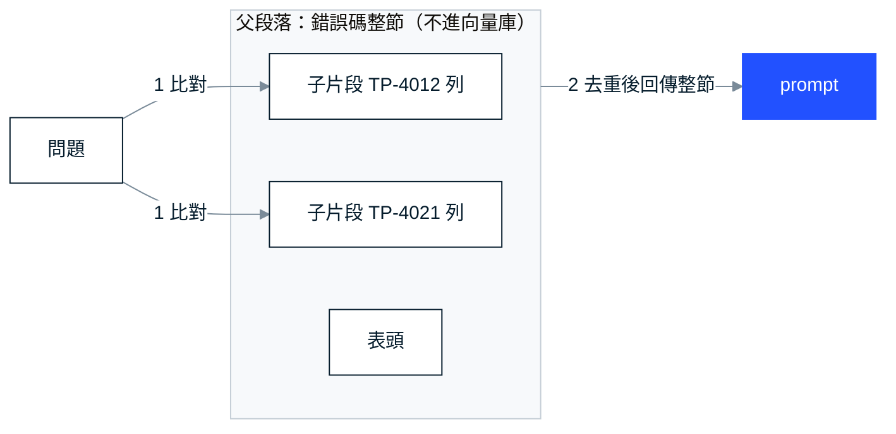

<sub>資料來源：本課整理；改繪自投影片「父子片段：小的找、大的回」與 `05_rerank_and_query.ipynb` Step 9。</sub>

**文件轉問答（document-to-QA）**是另一個方向：使用者的問句，跟另一個問句比，通常比跟說明文字更像。所以離線時讓 LLM 替每個片段寫出幾個可能被問的問題（「ERR-4012 是什麼錯誤？」「憑證要怎麼重新簽發？」），這些問題當作額外的搜尋入口，命中後都指回原片段。這是資料增強的思路：不改模型，替每份資料多造幾個「視角」，讓它更容易被找到。成本是每個片段多一次 LLM 呼叫，但放在離線，只做一次。

**查詢端的處理**則是在線上動問題本身。查詢改寫請 LLM 把口語問題改成幾個術語查詢，各自檢索再用 RRF 合併；HyDE（Hypothetical Document Embeddings）請 LLM 先編一段「假答案」，用假答案去做向量檢索，因為假答案跟真文件長得比較像。兩者都靠 LLM 的知識，而這正是它們的風險：

| 方法（本課實測，15 題語意題） | Hit@1 |
|---|---|
| 向量（原問題） | 1.00 |
| 向量（HyDE） | 0.73 |
| 混合 | 0.87 |
| 混合＋查詢改寫 | 0.87 |

<sub>資料來源：本課實測，`modules/module-03-rag/05_rerank_and_query.ipynb` Step 8；改寫與 HyDE 用本機 `qwen2.5:3b`。</sub>

結果跟教科書說的不一樣：HyDE 讓語意題變差，改寫也沒幫上忙。看假答案就懂了：3B 模型不知道海風科技的系統，編出來的是「優化線程、調資料庫」這種通用說法，反而把檢索帶離了真正的 runbook；而 bge-m3 本來就擅長語意題。這兩招適合「embedding 模型較弱」或「問題很短、很模糊」的情況，而且每次要多呼叫一次 LLM（本課約 1～3 秒）。要不要用，讓題庫決定。

| 方法 | 動哪一端 | 做法 | 什麼時候有用 |
|---|---|---|---|
| 父子片段 | 索引 | 小塊建索引，命中後回傳所屬整節 | 要精準命中又要完整上下文（表格列＋表頭） |
| 文件轉問答 | 索引 | 離線為每段生成可能的問題，一起建索引 | 使用者習慣用問句搜尋 |
| 查詢改寫 | 查詢 | LLM 把口語改成術語，多路檢索再 RRF | 使用者用語和文件用語差很多 |
| HyDE | 查詢 | LLM 先編假答案，用假答案去檢索 | 問題很短、embedding 模型較弱 |

---

## 5.5 補一句背景能讓檢索失敗率降 67%，但那是別人語料上的數字

Contextual retrieval 是 Anthropic 2024 年 9 月提出的做法，問題講得很具體：一個片段寫著「營收比上一季成長」，只看這句不知道是哪家公司、哪一季。解法是在建索引前，用 LLM 讀整份文件加上這個片段，為片段寫 50–100 token 的情境前綴（「這段來自 ACME 公司 Q2 財報的營收一節」），把前綴和片段拼起來，同時送進向量索引和 BM25 索引。

**圖 5-7　每多疊一層，Top-20 檢索失敗率就再降一截**


<sub>資料來源：Anthropic（2024-09-19）〈Introducing Contextual Retrieval〉，依文中數字重繪；四個知識領域（程式碼庫、小說、arXiv 論文、科學論文）平均，重排為先取 150 再排出 20。</sub>

這組數字有兩個值得注意的地方。第一，最大的一跳來自「混合」與「重排」的疊加，跟本章前三節的結構完全一致；補背景是讓每一路的輸入更有辨識度，而不是取代它們。第二，成本是一次性的：文中估算每百萬文件 token 約 1.02 美元，前提是 800 token 的區塊、8k token 的文件，並使用 prompt caching（同一份文件在多次呼叫間共用快取）。這是典型的「離線多花一點」。

但第 4 章已經看過反例：在本課語料上，補標題讓向量檢索的 Hit@1 從 0.89 掉到 0.82，因為同系列文件被補上同樣的標題後更像了。兩個結果並不矛盾。Anthropic 的語料是彼此差異大的領域，補背景是在增加區分度；本課語料是同一家公司幾十份格式相似的內部文件，還刻意放了新舊版本，補背景反而在消除區分度。結論一樣是那句話：數字是在別人的語料上量的，換到你的資料，一定要自己量。

---

## 5.6 PDF 裡沒有段落和表格，解析要放離線批次，用版面模型把結構救回來

前面的切塊都假設文件是乾淨的 Markdown。真實世界的文件多半是 PDF，而 PDF 裡沒有「段落」或「表格」，只有「在某個座標畫某個字」。純文字抽取常見四種壞法：雙欄文字被一橫行一橫行接在一起；表格被攤平成一格一行，欄位關係只剩順序；上標下標消失（`10²⁰` 變成 `1020`）；頁首頁尾、頁碼混進內文。

**圖 5-8　純文字抽取照橫行讀，雙欄與表格的閱讀順序就亂了**

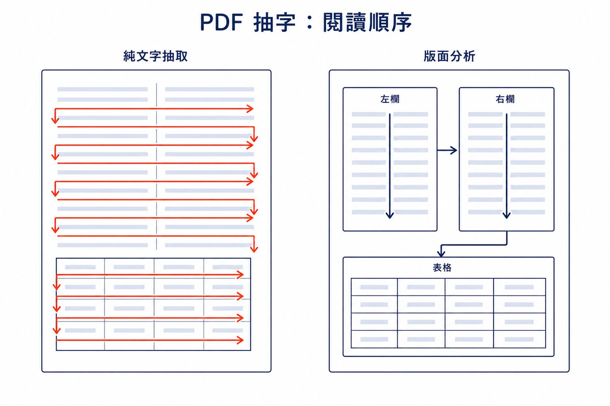

<sub>資料來源：本課模組三 `08_pdf_parsing.ipynb` 配圖。</sub>

表格是最容易出事的地方。一張「錯誤碼｜原因｜處理」的表，直接抽字會變成「錯誤碼 原因 處理 ERR-4012 認證逾時 同步時間 ERR-4021 磁碟已滿 清理空間」，看不出「同步時間」是 ERR-4012 的處理方式。修法是先轉成 Markdown 表格；表格太長要拆開時，每一塊都重複表頭，並加上 `type: table` 這類 metadata，檢索時才能認出它是表格並找回原頁。這其實就是父子片段的另一種形態：表格列是子、表頭加整表是父。

解析工具分輕重兩級。輕量級直接讀 PDF 物件的文字座標，例如 PyMuPDF 用 `clip` 分欄讀、`find_tables().to_markdown()` 轉表格；重型解析器則是一條模型管線：版面分析 → 區塊分類（標題、段落、表格、公式、圖片）→ 表格轉 HTML 或 Markdown、公式轉 LaTeX、圖片另存 → 依閱讀順序輸出。代價是數 GB 模型、最好有 GPU、每頁數秒。不論哪一種，解析都放離線批次，不放在問答路徑上。

| 工具 | 怎麼做 | 什麼時候選它 | 授權／狀態 |
|---|---|---|---|
| PyMuPDF（本課用） | 讀文字座標；`find_tables()` 轉 Markdown | 單欄、少量格線表格；不想下載模型 | AGPL-3.0，另售商業授權 |
| Docling | 版面模型：閱讀順序、表格、公式、OCR | 表格多、掃描檔；要寬鬆授權 | MIT；LF AI & Data 託管 |
| MinerU | 版面分析＋表格轉 HTML＋公式轉 LaTeX | 中文、論文、財報等表格公式密集的 PDF | Apache 2.0 加條件；進階引擎要 GPU |
| olmOCR | 7B 視覺語言模型讀頁面圖片 | 有 GPU、大量掃描檔批次轉文字 | Apache-2.0；顯存 ≥ 12 GB |

再往前一步就是多模態 RAG。文件裡的表格、圖片、公式本身就是資訊，純文字 RAG 會在三處壞：解析時丟掉圖裡的數字、切塊時拆散表格、問題的答案在長條圖裡卻檢索不到。多模態 RAG 的共同第一步是把非文字區塊找出來，再各自轉成可索引的形式。

**圖 5-9　多模態 RAG 的第一步是拆區塊：每種區塊各走各的路，最後都變成可檢索的文字**

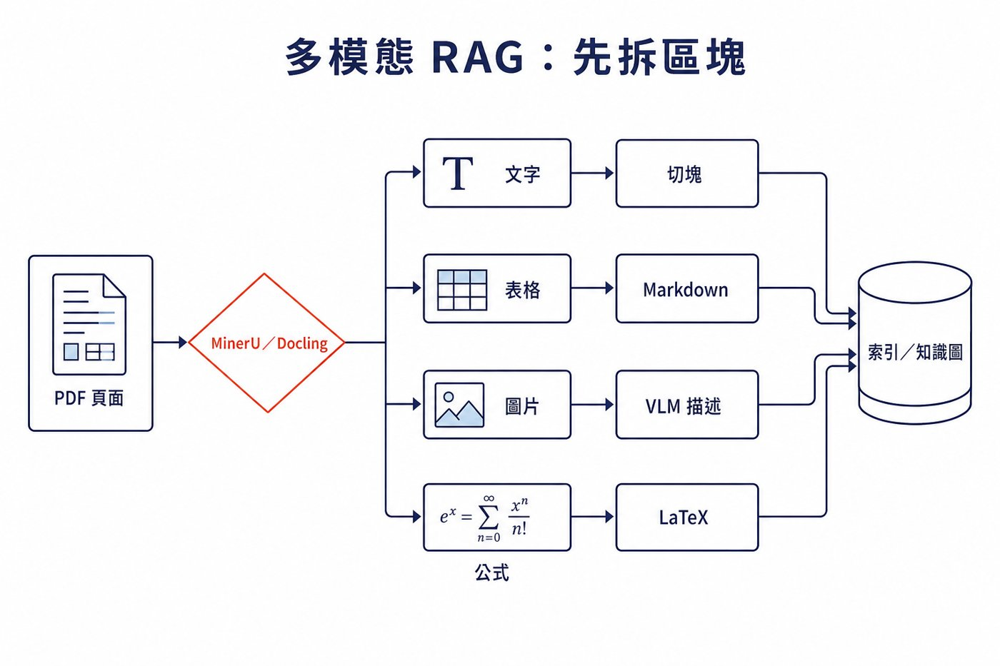

<sub>資料來源：本課模組三 `00_concepts.md` 第 9 節配圖。</sub>

RAG-Anything（香港大學 HKUDS，MIT 授權）是把這條路做完整的開源框架：解析預設用 MinerU，圖片交給視覺語言模型寫描述，表格與公式各有處理器，再建在 LightRAG 上組成多模態知識圖，檢索時同時用向量與圖。本課只做選型、不實作，理由很務實：解析器需要 GPU 與數 GB 模型，屬於維運重負擔；它的零件本課都已拆開教過（版面區塊、混合檢索與重排、第 6 章的知識圖譜）；本課語料是 Markdown，用不到它的長處。該考慮它的時機是：文件以 PDF 為主、圖表承載關鍵數字、問題需要「看圖加讀文」一起推理，而且團隊有 GPU 跑離線解析批次。

---

## 5.7 檢索後先自評，不夠就重查：固定流水線開始長出迴圈

到目前為止，RAG 都是一條固定流水線：檢索完就生成，不管撈回來的東西好不好。Self-RAG 與 CRAG（Corrective RAG）在中間加了一個評分節點：撈回來的片段先評分，夠用才生成，不夠就改寫問題重查，或者乾脆上網搜尋。

**圖 5-10　Self-RAG 讓模型自己決定要不要撈，撈回來還要逐篇批改**

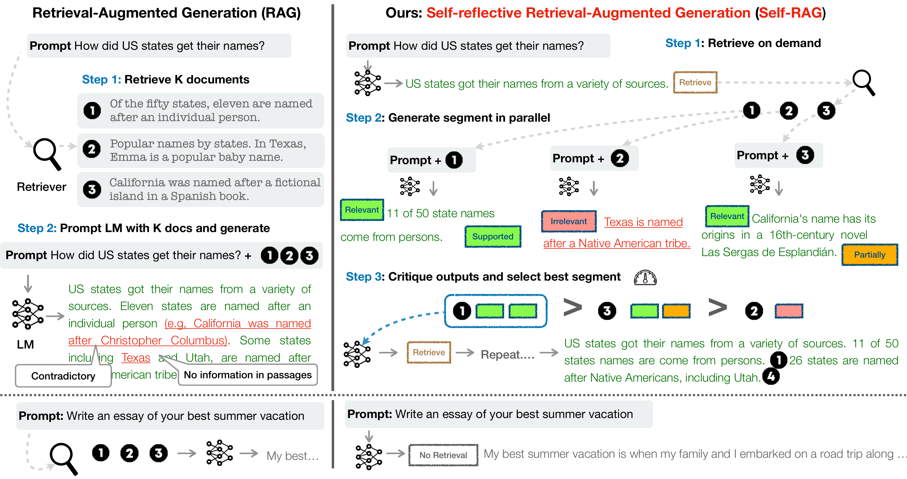

<sub>資料來源：Asai et al.（2023）〈Self-RAG: Learning to Retrieve, Generate, and Critique through Self-Reflection〉Fig. 1，arXiv:2310.11511，CC BY 4.0。</sub>

兩篇論文的做法不同。Self-RAG 把評估直接訓練進模型的輸出詞表：多加幾類特殊的 reflection token，包括 Retrieve（要不要查）、ISREL（文件相關嗎）、ISSUP（答案有被文件支持嗎）、ISUSE（有用程度），等於在 softmax 上多開幾個類別。CRAG 則外掛一個輕量的檢索評估器，給出信心分數後分三條路：正確就精煉內部文件，不正確就丟棄並改寫問題上網搜尋，模糊就兩者並用。這個三分類取代二分類，就是在分類器的決策門檻附近多留一個「不確定」區間。

效果的量級可以從論文數字看出來。在 PubHealth 這種容易被雜訊文件帶偏的任務上，Llama2 7B 加上檢索只有 30.0% 準確率，比不檢索的 34.2% 還低；Self-RAG 7B 拉到 72.4%。CRAG 是外掛式的補強，掛在一般 RAG 或 Self-RAG 上都有加分（以上依 Asai et al. Table 2、Yan et al. Table 1）。

工程上很少有人真的去訓練 reflection token，更常見的是把評分做成一個獨立的節點加條件分支。評分節點就是一個小分類器（相關／不相關），回圈像訓練迴圈裡 early stopping 的判斷。這張圖在第 7 章會以 LangGraph 狀態圖的形式再出現一次。

**圖 5-11　工程版的自評 RAG：評分節點決定往右生成、往上改寫重查，或往下上網搜尋**

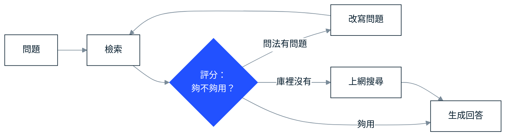

<sub>資料來源：本課整理；改繪自投影片「Self-RAG 與 CRAG：檢索後自評」。</sub>

這一步把 RAG 從「函式」推向「迴圈」。迴圈帶來彈性，也帶來新的工程問題：要設最多重查幾次、每次多花多少 token 與延遲、評分節點本身錯判怎麼辦。這些正是第三部 agent 要正面處理的問題；在這裡只要記住，自評迴圈是有成本的選配，不是預設。

---

## 5.8 沒有題庫，每個「優化」都只是感覺；評估要把檢索與生成拆開量

本章引用了一連串實測數字，它們都來自同一份 38 題題庫：每題有問題、標準答案、應該命中的文件 id，以及「靠關鍵字」或「靠語意」的標記。有了它，「感覺比較好」才能變成數字。題庫是評估的地基，題目要像真實使用者會問的，標準答案要有人確認過。

**圖 5-12　同一份題庫跑過管線，分檢索與生成兩條線評估**

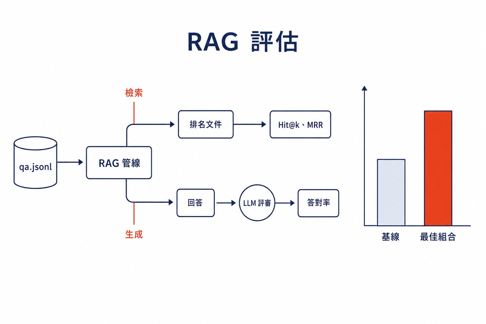

<sub>資料來源：本課模組三 `06_rag_eval.ipynb` 配圖。</sub>

檢索指標在有標註時很直接。Hit@k 問「前 k 名有沒有命中標準文件」，命中得 1、沒中得 0，取平均；MRR（Mean Reciprocal Rank）是第一個命中名次的倒數取平均，第 1 名命中得 1、第 2 名得 0.5。它們是確定的：同樣輸入、同樣結果。生成指標則一定有雜訊：規則版從標準答案抽出代碼、數字、指令，看回答包含幾成，確定、免費、可重現，但看不懂「不可重試」這種結論；LLM 評審看得懂語意，但本身也會錯。Ragas 等套件的 context precision／recall 是在**沒有**標準文件時用 LLM 猜相關性，有標註時 Hit@k 與 MRR 更直接。

| 指標（本課實測） | 基線 | 最佳組合 |
|---|---|---|
| Hit@1 | 0.89 | 0.97 |
| Hit@3 | 1.00 | 1.00 |
| MRR | 0.94 | 0.99 |
| 答對率（規則） | 0.63 | 0.79 |
| 答對率（LLM 評審） | 0.84 | 0.74 |

<sub>資料來源：本課實測，`modules/module-03-rag/06_rag_eval.ipynb` Step 10。基線＝固定 128 token、純向量、不過濾、不重排；最佳組合＝依標題＋補標題、BM25＋向量 RRF、排除封存文件、cross-encoder 20 選 3；兩者都取前 3 塊、生成與評審皆為 `qwen2.5:3b`。</sub>

這張表最值得看的是最後一列：LLM 評審的答對率跟檢索指標反方向走。規則與 LLM 評審的一致率只有 74%，把不一致的題目拿出來人工看，會發現兩邊各有誤判：3B 評審常把幾乎逐字照抄文件的正確答案判錯。這是小模型當評審的真實狀況；正式專案要用更強的模型當評審、固定評審 prompt、並定期抽樣人工複查，第 11 章會專門處理。

拆開量的真正目的是**錯誤歸因**。每題同時看兩件事：前 k 名有沒有命中、答對沒有。命中卻答錯是生成的錯，該換模型或改 prompt；沒命中是檢索的錯，先修檢索；沒命中卻答對要小心，模型可能是靠自己的知識猜中的。本課最佳組合在 38 題裡仍有 8 題屬於「資料給了、模型沒用好」（基線是 14 題），這時候再調檢索已經沒用，換更大的模型才有效。

**圖 5-13　錯誤歸因的四格：先判斷錯在哪一段，再決定修哪裡**

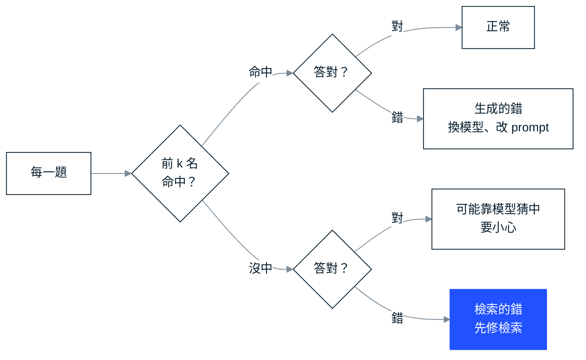

<sub>資料來源：本課整理；依 `modules/module-03-rag/06_rag_eval.ipynb` Step 9。</sub>

最後一個習慣：不要只看平均分數。改了一個設定之後總分差不多，可能是幾題變好、幾題大翻車互相抵銷；逐題列出翻盤的題目，才看得出那一招到底在哪種題目上有效。

---

## 5.9 框架不是必需品：先用零件拼出能除錯的管線，再決定要不要包進框架

把本章所有零件串起來，就是本課 Lab 3 的完整架構：離線把文件依標題切片、補標題，同一批片段存兩份，向量進 Chroma、字面進 BM25；在線兩路各撈 20 名、套同一個過濾條件，RRF 融合後交給 cross-encoder 重排，前 3 段拼進 prompt。因為本地 Chroma 沒有內建混合檢索，BM25 與 RRF 都是自己寫的，總共也只有幾十行。

**圖 5-14　零件拼裝版與 LlamaIndex 一一對應，差別在可控程度**

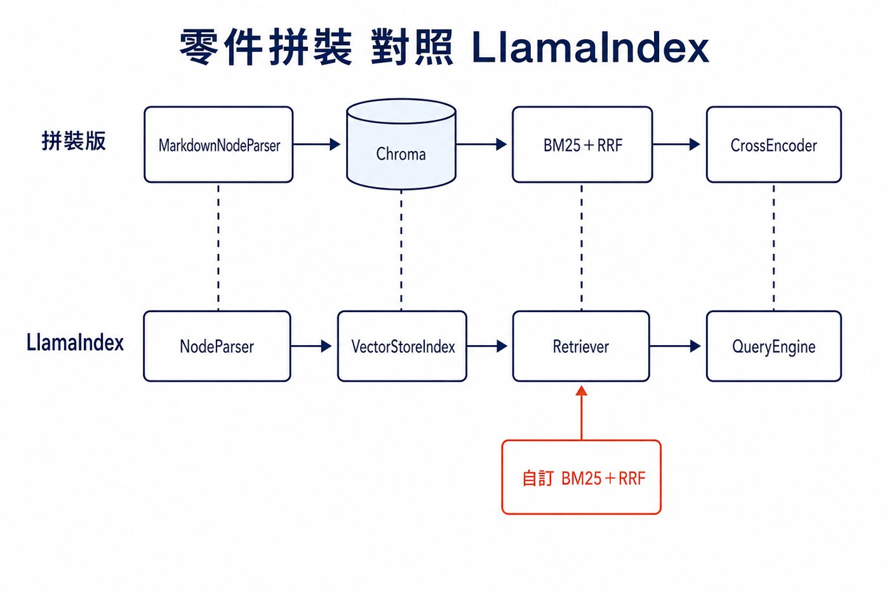

<sub>資料來源：本課模組三 `07_llamaindex.ipynb` 配圖。</sub>

框架負責把「切分 → 入庫 → 檢索 → 組提示詞」串起來，差別在重心放在哪裡。LlamaIndex 把整條 RAG 包成 Document、Node、VectorStoreIndex、QueryEngine 四個物件，擴充點是自訂 `BaseRetriever`、`QueryFusionRetriever`（RRF）與 node postprocessor（重排）；它內建的 metadata 會跟著文字一起 embed，這本身就是一種補上下文。它也有要注意的預設值：預設切塊器 `SentenceSplitter` 不會依標題切、預設 prompt 是英文、預設 LLM 會去找 OpenAI。本課實測兩種做法在同一份題庫上的檢索分數相近。

| 名稱 | 定位 | 什麼時候選它 | 授權／狀態（2026-11） |
|---|---|---|---|
| LangChain（本課主線） | 整合生態＋Agent 外殼 | 要大量整合，之後還要接 LangGraph | MIT；`langchain` 1.5.0，舊 retriever 移到 `langchain_classic` |
| LlamaIndex | 以資料與索引為中心 | 重點在文件解析、切分、索引策略 | MIT；v0.14.26，公司重心已轉向 LlamaParse |
| Haystack | 元件化、可控的生產管線 | 要型別清楚、好測試的 pipeline | Apache-2.0；已進 3.x |
| RAGFlow | 開箱即用的 RAG 平台 | 不寫程式，要 Web UI 與深度文件解析 | Apache-2.0；v1.0.0，Docker 部署，吃記憶體 |

選擇原則很單純：要快速做出可用版本、要接多種資料來源，用框架；要客製每一步、要除錯、要把檢索包成 agent 的工具，用零件拼裝。第三部的 agent 會把本章的檢索管線當成一個工具呼叫，到那時候你會希望每一步都看得見、改得動。

上線前最常見的四個坑，都是本章某一節的反面：

| 症狀 | 原因 | 修法 |
|---|---|---|
| 答案夾雜不相干的內容，甚至一本正經亂編 | 召回太多邊緣相關片段，塞滿上下文 | 限制 Top-N（3–5 段），重排分數設截斷門檻 |
| 用中文問英文文件，撈不到 | 單語 embedding 把不同語言放在不同角落 | 改用多語模型，如 bge-m3、text-embedding-3；重排用 bge-reranker-v2-m3 |
| 中文問中文，關鍵詞那一路幾乎撈不到 | 中文沒有空格，`split()` 後整句是一個詞 | 先斷詞（jieba 或相鄰兩字），代碼整段保留；0 分不入榜 |
| 片段裡沒有標題，查不出屬於哪一章 | `strip_headers` 預設 True | 設成 False，或把標題拼回內文再 embed |

---

## 本章重點

BM25 與向量檢索的盲區互補，正式管線一律兩路並行、用 RRF 依名次融合；RRF 不需要校準分數，任一路失效時另一路仍能撐住，這是專案規則把 Dense＋Sparse＋RRF 定為必備 fallback 的原因。Cross-encoder 讓問題與段落一起讀，準但無法預算，所以只放在召回之後，形成「粗篩 10–50、精排 3–5」的漏斗。父子片段、文件轉問答、表格轉 Markdown 都是把「搜尋的單位」與「餵給模型的單位」分開；查詢改寫與 HyDE 依賴 LLM 的知識，小模型不懂你的系統時會把檢索帶偏。所有技巧的效果都要用有標註的題庫量，並把錯誤歸因到檢索或生成，才知道下一步修哪裡。

## 對應實作與延伸閱讀

- [Lab 3-04 混合檢索與 RRF](../../modules/module-03-rag/04_hybrid_rrf.ipynb)：jieba＋rank_bm25、手寫 RRF、`QueryFusionRetriever` 對答案。
- [Lab 3-05 重排與查詢處理](../../modules/module-03-rag/05_rerank_and_query.ipynb)：cross-encoder、名次變化、查詢改寫、HyDE、small-to-big。
- [Lab 3-06 評估（Lab 3）](../../modules/module-03-rag/06_rag_eval.ipynb)：Hit@k、MRR、規則與 LLM 評審、錯誤歸因。
- [Lab 3-07 LlamaIndex](../../modules/module-03-rag/07_llamaindex.ipynb)：用框架重組整條管線，對照拼裝版。
- [Lab 3-08 PDF 解析（選讀）](../../modules/module-03-rag/08_pdf_parsing.ipynb)：雙欄交錯、表格攤平、區塊偵測。
- [模組三原理紀要](../../modules/module-03-rag/00_concepts.md) 第 4–10 節。
- 投影片：[deck.pdf](../slides/deck/deck.pdf) 模組三「BM25 與向量的盲區」到「面試：RAG 檢索」。
- Asai et al.（2023）〈Self-RAG〉，arXiv:2310.11511；Yan et al.（2024）〈Corrective Retrieval Augmented Generation〉，arXiv:2401.15884。
- Anthropic（2024-09-19）〈Introducing Contextual Retrieval〉。
