# 第 6 章　知識圖譜與 GraphRAG：從「找像的」走到「找連的」

**本章結論**：向量檢索只會找「長得像問題」的片段，所以有兩種題它天生答不好：要串好幾個事實的多跳題，和要看完整份語料的全貌題。知識圖譜把文字裡「誰跟誰有什麼關係」抽出來存成節點與有型別的邊，問問題時沿著邊走，中間那幾段長得像不像問題就不重要了。代價全部落在建圖：要先定 schema、讓 LLM 抽三元組、做實體消歧，而圖只知道你設計它知道的事。「GraphRAG」這個詞底下其實有兩派：Microsoft GraphRAG 預先寫好社群報告、查詢時讀報告；Neo4j 系用 Cypher 沿關係走。本課 Lab 走後者，兩派都以模組三的向量檢索當入口。

---

## 6.1 向量 RAG 答不好兩種題：多跳關係與全局總結

第 4、5 章的 RAG 很擅長「答案就寫在某一段裡」的問題。它的根本假設是片段彼此獨立，像 i.i.d. 的樣本：每個 chunk 各自 embedding，檢索就是對問題做 k-NN，找最近的幾個點。這個假設在兩種題上會失效。

第一種是**多跳題**。「騙人布的父親所在海賊團的船長是誰？」答案要串三段：騙人布的父親是耶穌布、耶穌布在紅髮海賊團、紅髮海賊團的船長是香克斯。最後那段完全沒提到騙人布，跟問題「不像」，排不進前幾名。本課 notebook 實際看過：向量檢索撈到的多半是騙人布和耶穌布的小段，講香克斯是船長的那幾塊談的是斷臂、草帽和四皇，跟「騙人布、父親」不像。第二種是**全貌題**。「故事裡有哪幾股主要勢力？」答案不在任何一段裡，它更像要對整份資料先分群、再摘要；你做過 k-means 就知道，這不是「找最近的點」能回答的。

**圖 6-1　向量檢索比相似度，圖檢索沿著關係走：中間的段落不必長得像問題**

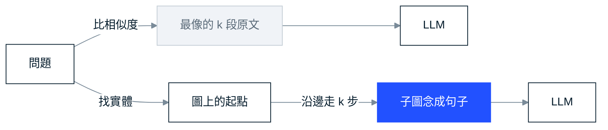

<sub>資料來源：本課整理；改繪自模組四 `00_concepts.md` 第 1 節與投影片「向量 RAG 答不了的兩種題」。</sub>

本課用 14 題（4 題單跳、10 題多跳）同時考向量檢索與圖檢索，先只問最基本的問題：給 LLM 的上下文裡到底有沒有答案？

| 題型（本課實測） | 向量檢索命中 | 圖檢索命中 |
|---|---|---|
| 單跳（4 題） | 4 | 3 |
| 多跳（10 題） | 3 | 10 |

<sub>資料來源：本課實測，`modules/module-04-graphrag/04_graph_vs_vector.ipynb` Step 4；向量為 bge-m3＋Chroma 取前 5 塊，圖為找實體＋剪枝走訪 4 步。</sub>

向量檢索的漏網幾乎都在多跳題，原因就是「鏈條後半段不像問題」。圖檢索唯一沒撈到的是單跳題「娜美在船上負責什麼工作」：本課的 schema 根本沒有「職位」這種關係，抽三元組時就丟掉了。這兩個 X 已經預告了本章的結論：兩者互補，而圖的盲區是 schema 之外的一切。

---

## 6.2 知識圖譜是「節點＋有型別的邊＋屬性」，每條邊讀起來就是一句話

知識圖譜（knowledge graph）把「誰和誰有什麼關係」記成點和線。你其實見過它：搜尋一位名人時旁邊跳出的資訊卡（配偶、作品、出生地）、社群網站的「你可能認識的人」、追劇時自己畫的人物關係圖。它由三種元素組成。實體（entity）是節點，圖裡的一個「東西」：一個人、一個海賊團、一件寶物，並帶一個類型標籤（label），例如 `Person`。關係（relationship）是有方向、有型別的邊，`(魯夫)-[:CAPTAIN_OF]->(草帽海賊團)` 讀成「魯夫是草帽海賊團的船長」。屬性（property）是掛在節點或邊上的鍵值對，例如 `name: "魯夫"`。

**圖 6-2　一小塊圖譜：從魯夫出發，走一步是他的船與寶物，走兩步就串到「夥伴的夥伴」**

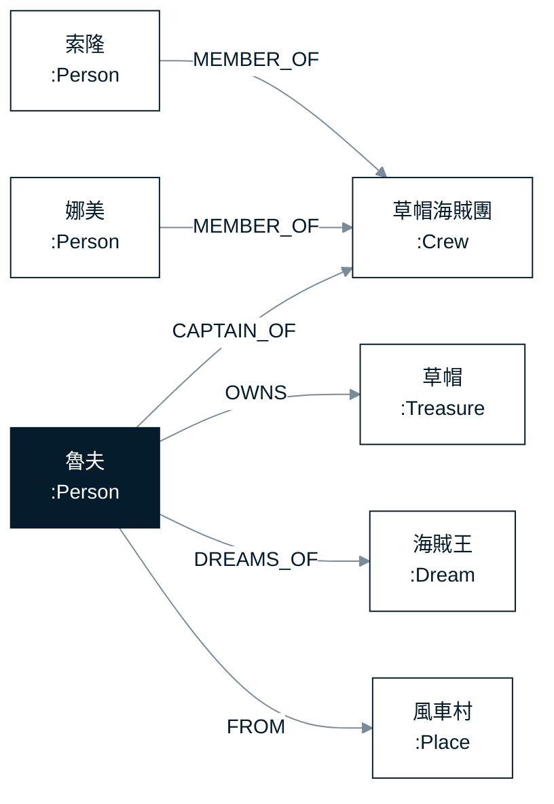

<sub>資料來源：本課整理；節點與關係取自本課圖譜 schema（`modules/module-04-graphrag/data/triples.json`）。</sub>

用深度學習的語言看，節點類型像類別標籤，但可以多標籤；屬性像特徵向量；邊的方向對應有向圖鄰接矩陣的不對稱。這套表示法接近 GNN 裡「node features＋edge features」的屬性圖。

圖的資料模型有兩大派。**LPG（Labeled Property Graph，標籤屬性圖）**允許節點與邊都掛屬性，圖遍歷好寫，Neo4j 就是這一型。**RDF（Resource Description Framework）**把一切攤平成（主詞, 謂詞, 受詞）三元組，用 URI 全域識別，是 W3C 標準，強項在推理與跨組織資料交換。差別在一個具體問題上最清楚：要記下「索隆加入草帽海賊團的時間」。LPG 一條邊就夠，時間是這條邊自己的屬性 `{since: …}`；RDF 1.1 要記「關係的屬性」得額外建模（例如多造一個「加入事件」節點），一件事拆成好幾條三元組。RDF 1.2 引入 triple terms 補上這一點，但截至 2026-09 仍是 Working Draft。

| | LPG（Neo4j） | RDF |
|---|---|---|
| 基本單位 | 節點、邊，兩者都能帶屬性 | （主詞, 謂詞, 受詞）三元組 |
| 關係上的屬性 | 直接掛在邊上 | RDF 1.1 需額外建模，1.2 草案在補 |
| 識別 | 資料庫內部 id 加屬性 | URI 全域識別 |
| 強項 | 遍歷查詢好寫、工程生態成熟 | 標準化、推理、跨組織交換 |
| 類比 | 物件：欄位跟著節點和邊走 | 三欄長表格 |

本課只用 LPG。對做 RAG 的工程師來說，「邊上能掛屬性的屬性圖」加上下一節的 Cypher，已經足夠處理絕大多數場景。

---

## 6.3 用 LLM 建圖的第一步是定 schema，把開放式生成變成固定類別的分類

要從文字建圖，最小的單位是一條三元組（triple）：(主體, 關係, 客體)，例如 `(騙人布, HAS_FATHER, 耶穌布)`。流程看起來很直接：每段文字交給 LLM 抽一次，抽完寫進圖。真正的關鍵在抽之前：要先定 schema，也就是允許哪些節點類型、哪些關係、方向怎麼走。

為什麼一定要 schema？不給規格的話，模型這段寫「是船長」，那段寫「擔任」「帶領」，圖裡每種寫法都是一種不同的邊，查詢時根本對不起來。本課的圖譜只允許 5 種節點、8 種關係：

```
(:Person)-[:CAPTAIN_OF | MEMBER_OF]->(:Crew)
(:Person)-[:OWNS]->(:Treasure)
(:Person)-[:DREAMS_OF]->(:Dream)
(:Person)-[:FROM]->(:Place)
(:Person)-[:HAS_FATHER | BROTHER_OF | DEFEATED]->(:Person)
```

用 Pydantic 把關係寫成 `Literal[...]`，交給模型做受限輸出（第 2 章的結構化輸出），等於把「開放式生成」變成「從固定類別裡挑」。這跟把 open-vocabulary 偵測改成固定類別偵測是同一個道理：約束輸出空間，錯誤就變少。

**圖 6-3　LLM 抽三元組的管線：規格限制格式，驗證與別名表把關內容**

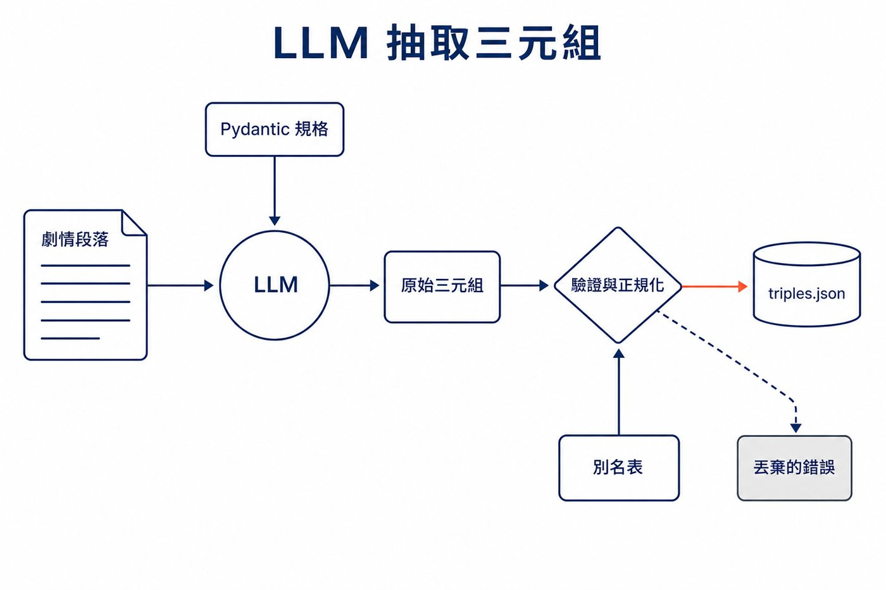

<sub>資料來源：本課模組四 `00_concepts.md` 第 2 節配圖。</sub>

但受限輸出只保證**格式**對，不保證**內容**對。方向反、關係標錯、客體根本不是實體，照樣會發生。所以要拿人工標註的標準答案量 precision（模型抽出來的，有幾成是對的）與 recall（該抽的，模型抽到了幾成）。本課的數字很能說明問題：在 7 段子集、49 條標準三元組上，本機 3B 模型的原始輸出 precision 26%、recall 22%；做完別名正規化後提升到 33%、29%（本課實測，`01_extract_triples.ipynb`）。正規化只動名字，不會讓錯的關係變對，所以提升有上限；剩下的錯要靠更好的模型、更細的 prompt，或人工校對。後續 notebook 用的是人工校對過的全量圖譜：187 個節點、182 條邊。

Schema 還有一個不明顯的代價：**關係標籤會壓縮語意**。本課只有 8 種關係，很多細節只能塞進最接近的那一種：波妮與大熊其實是養父女，仍記成 `HAS_FATHER`；東利、布洛基是巨兵海賊團的前代船長，也記成 `CAPTAIN_OF`。圖上看不出「養父」「前代」的差別，問到就會答錯。本課實測就有一題因此兩邊都錯：圖的檢索明明命中，`BROTHER_OF` 卻被念成「是…的結拜哥哥」，而那兩人其實是同父異母的兄弟。Schema 太少會失去細節，太多又讓模型難抽、人難標，要依你預期的問題取捨。

工具方面，LangChain 的 `LLMGraphTransformer` 可以直接把文件轉成圖，限定 `allowed_nodes`、`allowed_relationships`；它要從 `langchain_neo4j` 匯入（`langchain-neo4j` 0.11.0），舊的 `langchain_experimental` 路徑所在套件已在 sunset。Neo4j 官方的 `neo4j-graphrag`（1.24.0）則提供整條建圖管線 `SimpleKGPipeline`（仍標 experimental）：載入 → 切分 → chunk embedding → schema → LLM 抽取 → 寫入 → 實體消歧。

```python
from langchain_neo4j import LLMGraphTransformer   # 新路徑
transformer = LLMGraphTransformer(
    llm=llm,
    allowed_nodes=["Person", "Crew", "Treasure", "Dream", "Place"],
    allowed_relationships=["CAPTAIN_OF", "MEMBER_OF", "OWNS", "DREAMS_OF",
                           "FROM", "HAS_FATHER", "BROTHER_OF", "DEFEATED"],
)
graph_docs = transformer.convert_to_graph_documents(docs)
```

---

## 6.4 實體消歧決定圖會不會裂成孤島，而「名字像」不代表是同一個東西

同一個人在不同段落有不同叫法：「魯夫」「蒙其·D·魯夫」「草帽小子」。LLM 逐段抽取，不知道這是同一個人；不合併的話，圖會裂成好幾座孤島，多跳查詢走到一半就斷了。把同一個東西的不同叫法合併成一個節點，叫實體消歧（entity resolution）或實體正規化。

常見的流程跟第 5 章的兩階段檢索是同一個心智模型：便宜地找候選，再用貴的判斷器確認。先用 embedding 近鄰或字串規則找出疑似別名（粗召回），再用編輯距離過濾，最後交給人或 LLM 裁決（精排），寫進別名表後合併。Tomaž Bratanič 在 Neo4j 上的公開做法是：名稱加描述的 embedding 建 k-NN 圖（topK 10、相似度 ≥ 0.95）→ 弱連通分量分組 → 編輯距離 < 3 過濾 → LLM 判斷是否同一實體 → 合併節點。`neo4j-graphrag` 也內建三種消歧器：同名精確合併、spaCy embedding 相似度、RapidFuzz 編輯距離。

**圖 6-4　實體消歧是一個「粗找候選、精細裁決」的漏斗，最後一關由人拍板**


<sub>資料來源：本課整理；依素材地圖 M4 論點 4（Bratanič 2024、neo4j-graphrag 文件）與投影片「踩坑：別名、成本、語法」。</sub>

最重要的一點是：**名字像不代表是同一個東西**。本課語料刻意埋了幾個陷阱，自動規則「互相包含就合併」會把前三個全部合錯：

| 候選 | 該不該合併 | 原因 |
|---|---|---|
| 「人人果實」↔「人人果實．幻獸種．模型『尼卡』」 | 不該 | 一個是喬巴的果實，一個是魯夫的果實 |
| 「巨兵海賊團」↔「新巨兵海賊團」 | 不該 | 前者是東利、布洛基的老海賊團，後者是海爾丁重組的 |
| 「草帽」↔「草帽海賊團」 | 不該 | 一個是帽子，一個是海賊團 |
| 艾斯、薩波都「擁有燒燒果實」 | 兩條邊指向同一個節點 | 果實在艾斯死後重新出現，被薩波吃下 |
| 「羅傑」↔「哥爾·D·羅傑」 | 該 | 同一個人的簡稱與全名 |

所以候選可以自動找，合併要人拍板。評分時也一樣：「客體互相包含就算對」會把「魯夫擁有人人果實」判成對的。還有一招便宜的檢查：每種關係的客體類型是固定的，可以反推每個名字「應該」是什麼類型，同一個名字被推成兩種類型（本課實測抓到「艾爾巴夫」同時被推成 Person 與 Place），就代表某條邊一定錯了。這些衝突是給人看的警示燈，不是自動判決。

---

## 6.5 圖檢索就是找起點、做 BFS、把子圖念成句子，而且一定要有展開規則

建好圖之後，檢索分三步，而模型只在最後出場一次，中間「找誰、走哪」都是確定的程式，可以重跑、可以除錯。

**圖 6-5　圖檢索：先在問題裡找實體，再沿著邊走多跳，把子圖轉成文字交給 LLM**

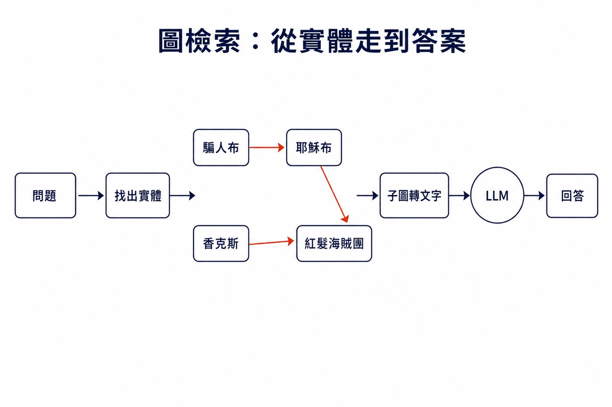

<sub>資料來源：本課模組四 `00_concepts.md` 第 4 節配圖。</sub>

第一步是**找起點（entity linking）**：問題裡出現了哪個節點的名字或別名。小圖用字串比對就夠；大圖會用向量比對實體描述，這就是 6.8 節 Local Search 的做法。要小心短名字被長名字蓋住：問「白鬍子海賊團」時，「白鬍子」不算起點。第二步是**沿著邊走（多跳）**：從起點一圈一圈往外，這就是廣度優先搜尋（BFS），走 1 步叫一跳、走 k 步叫 k 跳；networkx 的 `ego_graph`、`bfs_layers`、`shortest_path` 都是現成的。第三步是**子圖念成句子**：`(騙人布, HAS_FATHER, 耶穌布)` 寫成「騙人布的父親是耶穌布」，小模型讀句子比讀符號準。

這裡有一個一定會撞到的坑：**超級節點（hub）**。有些節點連著一大堆邊，「草帽海賊團」連著十幾個船員。BFS 一碰到它，下一步就把所有成員、再下一步把所有成員的果實、夢想、故鄉都拉進來，子圖很快接近整張圖。塞整張圖給 LLM，等於回到「把全部文件塞進 prompt」：貴、慢，小模型還會被無關的事實干擾。

| 從「騙人布」往外走（本課實測） | 每一層新增的節點數 |
|---|---|
| 全部展開 | 1、6、13、55 |
| 走到海賊團只往船長走 | 1、6、5、21 |

<sub>資料來源：本課實測，`modules/module-04-graphrag/02_graph_networkx.ipynb` Step 7；整張圖 187 個節點、182 條邊。不加限制時走 4 步就碰到 111 個節點。</sub>

所以一定要有**展開規則**。本課用的規則是「走到海賊團，只往它的船長走」；其他常見做法包括限制每個節點最多展開幾條邊、只走特定關係、依相關性排序後截斷。這跟第 5 章「只讓 3–5 段進 prompt」是同一個原則：上下文的品質比數量重要。

---

## 6.6 Cypher 把要找的形狀畫出來；讓 LLM 寫 Cypher 要守住唯讀與錯誤回饋

networkx 適合小圖與理解，資料一大（幾百萬節點）、多人同時查詢，就需要圖資料庫。Neo4j 的查詢語言 Cypher 用 ASCII 畫圖的方式寫查詢：圓括號是節點，方括號加箭頭是關係。它描述的是「要找的子圖形狀」，像拿一個固定的 kernel 在圖上做樣式比對，只是比對的是結構，不是像素。

```cypher
MATCH (p:Person {name: '騙人布'})-[:HAS_FATHER]->(f)-[:MEMBER_OF]->(c:Crew)<-[:CAPTAIN_OF]-(cap)
RETURN cap.name
```

這一行就是「騙人布的父親所在海賊團的船長」整個三跳問題。寫入時一律用 `MERGE`（有就用、沒有才建），不用 `CREATE`，重跑匯入也不會生出重複節點。

**圖 6-6　Neo4j 的兩條路：三元組用 MERGE 匯入，LLM 寫的 Cypher 先過唯讀檢查才能執行**

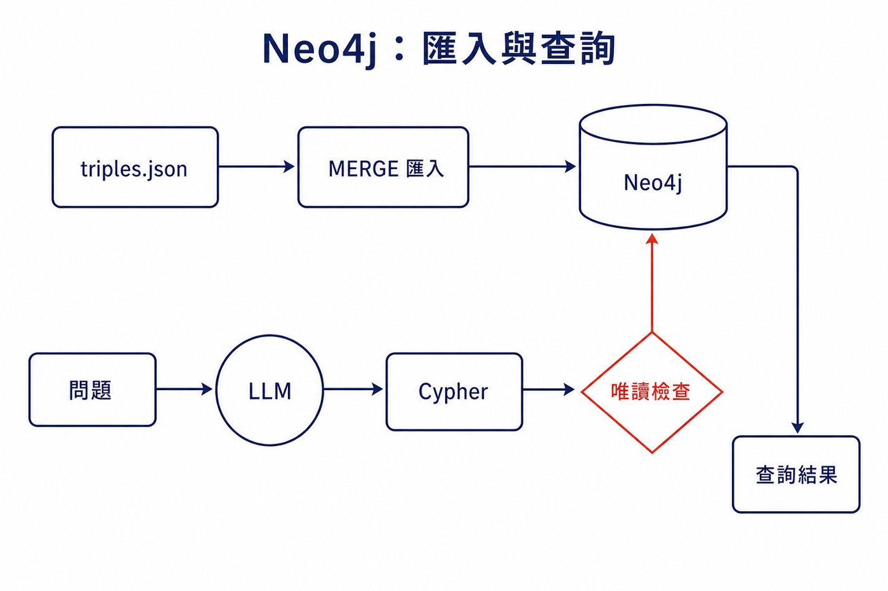

<sub>資料來源：本課模組四 `03_neo4j_cypher.ipynb` 配圖。</sub>

讓 LLM 把自然語言翻成 Cypher（Text2Cypher）是模組二 Text2SQL 的圖版本：同一個套路，換一個資料庫。它很方便，但要守三件事：擋掉寫入語句（LLM 寫出的查詢可能有 `DELETE`、`SET`）、用唯讀交易執行、查詢出錯時把錯誤訊息回饋給模型重試。給模型的 schema 要包括節點標籤與屬性型別、關係型別、以及「哪種節點用哪種關係連到哪種節點」的模式，再附幾個範例。

2026 年還多了一個新坑：Neo4j 改用年月版號後，自 2026.02 起新建資料庫的預設查詢語言是 Cypher 25，並持續加入對齊 GQL 的語法；LLM 的訓練資料多為舊語法，生成的查詢可能報語法錯或箭頭方向反了。Neo4j 2026-02 的實務指南結論很清楚：Text2Cypher 適合探索與兜底，高頻、複雜的查詢應寫成參數化的固定 Cypher 工具。

**圖 6-7　查詢越常用、越複雜，越該寫成固定模板；Text2Cypher 留給低頻探索**

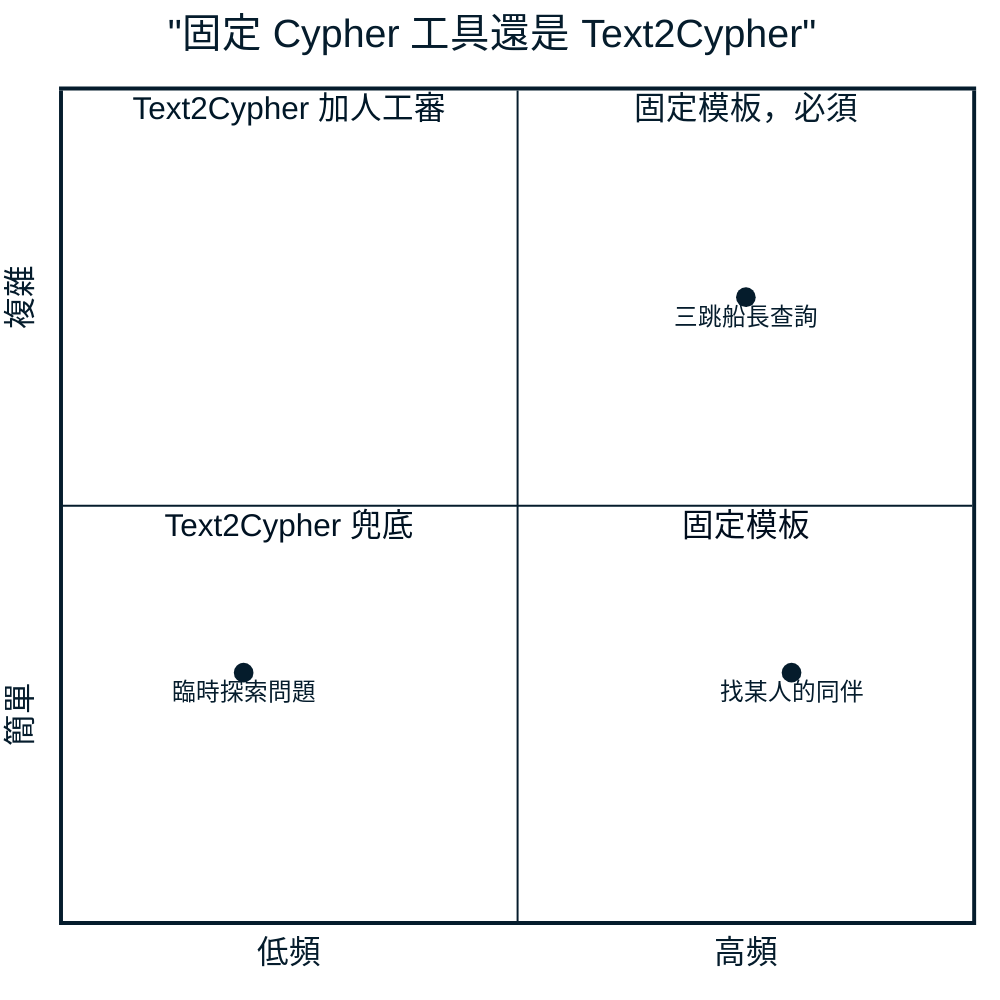

<sub>資料來源：本課整理；改繪自 Alex Gilmore〈Text2Cypher guide〉（Neo4j Blog，2026-02-09）的頻率×複雜度四象限，點的位置為示意。</sub>

本課投影片版的 Lab 就採這個原則：模型只負責兩頭，從問題抽出角色名、最後組織答案；中間的 Cypher 是寫好的模板，把名字當參數填進去、唯讀執行。比起讓模型寫整句查詢，這更好驗證、更可控。

```cypher
MATCH (h:Person {name: $name})-[:MEMBER_OF]->(s:Crew)<-[:MEMBER_OF]-(p:Person)
RETURN s.name AS sect, p.name AS peer
```

---

## 6.7 Microsoft GraphRAG 把成本前移到建索引：分社群、預寫報告，查詢時只讀報告

前面幾節處理的是多跳題；全貌題要另一套機制。Microsoft GraphRAG（Edge et al., 2024）的核心想法是：既然「故事裡有哪幾股勢力」需要先分群再摘要，那就在建索引時把分群和摘要都做完。

**圖 6-8　GraphRAG 的原始管線：左欄建索引時抽實體、建圖、分社群，右欄查詢時逐社群作答再彙整**

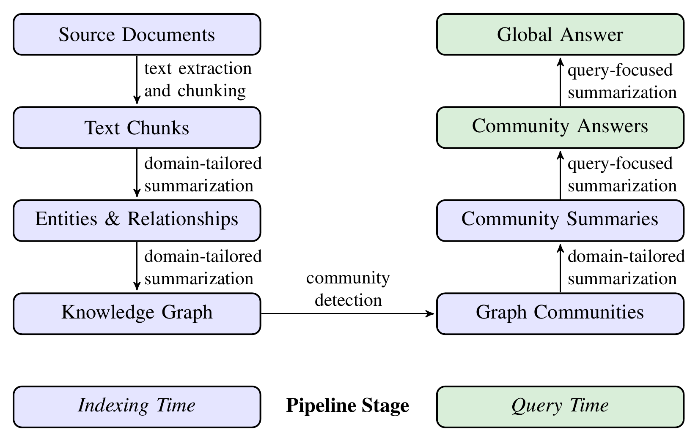

<sub>資料來源：Edge et al.（2024）〈From Local to Global: A Graph RAG Approach to Query-Focused Summarization〉Fig. 1，arXiv:2404.16130，CC BY 4.0。</sub>

索引分六個階段：把文件切成 TextUnit（預設 1200 token）、文件處理、用 LLM 抽實體與關係（claims 抽取預設關閉）、用階層式 Leiden 演算法分社群、請 LLM 為每個社群寫一份報告、最後把 TextUnit、實體描述、社群報告都轉成向量。Leiden 是 Louvain 社群偵測的改良版（修正 Louvain 可能產生內部不連通社群的問題），以 modularity（群內的邊比隨機期望多多少）為目標，在離散空間上做貪婪最佳化；它是階層式的，由細到粗合併，跟 hierarchical clustering 的 dendrogram 同一個概念。社群報告就是預先算好的各層摘要，像 feature pyramid：低層細節多，高層摘要粗。

查詢時的 Global Search 是一個 map-reduce：把選定層級的社群報告切成批次，每批各自回答一次並給出帶重要度分數的要點（map），再篩選高分要點合成最終答案（reduce）。這跟 data parallel 之後做 all-reduce 是同一個形狀。

**圖 6-9　Global Search：報告在索引時就寫好，查詢時每份報告各答一次再合併**

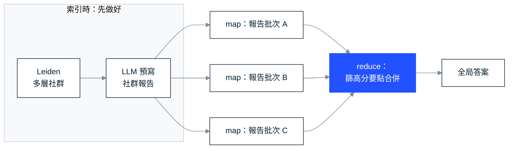

<sub>資料來源：本課整理；改繪自投影片「Global Search 社群報告」與 Microsoft GraphRAG 文件〈Global Search〉。</sub>

效果與成本都要一起看。論文用兩個語料（Podcast 逐字稿與新聞）比較各層社群摘要與傳統向量 RAG，在「完整性」與「多樣性」兩項上，GraphRAG 各層對向量 RAG 的勝率落在 62–81%；只用最粗那層（C0）時，每次查詢需要的 token 不到全文 map-reduce 摘要的 3%，仍保有完整性 72%、多樣性 62% 的勝率。但在「直接性」上向量 RAG 最高，因為它本來就只回答被問的那一點。

成本的大頭在索引。官方 README 直接警告建索引是昂貴的操作，建議從小資料開始，並先做 prompt tuning。查詢端也不便宜：map 階段要把所選層級的每份社群報告都讀一遍，一個全局問題就是一大串 LLM 呼叫。後續的改良都在處理這兩件事。Dynamic community selection（2024-11）從根社群往下，先讓 LLM 判斷報告是否相關，不相關就整枝剪掉，在 level 1 時 token 成本約降 77%、品質接近靜態做法，這是樹搜尋的早剪枝。LazyGraphRAG 則把 LLM 工作延後到查詢時，索引成本與向量 RAG 相同、約為完整 GraphRAG 的 0.1%，是典型的 eager 與 lazy 計算取捨；但它已整合進 Microsoft Discovery 與 Azure Local，開源套件裡沒有。

---

## 6.8 兩派 GraphRAG 差在怎麼取上下文，入口都是模組三的向量檢索

「GraphRAG」這個詞有兩派，讀文章時先分清楚是哪一派。**Microsoft GraphRAG（社群報告派）**：LLM 抽實體與關係、Leiden 分社群、預先寫好社群報告；查詢時不跑 Cypher、不用 Neo4j，預設輸出是資料表加向量庫。**Neo4j 系（Cypher 多跳派）**：LLM 抽三元組、消歧後用 `MERGE` 寫進 Neo4j；查詢時從問題找出實體、到圖中定位節點，用 Cypher 沿關係走 1–2 跳，結果格式化成背景文字。本課 Lab 走後者。

**圖 6-10　同樣叫 GraphRAG，兩派在建圖、找入口、展開上下文三步都不同**

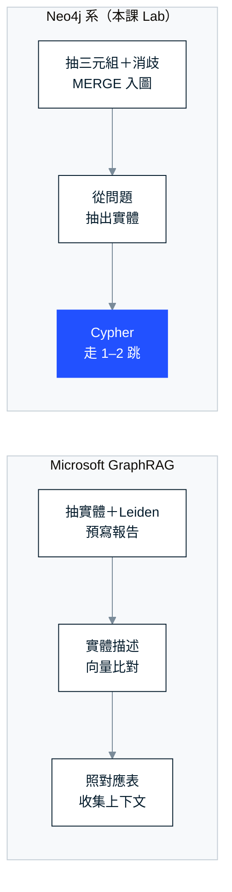

<sub>資料來源：本課整理；改繪自投影片「GraphRAG 兩派分清」，Microsoft 一側依官方文件〈Local Search〉〈Default Indexing Dataflow〉核實。</sub>

常見的誤解是把 Microsoft GraphRAG 的 Local Search 講成「1-hop、2-hop 拓撲展開」。官方文件描述的機制不是這樣：它用問題與「實體描述的 embedding」比對找出切入實體，再透過建索引時存好的對應表收集候選：相關的文字片段、所屬社群的報告、鄰近實體與關係、covariates，各自排序過濾後塞進同一個 context window。入口仍是模組三的向量檢索，只是檢索的對象從 chunk 換成了「實體描述」；之後不跑任何圖遍歷查詢。

官方目前列出四種查詢模式，選擇的第一步是判斷問題是「點」還是「全貌」：

| 模式 | 做法 | 適合的問題 |
|---|---|---|
| Basic | 傳統 top-k 向量 RAG，當對照組 | 單點事實 |
| Local | 從問題裡的實體切入，照對應表收集上下文 | 具體對象的來龍去脈：某個人、某件寶物 |
| Global | 讀社群報告，做 map-reduce | 全貌：主要勢力、主題有哪些 |
| DRIFT | 先用 top-K 社群報告得出初步答案與追問，再對追問做 Local 搜尋 | 從全貌往下追細節 |

**圖 6-11　DRIFT 先用社群報告給粗答案與追問，再一層層用局部檢索追下去**

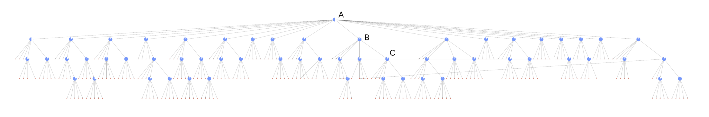

<sub>資料來源：Microsoft GraphRAG 文件〈DRIFT Search〉Figure 1，MIT License © Microsoft Corporation。</sub>

最後是現況。Microsoft GraphRAG 最新版 v3.3.0（2026-10-08），README 寫明已「largely in maintenance mode」，不收新 PR、不加新功能，只修 bug 與更新相依套件。這不代表它的想法過時，而是代表面試與設計討論時，講「社群報告、map-reduce、成本前移」這些概念與取捨，比背它的套件 API 穩。想要同類能力又更便宜，LightRAG 提供 local、global、hybrid、naive、mix 五種模式，後端可接 PG 或 Neo4j；要注意它的 server 預設綁定所有網卡且不開認證。

---

## 6.9 什麼時候值得建圖：多跳與全貌用圖，其餘先用向量，最常見的是兩者並用

建圖有真實的成本：要定 schema、抽取、消歧、人工校對，資料一改還要重做。所以判斷的起點永遠是「問題長什麼樣」，而不是「圖比較先進」。本課 Lab 4 最後一本 notebook 就是用同一組題目、同一個模型、同一個 prompt，只換上下文，讓兩種檢索正面比較。

**圖 6-12　同一個問題走兩條路，只差上下文，最後比正確率**

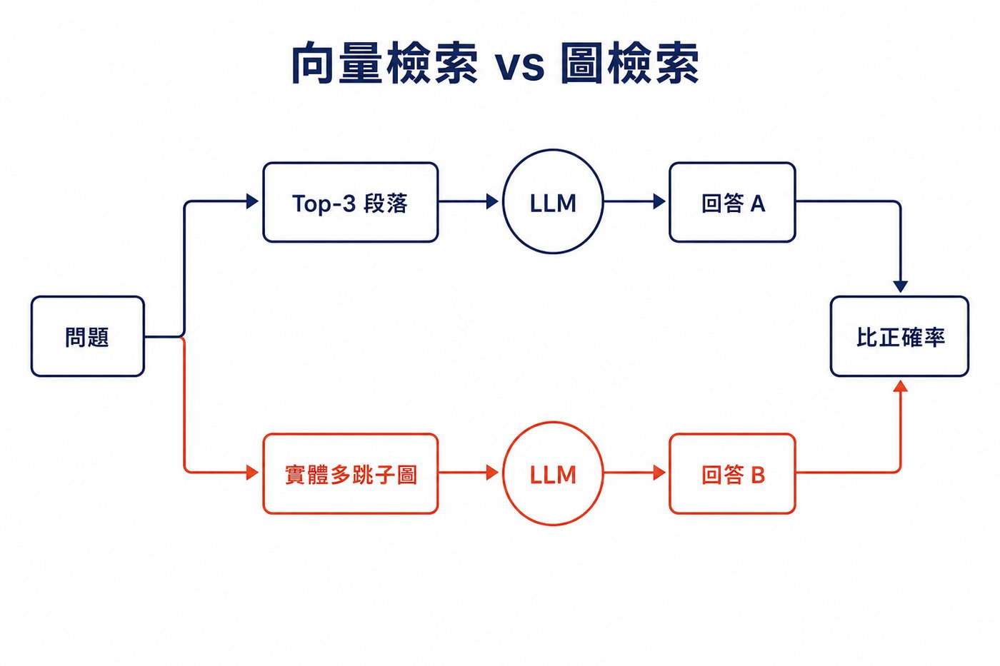

<sub>資料來源：本課模組四 `04_graph_vs_vector.ipynb` 配圖。</sub>

端到端的結果還揭露了評估本身的陷阱。有一題圖檢索被關鍵字評分判「對」，其實它回答的是「資料不足」，只是句子裡順口提到了答案關鍵字；有一題的題目在語料更新後出現兩個正確答案，模型挑了另一個。跟第 5 章一樣，評估要把檢索和生成拆開量，關鍵字評分只能當粗篩，第 11 章會換成校準過的 LLM 評審。

| 問題長什麼樣 | 建議 | 原因 |
|---|---|---|
| 答案寫在某一段裡，問法跟原文像 | 向量 | 便宜、不用建圖，單跳表現已經很好 |
| 要串好幾個實體（「A 的 B 的 C」） | 圖 | 沿著邊走，中間的段落不必像問題 |
| 問的是 schema 沒有的細節（職位、外號、場景） | 向量 | 圖只存你定義過的關係，其他資訊在抽取時就丟了 |
| 要看全貌（「有哪幾股勢力」） | GraphRAG Global Search | 要先分群、寫社群報告再彙總 |
| 資料常改、沒人維護 schema | 向量 | 建圖要抽取、正規化、人工校對，維護成本高 |

實務上最常見的是**兩個一起用**：圖負責找出「相關的是誰」，再把這些實體出現的原文段落一起撈出來。這也呼應第 5 章的專案規則：圖檢索是多加的一路，跟 Dense、Sparse 兩路一起用 RRF 融合，任何一路失效都不會讓系統變空。`neo4j-graphrag` 的 `VectorCypherRetriever`、`HybridCypherRetriever` 就是「向量或混合檢索找入口、Cypher 擴展上下文」的現成實作。

**圖 6-13　從問題形狀到檢索策略的決策樹**

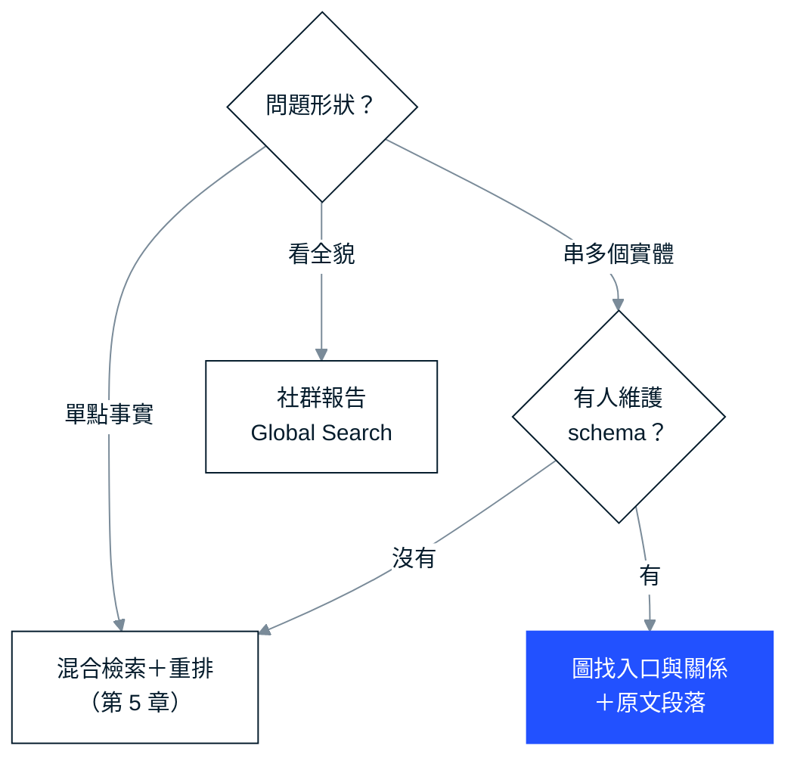

<sub>資料來源：本課整理；依模組四 `00_concepts.md` 第 7 節。</sub>

工具分兩層看：底下存圖的資料庫，上面負責「建圖＋檢索」的套件。授權差異很大，商用或對外提供服務前，最右欄比效能更先決定（核實日 2026-11-17）。

| 名稱 | 是什麼 | 什麼時候選它 | 授權／狀態 |
|---|---|---|---|
| Neo4j（本課用） | LPG 圖資料庫，Cypher 查詢 | 要成熟的圖資料庫、教材多、GDS 演算法 | Community 為 GPLv3；Enterprise 需商業合約；2026.02 起預設 Cypher 25 |
| `LLMGraphTransformer`（langchain-neo4j） | LangChain 的抽圖工具 | 已用 LangChain，快速把文件轉成圖 | MIT；從 `langchain_neo4j` 匯入 |
| neo4j-graphrag-python | Neo4j 官方建圖＋檢索 | 要消歧、Text2Cypher、混合檢索 | Apache-2.0；建圖管線仍標 experimental |
| Microsoft GraphRAG | 社群報告派的研究實作 | 研究或重現 Global／Local／DRIFT | MIT；維護模式，v3.3.0 |
| LightRAG | 輕量 KG-RAG | 要比 MS GraphRAG 便宜、多種查詢模式 | MIT；server 預設不開認證 |
| Memgraph | 記憶體內圖資料庫，相容 Cypher | 要低延遲即時查詢、沿用 Neo4j 驅動 | BSL 1.1，非 OSI 開源 |

另外，FalkorDB 是 Redis 模組（SSPLv1）；嵌入式圖資料庫 Kùzu 已在 2025-10 封存，舊教材推薦它當輕量 GraphRAG 後端的，要拿掉。Neo4j 方面，官方建議避開 2026.07.0（`trim()` 的 bug 可能損壞字串資料）。

---

## 本章重點

向量檢索把片段當成彼此獨立的點，所以答不好多跳題與全貌題；知識圖譜把關係本身存成資料，讓檢索可以沿著邊走。建圖的品質由三件事決定：先定 schema 把抽取變成固定類別的分類、用標準答案量 precision 與 recall、實體消歧由人拍板而不是靠「名字互相包含」。圖檢索是「找起點、BFS、念成句子」，一定要有展開規則對付超級節點；LLM 寫的 Cypher 要唯讀執行並回饋錯誤，高頻查詢寫成固定模板。Microsoft GraphRAG 用 Leiden 社群與預寫報告回答全貌題，代價是昂貴的索引，且套件已進入維護模式；Neo4j 系用 Cypher 多跳回答關係題。實務上圖與向量並用，圖只是融合裡多加的一路。

## 對應實作與延伸閱讀

- [Lab 4-01 抽三元組](../../modules/module-04-graphrag/01_extract_triples.ipynb)：Pydantic 受限輸出、precision／recall、別名正規化與命名陷阱。
- [Lab 4-02 networkx 圖檢索](../../modules/module-04-graphrag/02_graph_networkx.ipynb)：`ego_graph`、`shortest_path`、`bfs_layers`、超級節點展開規則。
- [Lab 4-03 Neo4j 與 Cypher](../../modules/module-04-graphrag/03_neo4j_cypher.ipynb)：MERGE 匯入、Cypher 多跳、Text2Cypher 的三道防線。
- [Lab 4-04 圖檢索 vs 向量檢索](../../modules/module-04-graphrag/04_graph_vs_vector.ipynb)：14 題分開量檢索命中與回答正確。
- [模組四原理紀要](../../modules/module-04-graphrag/00_concepts.md)。
- 投影片：[deck.pdf](../slides/deck/deck.pdf) 模組四「知識圖譜是什麼」到「模組四面試題」。
- Edge et al.（2024）〈From Local to Global: A Graph RAG Approach to Query-Focused Summarization〉，arXiv:2404.16130。
- Microsoft GraphRAG 文件：Default Indexing Dataflow、Global／Local／DRIFT Search。
- Tomaž Bratanič〈Implementing 'from local to global' GraphRAG with Neo4j and LangChain〉、〈Integrating Microsoft GraphRAG into Neo4j〉（Neo4j Developer Blog，2024）。
