# 第二部　知識層：讓模型查得到它沒學過的事

第一部講的是模型本身：它怎麼預測下一個 token、怎麼用提示與結構化輸出控制它、什麼時候值得改權重。第二部處理一個更日常的問題：模型的知識凍結在訓練完的那一刻，公司內部的錯誤碼、上週改過的流程、昨天的事故，它都沒看過；問了也不會說不知道，而是編一個看起來合理的答案。

本部要回答的核心問題是：**怎麼在不改權重的前提下，讓模型在回答前拿到正確的資料，並且知道系統錯在哪一段。**

## 論證主線

答案分三層展開。第 4 章先建立骨架：RAG 是「改輸入、不改權重」，系統分成離線建庫與在線問答兩條鏈路，embedding 是預訓練 encoder 的特徵向量，而分塊決定了檢索品質的上限。第 5 章處理「找得準」：向量檢索分不清只差一個字的代碼，關鍵字檢索不懂換句話說，所以兩路並行、用 RRF 依名次融合（這也是本課專案規則要求的 fallback），再用 cross-encoder 精排，只讓 3–5 段進 prompt；其餘技巧都在把「搜尋的單位」與「餵給模型的單位」分開，而每一招都要用題庫量過。第 6 章處理「找得連」：向量檢索把片段當成彼此獨立的點，答不好要串好幾個事實的多跳題與要看完整份語料的全貌題，知識圖譜把關係存成資料，讓檢索可以沿著邊走。

貫穿三章的判斷是同一句話：RAG 系統的品質問題，先假設是檢索問題，量過之後才歸給生成。

**圖 二-0　第二部的三章：先搭骨架，再讓它找得準，最後讓它找得連**

```mermaid
%%{init: {'theme':'base','themeVariables':{'fontFamily':'Noto Sans TC, Helvetica, Arial, sans-serif','fontSize':'15px','primaryColor':'#FFFFFF','primaryTextColor':'#051C2C','primaryBorderColor':'#051C2C','lineColor':'#7A8B99','secondaryColor':'#F0F3F7','tertiaryColor':'#F0F3F7','clusterBkg':'#F7F9FB','clusterBorder':'#C5CED6','edgeLabelBackground':'#FFFFFF','actorBkg':'#FFFFFF','actorBorder':'#051C2C','noteBkgColor':'#F0F3F7','noteBorderColor':'#C5CED6'}}}%%
flowchart LR
    subgraph C4["第 4 章 骨架"]
        A["改輸入<br/>不改權重"] --> B["離線建庫<br/>在線問答"] --> C["分塊<br/>決定上限"]
    end
    subgraph C5["第 5 章 找得準"]
        D["BM25＋向量<br/>RRF 融合"] --> E["Cross-Encoder<br/>精排"] --> F["題庫評估<br/>錯誤歸因"]
    end
    subgraph C6["第 6 章 找得連"]
        G["三元組建圖<br/>實體消歧"] --> H["多跳檢索<br/>社群報告"]
    end
    C --> D
    F --> G
    H --> I["第三部<br/>檢索變成工具"]
    classDef accent fill:#2251FF,stroke:#2251FF,color:#FFFFFF
    class D accent
```

資料來源：本課整理。

## 各章導覽

| 章 | 檔案 | 一句話摘要 |
|---|---|---|
| 第 4 章 | [RAG 全鏈路：改輸入，不改權重](04-rag-pipeline.md) | RAG 的兩條鏈路、embedding 與「相似不等於相關」、metadata 過濾、分塊策略與選型順序 |
| 第 5 章 | [檢索優化：兩路撈、依名次融合、再精排](05-retrieval-optimization.md) | BM25 與向量互補、RRF 與 fallback 規則、cross-encoder 漏斗、父子片段、contextual retrieval、PDF 與多模態、Self-RAG／CRAG、評估與框架選型 |
| 第 6 章 | [知識圖譜與 GraphRAG：從「找像的」走到「找連的」](06-knowledge-graphs-and-graphrag.md) | 多跳與全貌兩種題、LPG 與 RDF、schema 與三元組抽取、實體消歧、圖檢索與超級節點、Cypher、兩派 GraphRAG、何時用圖 |

三章的小節標題都是結論句。時間不夠時，只讀每節第一段也能拿到主線；遇到要動手的地方，再往下讀支撐論據與數字。

## 先備知識

本部假設你懂深度學習的基本元件，並讀過第一部：

- **embedding 層與特徵向量**：`nn.Embedding` 是查表取一列；預訓練 CNN 的倒數第二層可以拿來做最近鄰搜尋。第 4 章的文字 embedding 就是這兩件事的組合。
- **siamese network 與二元分類器**：第 5 章用它們解釋雙塔（bi-encoder）與 cross-encoder 的差別。
- **兩階段偵測、clustering、dendrogram**：分別對應第 5 章的「粗召回加精排」與第 6 章的 Leiden 社群。
- **第 1 章的 token、context 成本**：理解為什麼只讓 3–5 段進 prompt。
- **第 2 章的結構化輸出**：第 6 章用它把三元組抽取限制在固定的關係類型裡。

沒學過 NLP 不影響閱讀。BM25、RRF、Cypher 這些新名詞，第一次出現時都會先給一句白話與一個例子。

## 對應模組與 notebook

| 章 | 模組 | notebook |
|---|---|---|
| 第 4 章 | [模組三 RAG](../../modules/module-03-rag/) | `01_embeddings`、`02_first_rag`、`03_chunking` |
| 第 5 章 | [模組三 RAG](../../modules/module-03-rag/) | `04_hybrid_rrf`、`05_rerank_and_query`、`06_rag_eval`（Lab 3）、`07_llamaindex`、`08_pdf_parsing`（選讀） |
| 第 6 章 | [模組四 GraphRAG](../../modules/module-04-graphrag/) | `01_extract_triples`、`02_graph_networkx`、`03_neo4j_cypher`、`04_graph_vs_vector` |

模組三的語料是虛構電商「海風科技」的 30 份內部技術文件與 38 題評估題庫，刻意放了大量錯誤碼與 2 份已封存的舊版說明，讓純向量檢索有機會出錯；第三部的 agent 與旗艦專案會沿用這份語料。模組四的語料是課程自寫的 34 段《海賊王》人物與劇情摘要，同一人物刻意用不同稱呼、事實刻意拆在不同段落，用來練習實體消歧與多跳檢索。

本部引用的數字有兩種來源，文中都會標明：標「本課實測」的來自上表 notebook 的存檔輸出，用本機 `qwen2.5:3b` 與 `bge-m3` 跑一次，重跑會略有不同；其餘來自論文或官方文件，並註明出處。所有套件版本與授權以 2026-11 核實的狀態為準。

## 建議的閱讀與實作順序

第 4 章與 Lab 3-01～3-03 可以一起讀：先讀 4.1～4.5 節，跑 `01_embeddings` 與 `02_first_rag` 看「相似不等於相關」與舊版文件的問題；再讀 4.6 節，跑 `03_chunking` 看補標題在本課語料上的反直覺結果。

第 5 章的 5.1～5.3 節對應 `04_hybrid_rrf` 與 `05_rerank_and_query`，是整部最重要的工程內容；5.8 節對應 Lab 3 本體 `06_rag_eval`，建議在跑任何優化之前先讀，因為它決定你怎麼判斷那個優化有沒有用。5.5～5.7 節是選讀，偏向選型與觀念。

第 6 章建議照 notebook 順序：`01_extract_triples` 看抽取有多不可靠，`02_graph_networkx` 看超級節點怎麼讓子圖爆炸，`04_graph_vs_vector` 看兩種檢索各自輸在哪裡。`03_neo4j_cypher` 需要 Docker 起一個 Neo4j，可以最後再做。

## 讀完本部你應該能

- 畫出 RAG 的離線與在線兩條鏈路，指出昂貴的步驟該放在哪一條。
- 解釋為什麼正式的檢索管線一定要有 Dense 與 Sparse 兩路，並用 RRF 融合。
- 說清楚雙塔與 cross-encoder 各自為什麼快、為什麼準，以及漏斗兩端的數量怎麼定。
- 用 Hit@k、MRR 與錯誤歸因，判斷一個失敗是檢索的錯還是生成的錯。
- 判斷一個問題該用向量、圖，還是社群報告來回答，並說出建圖的代價。
