# 第 7 章　Agent 迴圈與 LangGraph：把模型放進一個看得見的迴圈

**本章結論**：Agent 沒有魔法，它是把一次呼叫的模型 f(x) 放進迴圈，讓模型的輸出決定下一輪要呼叫哪個工具，或是交出答案。模型只負責「寫出」想呼叫的工具與參數，真正執行的永遠是你的程式，所以 agent 能做什麼，由你給的工具決定。這個迴圈用 50 行 Python 就寫得完；但一旦要分支、重試、暫停等人、當機後恢復，while 迴圈就撐不住，必須把它畫成可存檔的狀態圖，這就是 LangGraph 的 StateGraph。到了 LangChain 1.x，最常見的那張圖已經由 `create_agent` 預先接好，客製行為改用 middleware 掛上去。

讀完本章，你應該能說清楚三件事：tool calling 的三則訊息各是誰產生的；什麼時候該用固定的 workflow、什麼時候才值得交給 agent；以及 State、Node、Edge、Reducer 各自解決了手寫迴圈的哪個痛點。

---

## 7.1 Agent 就是把 f(x) 放進迴圈，模型只負責決定下一步

你訓練過的網路都是一次前向：輸入 x，輸出 y，呼叫一次就結束。單獨使用的大型語言模型（LLM）也是這樣：給它一串對話訊息，它回一段文字。**Agent 多了一個迴圈**：模型這一輪的輸出不一定是答案，也可能是「我要用某個工具」；你的程式去執行那個工具，把結果接回對話，再呼叫一次模型，直到模型說「好了」。

這個差別比看起來大。一次前向的模型，要做多步推理只能把所有步驟塞進一次輸出；放進迴圈之後，模型每走一步都能看到真實世界的回饋（日誌內容、資料庫查詢結果、計算機輸出），再決定下一步。換句話說，迴圈讓模型的「決策」和環境的「觀測」交錯起來，這和強化學習裡 agent 與環境的互動迴圈是同一種結構，只是 policy 換成了 LLM。

用你已經會的東西對照，有三組老朋友可以直接搬過來。第一，一次 forward 對應一輪 agent：前者輸入進、預測出，後者訊息進、動作或答案出。第二，要多步時，訓練迴圈的 `for step in range(...)` 是你自己寫的；agent 的迴圈也是你寫的，但「要不要再走一輪」改由模型決定。第三，RNN 推論時你得自己把 hidden state 帶到下一步；LLM 的 API 沒有記憶，整串 messages 也得由你的程式每輪重新送進去。

**圖 7-1　Agent 和一次前向的差別只在「輸出能不能回到輸入」**

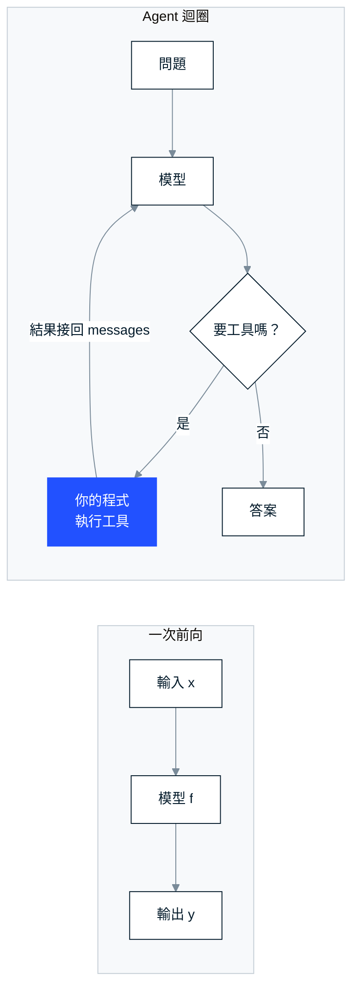

<sub>資料來源：本課整理；改繪自投影片「從 f(x) 到迴圈」與模組五 `00_concepts.md` 第 1 節。</sub>

圖中唯一用強調色標出的是「你的程式」，因為這是整章最容易誤解的地方。模型在迴圈裡只做一件事：決定下一步。它不連網、不讀檔、不碰資料庫，所有對外的動作都是你的程式代勞。這個事實有兩個直接後果。其一，agent 的能力上限由工具清單決定，模型再聰明，沒給它重啟服務的工具，它就重啟不了。其二，安全邊界也畫在你的程式裡：哪些工具可以直接執行、哪些要先停下來等人點頭，是工程決策，不是 prompt 的措辭問題。第 8 章整章都在處理第二點。

本部延續模組五的同一個情境：虛構公司「晨光外送」14:00 起下單一直回 502 錯誤，值班 agent 要查日誌、查指標、查 runbook（維運手冊），必要時要求重啟服務。前面幾節先用更小的查價例子講清楚機制，再回到這個事故。

## 7.2 Tool calling 只是模型寫出一段 JSON，執行權永遠在你的程式

**工具呼叫（tool calling，也叫 function calling）的本質是：模型生成一段符合 JSON schema 的 token，而不是去執行函式。** 你的程式解析這段 JSON、真的呼叫函式，再把結果當成一則新訊息塞回對話。看懂這來回的三則訊息，agent 就沒有任何神祕之處。

先看實物。下面是一段 OpenAI 相容 Chat Completions 格式的完整往返（Ollama 的本機端點也吃這種格式；商品與價格是編的）：

```json
{"role": "user", "content": "USB-C 轉接器多少錢？"}
{"role": "assistant", "tool_calls": [{"id": "call_1", "type": "function",
  "function": {"name": "get_price", "arguments": "{\"item\": \"USB-C 轉接器\"}"}}]}
{"role": "tool", "tool_call_id": "call_1",
  "content": "{\"price\": 350, \"currency\": \"TWD\"}"}
{"role": "assistant", "content": "USB-C 轉接器 350 元。"}
```

第一則是使用者的問題，請求裡另外附上工具清單（名稱、說明、參數格式）。第二則是模型的回覆，它不是答案，而是一段 `tool_calls`：想呼叫 `get_price`，參數是一個 **JSON 字串**（注意 `arguments` 外面還有一層引號，你的程式要先 `json.loads`，而且可能解析失敗）。第三則是你的程式執行完函式後，用 `role: "tool"` 追加的結果，並用 `tool_call_id` 對回第二則的 `id`。第四則是模型讀完整串訊息後，這次直接寫出文字答案。

對深度學習背景的讀者，最有說服力的證據來自開源模型。Hugging Face Transformers 的官方文件用 `apply_chat_template(messages, tools=tools)` 把工具 schema 和對話渲染成一長串 token，再用 `model.generate()` 生成，輸出直接印出 `<tool_call>{"name": ..., "arguments": {...}}</tool_call>` 這段文字，文件也明講模型無法自己呼叫工具。模型最後一層仍然是詞表上的 softmax；它只是經過微調（你熟悉的遷移學習），學會在適當時機輸出這種特定格式的 token 序列。這就像一個分類器只輸出 label，真正「採取行動」的是讀 label 的那段程式。

**圖 7-2　一次工具呼叫是兩次請求：模型寫 JSON，你的程式執行並回填**

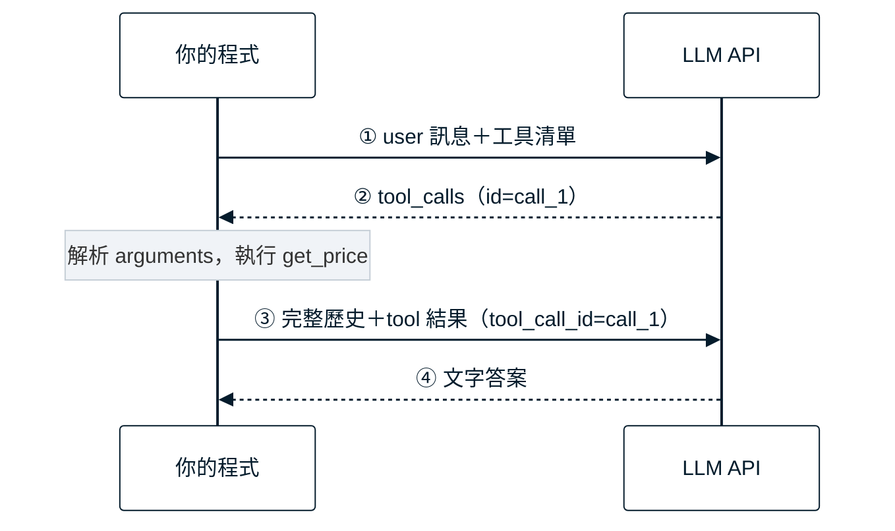

<sub>資料來源：本課整理；改繪自投影片「Tool calling 的真面目」，格式依 OpenAI 與 Anthropic 官方 tool use 文件。</sub>

不同供應商的欄位名稱不同，但結構一致。OpenAI 官方指南現在主推 Responses API，欄位是 `function_call`、`function_call_output` 與 `call_id`；OpenAI 相容端點（vLLM、Ollama 等）仍是上面的 Chat Completions 格式；Anthropic 則用 `tool_use` 與 `tool_result` 兩種 block，以 `tool_use_id` 配對。寫程式時選定一種格式寫到底，不要混用。

這個機制直接帶出三條工程規則，後面每一章都會用到。

**工具說明書就是 prompt。** 模型看不到你的函式本體，只看得到名稱、說明和參數 schema。說明寫得含糊，模型就會選錯工具或填錯參數，就像標籤說明寫錯，模型就學錯。本課的做法是用 Pydantic 定義參數模型：同一份定義既產生送給模型的 JSON Schema，也在執行前驗證模型給的參數。這也是本專案 `AGENTS.md` 的硬性規則：所有工具定義都要用 Pydantic 模型驗證參數。

**每一輪都重送整串 messages。** API 是無狀態的，模型沒有記憶；agent 的「短期記憶」就是這一串訊息。所以每走一輪，送出的 prompt token 就比上一輪多，工具回傳的內容要盡量短，否則 context 很快就被撐滿。工具定義本身也會吃 input token，工具越多越貴。

**錯誤也要回給模型。** 參數驗證失敗、工具丟例外，都應該包成一則 `role: "tool"` 的文字送回去，讓模型自己決定換個參數重試或改走別條路，而不是讓程式當掉。

**圖 7-3　messages 每走一輪就疊高一層，而且每輪都整串重送**

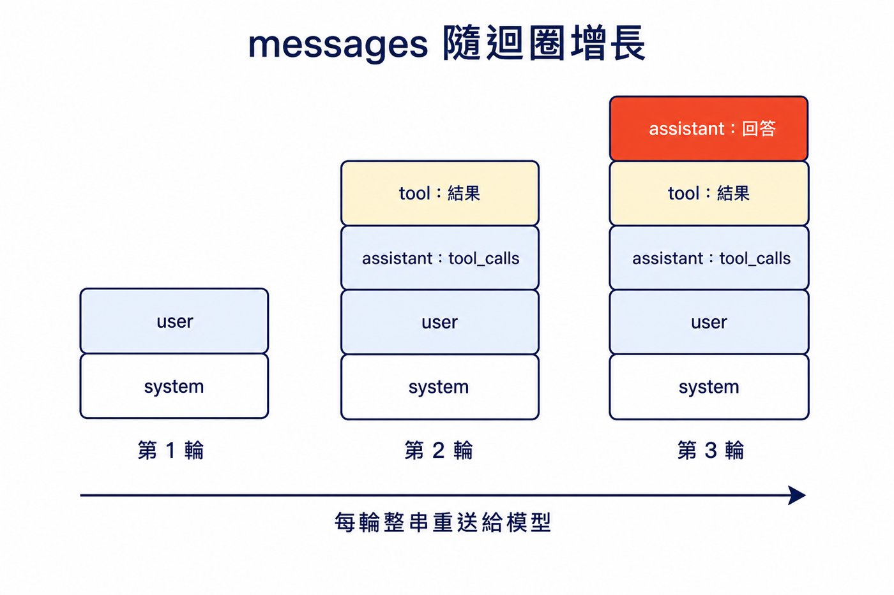

<sub>資料來源：模組五 `images/messages_stack.jpg`（本課繪製）。</sub>

## 7.3 ReAct 把推理和行動交錯成迴圈，比只想或只做都可靠

**ReAct（Reason + Act，Yao 等人 2022）是 agent 迴圈最早被廣泛採用的格式：模型交替寫出 Thought（想法）、Action（動作）、Observation（觀測），直到寫出 Final Answer。** 它出現在 function calling 普及之前，完全靠 prompt 規定說話格式；今天的 `tool_calls` 其實就是把 Action 那一行換成結構化欄位，Observation 換成 `role: "tool"` 訊息。

用查價例子走一遍，三個 USB-C 轉接器的總價需要兩次工具呼叫：

```text
Thought: 使用者要三個 USB-C 轉接器的總價，先查單價
Action: get_price(item="USB-C 轉接器")
Observation: 350
Thought: 單價有了，三個要乘起來
Action: calc("350 * 3")
Observation: 1050
Thought: 資訊夠了，可以回答
Final Answer: 三個共 1050 元
```

每一圈都有一個 Thought 決定「要不要繼續」。夠了，就從 Final Answer 這個出口離開；不夠，就再選一個工具。

**圖 7-4　ReAct 迴圈：想、做、看，直到出現答案**

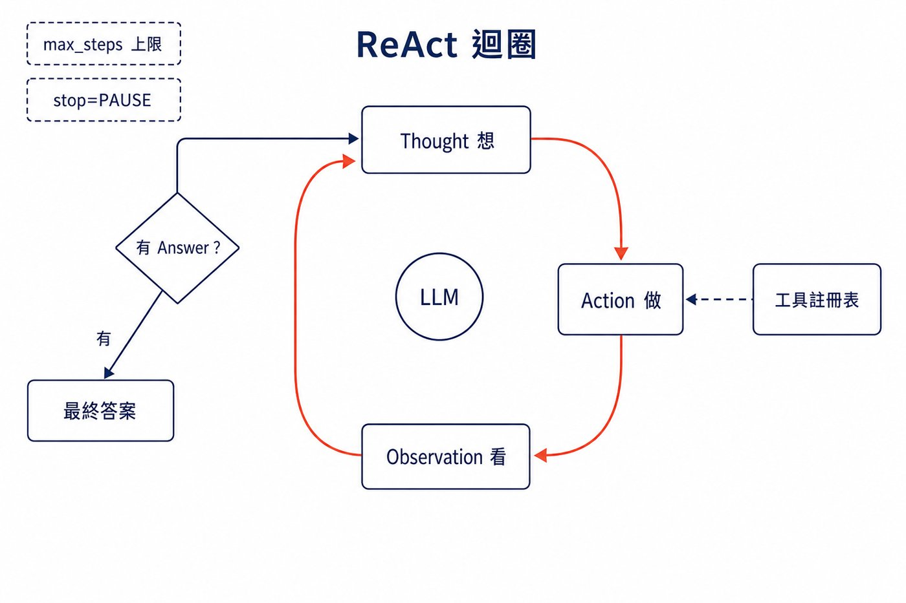

<sub>資料來源：模組五 `images/react_loop.jpg`（本課繪製）。</sub>

為什麼要把「想」和「做」交錯？論文的對照實驗給了答案。在 HotpotQA 這種多跳問答上，只推理的 Chain-of-Thought（CoT）會憑記憶編造事實；只行動的 Act-only 不會規劃，會亂搜一通。ReAct 讓模型邊查邊修正方向。數字要誠實地讀：在 HotpotQA 上，ReAct 的 EM 分數 27.4 其實略輸 CoT 的 29.4；但在需要一步步操作環境的 ALFWorld 上，同樣有工具，有沒有 Thought 的成功率從 45%（Act，6 次取最佳）拉到 71%（ReAct，6 次取最佳）。可以這樣記：**工具讓模型接地，思考讓模型不亂跑。**

**圖 7-5　ReAct 論文原圖：每一輪都是 Thought、Act、Obs，觀測結果改變下一個想法**

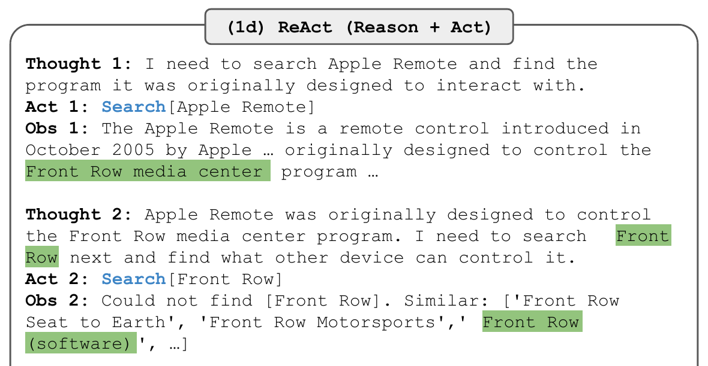

<sub>資料來源：Yao et al.（2022）〈ReAct: Synergizing Reasoning and Acting in Language Models〉Fig. 1 (1d) 上半部（裁切，未改動內容），arXiv:2210.03629，CC BY 4.0。</sub>

純 prompt 版的 ReAct 很脆弱，因為格式全靠模型自律。模組五的 `01_react_from_scratch.ipynb` 保留了這個寫法，並示範四道必要的防護，每一道都對應一種實際會發生的失敗：

| 防護 | 防什麼 |
|---|---|
| `stop=["PAUSE", "Observation:"]` | 模型自己編出 Observation（小模型很常見） |
| 解析失敗時回一句錯誤當 Observation | 格式跑掉時讓模型自己修正，而不是程式當掉 |
| 工具註冊表查不到就拒絕 | 模型想呼叫不存在的工具（例如重啟） |
| `max_steps` | 模型永遠不收尾，一直花錢 |

第一道特別值得一提：如果不設 stop，小模型常常寫完 Action 之後順手把 Observation 也編好，然後根據自己編的觀測繼續推理。這正是「只想不做」的失敗模式回來了。function calling 把解析交給 API 之後，前兩道防護大致由模型訓練和 API 格式承擔，但後兩道永遠要你自己寫。

## 7.4 50 行就能寫出 agent，真正的工程在終止條件與錯誤回饋

**一個可用的 agent 迴圈只有十幾行核心程式，加上 client 和工具定義約 50 行。** Thorsten Ball 的〈How to Build an Agent〉把這件事講成一句話：agent 就是「an LLM, a loop, and enough tokens」。先親手寫一次，之後看任何框架都能在裡面找到同一個迴圈。

```python
messages = [{"role": "user", "content": question}]
for _ in range(MAX_STEPS):                       # 終止條件 1：步數上限
    msg = client.chat.completions.create(
        model=MODEL, messages=messages, tools=TOOLS).choices[0].message
    messages.append(msg)                         # 模型的回覆也要存進去
    if not msg.tool_calls:                       # 終止條件 2：沒要工具＝說完了
        return msg.content
    for call in msg.tool_calls:
        args = json.loads(call.function.arguments)
        out = REGISTRY[call.function.name](**args)
        messages.append({"role": "tool", "tool_call_id": call.id,
                         "content": str(out)})
```

逐段讀。`messages` 是這次對話的全部記憶，對應訓練迴圈裡一路累積的狀態。`for` 迴圈加上 `MAX_STEPS` 是保險絲。每一輪把整串 messages 和工具清單一起送給模型，回覆也存回 messages，否則下一輪模型看不到自己剛才要過什麼工具。沒有 `tool_calls` 就代表模型說完了，直接回傳。有的話，逐一解析參數、查註冊表、真的執行、把結果以 `role: "tool"` 追加，下一圈模型就讀得到。

**圖 7-6　手寫迴圈有兩個出口，少一個就會出事**

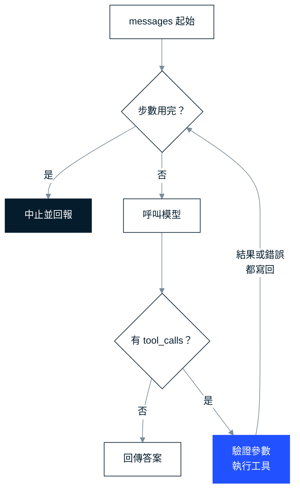

<sub>資料來源：本課整理；改繪自投影片「50 行手寫 agent 的解剖」與「Lab 5-A：50 行手寫 ReAct agent」。</sub>

迴圈本身簡單，難的是兩件事。第一是**終止條件**：只靠「模型不再要工具」來結束是不夠的。工具回傳的格式不是模型預期的、或 prompt 被截斷時，模型會反覆呼叫同一個工具，帳單一直跳。步數上限是最後一道保險，第 8 章會看到 LangGraph 的對應物 `recursion_limit` 的預設值大到等於沒有保險。第二是**錯誤回饋**：參數驗證失敗或工具丟例外時，把錯誤訊息當成 tool 結果回給模型，讓它有機會修正；直接讓程式崩潰，迴圈就白跑了。

模組五的 `02_function_calling_loop.ipynb` 是這段程式的完整版：用 Pydantic 產生 schema、印出每一輪的 messages 和 token 時間軸。跑過一次就會看到 prompt token 一輪比一輪多，這是第 9 章談 context 成本的起點。

還有一個只有看 trace 才會發現的失敗：小模型會在最終回答裡說「已重啟服務」，但 trace 裡根本沒有呼叫重啟工具；或寫「根據手冊」，卻從沒呼叫檢索工具。模組五的 notebook 刻意保留這些輸出當教材。教訓很直接：**驗收 agent 要看 trace，不能只看最後一句回答。**

## 7.5 步驟寫得出來就用 workflow，寫不出來才交給 agent

**在寫任何 agent 之前，先問一個問題：這件事的步驟，事先寫得出來嗎？** 寫得出來，就寫成固定流程（workflow）：便宜、快、好測、成本固定。只有「看了結果才知道下一步」的工作，才值得讓模型自己決定流程。這條原則出自 Anthropic〈Building effective agents〉，核心建議是「先找最簡單的方案，必要時才增加複雜度」。

兩者的定義只差在「誰決定下一步」。Workflow 是 LLM 與工具透過**預先定義的程式路徑**編排，路徑寫死在程式裡；agent 是 LLM **動態主導**自己的流程與工具使用，走幾輪不固定。用深度學習的語言說，workflow 像靜態計算圖，每次 forward 走同一條路；agent 像 PyTorch eager 模式下由資料決定 if／while 往哪走的動態控制流。

**圖 7-7　Workflow 的 LLM 嵌在寫好的路徑裡，agent 的 LLM 依環境回饋自己決定動作**

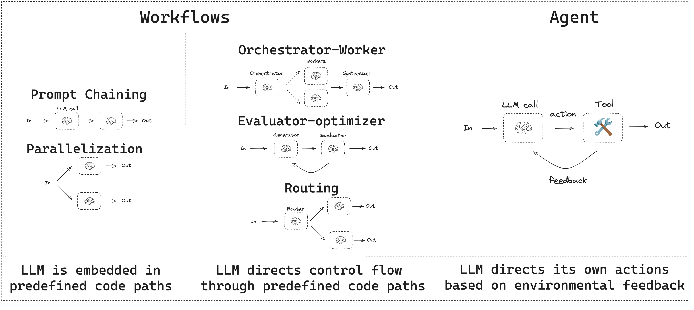

<sub>資料來源：LangChain Docs〈Workflows and agents〉，MIT License © 2025 LangChain。</sub>

上圖把常見的模式排成一條光譜。左邊五種都是 workflow：提示鏈（prompt chaining，固定步驟串接、中間設檢查閘）、路由（routing，先分類再交給專責流程）、平行化（parallelization，子任務同時跑或跑多次投票）、指揮者與工人（orchestrator-workers，中央 LLM 拆任務、派工、彙整）、評估與改寫（evaluator-optimizer，一個生成、一個評分，改到通過）。右邊才是自主 agent。下表依本課整理的「誰決定下一步」欄排序，越多「程式」越好測、越便宜：

| 模式 | 誰決定下一步 | 什麼時候選 | 代價 |
|---|---|---|---|
| Prompt chaining | 程式 | 能拆成固定子任務 | 延遲疊加；前一步錯，後面跟著錯 |
| Routing | 模型分類，程式分派 | 類別清楚、各類要不同處理 | 分錯類就全錯 |
| Parallelization | 程式 | 子任務獨立、要速度或信心 | token 隨分支數倍增 |
| Orchestrator-workers | 模型拆題，程式扇出 | 事先不知道要拆成哪些子任務 | 拆題品質決定成敗 |
| Evaluator-optimizer | 程式管迴圈，模型評分 | 評分標準明確 | 每輪多一次推論 |
| ReAct／工具呼叫迴圈 | 模型 | 開放式問題，步數無法預估 | 錯誤會累積；成本延遲不可控，要設上限 |

Agent 的代價要講清楚。它更貴（每多走一輪就多一次推論，而且 prompt 越來越長）、更慢、更難預測，錯誤還會一步步累積，這和序列模型的誤差累積是同一個現象。回到晨光外送：「查日誌、查指標、算錯誤率倍數」這種步驟固定的工作，寫成一段程式就好；「看完日誌才知道該懷疑連線池還是上游服務」這種工作，才需要 agent。

**圖 7-8　選擇 workflow 還是 agent，只需要回答一個問題**

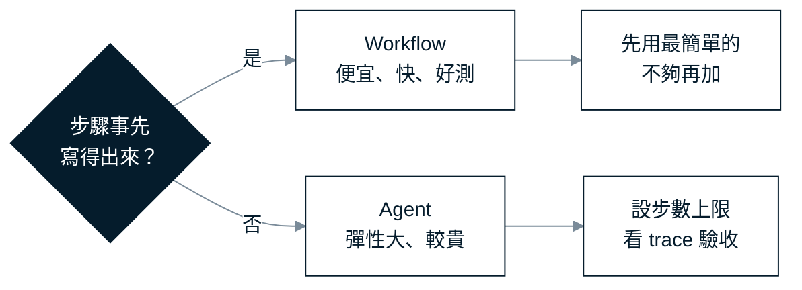

<sub>資料來源：本課整理；依 Anthropic〈Building effective agents〉（2024-12-19）與投影片「Workflow 還是 Agent？」。</sub>

現實系統很少是純粹的其中一種。第 9 章會看到 2026 年企業系統的典型形狀：外殼是一張固定流程圖，只有中間「調查」那一格交給 agent。先記住這條判準，它會反覆出現。

## 7.6 while 迴圈撐不起分支、暫停與恢復，所以要把它畫成狀態圖

**7.4 節的 while 迴圈撐得住第一版；一旦要分支、重試、暫停等人、重啟後恢復，就得把流程變成一個存得下來的圖。** 這不是框架的品味問題，而是這四個需求都要求「流程的當前位置和資料」能被明確表示、保存、讀回。

四個需求逐一看手寫會發生什麼。**分支**：結果不同要走不同的路，手寫就是 `if/elif` 越寫越亂。**暫停**：危險操作先等人批准，但手寫的迴圈活在一個 Python 行程的記憶體裡，一停就沒了；人可能十分鐘後才回來點核准，你不能讓行程一直卡著。**重試**：工具失敗要回頭再試，手寫的計數器散落各處，很容易無限重試。**恢復**：服務重啟後要從中斷處接著跑，手寫的狀態沒存下來，只能從頭來過。

**圖 7-9　一張狀態圖同時裝下分支、暫停、重試與恢復**

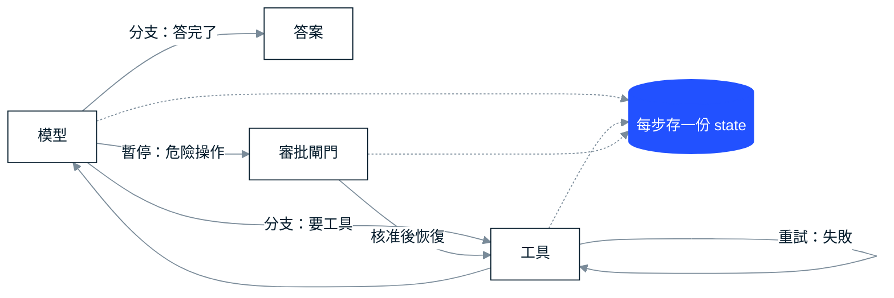

<sub>資料來源：本課整理；改繪自投影片「為什麼 agent 需要狀態圖」。</sub>

圖中強調的是最下方的存檔點。四個需求裡，分支和重試靠「圖」就能解決；暫停和恢復則必須靠「每一步都存一份 state」。這正是 LangGraph 的設計重心：它把迴圈表示成狀態機（state machine），並且在每一步之後由 checkpointer 存檔。第 8 章會看到，同一個存檔機制同時撐起跨回合記憶、時光旅行和人在回路三件事。

用訓練的經驗類比：訓練迴圈寫久了，你會換成 PyTorch Lightning 或 Hugging Face Trainer。框架沒有發明新演算法，只是把你本來就在寫的迴圈結構化，把 checkpoint、logging、early stopping 這些每次都要寫的東西收進去。LangGraph 對 agent 迴圈做的是同一件事。模組五 `00_concepts.md` 第 4 節直接把 02 的 while 迴圈拆成狀態 dict、節點表、邊表和快照清單，讓你看到「狀態機」只是同一段程式換個組織方式。

## 7.7 StateGraph 用 State、Node、Edge 三樣東西描述整個迴圈

**LangGraph 的 StateGraph 只有三個要素：State 是所有節點共用的白板，Node 是讀白板、回傳更新的函式，Edge 是決定下一步去哪的箭頭。** 把 7.4 節的手寫迴圈拆開，剛好就是這三樣。

**State（狀態）**是一個用 `TypedDict` 定義的資料結構，例如只有一個 `messages` 欄位。它在整張圖裡流動，可以類比成在網路裡流動的 tensor。LangGraph 內建的 `MessagesState` 就是只含 `messages` 欄位的現成 State。

**Node（節點）**是一個普通的 Python 函式：輸入目前的 state，回傳「要更新哪些欄位」的部分 dict，而不是整份 state。可以類比成一層 layer，輸入 state、輸出更新。

**Edge（邊）**決定一個節點跑完之後去哪裡。固定邊永遠走同一條路；條件邊（conditional edge）由一個函式讀 state 後決定，下一節細講。

```python
from langgraph.graph import StateGraph, MessagesState, START

g = StateGraph(MessagesState)                 # State：白板
def call_model(state):                        # Node：讀 state、回傳更新
    reply = model.invoke(state["messages"])
    return {"messages": [reply]}
g.add_node("call_model", call_model)
g.add_node("run_tool", run_tool)
g.add_edge(START, "call_model")               # Edge：固定邊
g.add_conditional_edges("call_model", route)  # 條件邊：route 決定去哪
g.add_edge("run_tool", "call_model")
```

**圖 7-10　StateGraph 把手寫迴圈拆成兩個節點、一條條件邊和一塊共用白板**

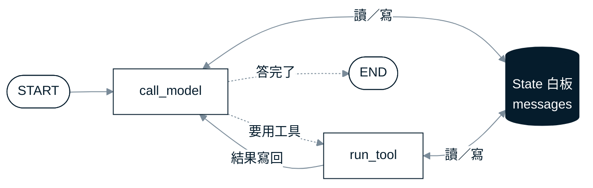

<sub>資料來源：本課整理；改繪自投影片「StateGraph：State、Node、Edge」。實線為固定邊，虛線為條件邊。</sub>

手寫版和 LangGraph 版的對應關係可以整理成一張表。左欄每一樣東西你在 7.4 節都寫過，右欄只是它們的正式名稱：

| 手寫迴圈 | LangGraph |
|---|---|
| `messages` 這個 dict 或 list | `TypedDict` 定義的 State |
| 「回覆要 append」這條規則 | reducer：`Annotated[list, add_messages]`、`operator.add` |
| 呼叫模型、執行工具兩段程式 | `add_node` |
| `if not msg.tool_calls` | `add_conditional_edges` |
| `for _ in range(MAX_STEPS)` | `recursion_limit` |
| （沒有，或自己 deepcopy） | checkpointer：`InMemorySaver`、`PostgresSaver` |

最後一列是手寫版沒有、而 LangGraph 免費送的東西。執行時，LangGraph 以 **super-step** 為單位推進：循序的節點各占一個 super-step，平行的節點共用同一個 super-step；每個 super-step 結束都可以存一個 checkpoint。這個單位等一下談 reducer 和 `recursion_limit` 時都會用到。

官方〈Thinking in LangGraph〉建議的設計順序也值得照做：先拆步驟、判斷每步類型、設計 state，再寫 node、最後接線。這和你先畫網路架構圖再實作 `forward()` 是同一個習慣。

## 7.8 條件邊就是一個回傳節點名稱的普通函式

**條件邊讓流程有分岔，而它的實作簡單得出奇：一個普通函式讀 state，回傳「下一個節點叫什麼名字」。** 7.4 節手寫迴圈裡那行 `if not msg.tool_calls`，在圖上就變成一條條件邊。

```python
def route(state: MessagesState):
    last = state["messages"][-1]
    if last.tool_calls:
        return "run_tool"
    return END

g.add_conditional_edges("call_model", route, ["run_tool", END])
g.add_edge("run_tool", "call_model")
```

`add_conditional_edges` 的第三個參數列出 `route` 可能回傳的目的地，讓 LangGraph 在編譯時就知道圖的完整結構，可以畫出來、也可以檢查。工具跑完之後是固定邊，永遠回到模型。

**圖 7-11　路由函式是圖上唯一的分岔點，其餘都是固定邊**

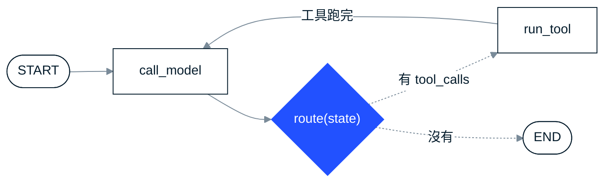

<sub>資料來源：本課整理；改繪自投影片「條件邊：讓流程有分岔」。</sub>

用你熟悉的東西類比：early-exit 網路依輸入的難度決定在哪一層提早輸出，Mixture-of-Experts 的 gating network 依輸入決定交給哪個 expert。條件邊做的是同一件事，只是 router 不是一個學出來的網路，而是你寫的一個普通函式。這點很重要：路由邏輯可以完全是確定性的程式碼（看 state 裡有沒有 `tool_calls`），也可以讀模型輸出的分類結果；但「讀什麼、走哪條」永遠寫在程式裡，可以測試、可以稽核。

除了條件邊，LangGraph 還允許節點直接回傳 `Command(update=..., goto=...)`，一步同時更新狀態並指定下一個節點。官方文件把這種「在節點執行期才決定的路線」畫成虛線，和編譯時就確定的實線區分開。第 8 章的審批閘門就用這個寫法：審批節點根據人的決定，`goto` 執行節點或退回 agent。

## 7.9 Reducer 決定同時寫入時要覆蓋還是累加，預設是覆蓋

**當兩個節點都要更新 state 的同一個欄位，reducer 決定怎麼合併；LangGraph 的預設是覆蓋，想累加就要在欄位上明講。** 這是新手最常踩的坑之一，而用深度學習搭橋一秒就懂：PyTorch 的 `.grad` 預設是**累加**（所以每步要 `zero_grad()`）；LangGraph 的 state 剛好相反，預設是**覆蓋**。

看一個具體情境：兩個平行的工具節點 `search_web` 和 `search_db`，都把結果寫進 `results` 欄位。

```python
class State(TypedDict):
    results: list                              # 沒有 reducer：只能一個寫入者

class State(TypedDict):
    results: Annotated[list, operator.add]     # 有 reducer：兩個值都留下
```

沒有 reducer 時會發生兩種情況，取決於執行順序。如果兩個節點分先後執行，後者直接覆蓋前者，`results` 只剩 `["db"]`，`["web"]` 無聲無息地消失了。如果兩個節點在同一個 super-step 平行寫入，LangGraph 乾脆拋出 `InvalidUpdateError`，因為它不知道該留哪一個。加上 `Annotated[list, operator.add]` 之後，兩次更新會被接在一起，得到 `["web", "db"]`。

**圖 7-12　同一步的兩個寫入，沒有 reducer 會出錯，有 reducer 才會合併**

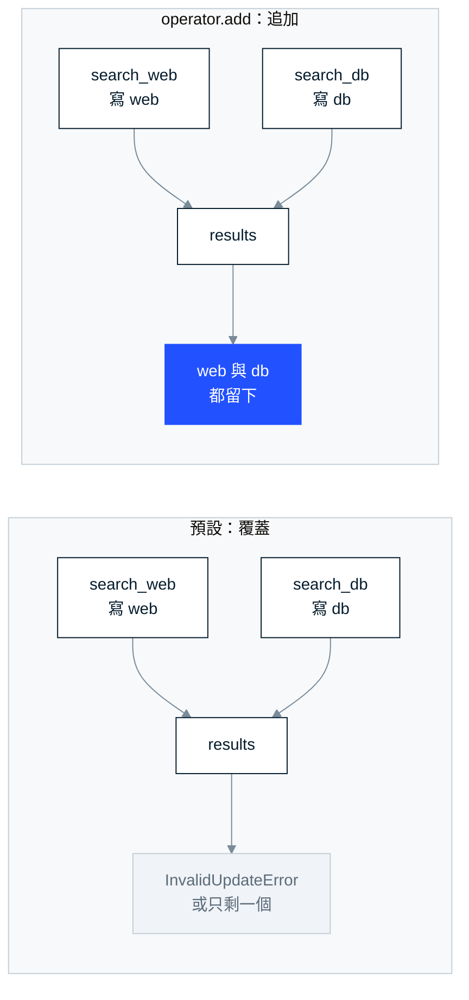

<sub>資料來源：本課整理；改繪自投影片「Reducer：同時寫入怎麼合併」與「踩坑：死循環燒 token、並發寫入出錯」。</sub>

`messages` 欄位有自己的專屬 reducer：`add_messages`。為什麼不用 `operator.add` 就好？因為 `operator.add` 只能追加，而 `add_messages` 還能依訊息 id 更新既有訊息。例如人工審批時把某則 tool call 的參數改掉，你要的是替換那一則，而不是在尾巴再多加一則。`MessagesState` 內建的 `messages` 欄位就是用 `add_messages`。

課綱原本把這個問題寫成「並發狀態覆蓋與資料競爭」，聽起來像多執行緒的 race condition，實際上不是。LangGraph 的執行是 super-step 同步推進的，不會有兩個執行緒搶著寫同一塊記憶體；問題純粹是「同一 super-step 有兩個更新、而合併規則是覆蓋」。理解成合併規則的問題，修法就很自然：在欄位上明講怎麼合併。

## 7.10 create_agent 把最常見的圖預先接好，客製行為改用 middleware

**前面幾節親手接的那張「模型 ⇄ 工具」圖，在 LangChain 1.x 已經由 `create_agent` 預先接好；想改變行為（限制呼叫次數、人工審批、摘要舊對話、遮蔽個資），就把 middleware 掛上去。** 它底下跑的仍是 LangGraph 的 StateGraph、checkpointer 和 interrupt，前面學的全部可以沿用。

先釐清版本與歷史，避免被網路上的舊教材誤導。LangChain 1.0 和 LangGraph 1.0 於 2025-10-22 同日發布，承諾 2.0 之前不做破壞性變更。1.x 的主角是 `from langchain.agents import create_agent` 加 middleware，它取代了 `langgraph.prebuilt.create_react_agent`（後者已標為 deprecated）。舊版的 `AgentExecutor` 已經移出主套件，只存在於相容套件 `langchain-classic`；你可能在面試題裡聽到它，但新程式不會再用。

```python
from langchain.agents import create_agent
from langchain.agents.middleware import (
    ModelCallLimitMiddleware, ToolCallLimitMiddleware)

agent = create_agent(
    model="ollama:qwen3:14b",
    tools=[get_price, calc],
    system_prompt="你是購物助手",
    middleware=[ModelCallLimitMiddleware(run_limit=10),
                ToolCallLimitMiddleware(run_limit=10)],
)
agent.invoke({"messages": [("user", "三個 USB-C 轉接器多少錢？")]})
```

（上限數值依任務自訂，這裡只是示意。）

Middleware 的意思是「掛在迴圈特定位置的攔截器」：在呼叫模型之前、之後，或執行工具之前插手。和前面手寫的版本對照，`ModelCallLimitMiddleware` 和 `ToolCallLimitMiddleware` 就是你寫在 for 迴圈上的步數上限，只是拆成「模型呼叫次數」和「工具呼叫次數」兩種成本保險；`HumanInTheLoopMiddleware` 就是在「模型 → 工具」那條邊上插一個收費站，第 8 章細講。官方內建的還有摘要、PII 遮蔽，以及規劃用的 `TodoListMiddleware`。

**圖 7-13　三層堆疊：create_agent 在上、middleware 掛在迴圈上、LangGraph 在底層執行**

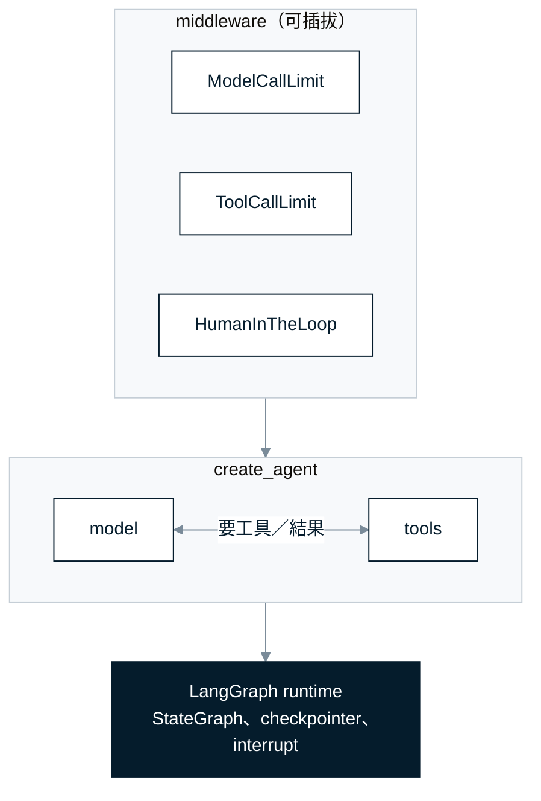

<sub>資料來源：本課整理；改繪自投影片「create_agent：把圖預先接好」。</sub>

這個分層可以用你熟悉的框架堆疊來記：CUDA → PyTorch → Lightning。LangGraph 是底層 runtime，負責持久化、串流、中斷與恢復；`create_agent` 是上層的 agent 外殼；再往上還有第 9 章的 Deep Agents。LangChain 官方自己的定位也是如此：LangChain 是 framework，LangGraph 是 runtime，Deep Agents 是 harness。

那還需要學 StateGraph 嗎？需要，理由有二。第一，`create_agent` 只是預先接好的一張圖；當你的流程不是單純的「模型 ⇄ 工具」迴圈，例如第 8 章的「調查 → 計畫 → 審批 → 執行 → 驗證」固定流程，就得下探到 StateGraph 自己接線。第二，所有高階抽象出錯時，你看到的錯誤訊息、trace 和 checkpoint 都是 LangGraph 層的東西。看得懂底層，才除得了錯。

`create_agent` 也支援 `response_format=`，讓 agent 最後回傳一個 Pydantic 定義的型別化結果：模型支援原生結構化輸出就走 ProviderStrategy，否則退回 ToolStrategy。第 8 章的旗艦專案就用這個機制，讓調查 agent 交出一份 `Diagnosis` 物件，而不是一段自由文字，固定流程才能接手。

## 本章重點

Agent 是把模型放進迴圈：模型只負責寫出「下一步要呼叫哪個工具、參數是什麼」的 JSON，執行權永遠在你的程式，所以能力與安全邊界都由工具清單和你的程式決定。ReAct 證明了推理與行動交錯比只想或只做更可靠，而 50 行的手寫迴圈已經包含所有核心元素，真正的工程在終止條件、錯誤回饋和看 trace 驗收。動手前先問步驟寫不寫得出來，寫得出來就用 workflow。需要分支、暫停、重試與恢復時，把迴圈畫成 StateGraph：State 是白板、Node 回傳部分更新、Edge 決定去向、reducer 決定合併規則（預設覆蓋，`messages` 用 `add_messages`）。LangChain 1.x 的 `create_agent` 把常用的圖接好，行為用 middleware 調整，底下仍是 LangGraph。

## 對應實作與延伸閱讀

- 原理紀要：[模組五 `00_concepts.md`](../../modules/module-05-agent-harness/00_concepts.md) 第 1–4 節
- 手寫 ReAct：[`01_react_from_scratch.ipynb`](../../modules/module-05-agent-harness/01_react_from_scratch.ipynb)
- 手寫 function calling 迴圈：[`02_function_calling_loop.ipynb`](../../modules/module-05-agent-harness/02_function_calling_loop.ipynb)
- 把 RAG 包成工具：[`03_rag_as_tool.ipynb`](../../modules/module-05-agent-harness/03_rag_as_tool.ipynb)
- StateGraph、reducer、checkpoint：[`04_state_checkpoint.ipynb`](../../modules/module-05-agent-harness/04_state_checkpoint.ipynb)
- 六種寫法的行數與控制權對照：[`10_framework_map.ipynb`](../../modules/module-05-agent-harness/10_framework_map.ipynb)
- 投影片 PDF：[`deck.pdf`](../slides/deck/deck.pdf)（模組五 500–513、528、550、560 頁）
- Yao et al.（2022）〈ReAct: Synergizing Reasoning and Acting in Language Models〉，arXiv:2210.03629
- Anthropic〈Building effective agents〉（2024-12-19）：workflow 與 agent 的定義、五種 workflow 模式
- Thorsten Ball〈How to Build an Agent〉（2025-04-15）：從聊天迴圈逐步長出 agent
- LangGraph 官方文件〈Graph API overview〉〈Workflows and agents〉〈Thinking in LangGraph〉；LangChain〈Agents〉與 v1 release notes
- Hugging Face Transformers 文件〈Tool use〉（chat_extras）：用開源模型看 tool call 的 token 長相
