# 第 9 章　Harness 架構：一個 agent 配齊外掛，而不是一張職能組織圖

**本章結論**：2026 年 Anthropic、OpenAI、LangChain 與企業 SRE 產品的預設架構收斂到同一個形狀：一個通用 agent 迴圈，外掛 skills、子 agent、檔案記憶、壓縮、MCP 工具與權限 hooks，業界稱為 harness。要加能力，就加一格外掛，而不是再加一個 agent。多 agent 沒有消失，但被降級成「需要時才用的工具」：切開的理由只有隔離 context、平行查證、寫審分離與權限邊界，不是業務職能；而且每多一個 agent，token 帳單就以倍數成長。確定性控制也沒有消失，而是移到護欄層：寫入走固定流程、權限走 hooks、成本走呼叫上限。本章的判準是：**先用一個 agent，有證據才切；外殼用流程圖，核心用 harness。**

讀完本章，你應該能解釋為什麼「主管 agent → 文件／資料庫／運維 agent」的切法被點名為反模式，能估算多 agent 大約貴多少，也能為一個新任務選出模式與框架。

---

## 9.1 Harness 是一個迴圈加上整套配備，2026 年三大廠的旗艦都長這樣

**Harness（直譯是「馬具」）指的是包在模型外面、讓它能長時間可靠工作的那整套東西：呼叫模型的迴圈、把工具呼叫導向實際系統的路由，以及 skills、子 agent、記憶、壓縮、權限這些外掛。** Anthropic 在〈Scaling Managed Agents〉（2026-04-08）給的定義最精簡：harness 是「呼叫 Claude、並把 Claude 的工具呼叫導向相關基礎設施的那個迴圈」。換句話說，第 7 章的 50 行迴圈就是一個最陽春的 harness；本章談的是它長大之後的樣子。

這個形狀不是某一家的偏好，而是三家的旗艦產品各自走到同一處。Anthropic 的 Claude Agent SDK 與 Managed Agents、OpenAI 的 Codex 搭配 `AGENTS.md` 與 Skills、LangChain 的 Deep Agents，核心都是單一 agent 迴圈加上內建工具、按需載入的 skills、當成工具呼叫的子 agent、檔案系統記憶、壓縮與權限。開源社群的 pi、OpenClaw、Hermes Agent 也一樣：核心都是單一 agent loop，沒有 supervisor 或 graph 編排器（本課整理自 `architecture-2026.md`，核實日 2026-11-17）。

**圖 9-1　Harness：中間是同一個迴圈，周圍是外掛；權限與審批在最外層把關**

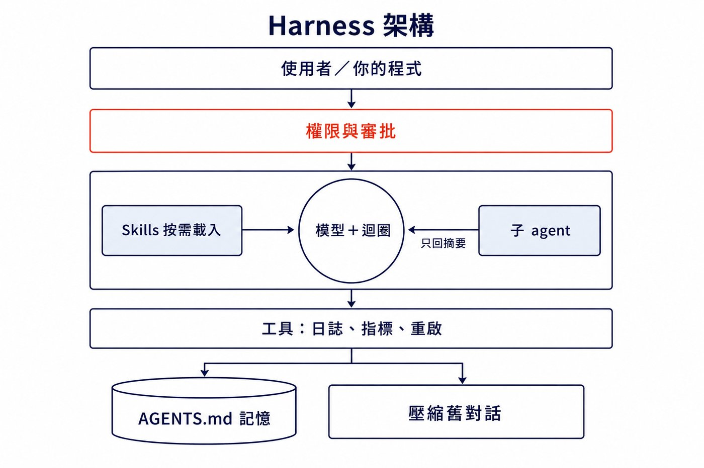

<sub>資料來源：模組五 `images/harness.jpg`（本課繪製）。</sub>

LangChain 官方對自家三個套件的重新定位，正好說明了這個轉變。Harrison Chase 在 2025-10-25 的文章把三者分成三層：LangChain 是 framework，LangGraph 是 runtime（負責持久化、串流、人在回路），Deep Agents 是 harness（開箱即用的 prompt、規劃、檔案系統）。這意味著直接用 StateGraph 畫出 agent 之間的拓撲，已經變成「要客製時才下探」的層級；第 7、8 章學的 StateGraph 並沒有過時，它的位置變成了 runtime 與固定流程，而不是 agent 組織圖。

**圖 9-2　LangChain 家族的三層分工：framework、runtime、harness**

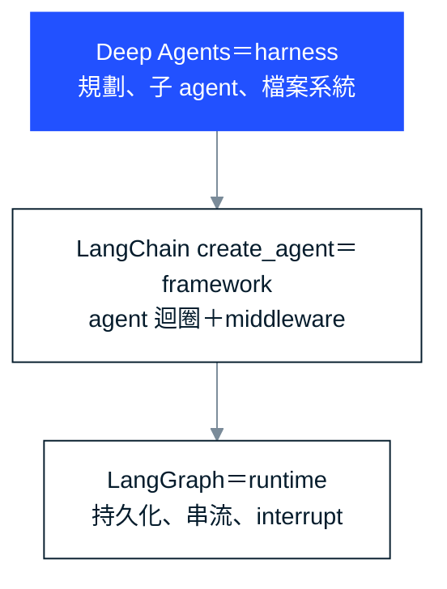

<sub>資料來源：本課整理；依 Harrison Chase〈Agent frameworks, runtimes, and harnesses — oh my!〉（2025-10-25）與 LangChain Deep Agents 文件。</sub>

為什麼大家都收斂到這裡？有一條實證值得記住：LangChain 在 2026-02-17 的〈Improving Deep Agents with harness engineering〉裡，**模型固定不變**（gpt-5.2-codex），只調整 harness 的 system prompt、工具和 middleware，Terminal Bench 2.0 的成績就從 52.8% 提升到 66.5%。同一個模型，配備不同，表現差了 13.7 個百分點。這說明了工程重心在哪：比起換模型、加 agent，把一個 agent 的配備調好往往更划算。

## 9.2 Harness 的每個外掛，都在解決一個 context 問題

**Harness 的外掛清單看起來雜，但幾乎每一格都在處理同一件事：context window 有限，而且越滿越不可靠。** 理解了這個共同敵人，你就知道每個外掛為什麼存在，也知道什麼時候不需要它。

先建立直覺。第 7 章看過，agent 每走一輪就把整串 messages 重送給模型，context 只會越來越長。Anthropic 在〈Effective context engineering for AI agents〉（2025-09-29）把隨之而來的退化稱為 context rot：token 越多，模型對其中個別資訊的回想越差，就像有一份「注意力預算」被攤薄了。你學過 attention 就能理解：softmax 的權重總和是 1，序列越長，每個 token 平均分到的注意力越少。所以 context 不只是貴，塞太多還會讓模型變笨。

| 外掛 | 做什麼 | 解決的 context 問題 |
|---|---|---|
| Skills | 一個資料夾一份 `SKILL.md`，system prompt 只放一行描述，用到才讀全文 | 專業知識太多，全塞進 prompt 會撐爆 |
| 子 agent | 主 agent 呼叫一次工具，子 agent 在全新 context 裡做完，只回摘要 | 讀大量日誌的細節污染主 context |
| 檔案記憶 | `AGENTS.md`、筆記檔、進度檔，跨次保存 | 長任務的中間結論無處可放 |
| 壓縮（compaction） | context 快滿時把舊對話換成摘要，原文存到檔案 | 長任務因 context 滿而中斷 |
| 工具／MCP | 外部系統的標準接頭；schema 可延遲載入 | 工具定義本身大量吃 token |
| 權限與 hooks | 工具執行前後插手：允許、拒絕、改參數、寫稽核 | （這格不是 context 問題，是安全問題） |

工具定義吃 token 這件事常被低估。Anthropic 的〈Advanced tool use〉提到，58 個工具的定義約佔 55K tokens，也見過工具定義高達 134K tokens 的情況；〈Code execution with MCP〉的例子則把 token 用量從 150,000 降到 2,000，做法是把工具做成檔案、按需讀取。同一篇 context engineering 文章也直說，最常見的失敗模式之一就是「涵蓋太多功能的臃腫工具集」。這是 skills 與 tool search 出現的原因：**context 膨脹的官方解法是漸進式揭露，不是拆成更多 agent。**

**圖 9-3　五個外掛對準同一個敵人：越長越不可靠的 context**

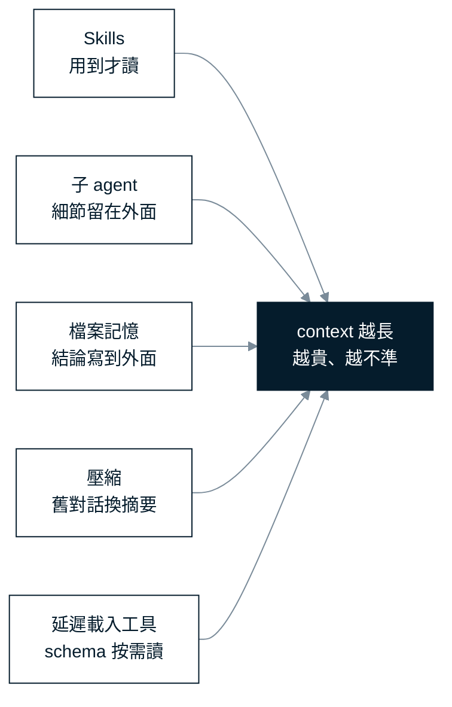

<sub>資料來源：本課整理；依 Anthropic〈Effective context engineering for AI agents〉（2025-09-29）、〈Code execution with MCP〉（2025-11-04）、〈Advanced tool use〉（2025-11-24）。</sub>

用深度學習的語言，這些外掛都是「把中間狀態搬到 context 外面」：todo 清單和檔案系統就是 agent 的外部記憶體，很像把 activation 搬到 CPU 記憶體的 offloading；壓縮則像把一段長序列先摘要成較短的表示。Manus 團隊的經驗文章把檔案系統稱為「終極的 context」：大小不受限、天生持久。

## 9.3 子 agent 的價值是隔離 context，主 agent 只看到一次請求與一份摘要

**子 agent 包成工具（subagents as tools）的意思是：主 agent 把一個子任務當成一次工具呼叫交出去，子 agent 在全新的 context 裡跑自己的迴圈，做完只回最後一則訊息。** 子 agent 讀了多少日誌、跑了幾步、走過哪些死路，主 agent 全都看不到。這正是它的價值所在。

用你熟悉的東西類比：把一個子網路包成 `nn.Module`，外層只看 `forward` 的輸入和輸出，不管裡面有幾層。子 agent 對主 agent 而言也是如此：請求字串進、摘要字串出。Anthropic 提到子 agent 回傳的摘要常在 1,000 到 2,000 tokens，而它自己可能讀了數萬 token 的原始資料。

**圖 9-4　所有路由都經過主 agent，子 agent 就像它手上的工具**

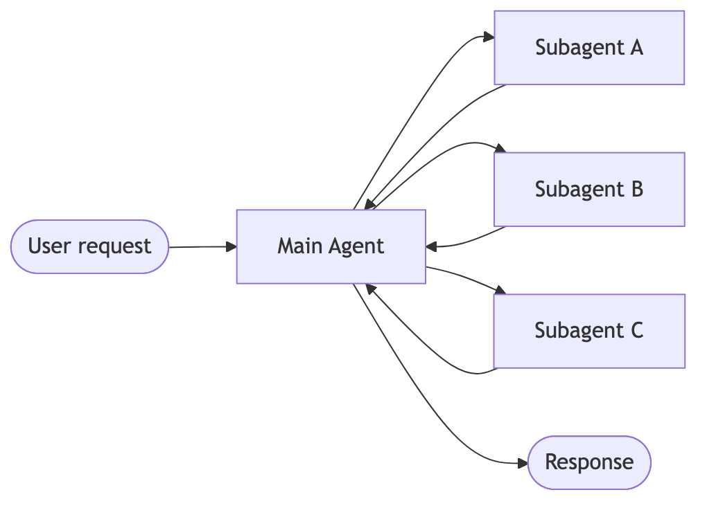

<sub>資料來源：LangChain Docs〈Multi-agent〉段落 Visual overview，MIT License © 2025 LangChain。</sub>

課綱原本用 `langgraph-supervisor` 套件實作這個模式，但它的 GitHub repo 已經封存，README 明寫「現在推薦直接用工具實作 supervisor 模式，而不是這個函式庫」，理由是工具呼叫的方式讓你更能掌控 context engineering。所以本課不安裝它。LangChain 官方的 Supervisor 教學就是這個寫法：子 agent 各用 `create_agent` 建，用 `@tool` 包成一個函式，內部 `invoke` 後只回傳最後一則訊息的文字。Deep Agents 則內建一個 `task` 工具，用宣告的方式定義子 agent：

```python
log_checker = {
    "name": "log-checker",
    "description": "查一個懷疑的原因：讀日誌、回報證據",   # 主 agent 看到的說明書
    "system_prompt": "只讀不寫。回三行：結論、證據、信心。",
    "tools": [read_logs, query_metrics],                 # 只給唯讀工具
}
agent = create_deep_agent(model, tools=[read_logs, query_metrics, restart_service],
                          system_prompt="你是值班 agent。", subagents=[log_checker])
```

注意兩件事。第一，子 agent 的 `description` 就是主 agent 選擇它時唯一看得到的說明，寫法要跟第 7 章的工具說明書一樣用心。第二，子 agent 只拿到唯讀工具；重啟這種寫入動作留在主 agent 手上，而且還要過審批。

隔離的代價是資訊不會自動流通。每次呼叫子 agent 都從空白 context 開始，子 agent 之間也不能直接溝通；要共用的資訊，必須由主 agent 轉手寫進下一個請求。下面這段晨光外送的調查過程是示意：

**圖 9-5　子 agent 之間只傳請求、只回摘要；「14:02」是主 agent 轉手過去的**

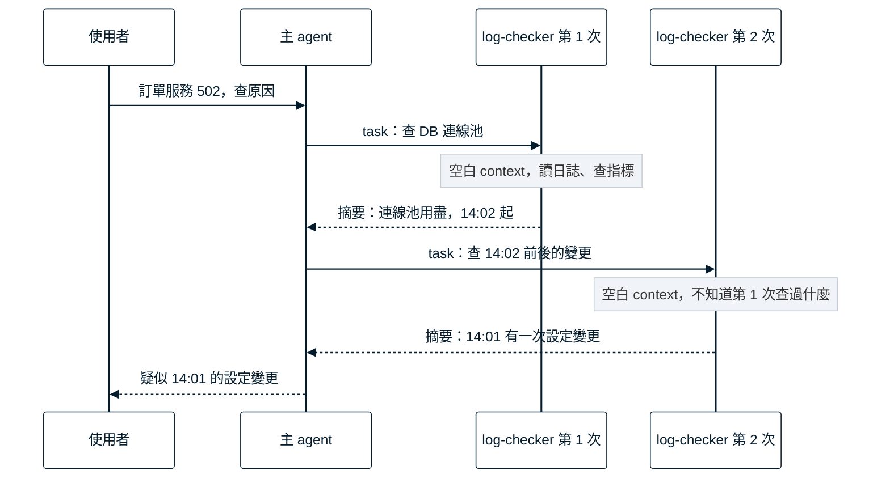

<sub>資料來源：本課整理；改繪自投影片「子 agent 之間：只傳請求、只回摘要」（示意）。</sub>

這張圖同時說明了子 agent 的優點與風險。優點：主 agent 的 context 只多了四則短訊息，乾淨得足以做最後判斷。風險：最終回覆只靠兩則摘要寫成，原始證據主 agent 看不到；摘要若抄錯，結論就跟著錯。Cognition 的〈Don't Build Multi-Agents〉（2025-06-12）正是從這個風險出發，主張共享完整 trace、而不只是個別訊息。下一節會看到，這個資訊損失加上 token 成本，決定了什麼時候值得切。

## 9.4 多 agent 的帳單以倍數計，要先證明多花的 token 買到了東西

**每個子 agent 都跑自己的迴圈、各用各的 context，agent 越多，token 帳單越大，而且是以倍數成長。** 所以多 agent 是一筆投資，動手前要能說出它買到什麼。

最常被引用的數字來自 Anthropic〈How we built our multi-agent research system〉（2025-06-13）：以聊天為基準，單一 agent 約用 4 倍 token，多 agent 系統約用 15 倍。同一篇也提到，在 BrowseComp 評測上，token 用量單獨就解釋了約 80% 的表現差異；換句話說，多 agent 很大程度是「用更多 token 換更好的結果」，跟 scaling law 裡「更多算力換更好表現」是同一條邏輯。Anthropic 2026-01-23 的指南則說，多 agent 在同等任務上通常多用 3 到 10 倍 token。

本課在小任務上也實測過一次。同一題「下單一直 502，找根因」，用 CrewAI 搭本機 `qwen2.5:3b` 各跑一次三種拆法，三版都找對根因：

| 版本 | agent 數 | 請求次數 | 總 tokens | 相對 A |
|---|---|---|---|---|
| A 單一 agent | 1 | 2 | 1,356 | 1× |
| B 依角色硬拆 | 4 | 28 | 13,212 | 約 9.7× |
| C 平行查證＋審查 | 4 | 28 | 14,116 | 約 10.4× |

<sub>本課實測，來源 `modules/module-05-agent-harness/09_crewai_multiagent.ipynb` Step 4–7；跑一次，重跑數字會略有不同。</sub>

**圖 9-6　同一件事，agent 越多，token 以倍數成長**

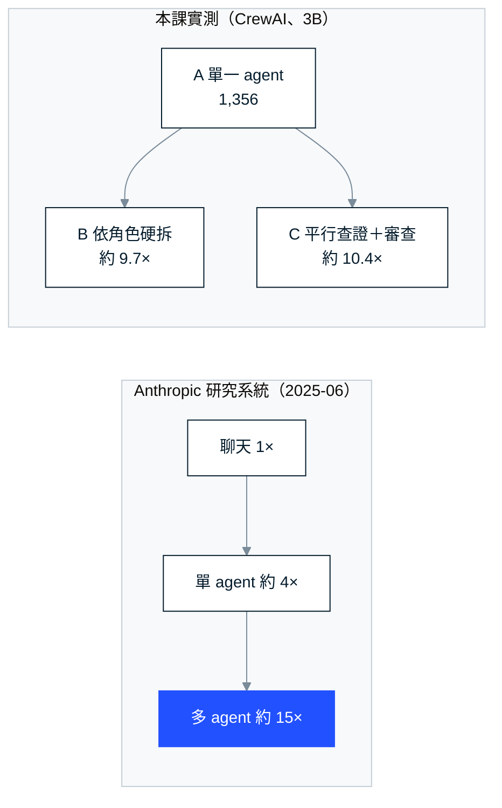

<sub>資料來源：Anthropic〈How we built our multi-agent research system〉（2025-06-13）；本課實測見 `09_crewai_multiagent.ipynb`。兩組數字來自不同系統與任務，不可混成同一個倍數。</sub>

兩組數字要分開讀：約 15 倍是 Anthropic 大型研究系統的數字，約 10 倍是本課單次小任務實測，都可以引用，但不能合併成一個數字。更重要的是讀出 B 和 C 的差別。兩者幾乎一樣貴，但 **B 沒有買到東西**：主管 agent 看不到原始資料，只能相信三份摘要，任何一份抄錯，結論跟著錯。**C 買到了東西**：每條線索同時查、各自的 context 乾淨，再由審查者挑出沒有證據支撐的結論。A 說明了另一件事：問題小、工具少的時候，一個 agent 就夠了。

Anthropic 也指出多 agent 適合與不適合的情境：適合廣度優先、可平行的研究類任務，資訊量超過單一 context、工具很多；不適合所有 agent 都需要共享同一份 context 的任務，以及大多數寫程式的任務。LangChain 的官方比較從另一個角度佐證成本：同一個單次請求，Subagents 模式要 4 次模型呼叫，Handoffs、Skills、Router 各 3 次，因為每一步都要經過主 agent 轉手。

## 9.5 切分的軸是 context、平行、審查與權限，不是業務職能

**什麼時候該切成多個 agent？先用一個，有證據不夠用才切；而切開的理由只有四種：隔離 context、平行查證、寫審分離、權限或組織邊界。依業務職能切（文件 agent、資料庫 agent、運維 agent）是被點名的反模式。** 這是本部最重要的架構判斷，也是本課從課綱改寫最多的地方。

先看反模式為什麼不行。「主管 agent 路由到文件 agent、資料庫 agent、運維 agent」的切法很直覺，像一張組織圖。但真實問題不照組織圖發生。「502 是不是資料庫連線池滿了？」這一題同時需要查 runbook（文件）、查連線池指標（資料庫）、查錯誤日誌（運維），主管只好來回轉手，每轉一次，細節就掉一點；主管自己看不到任何原始資料，只能相信摘要。Anthropic 2026-01-23 的指南說得很直接：依角色切分會造成持續的協調開銷，每次交接都會損失資訊；**要依 context 邊界切，不要依工作類型或角色切**。同一份指南的開頭也寫：單一 agent 系統能有效處理大多數企業工作流程。

**圖 9-7　左邊依角色硬拆，轉手掉細節；右邊依假設平行查證，再交給審查者**

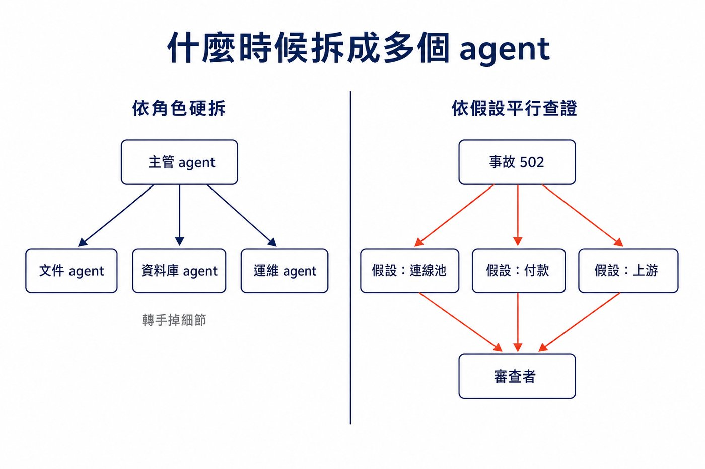

<sub>資料來源：模組五 `images/single_vs_multi.jpg`（本課繪製）。</sub>

值得切開的四種情況，每一種都對應一個具體的好處：

| 切開的理由 | 例子 | 好處從哪來 |
|---|---|---|
| 隔離 context | 要讀一大堆日誌，交給子 agent 讀完只回摘要 | 主 context 保持乾淨 |
| 平行查證 | 每個懷疑的根因開一個唯讀子 agent，同時跑 | 速度；一個假設不會帶偏另一個 |
| 寫的和審的分開 | 產出報告的 agent 不該自己打分數 | 乾淨 context 的審查者更敢挑毛病 |
| 權限或組織邊界 | 不同部門的資料與權限不能共用 | 合規 |

第二、三種有最強的證據。企業 SRE 產品的調研發現，真實系統的子 agent 是**依假設切**（每個候選根因一個），不是依資料源切：PagerDuty 是「每個候選根因一個子 agent」，Azure 的工程文章說這樣能避免一個假設帶偏另一個（本課整理自 arch-C 調研）。寫審分離則被 Anthropic 與 Cognition 反覆驗證：Anthropic 2026-03-24 的長任務 harness 文章發現，agent 評自己的作品時傾向自信地稱讚，而把一個獨立的評估者調成懷疑立場要容易得多；Cognition 2026-04-22 的文章也說乾淨 context 的審查者帶來明顯改善。

Cognition 同一篇文章還總結了一條很實用的原則：**寫入保持單執行緒**。有效的多 agent 型態是讓多個 agent 負責讀取或提供意見，寫入只由一個執行者做；平行寫入的 agent 群至今沒有看到有意義的採用。這和第 8 章的固定寫入流程完全吻合：唯讀的查證可以平行展開，寫入只有一條路。

**圖 9-8　要不要切的決策：先問理由，再問能否只讀**

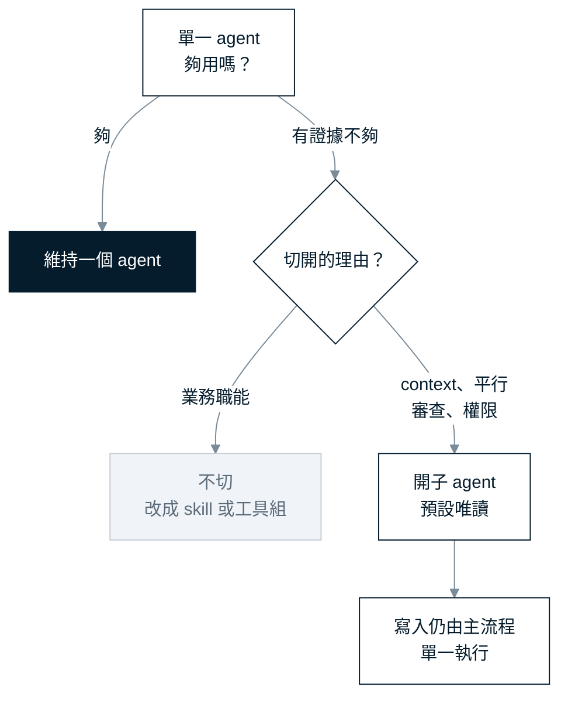

<sub>資料來源：本課整理；依 Anthropic〈Building multi-agent systems: When and how to use them〉（2026-01-23）、Cognition〈Multi-Agents: What's Actually Working〉（2026-04-22）與投影片「什麼時候才切成多個 agent」。</sub>

這不表示 supervisor 這個**概念**被否定了。Anthropic 2026-04-10 的協調模式文章建議大多數情況從 orchestrator-subagent 起步；LangChain 文件也說 subagents 模式適用於多個不同領域。被淘汰的是兩件事：專用的 supervisor graph 函式庫，以及依職能硬切的拓撲。那文件、資料庫、運維這三種能力該放哪？答案在下一節：它們比較像 skills、工具組或 MCP server，而不是 agent。

## 9.6 Skills 用漸進式揭露，讓一個通用 agent 按需變成專家

**Skill 是一個資料夾：一份 `SKILL.md` 寫名稱、描述與做法，旁邊可以附腳本、參考文件與範本。Agent 啟動時只載入每個 skill 的一行描述，判斷相關才讀全文，需要時才讀附檔。** 這個「漸進式揭露」（progressive disclosure）讓一個通用 agent 掛上幾十個 skill 也不會撐爆 prompt，取代「每個場景做一個專用 agent」的做法。

先看它要取代的東西。課綱把「一個場景一個 agent」稱為「智能體動物園」：請假、報銷、訂票、合約各自一套提示詞、工具、部署（這個詞不是 Anthropic 原文用語，是本課轉述）。場景一多就維護不動：同一個修正要在每個 agent 各改一次，共用的格式與權限規範被複製貼上後慢慢走樣，而「誰來決定把請求交給哪個 agent」又成了新問題。Anthropic〈Equipping agents for the real world with Agent Skills〉（2025-10-16）的定位正是：與其為每個用例打造零散的專用 agent，不如用 skills 把通用 agent 變成專家。

Skill 的資料夾結構很簡單：

```text
ops-runbook/
├── SKILL.md      名稱、描述、做法
├── scripts/      可執行腳本
├── references/   參考文件
└── assets/       範本、資源
```

旗艦專案的 `skills/ops-runbook/SKILL.md` 就是一個實例。開頭的 frontmatter 只有 `name: ops-runbook` 和一行描述「收集監控與日誌，提出有證據的修復建議」，這是 agent 啟動時唯一看到的部分；正文才寫做法：先讀指標與日誌、再與 runbook 交叉確認、只有兩個服務可以建議重啟、恢復標準是哪三個門檻，最後一句「回應是建議，不是授權」。

**圖 9-9　漸進式揭露：context 隨任務需要一層一層變長**

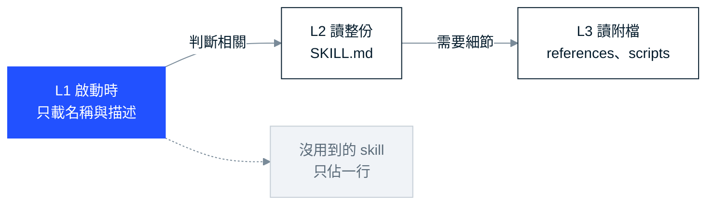

<sub>資料來源：本課整理；依 Anthropic〈Equipping agents for the real world with Agent Skills〉（2025-10-16）與 agentskills.io 規格，改繪自投影片「通用 Agent＋可插拔 Skills」。</sub>

用遷移學習搭橋最清楚：一個通用的 backbone，加上可插拔的 task head；或是第 3 章的 LoRA adapter，依任務熱插拔。漸進式揭露則像 lazy loading，用到才載入。Anthropic 用的比喻是新人入職手冊：目錄先看一遍，需要時翻到那一章，遇到細節再查附錄。

一句話分清 skills 和工具：**Tools 給能力，Skills 給做法。** 工具讓 agent 能讀日誌、能查指標；skill 告訴它遇到 502 時該先看什麼、看到什麼代表什麼。MCP 負責把外部系統接成工具（第 10 章細講），skills 負責教 agent 怎麼用那些工具，兩者互補。Agent Skills 在 2025-12-18 以開放標準發布，由 agentskills.io 維護，OpenAI 的 ChatGPT 與 Codex、LangChain 的 Deep Agents 都已採用同一種 `SKILL.md` 格式，skill 已經是跨廠商的東西。企業 SRE 產品也有同樣的趨勢：AWS 把 runbook 自動遷移成 skills，Azure、PagerDuty 都有 skills（本課整理自 arch-C 調研）。

Skills 也有代價。LangChain 的比較表指出，載入的內容會留在 context 裡越積越多；一個任務若連續觸發很多 skill，context 照樣會膨脹，這時才輪到子 agent 或壓縮出場。

## 9.7 Deep Agents 是 LangChain 家族的現成 harness，小模型要先瘦身

**Deep Agents（套件名 `deepagents`）把 9.2 節的外掛清單做成現成的 harness：規劃清單、`task` 子 agent、虛擬檔案系統、skills、`AGENTS.md` 記憶與 `interrupt_on` 審批，底層跑在 LangGraph 上。** 課綱寫的「DeepAgent」應改為正式名稱 Deep Agents；套件目前是 0.7.x，標示為 Beta。

它的設計思想來自 Harrison Chase 2025-07-30 的文章：簡單的「LLM 呼叫工具」迴圈是淺 agent，撐不了長任務；深 agent 多了四件套：規劃工具、子 agent、檔案系統、詳細的 system prompt，主要靈感來自 Claude Code。文章裡有一個有趣的觀察：Claude Code 的 todo 清單工具其實什麼都不執行，它的作用只是幫模型在長任務裡保持方向。

| 外掛 | Deep Agents 裡的形式 | 注意 |
|---|---|---|
| 規劃 | `write_todos` | v0.7 起改為手動開啟，要加 `TodoListMiddleware` |
| 子 agent | 內建 `task` 工具 | 隔離的 context，只回摘要 |
| 檔案系統 | `ls`、`read_file`、`write_file`、`edit_file`（另有 glob、grep 等） | 後端可選 state、本地磁碟、LangGraph store |
| Skills／記憶 | `skills=[...]`、`memory=["/AGENTS.md"]` | 同 9.6 節 |
| 審批 | `interrupt_on={"restart_service": True}` | 沒列入的工具自動放行 |

**圖 9-10　Deep Agents 的每一層都建在下一層上，前兩章學的全部沿用**

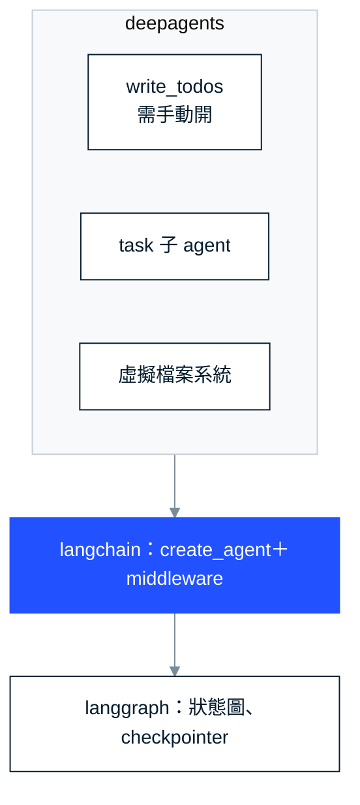

<sub>資料來源：本課整理；依 LangChain Deep Agents overview 文件與投影片「Deep Agents：同一個迴圈，加外掛就變深」。</sub>

組一個值班 harness 只要一次函式呼叫，下面是模組五 `06_harness.ipynb` 的骨架：

```python
agent = create_deep_agent(
    model,
    tools=[read_logs, query_metrics, restart_service],
    system_prompt="你是值班 agent。",
    backend=FilesystemBackend(root_dir="./oncall"),
    skills=["/skills/"],              # ops-runbook
    memory=["/AGENTS.md"],            # 值班慣例
    subagents=[log_checker],          # 唯讀查證
    interrupt_on={"restart_service": True},
    checkpointer=InMemorySaver(),
)
```

執行時的 trace 大致是：agent 先讀 `ops-runbook/SKILL.md`，接著用 `task` 叫兩次 log-checker 分別查「DB 連線池？」與「上游逾時？」，收到「連線池用盡；證據…；信心高」的摘要後提議 `restart_service`，此時圖暫停等值班主管審批，核准後用 `Command(resume={"decisions": [{"type": "approve"}]})` 恢復。這一串動作裡，第 7、8 章的每個機制都出現了。

接小模型有一個實務陷阱：**框架的預設 prompt 是為大模型設計的。** 模組五實測，deepagents 預設送出約兩萬字的內容（檔案工具說明、skills 與 memory 的英文使用指南），超過本機 Ollama `qwen2.5:3b` 的 4096 context，結果被截斷、答非所問。修法是先量實際送出的請求大小，再用正式的擴充點（`HarnessProfile`、同名 middleware）拿掉用不到的內建工具、縮短模板；換成雲端大模型就不需要這一步。這是第 1 章「Ollama 預設 `num_ctx` 4096」那條勘誤在 agent 層的後果。

## 9.8 外殼用流程圖、核心用 harness：確定性移到護欄層

**企業系統裡兩種東西並存：步驟寫得出來的（觸發、審批、執行、驗證）寫成固定流程圖；查不完的部分（看哪些日誌、懷疑哪個服務）交給一個 harness agent。** 這是第 7 章「workflow 還是 agent」那條判準在系統層級的答案：不是二選一，而是外殼用 workflow、核心用 agent。

2026 年沒有人說確定性控制不重要，爭議點在確定性該放在哪一層。舊做法把「哪個 agent 處理」寫成圖上的邊（LLM supervisor 路由），確定性和 agent 拓撲綁在一起。新做法把 agent 內部怎麼走交給模型與 harness，確定性放在**護欄層**：hooks、權限、HITL interrupt、linter 與測試、預算與輪數上限；或放在由程式碼驅動的外層 workflow（本課整理自 `architecture-2026.md` 第 6 節）。SRE 產品調研把它濃縮成一句：**調查要開放，執行要確定。**

**圖 9-11　只有中間那一格交給 agent 決定怎麼走，其餘每次都走同一條路**

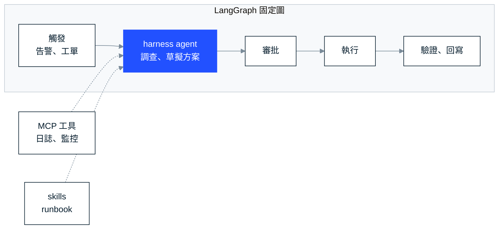

<sub>資料來源：本課整理；改繪自投影片「外殼用流程圖，核心用 harness」與模組五 `00_concepts.md` 第 8 節。</sub>

旗艦專案的 `live` 模式就是這張圖的實作。第 8 章的五節點固定圖是外殼；`investigate` 那一格裡，`harness.py` 用 `create_deep_agent` 組出調查核心：三個 skills（`doc-rag`、`text2sql`、`ops-runbook`）、一個唯讀的 `hypothesis-reader` 子 agent（「唯讀查證一個故障假設，回傳證據與反證」）、`AGENTS.md` 記憶，工具全部唯讀並透過 stdio MCP 讀資料。它的 system prompt 寫明「禁止聲稱已執行修復，實際寫入由外層 LangGraph 審批流程處理」，而且最後必須交出 `Diagnosis` 結構；若小模型沒交出結構化結果，程式改用供應商的 JSON schema 重新整理，驗證仍失敗就停止，**不會因此自動放行任何操作**。Deep Agents 的檔案是 checkpoint 內的虛擬檔案，不掛載主機檔案系統，也不提供 shell。

這個架構和課綱原本的「Supervisor → DocAgent／DBAgent／OpsAgent」對照，差別一目了然。原本的三個職能 agent，現在是三個 skill 加一組 MCP 工具；原本 OpsAgent 的寫入，現在是外層固定圖的 approve → execute → verify；原本 supervisor 的路由，現在交給單一 agent 自己判斷，必要時依假設開唯讀子 agent。Postgres checkpointer、人工審批、tracing 這些工程元素全部保留，只是換了位置。

最後要記住 harness 本身也會折舊。Anthropic 兩篇 2026 年的文章都強調，harness 的每個元件都編碼了一個「模型自己做不到什麼」的假設，這些假設要定期重新檢驗：為某一代模型加的 context reset，到下一代就成了累贅。這對任何寫死的架構都是警訊，包括多層的 agent 圖。框架本身也有取捨：PagerDuty 曾因 LangGraph 的 super-step 阻塞，改為自寫反應式迴圈（本課整理自 arch-C 調研）。教學用 LangGraph 是因為它把狀態、存檔、中斷講得最清楚，不代表它是唯一答案。

## 9.9 選型：先選模式，再選框架

**框架換得快，模式留得住。選型的順序是：先用第 7 章的判準決定是 workflow 還是 agent，再用本章的判準決定要不要切多個 agent，最後才挑實作這個模式最順手的框架。** 所有框架底下都是第 7 章那個迴圈，差別只在誰寫迴圈、內建了哪些外掛、你還能控制多少。

**圖 9-12　框架光譜：越往左自己寫得越多、能控制的也越多**

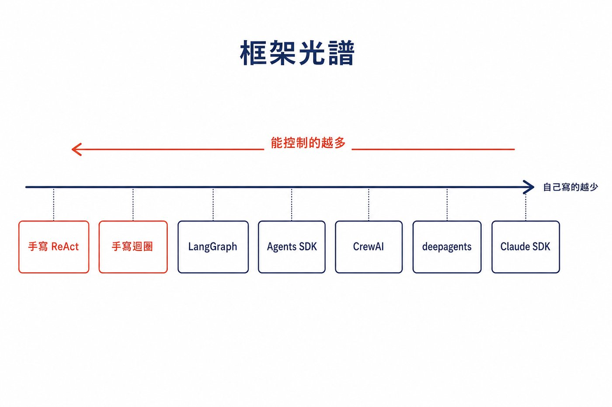

<sub>資料來源：模組五 `images/framework_map.jpg`（本課繪製）。</sub>

下表整理本課主線與常見替代方案，狀態以 2026-11-17 核實為準（`tool-selection.md` 表 C）。前三列是同一家族由低到高三層，中間兩列是模型廠商自己的 SDK：

| 寫法 | 抽象層級 | 你寫的 | 什麼時候選 | 狀態 |
|---|---|---|---|---|
| 手寫迴圈 | 無 | 全部 | 學原理、小而固定的工具集 | — |
| LangGraph | 低階：狀態圖 | 節點與邊 | 確定性步驟與 agent 混合、審批、可恢復的流程 | MIT，穩定版 |
| LangChain `create_agent` | 高階：agent＋middleware | 工具、middleware | 要能客製的 agent 外殼 | MIT，跑在 LangGraph 上 |
| Deep Agents | 現成 harness | 工具、skills、設定 | 長任務、調查型任務的核心 | MIT，Beta |
| OpenAI Agents SDK | 高階：agent＋handoffs | Agent 設定、工具 | OpenAI 生態、需要 guardrail | MIT，仍是 0.x |
| Claude Agent SDK | 把 Claude Code 當函式庫 | 設定、權限回呼、hooks | 要成熟的讀碼、跑指令、接 MCP 的通用 harness | 只能用 Claude；Alpha |
| CrewAI | 多 agent 角色 | 角色、任務 | 確定要多 agent 時快速做原型 | MIT，不依賴 LangChain |

兩家廠商 SDK 的關鍵差別在「迴圈在誰手上」，這一列決定了其他每一列。OpenAI Agents SDK 的迴圈在你的程式裡（`Runner.run`），Agent 只是設定；它沒有內建工具，要用 `@function_tool` 自己寫，子 agent 用 `agent.as_tool()`，審批用 `needs_approval=True`，也能改用 Chat Completions 接本機模型。Claude Agent SDK 的迴圈在 Claude Code CLI 裡，你只調 options；它內建讀檔、搜尋、shell，自訂工具以程式內 MCP 提供，審批用 `can_use_tool` 回呼與 `PreToolUse` hook，但只能用 Claude 模型。兩者都能放進 9.8 節圖中「核心」那一格；寫入動作的審批仍建議寫在外層的固定圖。

**圖 9-13　選型順序：模式先於框架**

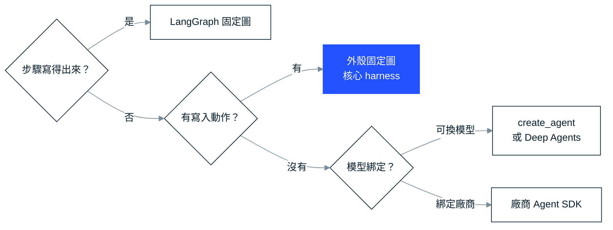

<sub>資料來源：本課整理；依 `tool-selection.md` 表 C 與投影片「選型：Agent 框架（一）（二）」「兩家 Agent SDK：迴圈在誰手上」。</sub>

幾個要避開的舊東西，一句帶過即可。`langgraph-supervisor` 已封存，改用子 agent 包成工具；`langgraph-swarm` 沒有封存但官方文件已不提，歸在 handoffs 底下即可。微軟的 AutoGen 官方已宣告停止維護，新專案改用 Microsoft Agent Framework（AutoGen 與 Semantic Kernel 的後繼者）。網路上 plan-and-execute、reflection 的 LangGraph 範例已封存，現行對應做法是 `TodoListMiddleware` 與 Deep Agents 的自評 middleware。

## 本章重點

2026 年的預設架構是 harness：一個通用 agent 迴圈，外掛 skills、子 agent、檔案記憶、壓縮、MCP 工具與權限 hooks，這些外掛大多在對付同一個敵人：越長越貴也越不準的 context。子 agent 的價值是隔離 context，代價是資訊只能經主 agent 轉手，而多 agent 的 token 以倍數成長（Anthropic 約 15 倍，本課小任務實測約 10 倍），所以先用一個 agent，有證據才切，切的軸是 context、平行查證、寫審分離與權限，不是業務職能；寫入保持單一執行者。專業知識做成 skills，以漸進式揭露按需載入；Deep Agents 是 LangChain 家族的現成 harness，接小模型前要先量 prompt、瘦身。系統層級的答案是外殼用固定流程圖、核心用 harness，確定性放在護欄層；選型時先選模式，再選框架。

## 對應實作與延伸閱讀

- 原理紀要：[模組五 `00_concepts.md`](../../modules/module-05-agent-harness/00_concepts.md) 第 6–9 節
- Deep Agents harness（skills、AGENTS.md、log-checker 子 agent、`interrupt_on`、小模型瘦身）：[`06_harness.ipynb`](../../modules/module-05-agent-harness/06_harness.ipynb)
- OpenAI Agents SDK：[`07_openai_agents_sdk.ipynb`](../../modules/module-05-agent-harness/07_openai_agents_sdk.ipynb)
- Claude Agent SDK：[`08_claude_agent_sdk.ipynb`](../../modules/module-05-agent-harness/08_claude_agent_sdk.ipynb)
- 多 agent 三種拆法實測：[`09_crewai_multiagent.ipynb`](../../modules/module-05-agent-harness/09_crewai_multiagent.ipynb)
- 框架行數與控制權對照：[`10_framework_map.ipynb`](../../modules/module-05-agent-harness/10_framework_map.ipynb)
- 旗艦專案的 harness 核心：[`oncall_agent/harness.py`](../../projects/incident-autonomous-agent/oncall_agent/harness.py)、[`skills/ops-runbook/SKILL.md`](../../projects/incident-autonomous-agent/skills/ops-runbook/SKILL.md)
- 投影片 PDF：[`deck.pdf`](../slides/deck/deck.pdf)（模組五 520–527、540–545、553 頁）
- Anthropic：〈Effective context engineering for AI agents〉（2025-09-29）、〈Equipping agents for the real world with Agent Skills〉（2025-10-16）、〈How we built our multi-agent research system〉（2025-06-13）、〈Scaling Managed Agents〉（2026-04-08）
- claude.com：〈Building multi-agent systems: When and how to use them〉（2026-01-23）、〈Multi-agent coordination patterns〉（2026-04-10）
- Cognition：〈Don't Build Multi-Agents〉（2025-06-12）、〈Multi-Agents: What's Actually Working〉（2026-04-22）
- LangChain：〈Deep Agents〉（2025-07-30）、〈Agent frameworks, runtimes, and harnesses — oh my!〉（2025-10-25）、〈Improving Deep Agents with harness engineering〉（2026-02-17）、官方文件〈Multi-agent〉
- Agent Skills 開放規格：agentskills.io
