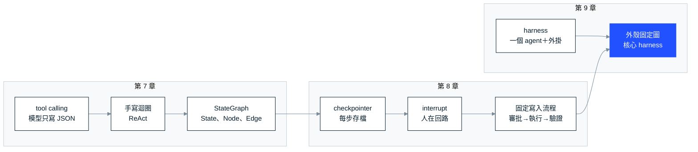

# 第三部　行動層：Agent 迴圈、LangGraph 與 Harness

第一部讓你理解模型怎麼產生文字，第二部讓模型讀得到你的知識。第三部要回答的是：**怎麼讓模型安全地採取行動？** 查日誌、查資料庫、重啟服務，這些動作模型自己做不到；它只能寫出「我想做什麼」，由你的程式代勞。本部的三章依序回答三個問題：agent 到底是什麼、怎麼讓它可暫停可恢復且不亂寫入、以及多個能力該怎麼組織成一個系統。

## 本部的論證主線

Agent 是把一次呼叫的模型 f(x) 放進迴圈：模型每一輪只寫出一段 JSON，表示要呼叫哪個工具、參數是什麼，你的程式執行後把結果接回對話，直到模型交出答案。這個迴圈 50 行就寫得完，但真實系統要分支、重試、暫停等人、當機後恢復，於是要把迴圈畫成可存檔的狀態圖（第 7 章）。存檔機制同時撐起記憶、時光旅行與人在回路；寫入動作的安全不能靠 prompt，而要靠一條固定的「審批 → 執行 → 驗證」流程，迴圈還要明確設上限，因為預設值擋不住死循環（第 8 章）。最後，當能力越來越多，2026 年的答案不是做更多職能 agent，而是一個 agent 配齊 skills、子 agent、記憶與權限的 harness；多 agent 只在隔離 context、平行查證、寫審分離時才值得付出倍數的 token 成本（第 9 章）。

整部用同一個情境貫穿：虛構公司「晨光外送」14:00 起下單一直回 502，值班 agent 要查日誌、查指標、查 runbook，必要時要求重啟服務。這個情境最後長成旗艦專案 `projects/incident-autonomous-agent/`。

**圖 三-0　第三部的地圖：從一個迴圈，到一張固定圖包住一個 harness**

資料來源：本課整理；依投影片模組五（500–599 頁）的章節結構。

## 各章內容

| 章 | 檔案 | 一句話摘要 |
|---|---|---|
| 第 7 章 | [Agent 迴圈與 LangGraph](07-agent-loop-and-langgraph.md) | Tool calling 是模型寫 JSON、你的程式執行；先問步驟寫不寫得出來，寫得出來就用 workflow；需要分支與存檔時把迴圈畫成 StateGraph，reducer 預設覆蓋；LangChain 1.x 用 `create_agent`＋middleware 接好常用的圖 |
| 第 8 章 | [狀態、存檔與人在回路](08-state-checkpoint-and-hitl.md) | Checkpointer 撐起記憶、時光旅行與 HITL；`interrupt()` 暫停、`Command(resume=...)` 恢復且節點從頭重跑；`recursion_limit` 預設 10,007 要明確設小；旗艦專案的五節點固定圖讓寫入只有一條路 |
| 第 9 章 | [Harness 架構](09-harness-architecture.md) | 2026 年的預設是單一 agent 配齊 skills、子 agent、記憶與權限；多 agent 依 context、平行、審查與權限切，不依職能切，且 token 以倍數成長；外殼用流程圖、核心用 harness；先選模式再選框架 |

讀完本部，你應該能做到這幾件事：

- 指著一段 messages JSON，說出每一則是使用者、模型還是你的程式產生的。
- 手寫一個有步數上限、會把錯誤回給模型的 agent 迴圈，並把它改寫成 StateGraph。
- 解釋為什麼正式環境的審批要用 `PostgresSaver`，以及恢復時哪段程式會再跑一次。
- 判斷一個任務該不該切成多個 agent，並估算大約要多付幾倍 token。

建議依序閱讀。只想抓架構判斷的讀者，可以先讀第 7.5 節（workflow 還是 agent）、第 8.4 節（寫入安全靠結構）與第 9.5 節（什麼時候才切多個 agent），這三節是本部的三個核心判準。

## 先備知識

- **深度學習基礎**：softmax、遷移學習、checkpoint 的存取、訓練迴圈的寫法。本部大量用這些概念搭橋，例如「tool call 是被微調成輸出特定格式的 softmax」「checkpointer 就是 `torch.save` 存圖的 state」「reducer 預設覆蓋，和 `.grad` 預設累加剛好相反」。
- **第一部**：messages 結構、context 長度的成本、結構化輸出與 Pydantic（第 2 章）、提示注入為什麼擋不住（第 2 章）。
- **第二部**：檢索管線與混合檢索。第 7 章會把 RAG 包成 agent 的一個工具，旗艦專案的 runbook 檢索就是第 5 章的 Dense＋BM25＋RRF。
- **Python**：`TypedDict`、`Annotated`、context manager（`with`）。不熟可先看 `docs/python-basics/`。

## 本部的事實基準

本部的版本號與 API 以 2026 Q3 之後的狀態為準，依據 `docs/slides/sources/product-facts.md`（2026-11-12 核實）與 `architecture-2026.md`（2026-11-17 核實）。讀網路上的舊教材時，最常遇到這幾個過時寫法：

| 舊寫法 | 現況 |
|---|---|
| `AgentExecutor` | 已移到 `langchain-classic`；新程式用 `langchain.agents.create_agent` |
| `create_react_agent` | 已標 deprecated，移到 `create_agent` |
| `recursion_limit` 預設 25 | langgraph 1.1.4 起預設 10,007，要明確設小值 |
| `Command` approve | 正確是 `Command(resume=...)`；middleware 版是 `Command(resume={"decisions": [...]})` |
| `langgraph-supervisor` | 已封存，改用子 agent 包成工具 |
| Supervisor 依職能分派多 agent 為主架構 | 2026 年預設是單一 agent＋skills＋子 agent＋MCP 的 harness |
| DeepAgent | 正式名 Deep Agents（`deepagents` 0.7.x），`write_todos` 要手動開 |

## 對應模組與實作

| 章 | notebook／程式 |
|---|---|
| 全部 | [模組五 `00_concepts.md`](../../modules/module-05-agent-harness/00_concepts.md)（先讀這份再開 notebook） |
| 第 7 章 | [`01_react_from_scratch`](../../modules/module-05-agent-harness/01_react_from_scratch.ipynb)、[`02_function_calling_loop`](../../modules/module-05-agent-harness/02_function_calling_loop.ipynb)、[`03_rag_as_tool`](../../modules/module-05-agent-harness/03_rag_as_tool.ipynb)、[`04_state_checkpoint`](../../modules/module-05-agent-harness/04_state_checkpoint.ipynb) |
| 第 8 章 | [`04_state_checkpoint`](../../modules/module-05-agent-harness/04_state_checkpoint.ipynb)、[`05_human_approval`](../../modules/module-05-agent-harness/05_human_approval.ipynb)、旗艦專案 [`oncall_agent/workflow.py`](../../projects/incident-autonomous-agent/oncall_agent/workflow.py) |
| 第 9 章 | [`06_harness`](../../modules/module-05-agent-harness/06_harness.ipynb)、[`07_openai_agents_sdk`](../../modules/module-05-agent-harness/07_openai_agents_sdk.ipynb)、[`08_claude_agent_sdk`](../../modules/module-05-agent-harness/08_claude_agent_sdk.ipynb)、[`09_crewai_multiagent`](../../modules/module-05-agent-harness/09_crewai_multiagent.ipynb)、[`10_framework_map`](../../modules/module-05-agent-harness/10_framework_map.ipynb)、旗艦專案 [`oncall_agent/harness.py`](../../projects/incident-autonomous-agent/oncall_agent/harness.py) |

環境準備見 [模組五 README](../../modules/module-05-agent-harness/README.md)：主環境 `uv sync --group m5`，本機模型用 Ollama 的 `qwen2.5:3b` 與 `bge-m3`；`09_crewai_multiagent` 要在獨立的相容環境 `.venv-compat` 執行。旗艦專案的啟動方式見 [專案 README](../../projects/incident-autonomous-agent/README.md)，預設 `demo` 模式不需要 Ollama、Docker 或金鑰。

本部對應的投影片是 [`deck.pdf`](../slides/deck/deck.pdf) 的模組五（500–599 頁）。下一部（第 10–12 章）接著處理上線：用 MCP 把系統功能接成工具、用 trace 與評估確認 agent 真的做對了。
