# 第 10 章　MCP 與低代碼：工具接一次，流程放對地方

**本章結論**　到了第三部，你的 agent 已經會在迴圈裡呼叫工具，但每個工具都是你親手為某一個框架、某一家模型寫的轉接程式。MCP（Model Context Protocol，模型上下文協定）把這件事標準化：工具寫成一支 Server，任何支援 MCP 的 AI 應用都能接上，N 個應用乘 M 個工具的整合工作因此降成 N 加 M。MCP 不會讓模型變聰明，它改的是模型能看到的輸入，權重一個都沒動；它也不替你管權限，工具能碰你的資料，信任邊界要自己畫。本章後半處理另一個上線時一定會遇到的問題：流程該畫在 Dify、n8n 這類低代碼畫布上，還是寫成 LangGraph 程式碼。判準只有一條，看執行路徑是事先畫得出來，還是要模型依狀態決定。

---

## 10.1 MCP 把 N×M 個客製接頭降成 N＋M 個標準介面

MCP 存在的理由是一個組合數問題。沒有共同標準時，每個 AI 應用都要為每個工具各寫一份轉接程式；有了共同協定，工具只要寫一次 Server、應用只要寫一次 Client，整合數就從乘法變成加法。這不是新發明，是軟體業反覆用過的老辦法，只是這次換到了「模型與工具之間」。

先看它是什麼、你在哪裡見過。MCP 是一套讓 AI 應用和外部工具說同一種話的協定，官方用「AI 應用的 USB-C 接口」來比喻。你多半已經碰過它：Claude Desktop、Cursor 的設定頁裡有「新增 MCP server」；工具廠商的公告寫著「我們提供 MCP server」；有人讓 AI 讀自己的本機檔案、GitHub 或行事曆，背後走的也常是 MCP。它做不到的事要同樣講清楚：它只是把接頭統一，模型的推理能力不會因此提升；插上去的工具能讀寫你的資料，權限和信任仍要你自己管。

痛點從模型 API 的格式差異就看得到。第 7 章學過，要讓模型呼叫函式，得把函式名稱、說明和參數格式交給模型。三家的核心資訊完全相同，外層包裝卻各寫各的：

```python
openai    = {"type": "function", "function": {"name": ..., "description": ..., "parameters": schema}}
anthropic = {"name": ..., "description": ..., "input_schema": schema}
gemini    = {"function_declarations": [{"name": ..., "description": ..., "parameters": schema}]}
```

這還只是模型 API 這一層。真正的痛在應用端：Claude Desktop、Cursor、公司自己的客服機器人，各有各的外掛機制。8 個應用、20 個工具，每一對都要一份轉接就是 160 份；改成每個工具寫一次 Server、每個應用寫一次 Client，只要 28 份。多一個工具時，前者要每個應用都補一份，後者只要那個工具自己接一次。

**圖 10-1　有了共同協定，整合數從乘法變成加法**

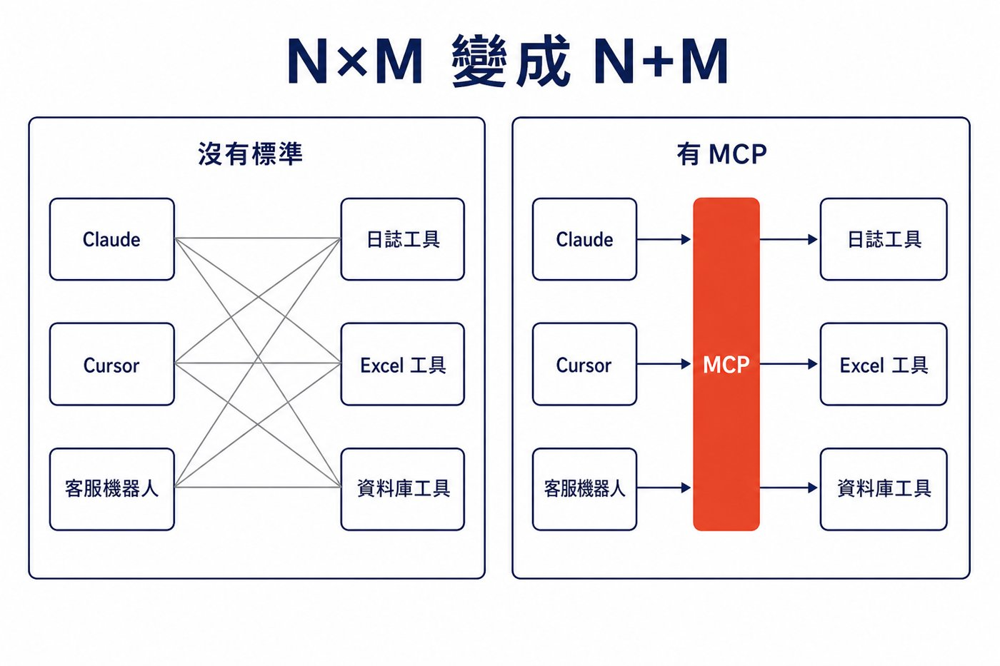

<sub>資料來源：模組七 `00_concepts.md`；論點整理自 Hugging Face MCP Course Unit 1。</sub>

用你已經會的東西搭橋，最接近的是 ONNX。沒有交換格式時，每個訓練框架乘每個推論引擎都要寫轉換器；有了 ONNX，框架只管匯出、引擎只管匯入。MCP 對應的是同一個結構：應用只管當 Client、工具只管當 Server，中間那層格式大家共用。

MCP 的出身和治理要分開講，這是面試常被追問的細節。它由 Anthropic 在 2024-11-25 發布；2025-12-09，Anthropic 把它捐給 Linux Foundation 旗下新成立的 Agentic AI Foundation（AAIF），和 Block 的 goose、OpenAI 的 AGENTS.md 同為創始專案。技術方向仍由既有的維護者透過公開提案流程（SEP）決定，基金會不主導技術。所以「Anthropic 推出的 MCP」只講對一半：起源是 Anthropic，今天的治理是中立基金會，這也是它能被各家客戶端接受的原因之一。

**圖 10-2　MCP 起源於一家公司，現由中立基金會治理**

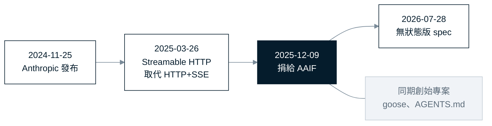

<sub>資料來源：`docs/slides/sources/product-facts.md`、`M7-mcp-lowcode.md`（Linux Foundation 新聞稿、MCP 2026-07-28 changelog）；改繪自投影片「MCP 的治理」。</sub>

---

## 10.2 MCP 改的是模型的輸入，不是模型的權重

把 MCP 放回全書的主線上，它和第 4 章的 RAG 是同一類手段：都在改模型這一次推理看到的上下文，模型參數完全不動。第 3 章的 LoRA 才是改權重。這條「改輸入還是改權重」的分界，是從深度學習搭過來最省力的一座橋，也決定了 MCP 的工程特性：換工具不用重新訓練，工具結果錯了也只影響這一次回答。

具體來說，一次工具呼叫的結果最後只是被串接進模型下一次的輸入序列。Server 回了一段文字，Host 把它包成一則訊息放回對話，模型在下一步讀到它，接著決定要再叫工具還是直接回答。對模型而言，工具結果和使用者的提問、RAG 撈回的文件沒有本質差別，都是 context 裡的 token。

這也說明了 MCP 和 function calling（函式呼叫）的關係。兩者常被混為一談，其實是上下兩層。function calling 是模型 API 的功能：你把工具清單交給模型，模型回一個「想呼叫哪個工具、參數是什麼」的結構，第 7 章寫的迴圈就是這一層。MCP 則是 Host 和工具之間的協定：工具清單從哪裡來、呼叫要送到哪裡去。兩層之間的接點只有一步：把 MCP 工具的 `inputSchema` 放進 OpenAI 格式的 `parameters`，原本的迴圈一行都不用改。

**圖 10-3　function calling 管模型怎麼提出呼叫，MCP 管 Host 去哪裡執行**

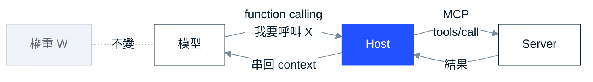

<sub>資料來源：模組七 `00_concepts.md`「MCP 跟 function calling 是什麼關係」；本課整理。</sub>

這個分層有兩個工程後果。第一，模型本身從不直接碰 Server，所有呼叫都經過 Host，所以白名單、審批這類安全關卡可以放在 Host 這一側，不必相信模型會自律。第二，換模型不影響工具：同一支 Server 可以接雲端商業模型，也可以接本機的開源模型，本課 Lab 7 用的就是 Ollama 上的 `qwen2.5:3b`。

| 手段 | 改什麼 | 換掉要付的代價 | 本書位置 |
|---|---|---|---|
| 提示與結構化輸出 | 輸入中的指令 | 改字串 | 第 2 章 |
| RAG | 輸入中的參考資料 | 重建索引 | 第 4–6 章 |
| MCP 工具 | 輸入中的工具清單與結果 | 換一支 Server | 本章 |
| LoRA 微調 | 權重（旁路 ΔW） | 重新訓練 | 第 3 章 |

---

## 10.3 Host 為每個 Server 開一個 Client，安全關卡因此能放在 Host 側

MCP 的角色分成三個，而且關係固定：Host 是使用者打開的 AI 應用，裡面有模型；Host 每連一個 Server，就開一個專屬的 Client 負責跟它講話，一個 Client 只連一個 Server；Server 是把能力包起來的小程式，不知道對面是哪家模型。很多文章把 Host 和 Client 混用，嚴格說它們不同，分清楚之後才看得出控制權在哪裡。

**圖 10-4　模型不直接碰 Server，每條連線都經過 Host 裡的一個 Client**

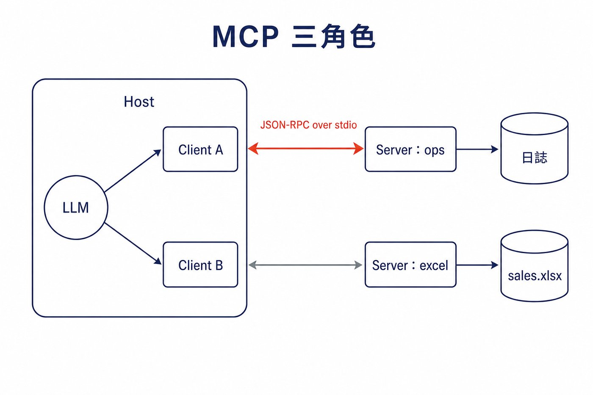

<sub>資料來源：模組七 `00_concepts.md`；架構依 modelcontextprotocol.io Architecture overview。</sub>

Host 的責任最重：它決定要不要真的執行模型提出的工具呼叫、要不要先問使用者，也負責把結果放回模型的 context。Client 是 Host 內部的連線物件，負責配訊息編號、協商版本、把回應轉成程式物件。Server 只回答兩類問題：「我有什麼」和「幫你做這件事」。

線上傳的是 JSON-RPC 2.0 訊息。JSON-RPC 是一種用 JSON 寫「呼叫某個方法、帶參數、回結果」的格式，只有三種訊息：請求（有 `id`、`method`、`params`，對方一定要回）、回應（帶同一個 `id`，內容是 `result` 或 `error`）、通知（沒有 `id`，對方不用回）。一次工具呼叫的往返長這樣：

```json
→ {"jsonrpc":"2.0","id":3,"method":"tools/call","params":{"name":"get_service_status","arguments":{"service":"payment"}}}
← {"jsonrpc":"2.0","id":3,"result":{"resultType":"complete","content":[{"type":"text","text":"{\"service\": \"payment\", \"state\": \"degraded\", …}"}]}}
→ {"jsonrpc":"2.0","method":"notifications/cancelled","params":{"requestId":4}}
```

`id` 的用途是對號：Client 可以連送好幾個請求，回應的順序不一定一樣，靠 `id` 知道哪個答案屬於哪一題。最後一行是通知，Client 告訴 Server 不等第 4 號請求了，Server 不用回。呼叫不存在的工具時，Server 回的是 `error` 而不是 `result`，行程不會掛掉。

2026-07-28 版的規格把連線流程改成無狀態，這是現行版本和多數二手教材最大的差異。舊版要先送 `initialize` 握手、整條連線共用一個 session；現行版拿掉了握手和 session，Client 可以先用 `server/discover` 問一次 Server 支援哪些版本與能力，之後每個請求都在 `_meta` 裡自己帶協定版本和 Client 能力，每個結果多一個 `resultType`。改的理由很實際：Server 不必記住連線狀態，HTTP Server 就能放在負載平衡後面任意擴充，不用把同一個 Client 黏在同一台機器上。

**圖 10-5　現行規格下，每個請求自己帶版本，Server 不記連線狀態**

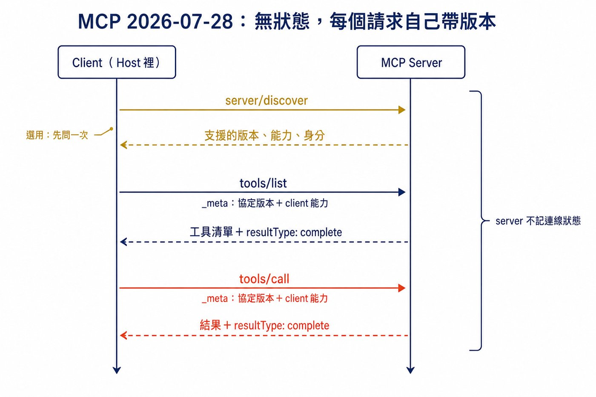

<sub>資料來源：模組七 `00_concepts.md`；MCP Specification 2026-07-28 changelog。</sub>

對寫程式的人影響很小。官方 Python SDK 2.x 的 `Client` 預設先試 `server/discover`，對方是舊 Server 才退回 `initialize` 握手，你的程式不必分兩套。這也是本書只教現行版本的原因：協定細節由 SDK 吸收，你要記住的是「無狀態」帶來的部署自由。同一版規格也把 Client 端的 Sampling、Roots、Logging 標為棄用，Client 端原語目前只剩 Elicitation（向使用者索取補充資訊）仍為現行，二手教材若還把 Sampling 列為第四種能力，要打折看。

---

## 10.4 三種原語的差別在於誰決定何時用

Server 能提供的東西只有三類：Tools、Resources、Prompts。最好記的分法不是看它們「是什麼」，而是看誰握有觸發權：Tools 由模型決定、Resources 由應用程式決定、Prompts 由使用者決定。記住觸發權，就同時記住了用途和風險，也自然推出「Tools 需要核准」的安全觀念。

**Tools（工具）** 是能做事的函式，模型在對話中自己決定什麼時候叫。工具可能有副作用，例如寫檔、寄信、訂房，所以客戶端通常要讓使用者先核准。每個 Tool 帶一份 `inputSchema`，就是它的函式簽名。用深度學習的眼光看，模型「挑哪個工具」像在候選動作上做一次分類，差別在輸出是結構化文字而不是 one-hot 向量。

**Resources（資源）** 是唯讀的資料來源，由應用程式決定什麼時候放進 context，典型做法是在對話開始前就塞進去。不少教材說 Resources 是「靜態資料」，這不精確：Resource 可以用模板依參數動態產生，例如 `weather://forecast/{city}/{date}`，也能訂閱變化。它的本質是「唯讀」與「由應用控制」，不是「靜態」。

**Prompts（提示詞模板）** 是現成的提示詞，由使用者主動挑選，常見形式是斜線指令，Server 把參數填進模板。

| 原語 | 誰決定何時用 | 副作用 | 例子 |
|---|---|---|---|
| Tools | 模型 | 可能有，通常要核准 | `describe_excel`、`get_service_status` |
| Resources | 應用程式 | 無（唯讀） | `excel://schema`、值班手冊 |
| Prompts | 使用者 | 無 | `plan-vacation` 這類斜線指令 |

**圖 10-6　觸發權落在三個不同的角色手上**

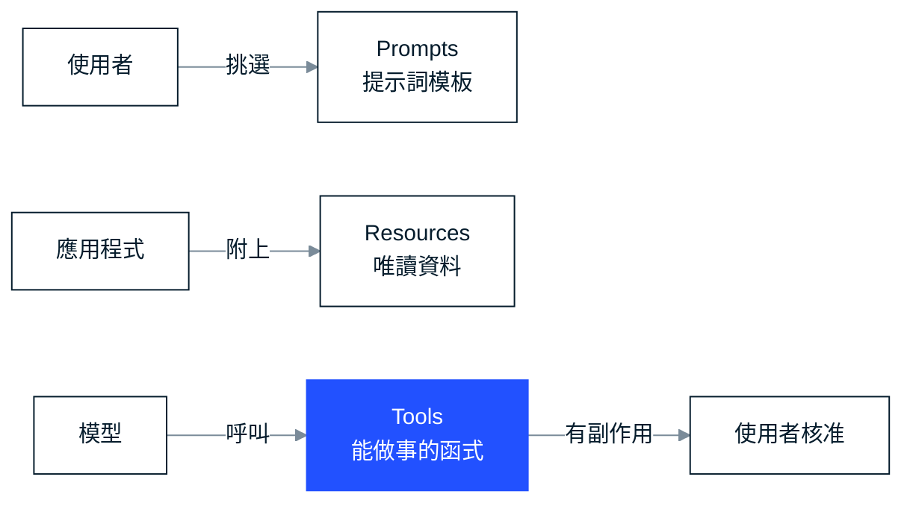

<sub>資料來源：modelcontextprotocol.io「Understanding MCP servers」的 Who controls it 欄；改繪自投影片「三種原語：誰決定用」。</sub>

Resources 和 Tools 的差別在 Lab 7 裡看得最清楚。Lab 7 是一個 Excel 分析 agent：使用者問銷售問題，本機的 `qwen2.5:3b` 透過 MCP 呼叫唯讀的 `excel_server`，它提供 `list_sheets`、`describe`、`query`、`make_chart` 四個工具，外加一個 `excel://schema` Resource。小模型在不知道工作表名稱時會亂猜一個不存在的名字，例如「銷售數據」；應用程式先把 Resource 裡的資料地圖放進 context，它就猜對了。這不是模型變強，是應用替模型準備了它該看到的輸入，正好呼應上一節「改輸入不改權重」。

**圖 10-7　Lab 7 讓應用先附上資料地圖，小模型才不會亂猜工作表名稱**

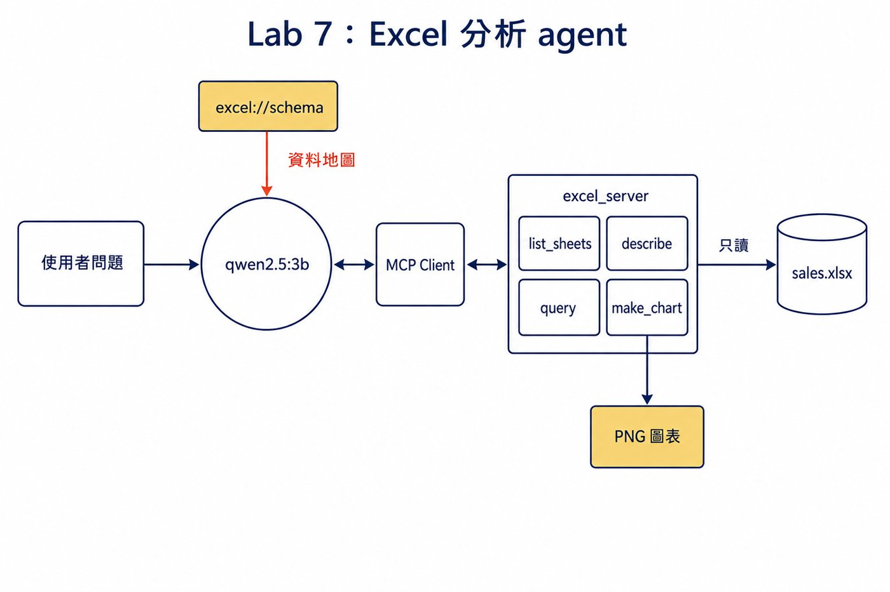

<sub>資料來源：模組七 `02_excel_agent.ipynb` 與 `README.md`。</sub>

---

## 10.5 資料層與傳輸層分開：本機走 stdio，遠端走 Streamable HTTP

MCP 把協定切成兩層：資料層是 JSON-RPC 訊息與原語，傳輸層是訊息走哪條管道。同一份訊息可以走兩種標準傳輸，本機用 stdio，遠端用 Streamable HTTP。舊教材寫的「STDIO＋SSE」已經過時：HTTP+SSE 傳輸在 2025-03-26 被 Streamable HTTP 取代，2026-07-28 版規格正式列為棄用。

這個分層對你不陌生。PyTorch 把模型定義和 device 分開，同一張計算圖可以放 CPU 也可以放 GPU；MCP 把訊息和傳輸分開，同一支 Server 的程式不變，只換最後一行的啟動參數。

**stdio** 的意思是 Host 把 Server 當子行程啟動，用子行程的標準輸入、標準輸出兩條管線傳訊息：Server 從 stdin 讀一行 JSON，往 stdout 寫一行 JSON。它像 Python 的 `subprocess.Popen` 接上 stdin／stdout。設定檔要寫的是啟動指令（`command`、`args`、`env`），適合 Claude Code、Cursor、Claude Desktop 這類本機應用，只有本機使用者能用，往返很快。

**Streamable HTTP** 的意思是每則訊息一個 HTTP POST，送到像 `http://127.0.0.1:8000/mcp` 這樣的網址，回覆可以是一次性 JSON，也可以是 SSE 串流（邊做邊回報進度）。它像呼叫一個推論 API。設定檔要寫的是 `url`，適合網頁型、跑在容器或遠端、多人共用的 Host；對外開放就要另外處理認證。注意 SSE 在這裡只是「回覆的一種格式」，不再是獨立的傳輸。

**圖 10-8　同一份訊息走兩種管道，stdio 的 stdout 是協定專用通道**

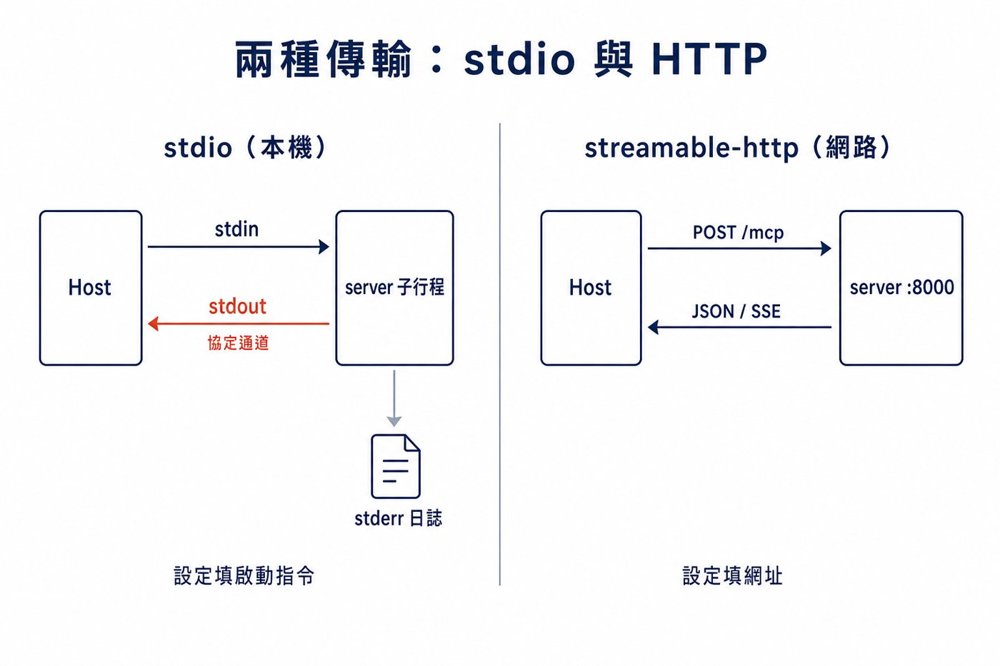

<sub>資料來源：模組七 `00_concepts.md`；MCP Specification 2026-07-28 Transports。</sub>

| | stdio | Streamable HTTP |
|---|---|---|
| 怎麼連 | Host 開子行程，接上 stdin／stdout | Host 連一個網址 |
| 設定檔要寫 | `command`、`args`、`env` | `url` |
| 適合 | 本機桌面應用、IDE、CLI | 容器、遠端、多人共用 |
| 安全 | 只有本機使用者能用 | 對外開放要另做認證 |
| 頭號地雷 | 往 stdout `print()` | Docker 裡的 `localhost` |

Server 的程式本身不用改，差別只在最後一行：`mcp.run()` 預設走 stdio，`mcp.run(transport="streamable-http", host="127.0.0.1", port=8000)` 走 HTTP。SDK 2.x 起 `host`、`port` 這類傳輸參數寫在 `run()`，不再寫在建構子裡。Lab 7 的做法正是利用這一點：先在 Cherry Studio 用 stdio 跑通，再把同一支 Server 改成 HTTP 接 Dify，資料層一行不動，只換傳輸層。

---

## 10.6 寫 Server 時，函式簽名就是工具定義

用官方 Python SDK 寫 MCP Server，你寫的是一個普通的 Python 函式，SDK 讀它的名稱、型別註記和 docstring，自動產生模型看得到的工具定義。這讓「工具設計」回到你熟悉的函式設計：參數型別寫清楚，模型就拿得到準確的 schema；型別限制寫嚴格，模型亂填的參數就會在 Server 邊界被擋下。

官方 SDK 套件叫 `mcp`，現行 2.x（本課驗證的是 2.3.0）。寫 Server 的高階類別在 2.x 改名為 `MCPServer`，從 `mcp.server` 匯入；1.x 時代叫 `FastMCP`，舊教材的 `from mcp.server.fastmcp import FastMCP` 在 2.x 已經移除。另有一個由 Prefect 維護的獨立專案 `fastmcp`（4.x），提供代理、組合多個 Server 等進階功能，和官方 SDK 裡曾經同名的類別是兩回事。Lab 7 的關鍵程式只有幾行：

```python
from mcp.server import MCPServer
import pandas as pd

mcp = MCPServer("excel-analyst")

@mcp.tool()
def describe_excel(path: str) -> str:
    """讀取 Excel，回傳欄位名稱與前五列。"""
    return pd.read_excel(path).head().to_string()

if __name__ == "__main__":
    mcp.run(transport="stdio")
```

SDK 把它轉成模型在 `tools/list` 裡看到的項目：`name` 是函式名、`description` 是 docstring、`inputSchema` 是由 `path: str` 推出來的 JSON Schema，`path` 為必填字串。型別寫 `Literal[...]` 會變成 schema 的 `enum`，寫 `Field(ge=1, le=20)` 會變成上下限。這和第 2 章用 Pydantic 定義結構化輸出是同一套功夫，只是方向反過來：那時是約束模型的輸出，這裡是約束模型填給工具的參數。

**圖 10-9　開發順序是 SDK 寫、Inspector 測、再接進客戶端**

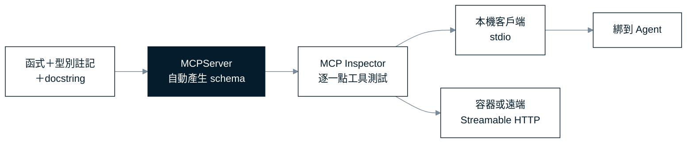

<sub>資料來源：投影片「選型：MCP 工具箱」「Lab7 關鍵程式」；`tool-selection.md` 表 D-2。</sub>

測試用官方的 MCP Inspector，`npx @modelcontextprotocol/inspector` 直接跑，不用安裝，寫完 Server 先在這裡逐一點工具看回應。接著接到客戶端。Claude Desktop 的設定檔 `claude_desktop_config.json` 在 `mcpServers` 底下為每個 Server 取一個顯示名稱，填 `command` 和 `args`；這兩欄就是 Host 替你在終端機下的那行指令，像用 `torchrun` 啟動訓練腳本時傳的參數。Cherry Studio 則在介面上走三步：新增 Server（本機填 command、遠端填 URL）、啟用並確認看得到它的 tools／resources／prompts、綁到某個 Agent。第三步最常被漏掉，沒綁到 Agent，模型就用不到它。

如果你的 agent 寫在 LangChain 上，MCP 的接法已經併進主套件：`pip install "langchain[mcp]"`，再 `from langchain.mcp import MCPAdapter`（目前是 beta，非同步介面）。舊的 `langchain-mcp-adapters` 套件和它的 `MultiServerMCPClient` 仍裝得起來，但 README 已要求遷移，新程式碼不要再用。

---

## 10.7 Server 連不上，問題幾乎都出在 Host 與 Server 之間那條線

MCP 的除錯經驗可以濃縮成一句話：Host 只會告訴你「連線逾時」或「解析錯誤」，真正的原因幾乎都在 Host 和 Server 之間那條線上，而且集中在三個坑。第一個坑最常見也最難猜：stdio Server 裡的一行 `print()`。

stdio 的規則是 stdout 只能放協定訊息。你在 Server 裡加一行 `print("debug: 收到", method)`，Client 讀到的第一行就不是 JSON，當場 `JSONDecodeError`，連線壞掉；Host 顯示的卻只是逾時或解析錯誤，完全看不出是 print 造成的。這就像訓練時把 debug 訊息寫進要被下游讀的 CSV 輸出檔，整條資料管線被污染。修法是 Server 裡不留任何 `print()`，除錯一律用 `logging`，它預設寫 stderr，那是另一條管線，Host 通常會把它存成日誌檔。

**圖 10-10　一行 print 混進 stdout，Client 就把整條連線判為壞掉**

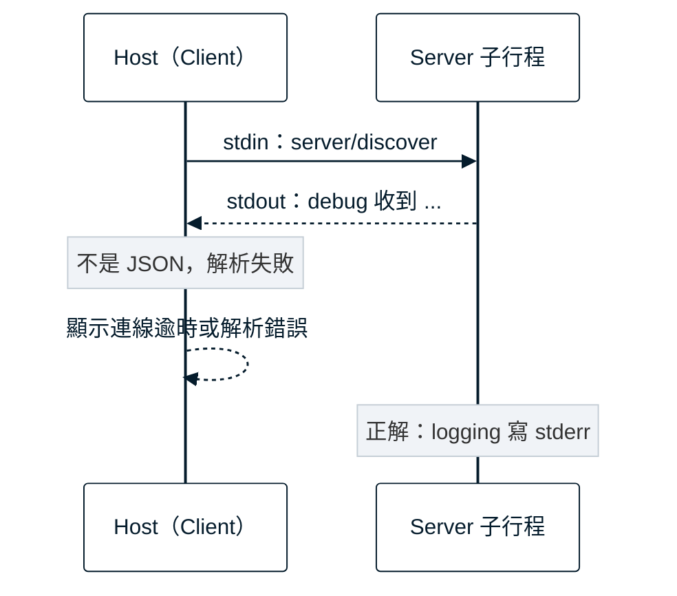

<sub>資料來源：模組七 `00_concepts.md` 第 6 節；modelcontextprotocol.io「Build an MCP server」。</sub>

第二個坑出在 Docker。容器裡的 `localhost` 指的是容器自己，不是你的宿主機；而且 Dify 當 MCP Client 時只接 HTTP 傳輸，不接 stdio。所以 Docker 部署的 Dify 要接你本機的 Server，Server 必須以 Streamable HTTP 啟動，網址填 `host.docker.internal`（Linux 要另設 `extra_hosts`）。第三個坑是環境：Host 從圖形介面啟動子行程時，不一定帶著你終端機裡的 `PATH` 和金鑰，相對路徑也會失效，因為 Host 的工作目錄不是你的專案資料夾。修法是 command 與路徑一律寫絕對路徑、環境變數寫進設定檔的 `env`，連不上時先看 `mcp-server-*.log`。

| 症狀 | 原因 | 修法 |
|---|---|---|
| 一連上就斷，工具清單載不出來 | stdio Server 往 stdout `print()` | 改用 `logging` 寫 stderr |
| Dify 連不到本機 Server | 容器內 `localhost` 是容器自己；Dify 只接 HTTP | Server 改 Streamable HTTP，網址用 `host.docker.internal` |
| 設定好了卻一直逾時 | 子行程沒帶到 `PATH`、環境變數；相對路徑失效 | 寫絕對路徑，變數放進 `env`，查日誌 |

連得上之後，下一個問題是「該不該相信它」。MCP 有一個 `readOnlyHint` 標記，讓 Server 自稱某個工具只讀不寫，但這只是 Server 自己說的話，Host 可以參考，無法驗證。真正的唯讀要靠兩邊各守一層：Server 端的實作只提供唯讀工具、限制可讀路徑；Host 端設白名單，非唯讀的呼叫一律先經人工審批，執行後再驗證結果。裝第三方 Server 前也要先看它能讀哪些路徑、有沒有寫入或刪除的工具、會不會連外網。

**圖 10-11　工具呼叫要過白名單、唯讀判斷、人工審批三道關卡**

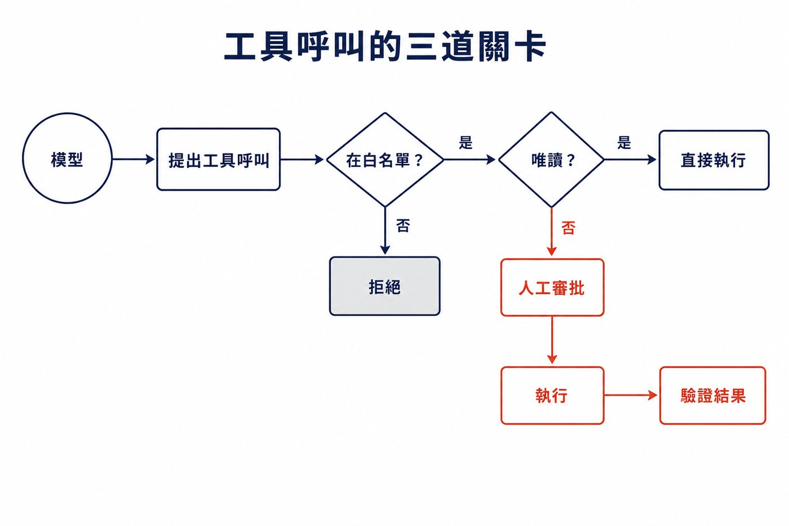

<sub>資料來源：模組七 `03_mcp_in_practice.ipynb` 與 `00_concepts.md` 第 8 節。</sub>

這三道關卡和第 8 章的 approve → execute → verify 是同一個想法換了位置：第 8 章把它寫在 LangGraph 的寫入流程裡，這裡把它放在 Host 呼叫 MCP 工具的入口。兩者並不衝突，上線系統通常兩層都有。

---

## 10.8 低代碼和程式碼的邊界，看執行路徑由誰決定

Dify、n8n 這類低代碼畫布和 LangGraph 程式碼不是二選一，判準只有一個：執行路徑是事先畫得出來，還是要模型依狀態決定下一步。前者用畫布，交付快、好維護；後者寫程式碼，換得重試、人工審批、暫停恢復這些精細控制。兩邊都能經 MCP 互接，所以真實系統常是混用。

這個分界直接來自第 7 章講過的 workflow 與 agent 之分。Anthropic 在〈Building effective agents〉裡的定義是：workflow 讓 LLM 與工具走預先定義的程式路徑；agent 讓 LLM 自行決定流程與工具使用。畫布上的節點和連線就是一條事先定義好的路徑，天生是 workflow；LangGraph 的 agent 迴圈由模型在狀態和工具之間來回，走幾圈由它決定。用你熟的框架來比，前者像靜態計算圖，路徑固定、好部署；後者像 PyTorch eager 模式的動態圖，每次依輸入決定走哪個分支。另一個類比是 Keras 和自寫 training loop：前者搭得快、細節看不到，後者慢一點，但每一步都能動手腳。

**圖 10-12　路徑畫得出來用畫布，要依狀態決定用程式碼，兩邊經 MCP 互接**

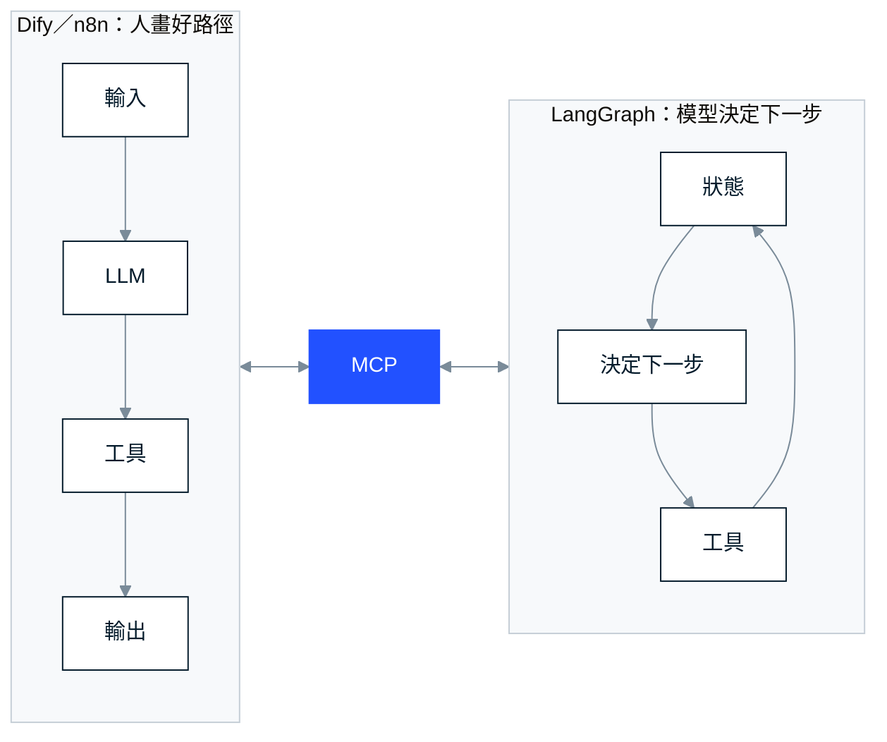

<sub>資料來源：投影片「低代碼與程式碼的邊界」；Anthropic〈Building effective agents〉；本課整理。</sub>

低代碼的長處在三件事。一是快速交付：Dify 的工作流可以一鍵發布成 Web 應用或 API；它分 Workflow（跑一次、可排程觸發）和 Chatflow（每則訊息觸發、必有回答節點）兩種形態。二是整合數量：n8n 的定位是整合與排程優先，AI 只是其中一個節點，排程、Webhook、Slack、Email 這類觸發器現成可用。三是非工程人員看得懂畫布，流程改動不必等工程師。

程式碼的長處則在狀態與控制。當流程需要依前一步的結果動態分支、在高風險處暫停等人核准、失敗後從 checkpoint 恢復、每一步狀態可存檔可回溯，這些是第 8 章用 LangGraph 一一建立的能力，畫布很難表達，硬畫也難維護。

兩邊經 MCP 雙向相通，這讓「混用」有了實際做法。Dify 可以把外部 MCP Server 匯入成工具（只接 HTTP），也可以把 Dify App 發布成 MCP Server 給 Claude Desktop、Cursor 用；n8n 有 MCP Client Tool 節點讓它的 AI Agent 呼叫外部工具，也有 MCP Server Trigger 把工作流暴露成 MCP Server（支援 SSE 與 Streamable HTTP，不支援 stdio）。所以一個常見的切法是：固定的報表、通知、排程流程放 n8n 或 Dify，需要模型調查與判斷的核心放 LangGraph，彼此透過 MCP 呼叫。

| 判斷點 | 選畫布（Dify／n8n） | 選程式碼（LangGraph） |
|---|---|---|
| 執行路徑 | 事先畫得出來 | 依狀態動態決定 |
| 交付速度 | 快，可一鍵發布 | 較慢 |
| 第三方整合、排程 | 現成觸發器多 | 要自己接 |
| 重試、審批、暫停恢復 | 難表達 | 一等公民 |
| 狀態存檔與回溯 | 有限 | checkpointer 內建 |

---

## 10.9 選平台先看 MCP 接法，再看授權是不是真的開源

挑低代碼平台時有兩件事最容易被忽略。第一是 MCP 接法：它當 Client 時能不能接本機 stdio Server，還是只接 HTTP，這決定了你的 Server 要怎麼部署。第二是授權：很多平台是「原始碼公開」，但不是 OSI 定義的開源，商用前要讀清楚。還有一個更根本的提醒：平台會消失，流程邏輯最好也能用程式碼重現。

| 平台 | 定位 | MCP 支援 | 授權（2026-11 核實） |
|---|---|---|---|
| Dify（本課用） | LLM 應用＋工作流畫布 | 雙向；當 Client 只接 HTTP | Apache 2.0 加附加條件：多租戶 SaaS 需書面授權 |
| n8n（本課用） | 整合與排程優先，AI 是節點 | 雙向；不支援 stdio | Sustainable Use License，非 OSI 開源 |
| Langflow | Python 視覺化流程，偏開發者 | 雙向；Client 支援 stdio | MIT |
| RAGFlow | 深度文件解析 RAG＋Agent | 雙向 | Apache 2.0 |
| Coze Studio | 字節跳動 Coze 的開源版 | 官方文件未載明 | Apache 2.0 |
| Flowise | 視覺化 Agent 建構器 | — | 2026-08 起停止維護、repo 已封存，新專案不要選 |

Flowise 是最好的反例。它曾是熱門的視覺化 agent 建構器，2026-07-29 凍結開發、隨後封存 repo、2026-08-31 結束支援，官方理由是開發者轉向 coding agent。押注在單一畫布平台上的流程，一旦平台停更就只能整個搬家；如果核心邏輯同時有程式碼版本，而平台和程式碼之間走的是 MCP 這種中立協定，搬家成本就小得多。

**圖 10-13　選平台的判斷順序：路徑、MCP 接法、授權**

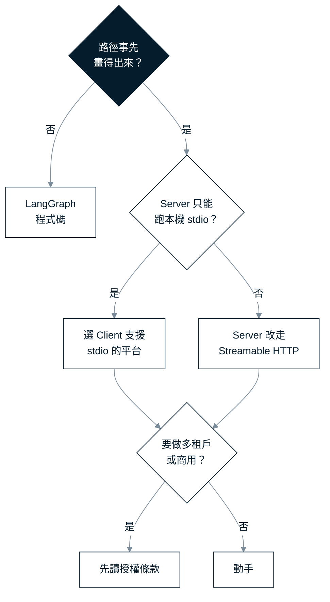

<sub>資料來源：`docs/slides/sources/tool-selection.md` 表 D-1；投影片「選型：低代碼平台」；本課整理。</sub>

MCP 這一側的積木也一併整理。寫 Server 預設用官方 SDK（Python `mcp`；TypeScript 在 v2 拆成 `@modelcontextprotocol/server` 與 `client` 兩個套件），需要代理或組合多個 Server 時才考慮獨立的 `fastmcp`。測試用 MCP Inspector。常見的 Host 有 Claude Desktop、Claude Code、Cursor、VS Code，專案層級的設定檔（如 `.mcp.json`）可以進版控讓團隊共用；本課 Lab 7 用 Cherry Studio 跑本機 stdio，它的授權是 AGPL-3.0。官方 MCP Registry 只收 Server 的中繼資料、不存程式碼，目前仍是 preview，不要把它寫成「官方應用商店已正式上線」。

---

## 10.10 面試時把 MCP 講成四個維度，而不是背定義

本章的兩道經典面試題都在考「講得出邊界」。照維度各講一句、有例子就帶上 Lab 7，比背定義有說服力。

第一題常見的問法是「請闡述 MCP 的技術架構，以及它為何被視為外掛整合標準」。回答可以照四個維度排：痛點是 N×M 個客製接頭，MCP 降成 N＋M；架構是 Host、Client、Server 三角色，資料層（JSON-RPC）與傳輸層（stdio、Streamable HTTP）分開；原語有三種，差在誰決定何時用；生態與治理方面，主流客戶端都支援，且自 2025-12 起由 Linux Foundation 旗下的 AAIF 中立治理。最後一點常被漏掉，卻正是「為何能成為標準」的答案。

第二題是「在大型企業架構中，如何界定 Dify／n8n 與 LangGraph 各自的應用邊界」。同樣分四句：路徑事先畫得出來用低代碼，要依狀態動態決定用 LangGraph；重試、人工審批、暫停恢復這類控制寫成程式碼；快速原型、整合排程與第三方服務，低代碼較快；兩者透過 MCP 互接，不是二選一。

**圖 10-14　兩道面試題各有四個回答維度**

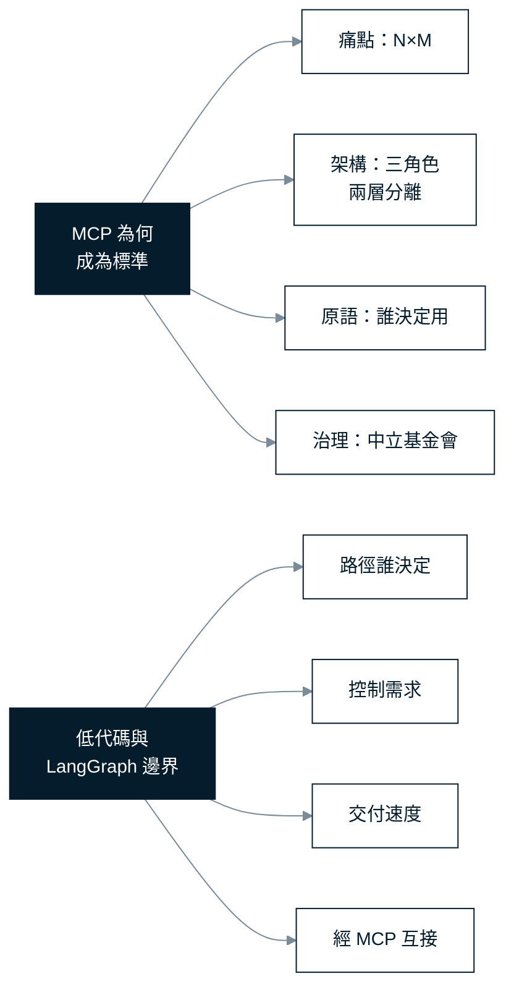

<sub>資料來源：投影片「面試題：MCP 與低代碼」；本課整理。</sub>

---

## 本章重點

MCP 是 AI 應用和工具之間的標準協定，把 N×M 個客製接頭降成 N＋M 個標準介面；它和 RAG 一樣只改模型的輸入，不改權重，也不替你管權限。Host 為每個 Server 開一個 Client，模型從不直接碰 Server，所以白名單、唯讀判斷與人工審批可以放在 Host 側；`readOnlyHint` 只是 Server 的自我聲明，不是防線。Server 的三種原語看觸發權：Tools 由模型、Resources 由應用、Prompts 由使用者決定。傳輸只教現行兩種：本機 stdio、遠端 Streamable HTTP，stdio Server 絕不往 stdout `print()`。低代碼與 LangGraph 的分界看路徑由誰決定，兩邊經 MCP 互接；挑平台時先看 MCP 接法，再看授權。

## 對應實作與延伸閱讀

- [Lab 7-01　官方 SDK 的 Client 連 Server，把 MCP 工具接上 tool calling 迴圈](../../modules/module-07-mcp/01_mcp_client.ipynb)
- [Lab 7-02　Excel 分析 agent：Resources 資料地圖修好小模型的亂猜](../../modules/module-07-mcp/02_excel_agent.ipynb)
- [Lab 7-03　各家 Host 設定、重現連不上的坑、白名單與審批三道關卡](../../modules/module-07-mcp/03_mcp_in_practice.ipynb)
- [模組七原理紀要 `00_concepts.md`](../../modules/module-07-mcp/00_concepts.md)
- 投影片 PDF：[`../slides/deck/deck.pdf`](../slides/deck/deck.pdf)，7xx 頁「模組七 MCP 與低代碼」
- Hugging Face，〈MCP Course — Unit 1: Key Concepts and Terminology〉，huggingface.co/learn/mcp-course/unit1/key-concepts
- modelcontextprotocol.io，〈What is the Model Context Protocol (MCP)?〉與〈Architecture overview〉
- Anthropic，〈Building effective agents〉，2024，anthropic.com/engineering/building-effective-agents
