# 第 11 章　可觀測性與評估：看得見才修得了

**本章結論**　LLM 應用壞掉時不會丟例外，只會用篤定的語氣答錯，所以上線後要做兩件事：用 trace 把每一次請求的每一步錄下來，用 eval 拿一份固定考題在每次改版前後各考一次。這兩件事你在訓練模型時早就做過，trace 對應 profiler 的耗時瀑布圖，eval 對應驗證集與「新 checkpoint 不能比舊的差」。真正新的難題只有一個：LLM 的輸出沒有唯一正確答案，常要請另一個 LLM 當評審，而這位評審本身是一個會犯錯的分類器，必須先拿人工標註校準。工具方面，可觀測性平台這兩年接連被收購，選哪一家之外，更重要的是資料走 OpenTelemetry 標準，換家時不必重寫。

---

## 11.1 LLM 應用壞掉時不報錯，所以要錄下每一步並定期考試

傳統程式出錯時會告訴你：一個 `KeyError: 'order_id'` 丟出來，你馬上知道哪裡壞了。LLM 應用出錯的樣子完全不同，它回你一句「退貨期限是 30 天」，語氣篤定、格式正確，只是內容錯了。沒有例外可以接，沒有錯誤碼可以告警。這個差異決定了整個上線層的設計：既然系統不會主動喊痛，就得主動把它的每一步錄下來，並且定期拿已知答案的題目去考它。

常見的出事方式有三種，而且都很安靜。第一種是改了一句提示詞，原本會答的題目壞了，沒有人發現，直到使用者回報。第二種是某個工具變慢，整體回應被拖慢，平均延遲看起來還好，最慢那一群使用者卻已經等不下去。第三種是答案一點一點變差，可能因為資料更新、embedding 模型換版或上游模型改了行為，直到客戶來抱怨才有人察覺。

**圖 11-1　傳統程式會報錯，LLM 應用只會安靜地答錯**

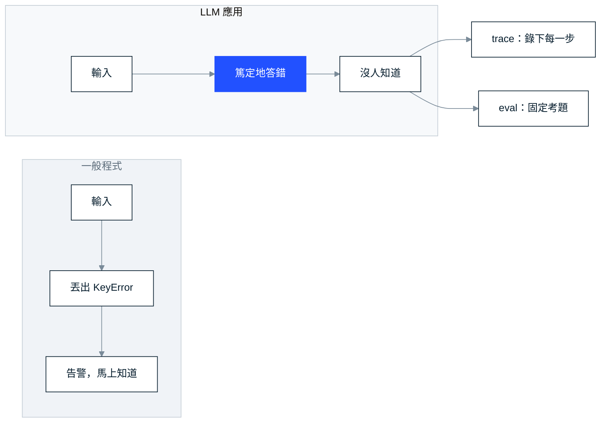

<sub>資料來源：投影片「上線後，為什麼還要一直盯」；本課整理。</sub>

本章的兩個工具各管一半。trace（追蹤）像行車紀錄器，把每一次請求的每一步輸入、輸出、耗時、token 錄下來，出事後回放找原因。eval（評估）像定期考試，用一份固定考題在每次改版前後各考一次，分數掉了就擋下。前者讓你在出事後找得到原因，後者讓你在出事前擋得住退步，兩者缺一不可。

---

## 11.2 訓練看 loss，上線看 trace 與 eval：思路相同，只是換了名字

你在深度學習裡養成的習慣，幾乎可以一對一搬到 LLM 應用上。看 loss 曲線找訓練哪裡出問題，換成看 trace 找哪一步慢、哪一步錯；驗證集換成評估集；「新 checkpoint 在驗證集上不能比舊的差才部署」換成回歸評估；部署後監控 data drift 換成線上評估。這張對照表能省掉大半的概念鋪陳，剩下的力氣留給唯一真正新的問題：評分器本身也要被驗證。

| 你已經會的（訓練） | 上線後對應的（LLM 應用） |
|---|---|
| 看 loss 曲線、用 profiler 找瓶頸 | 看 trace，找哪一步慢、哪一步錯 |
| 驗證集 (x, y) | 評估集：輸入加參考答案，再加題型標籤 |
| 評估指標（accuracy、F1） | 評分器：程式規則、LLM 評審、人工 |
| 新 checkpoint 不能比舊的差才部署 | 回歸評估：新版本不能比 baseline 差 |
| 部署後監控 data drift | 線上評估：真實流量，沒有標準答案 |

新的難題來自輸出空間。分類模型的輸出是有限類別，對錯一比就知道；LLM 的輸出是開放式文字，同一個正確答案可以有無數種寫法，「半年」和「6 個月」都對。BLEU、ROUGE 這類比對字面重疊的傳統指標，在開放式生成上和人類判斷的相關性很弱；BERTScore 用 embedding 相似度取代 n-gram 比對，好一些但仍不判斷事實對錯。於是實務上常請另一個 LLM 讀參考答案後打分，這就是 LLM 評審（LLM-as-a-judge）。評審一旦是模型，它就會有偏誤、會漏看，必須像任何分類器一樣被驗證，這是 11.5 節的主題。

**圖 11-2　離線評估擋在上線前，線上評估盯著上線後，兩者都回饋到下一輪迭代**

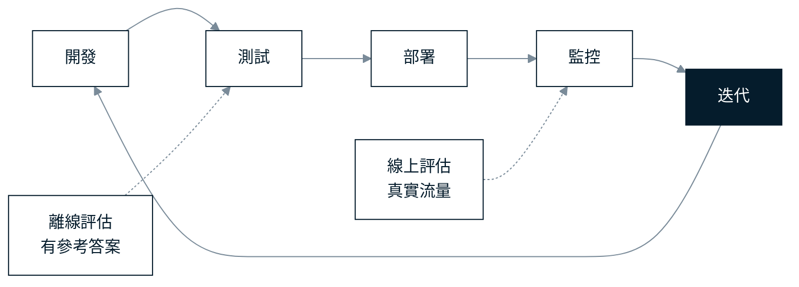

<sub>資料來源：LangSmith Evaluation concepts（見 `M8-observability-career.md`）；改繪自投影片「訓練看 loss，上線看 trace 與評測」。</sub>

離線評估在上線前跑，用固定的評估集，每題可以有參考答案；線上評估在上線後跑，看的是真實流量，沒有標準答案，只能靠規則、LLM 評審或使用者回饋（按讚、按倒讚）判斷。兩者的發現都回到下一輪迭代：線上發現的新失敗，經過人工確認後補進離線評估集，題庫就這樣一輪一輪長大。

---

## 11.3 一條 trace 是一棵 run 樹，每個節點記下耗時、token 與輸入輸出

trace 的結構只有三層，記住它們的包含關係就能讀懂任何一個可觀測性平台的介面。最小單位叫 run（在 OpenTelemetry 和 Langfuse 叫 span），代表一個工作單位：一次模型呼叫、一次檢索、一次工具執行。一次請求的所有 run 組成一棵樹，叫 trace。多回合對話的好幾條 trace，再用 `thread_id`（Langfuse 叫 session id）串成一個 thread。

先看實物。一個 agent 回答「ERR-4012 怎麼排除」的 trace，展開後是這樣一棵樹：

```text
agent（根）                       1760 ms
├─ LLM 呼叫 1                      820 ms   1.2k tokens
│    輸入  "ERR-4012 怎麼排除？"
│    輸出  tool_call search("ERR-4012")
├─ tool：search                    300 ms
└─ LLM 呼叫 2                      640 ms   1.8k tokens
```

讀法和 PyTorch Profiler 的耗時瀑布圖一樣：先找最長的那條橫桿，看慢在哪一步；再點開那一步看輸入和輸出，判斷是模型答錯還是工具回錯。差別在於 profiler 的每一層只有耗時，trace 的每個節點還保存了完整的輸入輸出內容，這讓你能回答「為什麼答錯」而不只是「哪裡慢」。

**圖 11-3　Thread 包含多條 trace，trace 是一棵 run 樹**

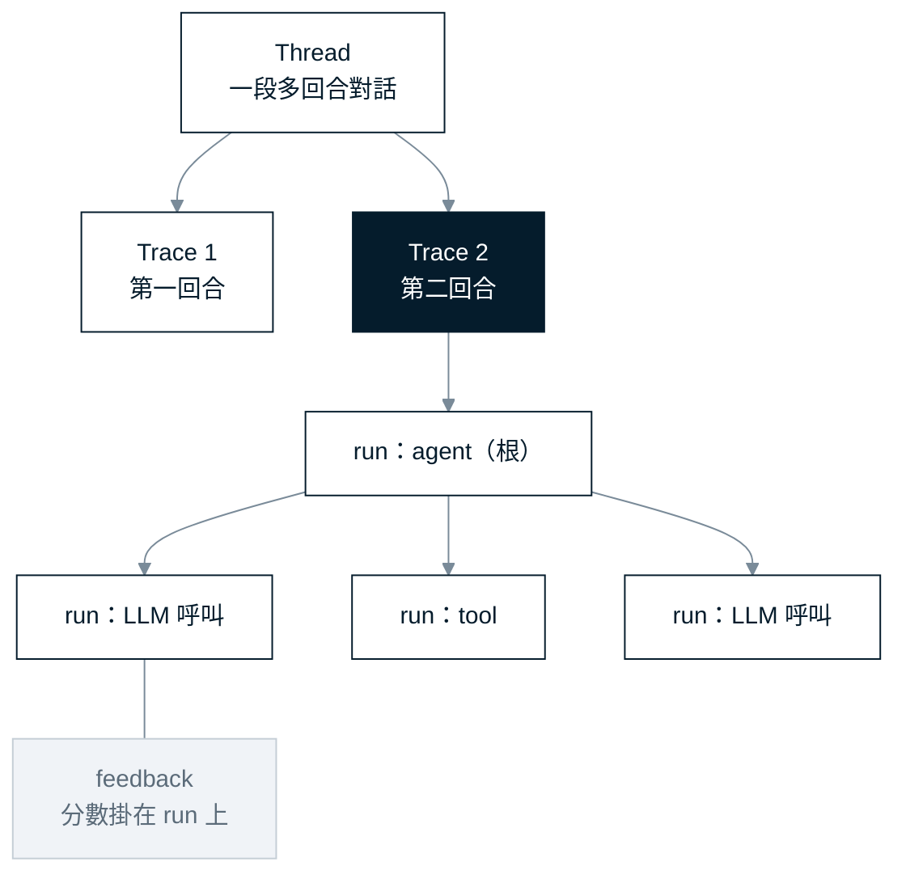

<sub>資料來源：LangSmith Observability concepts（見 `M8-observability-career.md`）；改繪自投影片「拆解一條 trace」。</sub>

run 之中有一種特別的類型叫 generation，代表一次 LLM 呼叫，除了一般的開始時間、結束時間、輸入、輸出、父節點，還多記模型名稱、參數和 token 數。掛在 trace 或 run 上的分數叫 score 或 feedback，來源可以是 LLM 評審、人工標註，也可以是使用者按讚。這讓 trace 和 eval 接在一起：評估分數不是另存在一張試算表裡，而是貼在它評的那一步上，看到低分直接點開就是當時的輸入輸出。

可觀測性平台的核心其實很小。模組八用一個十行的 context manager 示範最小版本：進入時記時間，離開時把 trace id、步驟名、輸入、延遲寫成一行 JSONL。

```python
@contextmanager
def span(trace_id, step, input_):
    t0 = time.perf_counter(); rec = {"trace_id": trace_id, "step": step, "input": input_[:40]}
    try: yield rec
    finally: rec["latency_ms"] = (time.perf_counter() - t0) * 1000; f.write(json.dumps(rec) + "\n")
```

平台多做的是 span 之間的父子關係（畫成樹和瀑布圖）、完整保存輸入輸出、成本換算、按分數篩選、標註佇列和團隊共享連結。把這個最小版本看懂，平台的欄位名稱再怎麼換，你都知道它在記什麼。

**圖 11-4　在一條 RAG trace 裡，生成與評審佔掉大半時間，檢索只佔一小段**

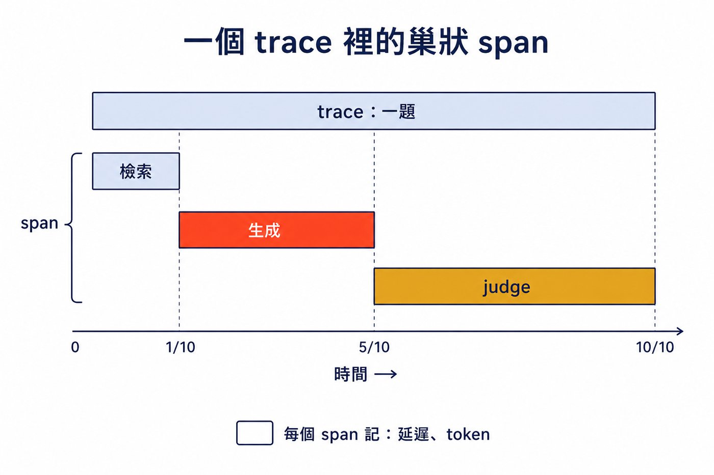

<sub>資料來源：模組八 `00_concepts.md` 第 5 節、`03_langfuse.ipynb`。</sub>

有了 trace，錯誤分析才有東西可看。一題答錯，先看檢索那一步有沒有撈到正解文件：沒撈到，問題在檢索，回第 5 章調分塊、混合檢索或重排；撈到了還答錯，問題在生成，回第 2 章調提示詞。沒有 trace，你只能對著一個錯的最終答案猜。

延遲要看分布，不要只看平均。平均值會被少數特別慢的請求拖著走，上線時看 p50（一般使用者的體驗）和 p95（最慢那 5% 的體驗）。本課在 `03_langfuse.ipynb` 某次執行的 12 題裡，生成步驟的 p50 是 109 ms、p95 是 403 ms，評審步驟佔了全部 token 的六成左右；這些數字每次重跑都會變，重點是它們只有從 trace 才算得出來。本機有其他程式搶 GPU 時 p95 會被拉長，這種現象只看平均完全看不到。最後一個實務提醒：trace 要連出錯的請求一起記，只記成功請求的 trace，最需要看的那一步反而沒有。

---

## 11.4 eval 是 LLM 應用的驗證集：題庫、評分器、對照基準

一套 eval 由三樣東西組成：一份評估集（每題有輸入、參考答案和題型標籤）、一組評分器、一個用來比較的 baseline。改完程式或提示詞就把新版本在評估集上跑一遍，評分器打分，分數不比 baseline 差才放行。結構上這就是你在深度學習裡做了無數次的驗證流程，只是評分器換成了三種，各有適用範圍。

評分器由便宜到貴分三種。程式規則最便宜：檢查是不是合法 JSON、有沒有出現某個數字、字串相似度多少，適合格式和必須出現的關鍵資訊，但判斷不了意思對不對。LLM 評審能大量處理開放式回答，但它自己也會錯，要先校準。人工標註最準也最貴，量大時做不起，適合用來校準 LLM 評審和抽查。實務上三種疊著用：規則當否決票、LLM 評審做大量評分、人工校準 LLM 評審。

| 評分器 | 例子 | 適合 | 不適合 |
|---|---|---|---|
| 程式規則 | 合法 JSON、關鍵數字有沒有出現、Hit@k | 格式、必須出現的事實、檢索命中 | 判斷語意對錯 |
| LLM 評審 | 讀參考答案後給 pass／fail 或量表分數 | 大量、開放式回答 | 未校準前不能信 |
| 人工標註 | 專家標 pass／fail 加理由 | 校準評審、抽查 | 量大時太貴 |

**圖 11-5　題庫餵給新版本，三種評分器打分，過了閘門才放行**

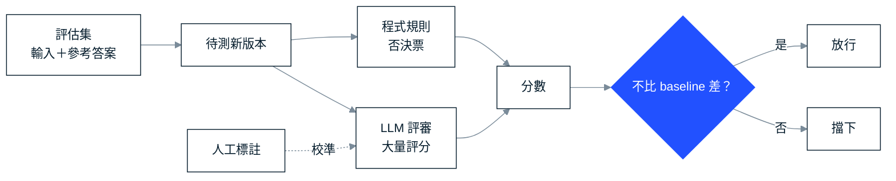

<sub>資料來源：模組八 `00_concepts.md` 第 1 節；改繪自投影片「評測：給 LLM 應用一張驗證集」。</sub>

不同評分器對同一批回答的判決常常不一致，這不是壞事，不一致的地方正是最值得讀的。模組八把同一批回答交給字串相似度、現成的 Hallucination 指標和自寫評審三種評分器，結果大部分題目三者同意，少數題目意見分歧；分歧那幾題要先讀評審寫的理由，才知道是哪一個評分器量錯了東西。字串相似度在某批樣本上可能看起來表現很好，追下去才發現那批錯的回答剛好都很長、對的都很短，它量到的其實是長度。

**圖 11-6　三種評分器看同一批回答，意見分歧的題目要先讀理由**

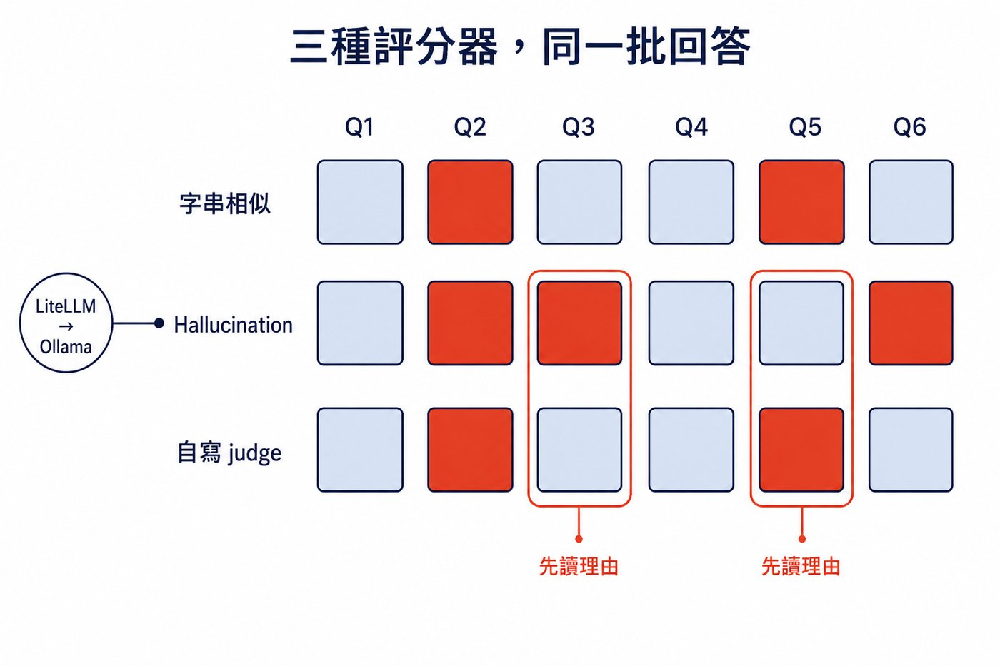

<sub>資料來源：模組八 `04_opik.ipynb`；`00_concepts.md` 第 6 節。</sub>

agent 的評估比單輪問答多一層隨機性。Anthropic 在 2026-01 的〈Demystifying evals for AI agents〉裡把同一題多跑幾次稱為 trial，並區分兩個指標：pass@k 是「k 次裡至少成功一次」，會隨 k 往上爬；pass^k 是「k 次都成功」，會隨 k 往下掉。單次成功率 75% 的 agent，連續三次都成功只剩約 42%（0.75 的三次方）。這就是「demo 能跑」和「上線穩定」的差距，也是為什麼值班 agent 這類要反覆執行的系統，該看 pass^k 而不是 pass@k。同一篇文章也建議從 20 到 50 個取自真實失敗的任務起步，而不是一開始就想湊出幾千題。

---

## 11.5 LLM 評審本身是一個要被校準的分類器

LLM 評審最容易被誤用的地方，是把它的分數當成真相。正確的看法是：評審就是一個二元分類器，人工標註是 ground truth，在信任它之前，要像驗證任何分類器一樣算混淆矩陣。調評審的提示詞，就像調超參數直到驗證集指標收斂。

一個評審提示詞有四個零件。第一是參考答案，沒有它，評審不知道什麼是對的，只能看長度和語氣。第二是評分量表，每個分數寫清楚定義，例如 5 分是關鍵事實全對、1 分是編造。第三是先寫理由：輸出欄位 `reason` 放在 `score` 前面，讓模型先推理再下判斷。第四是結構化輸出，用 Pydantic 定義欄位，拿回來的保證是合法物件，這是第 2 章的技術。

```python
class Verdict(BaseModel):
    reason: str
    score: int = Field(ge=1, le=5)
resp = client.chat.completions.parse(model=..., messages=..., response_format=Verdict)
```

評審有三種已知偏誤。位置偏誤是兩兩比較時偏好先出現（或後出現）的那個，修法是正反各問一次，兩次都選同一份內容才算贏，否則判平手。長度偏誤是長、客氣、像官方說明的回答分數比較高，就算內容是錯的，修法是給參考答案、在量表寫明長度不加分、附一個「長但錯」的範例。自我偏好是模型給自己產生的回答打比較高分，修法是受測模型和評審用不同模型。小模型還有一個毛病是會漏看數字，提示詞寫得再清楚，它也可能說「關鍵事實一致」卻沒發現 7 和 3 不同；能用程式檢查的就別交給 LLM，模組八的評審因此加了一條規則：參考答案裡的數字，回答都要出現，當否決票。

**圖 11-7　位置偏誤正反各問一次就能抓出，長度偏誤要靠參考答案拉回來**

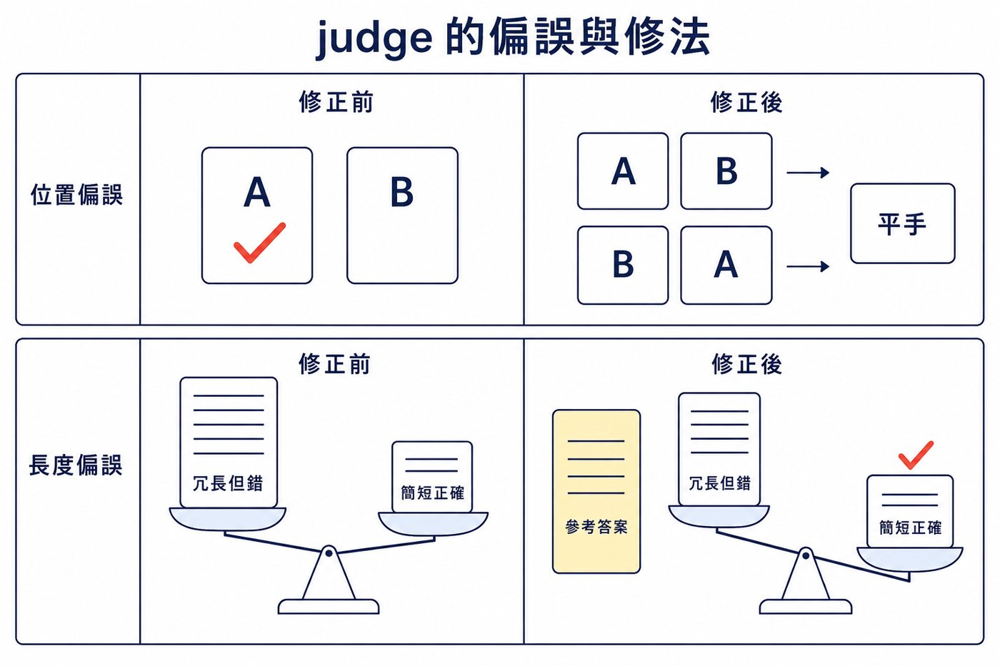

<sub>資料來源：模組八 `00_concepts.md` 第 2 節、`01_llm_as_judge.ipynb` Step 6；偏誤分類依 Eugene Yan〈Patterns for Building LLM-based Systems & Products〉。</sub>

校準的流程是：專家逐條標 pass／fail 並寫下理由，把評審的判決和人工對照，算出混淆矩陣；對不上的幾筆，讀人工的理由，改評審的提示詞或加規則，再算一次。四格的意思如下：TP 是兩邊都說 pass；FN 是好的被評審攔下；FP 是壞的被評審放行；TN 是兩邊都說 fail。由此算出 TPR（好的被判對的比例）＝TP ÷ (TP＋FN)，TNR（壞的被抓出的比例）＝TN ÷ (TN＋FP)。

**圖 11-8　評審對人工的混淆矩陣，FP 那一格對產品最危險**

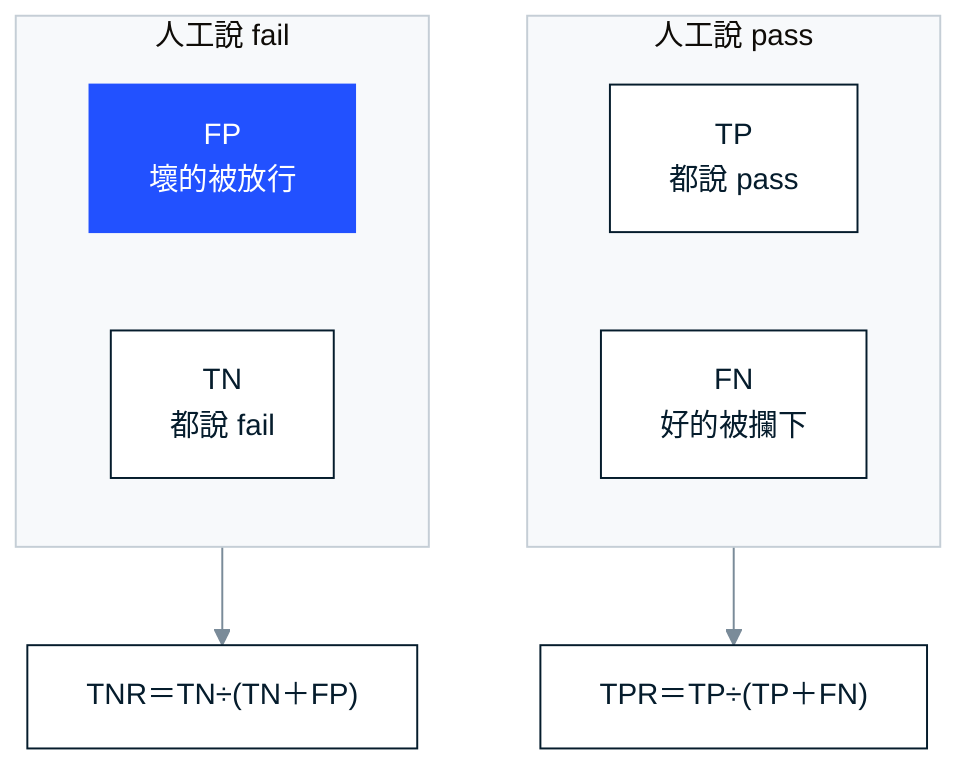

<sub>資料來源：模組八 `00_concepts.md` 第 3 節；改繪自投影片「評審校準：LLM 評審也要被驗證」。</sub>

類別不平衡時不能只看一致率，這和深度學習裡不能只看 accuracy 是同一件事。一個把所有回答都判 fail 的評審，TNR 是 100%、TPR 是 0%，在一半好一半壞的樣本上一致率仍有 50%；如果樣本幾乎都是 pass，全猜 pass 的評審一致率還會更高。四格之中 FP 對產品最危險：壞的回答被放行，分數就虛胖，你會以為系統比實際好。

本課的實測結果可以當作參考尺度。模組八用本機 `qwen2.5:3b` 當評審，拿 10 筆人工標註校準，某次執行得到一致率 70%、TPR 40%、TNR 100%：壞的都抓得到，但好的回答常因措辭差異被扣分。這個結果說明三件事。小評審偏嚴而且有雜訊；10 筆樣本只夠看出方向，不夠下定論；而本課受測系統和評審是同一個模型，違反了「不要讓模型評自己」的原則，這是為了全程本地執行而刻意接受的限制，寫報告時要誠實交代。還有一條紀律：用來校準的樣本不能拿去當評審提示詞裡的範例，否則就像拿測試集調超參數。

---

## 11.6 先做錯誤分析，再決定要寫哪些評分器

要評什麼，有兩派意見，差別在第一步。一派主張先做錯誤分析：親自讀 30 條以上的 trace，把失敗歸類計數，只為你「發現」的錯寫評分器。另一派主張評估驅動開發：先把成功標準寫成評估，再邊改邊跑，分數說了算。本書採前者為預設，因為 LLM 的失敗方式幾乎沒有邊界，憑想像寫出來的指標很容易量不到真正會出事的地方。

錯誤分析的做法來自質性研究，分兩步。第一步叫 open coding：逐條讀 trace，對每一條寫一句自由筆記，記下你看到哪裡不對。第二步叫 axial coding：把筆記歸成五到八個失敗類別，數每一類各有幾條，畫成長條圖。最高的那幾根長條，才值得寫自動評分器。這和你在深度學習裡做 error analysis 是同一套老功夫：把分錯的樣本按錯誤類型歸類，先修最大宗。

**圖 11-9　錯誤分析是一個漏斗，只有最大宗的錯才值得寫評分器**

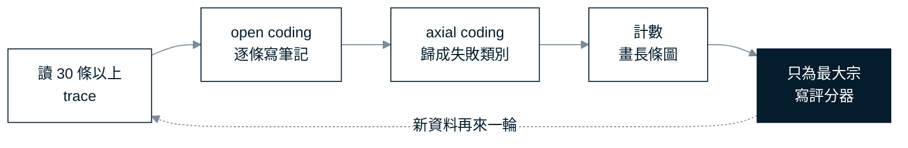

<sub>資料來源：Hamel Husain、Shreya Shankar〈AI Evals: Everything You Need to Know〉（2026），本課轉述；改繪自投影片「評測的兩派：先做哪一件」。</sub>

兩派各有出處。Eugene Yan 在〈Patterns for Building LLM-based Systems & Products〉以正面語氣提到 Eval Driven Development；Hamel Husain 與 Shreya Shankar 在 2026 年的 Evals FAQ 對「該不該做評估驅動開發」的回答是「通常不該」，主張為發現的錯誤寫評分器，而不是為想像的錯誤寫。兩派有一個共同點：成功標準非常明確的硬性約束，例如「絕不提及競品」，可以先寫評估。

同一份 FAQ 還有一條建議值得照做：偏好二元的 pass／fail，少用 1 到 5 分的量表。量表的問題是標註者之間不一致，而且大家傾向給中間值；二元判斷逼你寫清楚「什麼算過」，人工標註和評審校準都因此簡單得多。

| | 先做錯誤分析 | 評估驅動開發 |
|---|---|---|
| 第一步 | 讀 trace，歸類失敗 | 定成功標準，寫評估 |
| 評分器從哪來 | 只為發現的錯寫 | 從規格推出來 |
| 適合 | 開放式任務、失敗面大 | 硬性約束、標準明確 |
| 風險 | 前期要花人工讀資料 | 量到想像中的錯，漏掉真正的錯 |

---

## 11.7 回歸評估要按題型看，只看總分會漏掉最危險的退步

回歸評估（regression eval）是 eval 在日常開發中最實用的形態：題庫和評審都固定，只換受測系統，基準版和候選版各跑一次，分數掉了就擋下。它對應的正是「新 checkpoint 在驗證集上不能比舊的差才部署」。關鍵在於分數要按題型看，因為一次改版常常是某一類變好、另一類變差，總分剛好打平。

**圖 11-10　題庫與評審固定，只換受測系統，分數掉了就擋下**

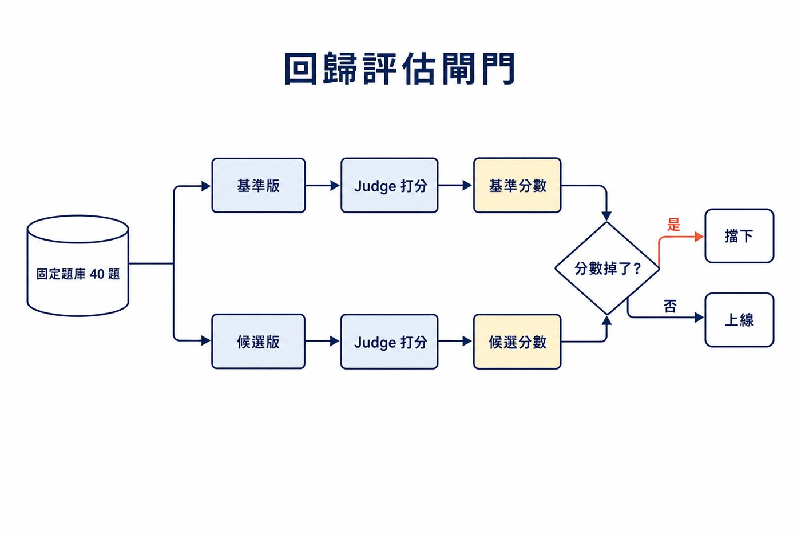

<sub>資料來源：模組八 `00_concepts.md` 第 4 節、`02_regression_eval.ipynb`。</sub>

本課的實測把這個陷阱演了一次。模組八的受測系統是一個虛構公司的 FAQ 助理，題庫 40 題，每題帶標籤（數字、條件、事實、改寫、無答案），其中 4 題是資料裡根本沒有答案的問題。基準版 `v1` 和一個語氣「更親切」的提示詞改版 `v2` 各跑一次，某次執行的結果是兩版總分都是 24／40，完全打平；但分標籤一看，`v2` 在「無答案」這一類從 4／4 掉到 2／4，也就是有兩題原本會老實說「資料裡沒有」，改版後開始編答案。只看總分，這次改版會被放行，而它引入的正是最不能接受的那種錯。

| 題型（某次執行） | 基準版 v1 | 改版 v2 |
|---|---|---|
| 全部 40 題 | 24／40 | 24／40 |
| 數字 | 13／19 | 14／19 |
| 條件 | 4／12 | 6／12 |
| 無答案 | 4／4 | 2／4 |

<sub>資料來源：模組八 `runs/baseline.json`、`runs/prompt_v2.json`（`02_regression_eval.ipynb` 存檔的一次執行；重跑數字會有些不同）。</sub>

門檻的設法因此要分兩種。評審有雜訊，同一份資料重跑可能差一兩題，所以整體門檻要留容許值，本課的 pytest 版閘門容許 40 題裡最多掉 1 題；但對最不能接受的錯，例如編造，容許值設為 0，按題型單獨把關。閘門寫成 pytest 放進 CI，每次改提示詞或參數都自動跑，基準版的結果存檔，不用每次重跑。

回歸評估也適用於 agent 的行為，不只適用於回答品質。本書旗艦專案附了一組免模型的回歸評估（`eval_benchmarks/`）：六個固定的值班情境，涵蓋核准重啟、拒絕重啟、受保護服務、服務已健康、修復後驗證失敗等，外加四筆檢索查詢。它驗證的是「審批前的寫入次數必須是 0」「受保護服務一律轉人工」「被拒絕就不准寫入」這類確定性的行為規則，以及檢索有沒有把正確的 runbook 排進前三。它的結果檔自己寫明了範圍：只代表六個固定教學情境與四筆檢索，不代表模型或線上事故表現。這個自我設限的寫法值得照抄，評估結果寫清楚「量了什麼、沒量什麼」，數字才有可信度。

---

## 11.8 可觀測性工具會被收購，OpenTelemetry 讓你換得走

可觀測性平台的選型，比挑哪一家更重要的是資料格式。2026 年這類工具接連被收購或停止加新功能：Langfuse 在 2026-01 被 ClickHouse 收購（官方承諾維持 MIT 授權），Helicone 在 2026-03 被收購後進入維護模式，OpenLLMetry 的母公司 Traceloop 在 2026-03 宣布加入 ServiceNow。在這種環境下，打點（instrumentation）若走 OpenTelemetry（OTel，業界通用的 trace 標準），同一批 span 換個匯出器就能送到別的後端，換家時不必改程式。

OTel 帶來的可攜性在 Langfuse 的架構上看得最清楚。Langfuse 3 版之後的 SDK 整個建在 OTel 上：你的程式呼叫 Langfuse SDK 打點，SDK 產生的是標準的 OTel span，平台的欄位只是一組有命名規則的屬性；這些 span 可以送到 Langfuse 雲端、自架伺服器，或在本機記憶體裡收下來看。本課 `03_langfuse.ipynb` 沒設金鑰時就是用 OTel 的 `InMemorySpanExporter` 在本機收 span。要注意的是 OTel 的 GenAI 語意規範目前仍在 Development 階段，欄位名稱可能再變。

**圖 11-11　打點走 OpenTelemetry，同一批 span 可以送到任何後端**

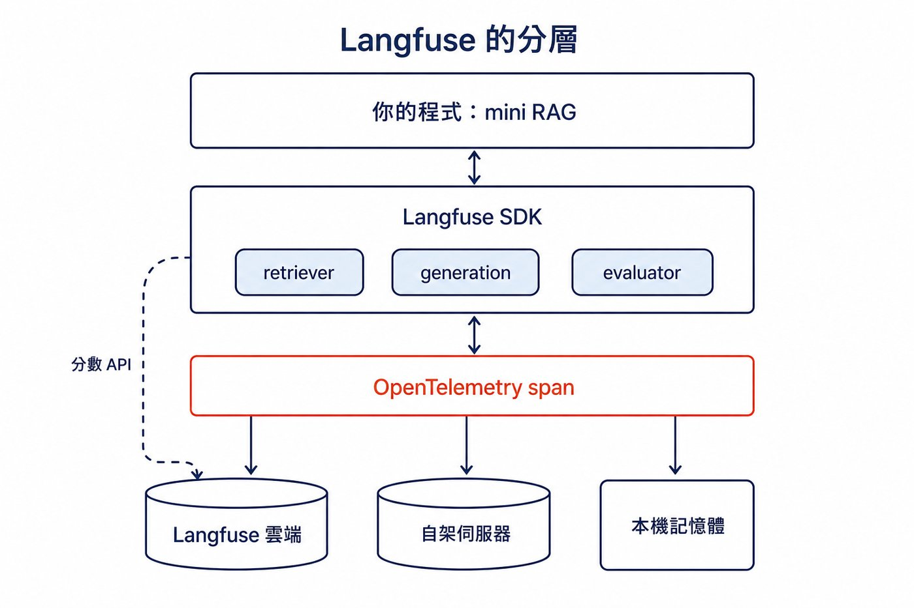

<sub>資料來源：模組八 `00_concepts.md` 第 5、7 節、`03_langfuse.ipynb`。</sub>

| 工具 | 定位 | 什麼時候選 | 授權／狀態（2026-11 核實） |
|---|---|---|---|
| LangSmith（本課 Lab 8 用） | LangChain 官方追蹤＋評估 | 團隊用 LangChain／LangGraph | 商業 SaaS；自架限企業版 |
| Langfuse | 開源的 LangSmith 替代，含 prompt 管理 | 要自架、資料不出公司 | MIT（`ee/` 除外）；2026-01 被 ClickHouse 收購 |
| Arize Phoenix | 本機一行起的追蹤介面 | notebook 裡除錯 | Elastic License 2.0，非 OSI 開源 |
| MLflow Tracing | MLflow 的 GenAI 追蹤 | 團隊已用 MLflow 管模型 | Apache 2.0 |
| OpenLLMetry | OTel 打點套件 | 想匯出到任何支援 OTel 的後端 | Apache 2.0；母公司加入 ServiceNow |
| Helicone | 改 base URL 的代理式追蹤 | 新專案不建議 | 2026-03 被收購後進入維護模式 |

本課 notebook 另外示範了 Langfuse 和 Opik 兩個開源平台，兩者都能自架、都同時做 trace 和評估，差在重心。一句話的選法是：以 trace 與 prompt 管理為主、要自架，選 Langfuse；要現成的評估指標、想在 notebook 或 CI 直接算分，選 Opik（Apache 2.0）；團隊已經全用 LangChain，選 LangSmith。它們對同一個概念的叫法不同，對照起來就不會被介面搞混：一題在三者都叫 trace；一步在 Langfuse 叫 observation（用 `as_type` 分類型），在 Opik 叫 span；評審分數在 Langfuse 是另一支 API 寫入的 score，在 Opik 叫 feedback score；打點寫法分別是 `start_as_current_observation` 和 `@opik.track`。

網路上很多 Langfuse 範例是 v2 寫法（`lf.trace(...)`、`trace.generation(...)`），在本課使用的 5.x 會直接報錯；5.x 一律用 `start_as_current_observation` 開 span 或 generation，用 `propagate_attributes` 設 session 與 tag，用 `score_current_trace` 或 `create_score` 寫分數。

---

## 11.9 評估工具依「評什麼」挑，最值錢的是你自己的題庫

評估工具的差別不在功能多寡，而在評的對象：RAG 的檢索與回答品質、應用流程的單元測試、提示詞與模型的比較，還是模型本身的能力與安全。先確定你要評哪一層，再挑對應的工具。不論挑哪一個，真正會累積價值的是你自己那份評估集：工具可以換，考題要一題一題累積。

| 工具 | 評什麼 | 什麼時候選 | 授權／狀態（2026-11 核實） |
|---|---|---|---|
| LangSmith Evals（本課用） | 資料集＋評分器＋實驗比較 | 已用 LangSmith 追蹤 | 商業 SaaS |
| Ragas | RAG 指標：忠實度、相關性 | 評 RAG 檢索與回答品質 | Apache 2.0；GitHub 已搬到 `vibrantlabsai/ragas` |
| DeepEval | pytest 風格的 LLM 測試 | 想把評估寫進單元測試 | Apache 2.0 |
| promptfoo | 比較 prompt／模型，含紅隊測試 | 在 CI 擋退步、做安全測試 | MIT；2026-03 OpenAI 宣布收購 |
| Inspect（UK AISI） | 模型與 agent 的能力、安全基準 | 評模型本身，而不是你的應用 | MIT |

**圖 11-12　先決定評的是哪一層，再挑工具**

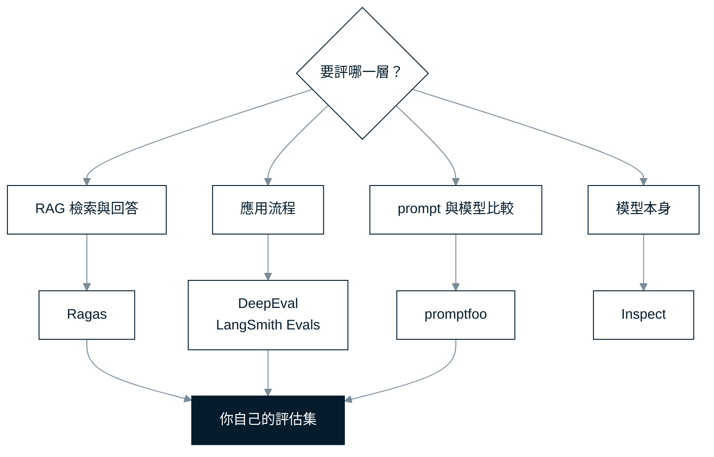

<sub>資料來源：`docs/slides/sources/tool-selection.md` 表 D-3；改繪自投影片「選型：評測（eval）工具」。</sub>

指標的選法也跟著評估對象走。檢索層用規則型的 Hit@k、MRR，量正解文件有沒有被排進前 k 名，需要每題標好正解文件 id；回答層的現成 LLM 指標（Hallucination、Faithfulness、Answer relevance）要先在你的資料上量過才能用，它們的提示詞多是英文、針對大模型設計，本課的 3B 模型偶爾吐不出要求的 JSON；你最在意的業務規則，最後還是要自寫評審並自己校準。速度與成本則從 trace 直接算：延遲 p50／p95、每題 token。

---

## 本章重點

LLM 應用壞掉時不報錯，所以要用 trace 錄下每一步、用 eval 定期考試。trace 是一棵 run 樹，每個節點記耗時、token 和完整輸入輸出，讀法和 profiler 的瀑布圖一樣，延遲看 p50／p95 而非平均。eval 是 LLM 版的驗證集：評估集、評分器、baseline；三種評分器疊著用，規則當否決票、LLM 評審做大量評分、人工校準評審。LLM 評審是一個要被校準的分類器，類別不平衡時分開看 TPR 與 TNR，FP 最危險。先做錯誤分析再決定評分器，回歸評估要按題型看，對編造這類錯設零容許。可觀測性工具會被收購，打點走 OpenTelemetry 才換得走；工具可以換，你的題庫要累積。

## 對應實作與延伸閱讀

- [Lab 8-01　LLM 當評審：現成指標、結構化輸出、偏誤重現、人工標註校準](../../modules/module-08-eval-career/01_llm_as_judge.ipynb)
- [Lab 8-02　40 題回歸評估：分標籤長條圖、回歸閘門與 pytest 版](../../modules/module-08-eval-career/02_regression_eval.ipynb)
- [Lab 8-03　Langfuse 打點：延遲分布、每題 token、瀑布圖、錯誤分析](../../modules/module-08-eval-career/03_langfuse.ipynb)
- [Lab 8-04　Opik 打點與三種評分器比較](../../modules/module-08-eval-career/04_opik.ipynb)
- [模組八原理紀要 `00_concepts.md`](../../modules/module-08-eval-career/00_concepts.md)
- 旗艦專案的免模型回歸評估：[`eval_benchmarks/evaluate_incident_agent.py`](../../eval_benchmarks/evaluate_incident_agent.py)、[`incident_cases.json`](../../eval_benchmarks/incident_cases.json)
- 投影片 PDF：[`../slides/deck/deck.pdf`](../slides/deck/deck.pdf)，8xx 頁「模組八 轉職衝刺」
- Hamel Husain，〈Your AI Product Needs Evals〉，2024，hamel.dev/blog/posts/evals/
- Hamel Husain、Shreya Shankar，〈AI Evals: Everything You Need to Know〉，2026，hamel.dev/blog/posts/evals-faq/
- Anthropic，〈Demystifying evals for AI agents〉，2026，anthropic.com/engineering/demystifying-evals-for-ai-agents
- LangSmith 官方文件，〈Observability concepts〉，docs.langchain.com/langsmith/observability-concepts
