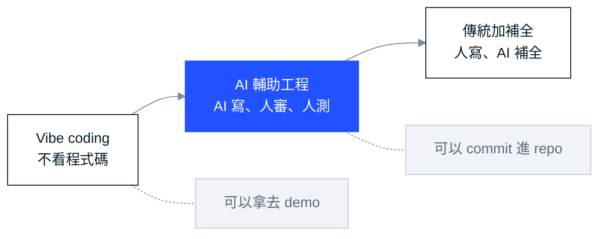
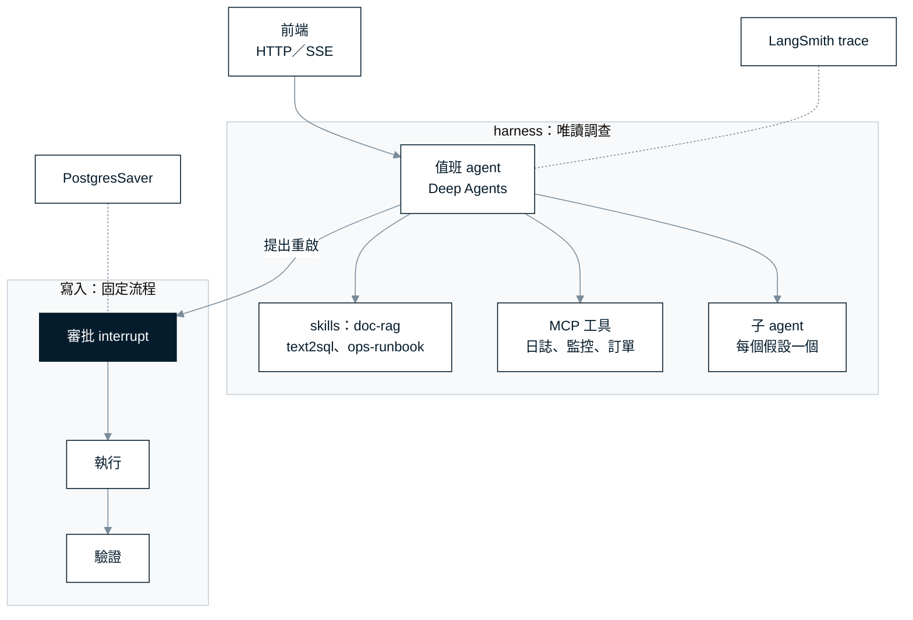
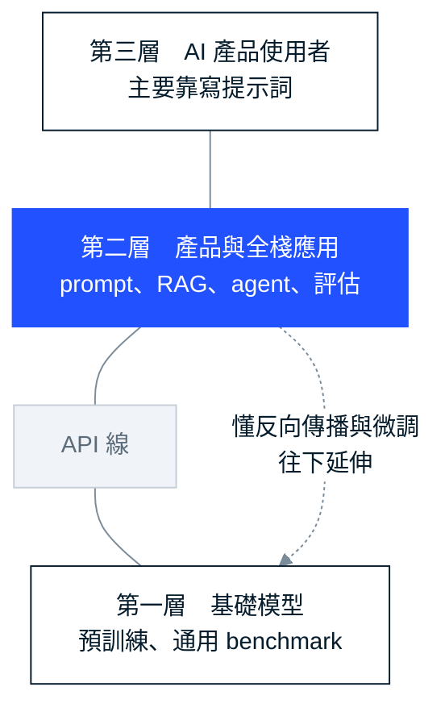
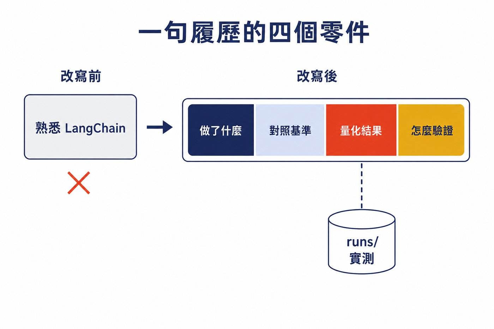
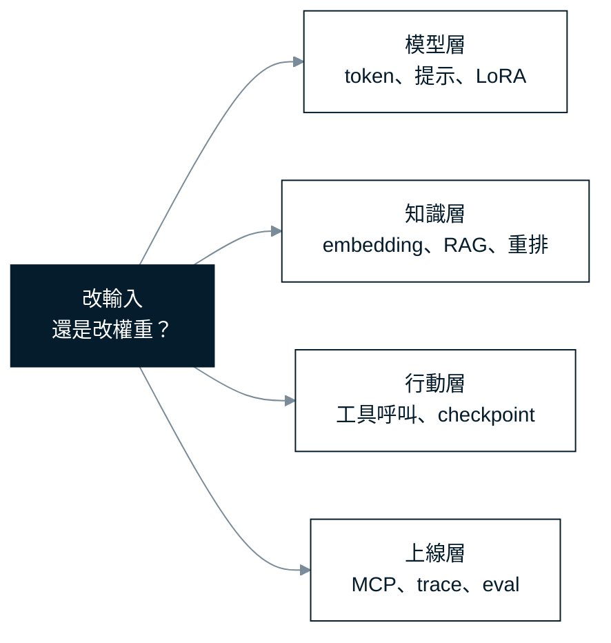

# 第 12 章　從專案到職涯：把系統接起來，把成果講清楚

**本章結論**　全書最後一章做三件事。第一，劃清用 AI 寫程式的界線：Vibe coding 能做 demo，要進 repo 的程式碼必須是你審過、測過、能向別人解釋的。第二，把前十一章的零件接成旗艦專案，一個值班 agent 帶三個 skill 與 MCP 工具負責調查，會動到線上的寫入走寫死的審批流程，再用一條公開 trace 證明它真的跑過。第三，把這些工作變成職涯上的證據：AI 工程師站在 API 線之上做產品，你的差異化是能往下延伸到模型；履歷每一行要寫出動作、對照基準、量化結果與驗證方式；面試時講得出限制、結構與數字。回頭看，全書四部各補上模型的一個缺口，合起來才是一個能上線的系統。

---

## 12.1 Vibe coding 能拿去 demo，要進 repo 就得能解釋

用 AI 寫程式已經是日常，問題不在用不用，而在你對產出負多少責任。本書的界線很簡單：不 commit 任何自己無法向別人解釋清楚的程式碼。這條線把「AI 寫、人審、人測」的工程做法，和「不看程式碼、只看結果能不能跑」的 vibe coding 分開。前者是本課要你做到的位置，後者適合低風險的原型與學習，不適合直接進 repo。

先把詞的來源講對。Vibe coding 這個說法是 Karpathy 在 2025-02 提出的，指完全順著感覺、讓 AI 寫、連程式碼存在都忘掉的寫法，不是很多教材寫的「2026 年興起」。到了 2026 年，據二手報導，他本人已改稱偏好 agentic engineering 這個說法，並把 vibe coding 視為過時用語；轉述的 agentic engineering 工作包括寫設計規格、監督計畫、檢查 diff、寫測試、建評估迴圈、管理權限、守住品質（本課轉述，非逐字原話）。Simon Willison 的整理更直接：vibe coding 就是用 LLM 寫軟體但不審查它寫的程式碼；他自己的規則是不 commit 任何無法向別人解釋清楚的程式碼。

**圖 12-1　人審得越多，離 repo 越近**



<sub>資料來源：Simon Willison〈Not all AI-assisted programming is vibe coding〉（2025），本課轉述；改繪自投影片「Vibe Coding 不等於 AI 輔助工程」。</sub>

對有深度學習背景的人，這個危險很好理解：只看 loss 下降、不看預測結果，模型可能學到的是捷徑（shortcut learning），指標好看不代表學到對的東西。程式能跑，同樣不代表邏輯是對的。AI 輔助工程的工作流因此固定為四步：人寫規格，AI 生成程式，人審查與測試，能解釋才 commit。工具方面，指的是 Cursor、Claude Code 這類程式碼 agent。有些教材把騰訊的 WorkBuddy 和它們並列，WorkBuddy 實際上是辦公類 AI 工作台，不是寫程式的工具。

這一節和第 11 章其實是同一件事。agentic engineering 列出的工作裡，「寫測試」「建評估迴圈」就是上一章的回歸評估和評審校準；你讓 AI 寫的程式碼，也要過你自己定義的測試與評估，才算交付。

---

## 12.2 旗艦專案是一個 agent 加一條寫死的審批流程

旗艦專案把全書的零件接成一個能跑的值班助理，它的架構濃縮了第三部的核心判斷：調查要開放，執行要確定。一個值班 agent 帶三個 skill 和一組 MCP 工具負責查原因，所有工具都是唯讀的；只有要重啟服務、改設定這類會動到線上的動作，才進入一條寫死的 approve → execute → verify 流程，由值班主管點頭才往下走。

**圖 12-2　調查交給 agent，寫入走固定流程，狀態與追蹤橫跨兩邊**



<sub>資料來源：`projects/incident-autonomous-agent/README.md`；改繪自投影片「旗艦專案：一個 agent，加一條審批流程」。</sub>

每個零件都能對回前面某一章。`doc-rag` skill 用的是第 5 章的混合檢索加 RRF，配上第 6 章 Neo4j 的服務依賴拓撲；`text2sql` skill 延續第 2 章的結構化輸出，用 Pydantic 驗證、只准 `SELECT`；`ops-runbook` skill 把排錯步驟寫成按需載入的說明；日誌、監控、訂單資料經第 10 章的 stdio MCP 讀取；可疑原因各開一個唯讀子 agent 平行查證，這是第 9 章講的「依假設切子 agent」，而不是依職能切出 DocAgent、DBAgent、OpsAgent；審批流程用第 8 章的 LangGraph `interrupt`，狀態存進 `PostgresSaver`，關掉程式後仍能接著審批；所有 graph 呼叫都明確設定 `recursion_limit`，因為 langgraph 1.1.4 之後的預設值是 10,007，預設值擋不住死循環。

為什麼不照課綱原本的設計，用一個 Supervisor 把任務分派給 DocAgent、DBAgent、OpsAgent 三個職能 agent？理由有兩個，都在第 9 章講過，這裡用數字再看一次。第一是 2026 年的業界預設：Anthropic、OpenAI、LangChain 和多家企業 SRE 產品都以「單一 agent 加 skills、子 agent 與 MCP」的 harness 為預設，按職能切 agent 被點名為反模式；子 agent 仍然有用，但用在隔離 context、平行查證這類需要時才開的地方。第二是成本：同一個「查 502 根因」的小任務，本課在 `09_crewai_multiagent.ipynb` 用本機小模型各跑一次，單一 agent 用了 1,356 tokens、2 次請求，依角色硬拆成 4 個 agent 用了 13,212 tokens、28 次請求，約 9.7 倍，三版都找對了根因。這是本課小任務的單次實測，和 Anthropic 多智能體研究系統報告的「約 15 倍」是不同條件下的兩個數字，不能混為一談；但方向一致：多 agent 的 token 代價是倍數級的，要有足夠的任務價值才值得付。

| 版本（本課實測，跑一次） | tokens | 請求次數 | 找對根因 |
|---|---|---|---|
| A　單一 agent | 1,356 | 2 | 是 |
| B　依角色硬拆（4 agent） | 13,212 | 28 | 是 |
| C　平行查證＋審查（4 agent） | 14,116 | 28 | 是 |

<sub>資料來源：`modules/module-05-agent-harness/09_crewai_multiagent.ipynb` Step 4–7（CrewAI、本機 `qwen2.5:3b`）；見 `product-facts.md`「本課 notebook 實測數字」。</sub>

寫入流程的邊界比架構圖更值得細讀，因為這是 agent 上線時最容易出事的地方。專案只允許兩個非關鍵服務重啟，付款與下單服務一律轉人工；服務已健康時不提重啟；模型提出的目標必須和調查中的服務相符；審批綁定事件的 `action_id`，拒絕、重複審批、目標不符都不執行；審批後會再檢查服務版本，若另一事件已經修好，舊的審批不會再觸發重啟；驗證要同時滿足健康、p95 延遲與錯誤率三個條件，不通過就停止自動操作。這些規則沒有一條交給模型判斷，全部寫在固定流程裡。

| 能力 | `demo` 模式（預設） | `live` 模式 |
|---|---|---|
| 調查 | 固定規則＋平行唯讀證據收集 | Deep Agents＋3 個 skills＋唯讀假設子 agent |
| 日誌、監控、訂單 | 直接讀模擬資料 | 透過 stdio MCP 讀同一份模擬資料 |
| 審批與修復 | LangGraph interrupt → execute → verify | 同一套固定圖，模型不能繞過 |
| 檢查點 | 預設 InMemorySaver，可改 PostgreSQL | 建議 PostgresSaver |

兩種模式共用同一套審批圖，這是刻意的設計：不論調查端換成多聰明的模型，寫入端的規則都不變。所有重啟都作用在 SQLite 模擬服務上，不會碰真實的線上系統。前端方面，課綱原本寫的 LangChain Agent Chat UI，其 repo 已在 2026-11-03 封存為唯讀，本專案改用自帶的 HTTP／SSE 頁面；你若要另選前端，記得避開已封存的專案，或 fork 一份固定版本自己維護。

---

## 12.3 Lab 8 用一條公開 trace 證明系統真的跑過

Lab 8 的目標不是再加功能，而是留下證據。把前幾章的零件接成一條鏈，開啟追蹤跑一輪完整對話，讀那條 trace 找出最慢的一步和 token 花在哪裡，最後產生公開連結，放進 README 和履歷。一條公開 trace 比任何自我描述都有說服力，因為面試官可以自己點開，看到每一步的輸入輸出、耗時和工具呼叫。

**圖 12-3　Lab 8 的四步：接起來、開追蹤、讀 trace、公開分享**


<sub>資料來源：改繪自投影片「Lab8：整合旗艦專案，留下公開 trace」。</sub>

開追蹤只要三個環境變數，金鑰從自己的 `.env` 讀，不要寫進程式碼：

```bash
export LANGSMITH_TRACING=true
export LANGSMITH_API_KEY=<你自己的 key>
export LANGSMITH_PROJECT=devagent-platform
```

公開分享的操作畫面以你動手當天的 LangSmith 介面為準，本課只核實到概念文件，沒有逐頁核對分享流程。不想用 LangSmith 的話，第 11 章的 Langfuse 或 Opik 也能做到同樣的事，只是分享方式不同。

拿這個專案去面試，最常被追問的是三個上線後才會遇到的陷阱，準備時可以直接從 trace 裡找證據。一是 context 越跑越肥：工具結果和對話歷史堆滿 context，成本和延遲都往上爬，解法是第 9 章的壓縮與子 agent 隔離。二是向量檢索漂移：資料或 embedding 模型更新後，同一個問題的檢索結果跟著變，解法是第 11 章的回歸評估在每次更新後重跑檢索題。三是冷啟動延遲：第一次請求特別慢，先用 trace 量出慢在哪一步，再決定要預熱模型還是快取索引。

---

## 12.4 全書回顧：四部各補上模型的一個缺口

回到全書的起點。第 1 章說過，語言模型是一個在詞表上做 softmax 的分類器，一個 token 一個 token 地生成，而且記不住上一輪對話。這樣一個 f(x)，離一個能上線的系統還很遠：它只知道訓練資料裡的東西、不能動手做事、出錯了也沒人知道。全書四部各補上一個缺口，順序就是一個 AI 系統從原型走到上線的順序。

**第一部 模型層**回答「模型本身能做什麼、怎麼讓它照規格輸出」。LLM 是詞表上的分類器，提示詞要當規格寫，輸出要用 schema 把關；真的需要改變模型行為時才動權重，LoRA 只學旁路的小矩陣 ΔW＝B·A，換風格不換底模。**第二部 知識層**回答「模型不知道你的資料怎麼辦」。RAG 改的是輸入不是權重：混合檢索加重排，讓模型引用你的文件；知識圖譜補上向量檢索做不到的多跳關係與全局總結。**第三部 行動層**回答「怎麼讓模型動手做事又不闖禍」。把 f(x) 放進迴圈，模型提出工具呼叫、由程式執行；LangGraph 的狀態圖把「想、做、看」串成可暫停、可恢復的迴圈，checkpointer 存下狀態，高風險處停下來問人；2026 年的預設架構是單一 agent 加 skills、子 agent 與 MCP 的 harness。**第四部 上線層**回答「怎麼接到真實世界並知道它還好不好」。MCP 讓工具接口寫一次、各家應用都能接；trace 與 eval 讓系統可除錯、可回歸。

**圖 12-4　四部依序補上模型的四個缺口**


<sub>資料來源：本課整理；改繪自投影片「大總結：四根支柱，八個模組」。</sub>

另一個看全書的角度是投影片總結頁的四根支柱：大腦、記憶、規劃、工具。大腦是第一部的模型本身；記憶有兩種，一種是第二部讓模型讀到外部知識的 RAG 與知識圖譜，另一種是第三部用 checkpointer 存下的對話狀態；規劃是第三部的 agent 迴圈與狀態圖；工具是第三部的 tool calling 加上第四部的 MCP。上線層不是第五根支柱，而是讓前四根都看得見、測得到的那一層。

貫穿全書還有一條從深度學習搭過來的主線：每個機制都可以問「它改的是輸入，還是權重」。提示詞、RAG、MCP 工具結果、checkpointer 還原的歷史，全都是在改模型這一次看到的輸入；只有第 3 章的微調改權重。這條線決定了大部分的工程取捨：改輸入便宜、可即時換、每次都要付 context 的成本；改權重貴、要重新訓練，但行為會內化。遇到新技術時先問這一題，通常就知道它該放在系統的哪一層。

| 部 | 回答的問題 | 核心機制 | 改輸入或權重 |
|---|---|---|---|
| 一 模型層 | 模型能做什麼、如何照規格輸出 | token、next-token、結構化輸出、LoRA | 提示改輸入；LoRA 改權重 |
| 二 知識層 | 模型不知道你的資料 | 混合檢索、RRF、重排、GraphRAG | 改輸入 |
| 三 行動層 | 怎麼做事又不闖禍 | agent 迴圈、StateGraph、checkpoint、HITL、harness | 改輸入（工具結果、狀態） |
| 四 上線層 | 怎麼接上真實世界、知道它好不好 | MCP、trace、eval、回歸閘門 | 改輸入；評估不改模型 |

---

## 12.5 AI 工程師站在 API 線之上，你的差異化是能往下延伸

求職前先弄清楚自己站在哪裡。本課把 AI 產業切成三層，這是本課自己整理的分法，不是業界共識：最下層是基礎模型層，做算力、框架、基座模型的預訓練與通用評測；中間是 AI 產品製造與全棧應用層，做出能上線的產品，包括提示、RAG、agent，加上產品自己的資料與評估；最上層是 AI 產品的使用者，用現成產品，主要靠寫提示詞。AI 工程師站在中間那層。

切分的依據來自 swyx 在〈The Rise of the AI Engineer〉提出的「API 線」：線的一側是做預訓練與通用 benchmark 的 ML 研究員與 ML 工程師，另一側是在 API 之上做產品、擁有產品特定資料與評估的 AI 工程師。站在線上側的人不必自己訓練基礎模型，但必須擁有產品的資料與評估，這正是第 11 章的內容。

**圖 12-5　AI 工程師在 API 線之上做產品，懂微調的人能往下延伸**



<sub>資料來源：三層切法為本課整理；「API 線」出自 swyx〈The Rise of the AI Engineer〉（2023）；改繪自投影片「AI 產業三層：你站在哪一層」。</sub>

這本書的讀者有一個少見的位置：你懂反向傳播、懂 embedding、做過遷移學習，又學完了應用層的整套工具。多數應用層工程師遇到「提示和 RAG 都調不動」時只能換模型；你能判斷是否該用 LoRA 微調、知道 chat template 不符時 loss 會正常下降但推理停不下來、知道 QLoRA 合併要回到原精度基座。這個「能從應用側往模型側延伸」的能力是你的差異化，履歷上要把第 3 章的微調和第 11 章的評估數據放在同一個專案敘事裡，讓人看到你不只會接 API。

---

## 12.6 履歷每一行要寫出動作、對照基準、量化結果與驗證方式

一句有效的履歷，由四個零件組成：做了什麼、對照基準、量化結果、怎麼驗證。少了任何一個，讀的人都無法判斷你做過什麼。最常見的無效寫法是「熟悉 LangChain，會調用 OpenAI API」：沒有問題、沒有對照、沒有數字，看不出你解決過什麼。寫履歷其實就是寫論文的 results 段，方法、指標、對照組缺一不可，沒有 baseline 的數字沒有意義。

**圖 12-6　一句履歷的四個零件，數字要追得回實測紀錄**



<sub>資料來源：模組八 `00_concepts.md` 第 8 節、`05_interview_sandbox.ipynb`。</sub>

投影片示範了旗艦專案可以怎麼寫成四行，但下表的數字全部是**範本數字**，來自課綱的句型範例，不是本課或任何人的實測結果。它們只能當句型參考，你必須換成自己評估集量出來的實測值；面試官一追問「怎麼量的」，答不出來的範本數字會直接扣分。

| 面向 | 寫法（**範本數字，非實測**） |
|---|---|
| 檢索優化 | 混合檢索＋Cross-Encoder 重排；內部文件 Top-3 召回 68% → 91% |
| 調查能力 | 40 件歷史事故回放；根因命中率 55% → 80% |
| 安全 | 高風險指令走審批流程；評估中 120 次寫入請求 0 次未經核准執行 |
| 性能與成本 | skill 按需載入、子 agent 平行查證；單次調查 Token −38%、中位耗時 6.5 → 2.8 分鐘 |

<sub>資料來源：投影片「履歷：從『熟悉』改成『做了什麼、好多少』」；`product-facts.md` 第 8 條註明為課綱範本，非實測。</sub>

真實的寫法要從你自己的實驗結果長出來。模組八給了一個改寫示範：「建立 40 題固定評估集與 LLM 評審（與 10 筆人工標註一致率 X%），以 pytest 閘門攔下一次讓資料外問題拒答率由 Y% 掉到 Z% 的 prompt 改版」。X、Y、Z 留空，由你從 `runs/` 的結果檔帶入。這句話對應的就是第 11 章 11.7 節那次「總分打平、無答案題退步」的實驗，四個零件齊全：做了什麼（題庫、評審、閘門）、基準（改版前）、結果（拒答率變化）、驗證（評審與人工的一致率）。

數字的紀律有兩條。第一，數字一律從實驗結果檔自動帶入，不要手抄；讓 LLM 幫你潤稿之後，用程式檢查每個數字都追得回出處，`05_interview_sandbox.ipynb` 就是在做這件事。第二，誠實交代限制：如果評審和受測系統是同一個模型、校準樣本只有 10 筆，就寫出來。面試官看到你主動講限制，會比看到一個漂亮但說不出來歷的數字更放心。最後別忘了驗證方式那一格：附上第 12.3 節的公開 trace 連結，讓讀者能自己點開檢查。

---

## 12.7 面試三心法：講限制、講結構、講數字

面試官聽膩的說法有三種：「大模型什麼都能做，準確率很高」「我做了一個聊天機器人，可以問答」「我熟悉大模型 API 的呼叫」。這三句的共同問題是沒有工程內容。本書整理成三個心法，各對應一種換句話說的方式：談工程不談神話，所以講得出限制；談架構不談玩具，所以講得出結構；拿指標說話，所以講得出數字。

| 原則 | 聽膩的說法 | 換成工程的說法 |
|---|---|---|
| 講限制 | 大模型什麼都能做，準確率很高 | 幻覺會發生，所以我用檢索、驗證、狀態機重試和審批流兜底 |
| 講結構 | 我做了一個聊天機器人，可以問答 | 一個 agent 配 skills 與 MCP，寫入走審批圖，狀態存進 Postgres，每一步都有 trace |
| 講數字 | 我熟悉大模型 API 的呼叫 | Top-3 命中率、延遲、Token 成本，都有改版前後對比（數字換成你的實測） |

**圖 12-7　幻覺一層擋不住，回答時由外到內按層講**


<sub>資料來源：改繪自投影片「面試題：幻覺與穩定性」；本課整理。</sub>

用兩道模組八的經典題示範怎麼套用。第一題「生產環境中如何評估與降低大模型應用的幻覺」，關鍵是承認一層擋不住，所以要分層：提示詞層用負面約束禁止編造；檢索層用混合召回加重排提升背景相關性；驗證層用 Self-RAG 這類機制讓模型自我檢查；架構層在高風險操作前設審批阻斷。最後補上「怎麼評估」：用第 11 章的題庫按題型量，特別是資料外問題的拒答率，每一層的效果都要能量化。

第二題「面對長流程、多工具的複雜 agent 任務，如何保證執行穩定」，先點出問題：單一 agent 把所有工具說明和中間結果都塞在一個 context 裡，認知負載過重。解法一是 skills 按需載入、子 agent 隔離 context；解法二是 checkpointer 做故障重試與狀態回滾。再補一句結構上的限制：迴圈要明確設定 `recursion_limit` 與呼叫次數上限，因為預設值擋不住死循環；穩定性要用 pass^k 而不是單次成功率來量。

第 10 章的兩道 MCP 題也是同一套方法：照維度各講一句，有例子就帶上 Lab。三心法的共通點是講得出限制、講得出結構、講得出數字。這三件事你在本書每一章都練過了，面試只是把它們用一個你親手做過的專案串起來講。

---

## 12.8 術語速查：三十個詞撐起全書的論證

全書的論證靠一組反覆出現的詞撐起來，面試時能用一句白話講清楚每個詞，比背一長串框架名稱有用得多。下表依全書章節順序排列，定義取自投影片術語表並對照前面各章；每一列的「它做不到的」或但書，往往就是面試追問的方向。忘了某個詞時回來查，再順著章號回去讀原文。

**圖 12-8　三十個術語分屬四部，每部的詞都在回答同一個問題**



<sub>資料來源：投影片「術語表（一）」「術語表（二）」；本課整理。</sub>

| 術語（英文） | 一句話 | 章 |
|---|---|---|
| token | 模型讀寫文字的最小單位，可能是一個字或半個詞 | 1 |
| 上下文長度（context window） | 模型一次能看的 token 上限，超出就看不到；Ollama 預設 `num_ctx` 4096 | 1 |
| 溫度（temperature） | softmax 前把分數除以 T，T 大更隨機、T 小更穩定；只管隨機性，不管對錯 | 1 |
| 注意力（attention） | 每個位置依內容替其他位置打分再加權平均：Q·K 打分、softmax、加權 V | 1 |
| 提示詞（prompt） | 送給模型的整段輸入：角色、任務、約束、示例，當成輸入規格來寫 | 2 |
| 少樣本（few-shot） | 在提示裡放幾組「輸入→輸出」示例讓模型照做，不改權重 | 2 |
| 思維鏈（chain-of-thought） | 讓模型先寫推理步驟再給答案，多生成的 token 就是多出來的計算步驟 | 2 |
| 提示注入（prompt injection） | 夾在資料裡的文字冒充指令；分隔符號擋不住，要靠最小權限 | 2 |
| 結構化輸出（structured output） | 用 JSON Schema 約束解碼，輸出符合格式；拒答或被截斷時除外 | 2 |
| LoRA | 凍結原權重 W，只訓練旁路兩個小矩陣 B·A | 3 |
| QLoRA | 基座壓成 4-bit 再加 LoRA 省顯存；合併時要回到原精度基座 | 3 |
| 對話模板（chat template） | 把 messages 攤平成帶角色標記的字串；不符時 loss 正常，推理卻停不下來 | 3 |
| 文字向量（embedding） | 把一句話編成固定維度的向量，語意近的向量也近 | 4 |
| 檢索增強生成（RAG） | 先查文件再生成，把查到的片段塞進輸入；改輸入，不改權重 | 4 |
| 分塊（chunking） | 把長文件切成可檢索的小片段；切法決定檢索品質的上限 | 4 |
| 混合檢索（hybrid search） | BM25 抓關鍵詞、向量抓語意，兩路結果用 RRF 依名次融合 | 5 |
| 重排（rerank） | Cross-Encoder 把問題和片段拼在一起讀並打分，從 Top-K 精排出 Top-N | 5 |
| 知識圖譜（knowledge graph） | 把文字抽成實體與關係（三元組）存成圖，用來答多跳與全局問題 | 6 |
| 智能體（agent） | 把模型放進「想→做→看」的迴圈，配上記憶與工具 | 7 |
| 工具呼叫（tool calling） | 模型輸出要呼叫哪個函式、參數是什麼（JSON），由程式去執行 | 7 |
| ReAct | Thought→Action→Observation：邊想邊做，看了結果再想下一步 | 7 |
| StateGraph | LangGraph 的圖：State 存狀態、Node 做事、Edge 決定下一步 | 7 |
| reducer | 多個節點寫同一欄位時的合併規則，例如 `operator.add` 是追加而非覆蓋 | 7 |
| 檢查點（checkpoint） | 每一步存一份狀態快照，可暫停、恢復、回溯；`thread_id` 隔離不同會話 | 8 |
| 人在回路（human-in-the-loop） | 高風險動作前暫停，等人批准或改參數再繼續 | 8 |
| harness | 包在模型外的整套配備：迴圈、工具、skills、子 agent、記憶、權限 | 9 |
| MCP | 工具與資料的標準協定（Host、Client、Server），寫一次、多處可接 | 10 |
| 追蹤（trace） | 一次執行的完整紀錄：每步耗時、token、輸入輸出 | 11 |
| 評估（eval） | 用評估集打分，LLM-as-judge 是讓另一個模型當評審；改動後跑一遍防退步 | 11 |
| Vibe coding | 不看程式碼、只看結果能不能跑的 AI 寫程式方式；Karpathy 2025-02 提出 | 12 |

---

## 本章重點

Vibe coding 適合 demo，要進 repo 的程式碼必須審過、測過、能解釋；這個詞是 Karpathy 在 2025-02 提出的。旗艦專案是一個 harness agent 加一條寫死的審批流程：調查開放、執行確定，寫入規則全部寫在固定流程裡而非交給模型，再用一條公開 trace 證明它跑過。全書四部依序補上模型的缺口：模型層讓它照規格輸出，知識層讓它讀得到你的資料，行動層讓它能做事也會停手，上線層讓它接得上真實世界、看得見好壞；判斷任何新技術時先問它改的是輸入還是權重。AI 工程師站在 API 線之上（三層切法為本課整理），懂微調是你往下延伸的差異化。履歷每一行要有動作、基準、數字與驗證方式，投影片上的 68%→91% 等都是範本數字，必須換成你自己的實測值；面試時講限制、講結構、講數字。

## 對應實作與延伸閱讀

- [Lab 8-05　把實測結果轉成履歷句子並查核數字出處；面試題沙盤](../../modules/module-08-eval-career/05_interview_sandbox.ipynb)
- [旗艦專案：晨光外送值班助理](../../projects/incident-autonomous-agent/README.md)，含 demo／live 兩種模式、審批流程、PostgreSQL 恢復與測試
- [旗艦專案的回歸評估結果](../../eval_benchmarks/results/incident-demo.json)
- [Lab 5-05　人工審批](../../modules/module-05-agent-harness/05_human_approval.ipynb)、[Lab 5-06　harness](../../modules/module-05-agent-harness/06_harness.ipynb)
- 全書各部導讀：[第一部 模型層](../01-transformer-and-prompt/README.md)、[第二部 知識層](../02-rag-and-graphrag/README.md)、[第三部 行動層](../03-langgraph-and-agents/README.md)、[第四部 上線層](README.md)
- 投影片 PDF：[`../slides/deck/deck.pdf`](../slides/deck/deck.pdf)，8xx 後半與 9xx 頁「大總結」「面試三心法」「參考文獻」「術語表」
- swyx，〈The Rise of the AI Engineer〉，2023，latent.space/p/ai-engineer
- Simon Willison，〈Not all AI-assisted programming is vibe coding (but vibe coding rocks)〉，2025，simonwillison.net/2025/Mar/19/vibe-coding/
- Chip Huyen，《AI Engineering》配套資源，github.com/chiphuyen/aie-book
- Yangshun Tay，〈Practical guide to writing FAANG-ready software engineer resumes〉，techinterviewhandbook.org/resume/
