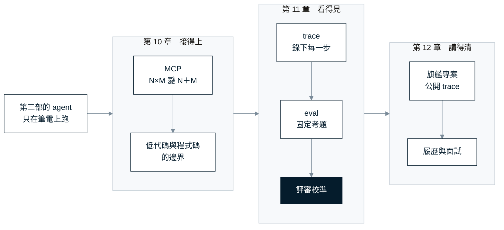

# 第四部　上線層：接上真實世界，並且知道它還好不好

前三部把一個語言模型變成了能讀你的資料、能動手做事、高風險處會停下來問人的 agent。但它還停在你的筆電上：工具是你為某個框架手寫的轉接程式，出錯時沒有任何紀錄，改一句提示詞也不知道有沒有讓別的題目壞掉。第四部要回答的核心問題是：**怎麼讓這個 agent 接上真實世界的工具與流程，並且在上線後持續知道它表現得好不好？**

## 本部的論證主線

上線要過兩關。第一關是「接得上」。工具的數量和使用工具的應用都在增加，每一對都寫一份轉接程式會變成 N×M 的維護負擔；MCP 把它降成 N＋M，工具寫一次 Server，各家應用都能接。接上之後，還要決定流程放在哪裡：路徑事先畫得出來的，交給 Dify、n8n 這類低代碼畫布；要模型依狀態決定下一步的，寫成 LangGraph 程式碼，兩邊再經 MCP 互接。

第二關是「看得見」。LLM 應用壞掉時不報錯，只會篤定地答錯，所以要用 trace 錄下每一步，用 eval 拿固定考題在每次改版前後各考一次。這兩件事你在訓練模型時都做過：trace 是 profiler 的瀑布圖，eval 是驗證集。唯一真正新的問題是評分器本身：開放式輸出常要請 LLM 當評審，而評審是一個會犯錯的分類器，必須先拿人工標註校準。

過了兩關，最後一步是把系統和成果講清楚。旗艦專案把全書零件接成一個值班 agent 加一條寫死的審批流程，用一條公開 trace 證明它跑過；履歷與面試則要求你講得出限制、結構與數字。第 12 章也在這裡收束全書，回顧模型層、知識層、行動層、上線層四部各自補上了模型的哪個缺口。

**圖 四-0　第四部先讓系統接得上，再讓它看得見，最後把成果講清楚**

資料來源：本課整理；章節範圍對應投影片 7xx、8xx、9xx。

## 各章導覽

| 章 | 一句話摘要 |
|---|---|
| [第 10 章　MCP 與低代碼：工具接一次，流程放對地方](10-mcp-and-lowcode.md) | MCP 用 Host／Client／Server 三角色與兩層分離，把 N×M 個接頭降成 N＋M；三種原語看誰決定何時用；本機 stdio、遠端 Streamable HTTP；低代碼與 LangGraph 的分界看路徑由誰決定。 |
| [第 11 章　可觀測性與評估：看得見才修得了](11-observability-and-evaluation.md) | trace 是一棵 run 樹，eval 是 LLM 版的驗證集；LLM 評審是要用人工標註校準的分類器；先做錯誤分析再寫評分器；回歸評估要按題型看；打點走 OpenTelemetry 才換得走。 |
| [第 12 章　從專案到職涯：把系統接起來，把成果講清楚](12-from-project-to-career.md) | Vibe coding 與 AI 輔助工程的界線；旗艦專案的 harness 加審批流程；全書四部回顧；API 線與你的差異化；履歷四零件（範本數字須換成實測）；面試三心法。 |

建議依序閱讀。第 10 章和第 11 章彼此獨立，只想補評估觀念的讀者可以直接從第 11 章開始；第 12 章會用到前兩章與第三部的內容。

## 先備知識

本部假設你讀過前三部，特別是以下幾個概念，忘了可以回去翻：

- 第 2 章的結構化輸出：用 Pydantic 定義欄位，讓模型的輸出保證合法。第 10 章的工具 schema 和第 11 章的評審輸出都用到它。
- 第 4、5 章的 RAG 與混合檢索：第 11 章的受測系統是一個最小 RAG，錯誤分析要先分清是檢索錯還是生成錯。
- 第 7、8 章的 tool calling 迴圈、checkpointer 與 approve → execute → verify 流程：MCP 是接在 tool calling 下面的那一層，旗艦專案的寫入流程直接沿用第 8 章。
- 第 9 章的 harness 架構：單一 agent 加 skills、子 agent 與 MCP。

深度學習方面，只需要你熟悉驗證集與測試集的分工、混淆矩陣與 precision／recall、類別不平衡時為什麼不能只看 accuracy，以及用 profiler 找訓練瓶頸的經驗。

## 對應模組與 notebook

| 模組 | notebook | 對應章節 |
|---|---|---|
| 模組七 MCP | [`00_concepts.md`](../../modules/module-07-mcp/00_concepts.md)（先讀） | 第 10 章全章 |
| | [`01_mcp_client.ipynb`](../../modules/module-07-mcp/01_mcp_client.ipynb) | 10.2、10.3 |
| | [`02_excel_agent.ipynb`](../../modules/module-07-mcp/02_excel_agent.ipynb) | 10.4、10.6 |
| | [`03_mcp_in_practice.ipynb`](../../modules/module-07-mcp/03_mcp_in_practice.ipynb) | 10.5、10.7 |
| 模組八 評估與求職 | [`00_concepts.md`](../../modules/module-08-eval-career/00_concepts.md)（先讀） | 第 11 章全章 |
| | [`01_llm_as_judge.ipynb`](../../modules/module-08-eval-career/01_llm_as_judge.ipynb) | 11.4、11.5 |
| | [`02_regression_eval.ipynb`](../../modules/module-08-eval-career/02_regression_eval.ipynb) | 11.7 |
| | [`03_langfuse.ipynb`](../../modules/module-08-eval-career/03_langfuse.ipynb) | 11.3、11.8 |
| | [`04_opik.ipynb`](../../modules/module-08-eval-career/04_opik.ipynb) | 11.4、11.8 |
| | [`05_interview_sandbox.ipynb`](../../modules/module-08-eval-career/05_interview_sandbox.ipynb) | 12.6、12.7 |
| 旗艦專案 | [`projects/incident-autonomous-agent/`](../../projects/incident-autonomous-agent/README.md) | 12.2、12.3 |
| 評估基準 | [`eval_benchmarks/`](../../eval_benchmarks/evaluate_incident_agent.py) | 11.7 |

模組七的 notebook 用 Ollama 的 `qwen2.5:3b` 跑本機模型，官方 `mcp` SDK 為 2.x。模組八需要兩個 Python 環境（Opik 仍要求較舊版的 `openai`），安裝方式見該模組 README。投影片原檔見 [`../slides/deck/deck.pdf`](../slides/deck/deck.pdf) 的 7xx 到 9xx 頁。

## 本部刻意不談的事

「上線」在不同團隊有不同的意思。本部只處理應用層的兩件事：工具怎麼標準化地接進來，以及系統的行為怎麼被記錄與評估。模型服務的叢集部署、GPU 排程、Kubernetes 這類維運工具不在本書範圍；企業 SSO、權限系統與真實變更管理也只在旗艦專案的限制說明裡點到為止。這些題目重要，但它們的判斷依據和本書的主線（改輸入還是改權重、路徑由誰決定、評分器可不可信）不同，混在一起講反而模糊焦點。

## 讀這一部時請記住

本部提到的工具版本、授權與收購消息，核實日期在 2026-11 中旬；這一塊變動很快，動手前請再到官方頁面確認一次。第 12 章的履歷範例數字是課綱提供的範本，不是實測結果，引用時請換成你自己評估集量出來的數字。
