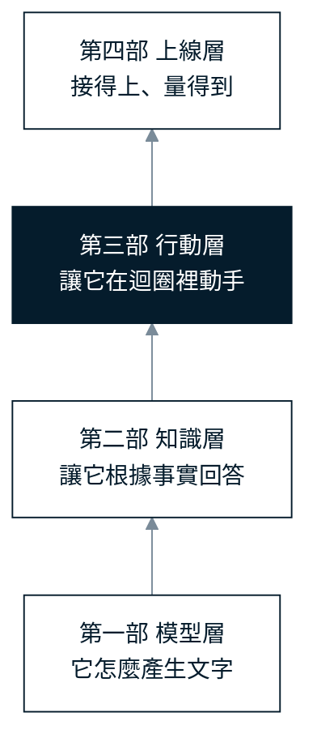

# AI Agent 工程：教科書版

這份教科書是 [20 小時投影片](slides/deck/deck.pdf)的散文版。投影片一頁講一個概念，適合上課；這裡把同樣的內容收斂成十二章，把概念之間的因果串起來，適合課前預習、課後複習，或沒有講師時自學。

技術內容以 2026 年第三季之後的狀態為準。版本號、API 名稱與課綱勘誤的依據是 [`slides/sources/product-facts.md`](slides/sources/product-facts.md)（2026-11-12 核實）；和課綱原文衝突時，以這裡為準。

## 全書主線：一個 Agent 由下往上蓋四層

一個能在企業裡上線的 Agent，由下往上需要四層能力。每一層都在補上一層的缺口：模型只會依機率接字，所以要用知識層餵它事實；有了事實還不會動手，所以要用行動層讓它在迴圈裡呼叫工具；能動手之後風險變大，所以要用上線層把工具接口標準化，並且量得出好壞。

圖 0-1　全書四部的依賴關係。行動層是課程的核心，前兩層是它的前提，最後一層讓它能上線。

## 目錄

| 部 | 章 | 這一章回答的問題 |
|---|---|---|
| [第一部 模型層](01-transformer-and-prompt/) | [1 LLM 怎麼運作](01-transformer-and-prompt/01-how-llms-work.md) | 語言模型為什麼只是「詞表上的 softmax」，卻能對話？ |
| | [2 提示與結構化輸出](01-transformer-and-prompt/02-prompts-and-structured-output.md) | 不改權重，怎麼讓輸出穩定、可解析、不被注入？ |
| | [3 微調與 LoRA](01-transformer-and-prompt/03-finetuning-and-lora.md) | 什麼時候才值得改權重，改的時候怎麼省？ |
| [第二部 知識層](02-rag-and-graphrag/) | [4 RAG 管線](02-rag-and-graphrag/04-rag-pipeline.md) | 怎麼把私有文件變成模型讀得到的上下文？ |
| | [5 檢索優化](02-rag-and-graphrag/05-retrieval-optimization.md) | 為什麼一定要混合檢索，rerank 擺在哪？ |
| | [6 知識圖譜與 GraphRAG](02-rag-and-graphrag/06-knowledge-graphs-and-graphrag.md) | 向量檢索答不了的多跳問題怎麼辦？ |
| [第三部 行動層](03-langgraph-and-agents/) | [7 Agent 迴圈與 LangGraph](03-langgraph-and-agents/07-agent-loop-and-langgraph.md) | 把模型放進迴圈之後，流程要怎麼控制？ |
| | [8 狀態、Checkpoint 與人工核准](03-langgraph-and-agents/08-state-checkpoint-and-hitl.md) | 寫入操作怎麼保證先核准、可中斷、可回放？ |
| | [9 Harness 架構](03-langgraph-and-agents/09-harness-architecture.md) | 2026 年為什麼預設單一 Agent 加 skills，而不是一群 Agent？ |
| [第四部 上線層](04-eval-and-mcp/) | [10 MCP 與低代碼](04-eval-and-mcp/10-mcp-and-lowcode.md) | 工具接口怎麼標準化，低代碼平台的邊界在哪？ |
| | [11 可觀測性與評估](04-eval-and-mcp/11-observability-and-evaluation.md) | 怎麼知道 Agent 變好還是變壞？ |
| | [12 從專案到職涯](04-eval-and-mcp/12-from-project-to-career.md) | 四層怎麼組成一個能講給面試官聽的作品？ |

## 怎麼搭配其他教材

- **動手**：每章結尾都連到對應的 notebook（`modules/module-0X-*/`）。建議讀完一章就跑該章的 Lab。
- **Python 底子**：看不懂 `class`、`yield`、`@tool`、Pydantic 時，先讀 [python-basics](python-basics/)。
- **上課**：[完整投影片](slides/deck/deck.pdf)（220 頁）、[精簡版](slides/lite/deck.pdf)（60 頁）。

## 讀者假設

你懂深度學習（神經網路、softmax、反向傳播、embedding 層、遷移學習），但沒學過 NLP、生成式 AI 或 Agent。每章都從你已經會的概念搭橋，術語第一次出現時會給定義。
