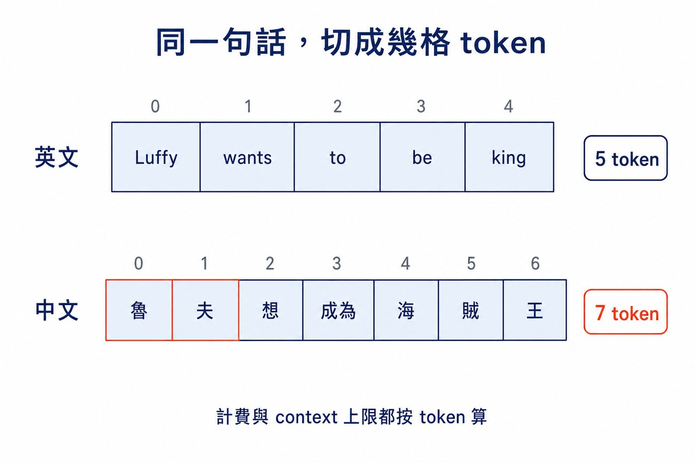
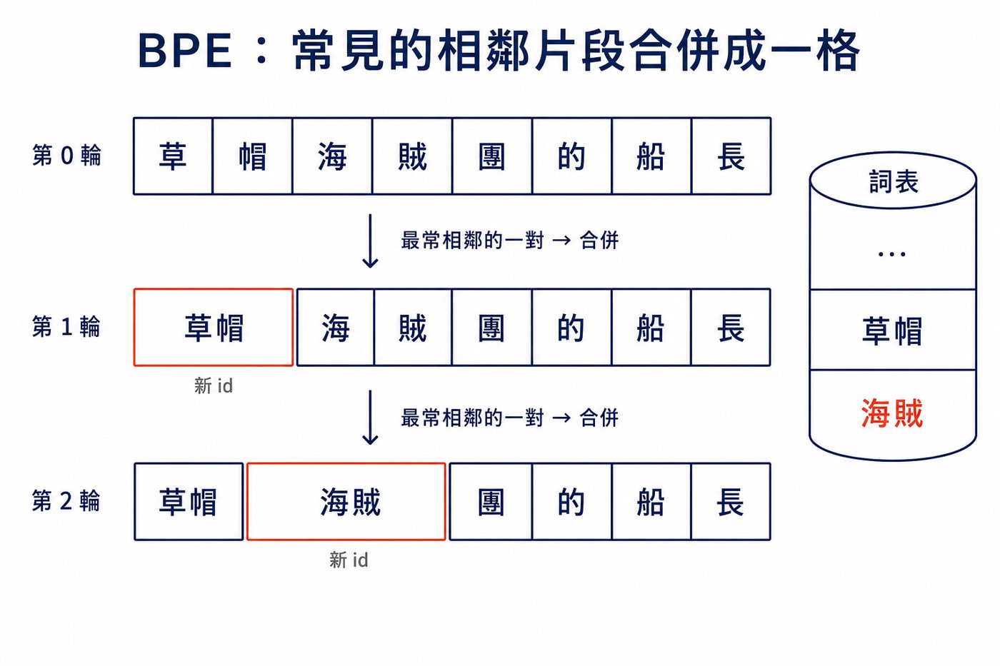
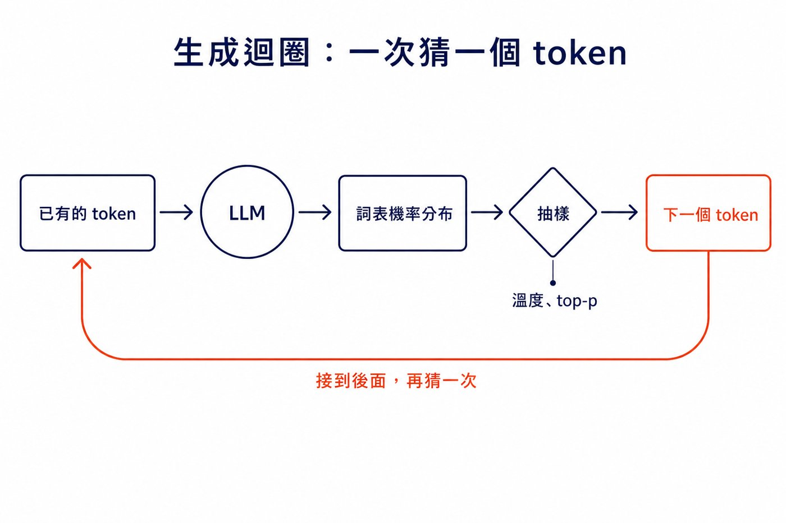
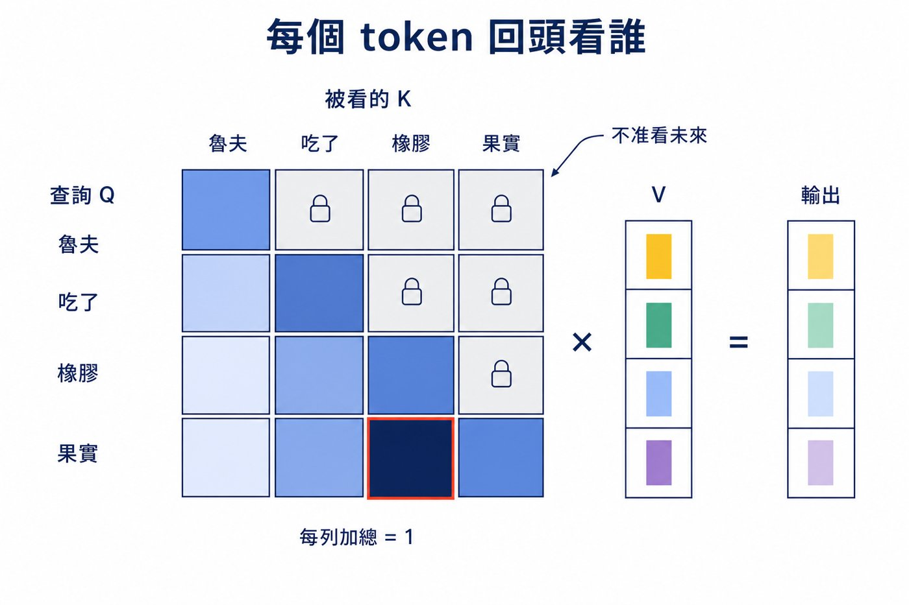
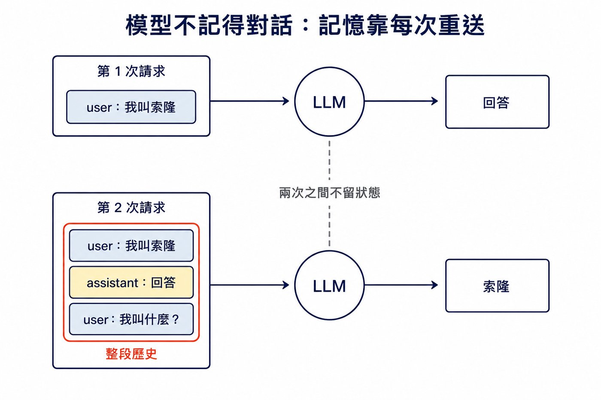
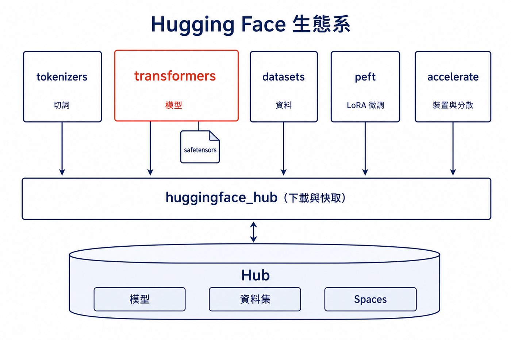
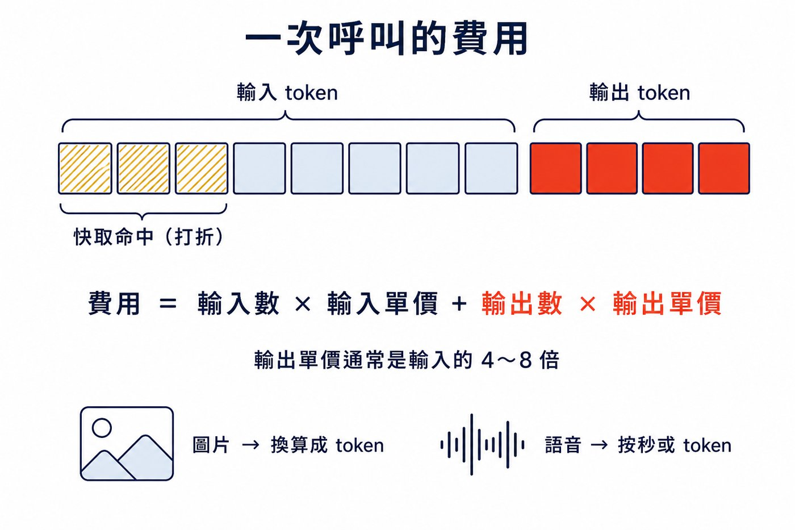

# 模組 1 原理紀要：LLM 在算什麼

> 先讀這份，再開 `01_tokens.ipynb`。notebook 直接用 `tiktoken`、`transformers`、OpenAI SDK 做事，需要看原理時只「點一下」：印出 tokenizer 切出的 token、模型輸出的機率、真實的 attention 權重。
> 這份文件負責講清楚那些輸出背後的道理。你懂深度學習，所以這裡只搭橋：把 LLM 對應到你已經熟悉的分類器、embedding、softmax。

## 0. 一句話版本

LLM 是一個「詞表大小」的分類器：輸入一串 token，輸出「下一個 token 是誰」的機率。
把它放進迴圈，一次猜一個 token，就生成了一段話。其他所有東西（對話、工具呼叫、agent）都是在這個迴圈外面加東西。

## 1. Token：模型看到的不是字

模型的輸入是一串整數（token id）。文字到 id 的對照表叫**詞表**（vocabulary），切的方法叫 **tokenizer**。



*圖：每一格是一個 token，上方數字是第幾格。模型只看得到每一格在詞表裡的編號；中文常常一個字一格，罕見字甚至拆成兩格。*

### 為什麼不直接用「字」或「單字」當單位？

| 切法 | 詞表大小 | 問題 |
|---|---|---|
| 一個 byte 一格 | 256 | 序列太長：一個中文字就是 3 格，算力全花在長度上 |
| 一個單字一格 | 幾百萬 | 詞表爆炸；沒看過的字（新名詞、錯字）完全無法表示 |
| **BPE（折衷）** | 幾萬～二十萬 | 常見片段一格、罕見字退回 byte，任何文字都切得了 |

### BPE 怎麼長出詞表

BPE（Byte Pair Encoding）的想法很樸素：**哪兩個片段最常黏在一起，就把它們合併成一個新 token**，重複幾萬到十幾萬次。



*圖：每一輪找出最常相鄰的一對，合併成一格並記進詞表。為了好讀，圖裡把一個中文字畫成一格；實際上 UTF-8 的中文字一開始是 3 個 byte，要先合併成一個字，再往上合併成詞。*

用一份小語料走一遍：

```
語料：「草帽海賊團的船長」「草帽海賊團的劍士」「草帽海賊團的航海士」…
第 0 輪：每個 byte 一格（中文一字 3 個 byte）
第 1 輪：統計所有相鄰的一對 → 「草帽」出現最多 → 合併成新 token（id 256），記進詞表
第 2 輪：再數一次 → 「海賊」最多 → 新 token（id 257）
……重複 N 次：N 越大，詞表越大、序列越短
```

要記住的三件事：

1. **詞表是統計出來的，不是人定的。** 訓練語料裡常出現的片段才會被合併。英文語料多，所以英文常見單字幾乎都是一格。
2. **切新句子時照「學到的順序」合併。** 越早學到的規則越優先。語料裡沒看過的整句話，只能退回比較碎的切法。
3. **永遠切得了。** 最差就是一個 byte 一格，所以不會有「未知字」。代價是罕見字很貴，而且單一 byte 解不出字來，印出來會是 `�`。

`01_tokens.ipynb` 會直接把 Qwen tokenizer 裡存的合併規則印出來（十五萬多條），不用自己重寫。

### Token 的實務後果

- **計費和 context 上限都按 token 算。** 同一段文字在不同模型上的 token 數不同；估費用要用該模型自己的 tokenizer 數。
- **模型看不到字母。** `strawberry` 被切成 `st` `raw` `berry`，所以「有幾個 r」容易數錯。
- **數字被切得很碎。** 有的詞表三位一組、有的一位一格，這是模型算術不穩的原因之一。要算數就交給工具。
- **對話格式也吃 token。** `messages` 會被 chat template 攤平成一段文字，加上 `<|im_start|>` 這類特殊 token。

## 2. 下一個 token 預測：一個超大的分類器



*圖：生成一段話就是這個迴圈。模型只負責「算機率」；溫度和 top-p 只改「抽樣」那一步。*

一次前向傳播的流程，對照你熟悉的影像分類：

```
token id ──查表──▶ 向量（embedding） ──▶ N 層 Transformer ──▶ 最後一層 ──▶ logits（詞表大小）──softmax──▶ 機率
          影像分類：像素 ──────────────▶ CNN／ViT ────────────▶ 分類頭 ──▶ logits（類別數）──softmax──▶ 機率
```

- **embedding 就是查表。** 模型第一層是一張「詞表大小 × 向量寬度」的表，token id 是幾號就取第幾列，沒有任何計算。
- **輸出是 logits。** 每個位置都會得到一個長度＝詞表大小（十幾萬）的分數向量；生成時只用最後一個位置。
- **softmax 把分數變機率。** 跟影像分類最後一層完全一樣，只是類別有十幾萬個。
- **訓練目標就是分類的交叉熵。** 拿網路上的文字，每個位置都問「下一個 token 是誰」，答錯就扣分。沒有人標註，文字本身就是答案，這叫自監督。

生成時把這件事放進迴圈：猜一個 → 接到後面 → 再猜一個，直到猜出結束 token 或達到長度上限。
`transformers` 的 `model.generate()`、Ollama、各家 API 背後都是這個迴圈，只是加了快取（KV cache，不用每次從頭算）和抽樣策略。

## 3. 溫度與 top-p：只改抽樣，不改模型

模型給的是一個機率分布，接下來要「挑一個」。挑法有幾種：

| 參數 | 做什麼 | 效果 |
|---|---|---|
| greedy（`do_sample=False`、溫度 0） | 永遠挑機率最高的 | 穩定、可重現，但容易重複 |
| 溫度 T | 抽樣前把 logits 除以 T | T < 1 拉尖分布（更保守），T > 1 壓平分布（更隨機） |
| top-p | 只留累積機率到 p 為止的 token | 把長尾整段剪掉，避免抽到離譜的字 |
| top-k | 只留前 k 名 | 跟 top-p 類似，但不看機率形狀 |

```
原始機率：  海賊王 0.62 │ 劍豪 0.15 │ 航海士 0.08 │ … 十幾萬個長尾
T = 0.3：   海賊王 0.97 │ 劍豪 0.02 │ …          （幾乎只會挑第一名）
T = 2.0：   海賊王 0.20 │ 劍豪 0.10 │ …          （長尾也常被抽中）
top-p 0.9： 只在「海賊王、劍豪、航海士、…」累積到 90% 的那幾個裡抽
```

（數字只是示意。）溫度**不會讓模型變聰明或變笨**，它只決定要不要常挑第二、第三名。
實務規則：要精準輸出（JSON、SQL、程式碼、分類）一律低溫；要發想、寫文案才調高。溫度和 top-p 通常只調一個。

## 4. Attention：每個 token 回頭看誰

Transformer 中間那一大段，最核心的是 attention。先看它要解決什麼問題：

- **RNN 的瓶頸**：讀句子時把前面所有內容壓進一個固定大小的向量，一路往後傳。句子一長，前面的細節就被擠掉。
- **attention 的做法**：每個 token 直接回頭看所有前面的 token，自己決定要從誰身上拿多少資訊。

### Q、K、V 是三個矩陣乘法

| 名稱 | 白話 | 怎麼來 |
|---|---|---|
| Q（query） | 我想找什麼 | 輸入向量 × W_Q |
| K（key） | 我身上有什麼可以被找 | 輸入向量 × W_K |
| V（value） | 被選中時我要交出去的內容 | 輸入向量 × W_V |

三個權重矩陣都是訓練學出來的。整個 attention 就四行：

```python
Q, K, V = X @ Wq, X @ Wk, X @ Wv
scores  = Q @ K.T / sqrt(d)       # 每個 token 對每個 token 打分數；再把「未來」設成 -∞
weights = softmax(scores)          # 每一列加起來是 1
out     = weights @ V              # 按權重把 V 加起來
```



*圖：每一列是一個正在看的 token（Q），每一欄是被看的 token（K）。右上角的鎖是因果遮罩：不准看未來。權重乘上 V 得到每個 token 的新向量。*

- **除以 √d**：讓分數不要太大，softmax 才不會一面倒。
- **因果遮罩**（causal mask）：生成時後面的字還不存在，所以每個 token 只能看自己和前面。這讓模型能一個字一個字生成。BERT 這類不生成的模型不用遮罩，叫雙向 attention。
- **多頭**（multi-head）：同時做好幾組 Q/K/V，各自學不同的「看法」（有的看語法、有的看指代），最後接起來。
- **一層 Transformer** ＝ attention（跟別的 token 交換資訊）＋ MLP（每個 token 自己想一想），各自加回原本的輸入（殘差），再加 LayerNorm。Qwen2.5-0.5B 疊了 24 層。

`03_next_token.ipynb` 會用 `output_attentions=True` 畫出真實模型某一層的權重表。你會看到右上角全白（遮罩），也會看到很多 token 都在看第一個 token：這叫 attention sink，是模型「沒什麼要看時」的預設去處。

### 為什麼 context 越長越貴：O(N²)

權重表是 N × N。token 數變 2 倍，表就變 4 倍。

| context 長度 | 一層一個頭的權重表（fp16） |
|---|---|
| 1,000 token | 2 MB |
| 8,000 token | 128 MB |
| 32,000 token | 2 GB |
| 128,000 token | 33 GB |

實際的推論引擎用 FlashAttention 之類的技巧避免把整張表存下來，但計算量仍然隨 N² 成長。實務後果：

- 塞一大堆文件進 context 不只貴，還慢。
- 模型容易漏看中間的內容（lost in the middle）。
- 所以要做 RAG（模組 3）：只放最相關的幾段進去。

## 5. 為什麼模型記不住對話



*圖：兩次呼叫之間模型什麼都不留。「記憶」是呼叫端把整段歷史一起重送。*

模型是一個純函式：**輸入 messages，輸出下一段字**。權重在推論時不會改變，兩次呼叫之間也沒有任何狀態。
ChatGPT 看起來記得你，是因為 app 每次都把整段對話歷史一起送出去。

後果：

- **對話越長，每次送出的 token 越多**，成本和延遲一起上升。`04_chat_api.ipynb` 會把每一輪的 `prompt_tokens` 畫出來。
- **歷史超過 context 上限就得取捨**：只留最近幾輪、把舊對話摘要、或把重要事實存到外部（模組 5 的 agent 記憶）。
- **三種角色**：`system` 放整段對話都要遵守的規則，`user` 是使用者這一輪說的話，`assistant` 是模型之前的回答（由你重送）。

## 6. 幻覺：模型永遠會給答案

模型每一步都**一定**會輸出一個機率分布，結構上沒有「我不知道」這個選項。
問它一件語料裡不存在的事，它照樣會接出一段很順的話，因為它的目標是「最像下一句」，不是「真的」。

幻覺常見的來源：

| 來源 | 例子 |
|---|---|
| 訓練資料沒有 | 問小眾主題、公司內部文件、訓練截止日之後的事 |
| 問題本身有錯誤前提 | 「台灣第一位登上月球的太空人是誰？」 |
| 小模型容量不夠 | 3B 模型對海賊王細節常常講錯 |
| 被要求精確數字 | 年份、金額、引用出處 |

對策不是調參數（溫度 0 也會幻覺），而是**把正確資料放進 prompt**（RAG，模組 3）、**讓模型呼叫工具查證**（模組 5）、**用評估抓出來**（模組 8）。

## 7. Hugging Face 生態系：開放模型從哪裡來

前面提到的 Qwen tokenizer、Qwen2.5-0.5B 模型，都是從 Hugging Face 下載的。它對開放模型的角色，就像 GitHub 對程式碼。

**怎麼來的**：Hugging Face 2016 年成立時做的是給青少年聊天的機器人 App。2018 年 Google 發表 BERT，他們把它移植到 PyTorch 並開源（`pytorch-pretrained-bert`），
意外成為研究者最常用的版本；這個專案後來改名 `transformers`，納入幾百種架構。公司也順勢轉型：做一個讓大家上傳、下載模型的平台（Hub），再陸續補上資料集、線上 demo 和訓練工具。



*圖：上面一排是你在 Python 裡 import 的函式庫，各管一件事；它們都透過中間的 `huggingface_hub` 去 Hub 下載、存進本機快取。權重檔用 `safetensors` 格式。*

| 元件 | 做什麼 | 本課在哪用 |
|---|---|---|
| **Hub** | 放模型、資料集、Spaces（線上 demo）的網站；每個模型是一個 git repo，名字是「組織/模型」 | 全課 |
| `huggingface_hub` | 查模型資訊、下載單一檔案、管本機快取；CLI 指令是 `hf` | M1-02 |
| `tokenizers` | 用 Rust 寫的快速切詞器，`transformers` 底下在用 | M1-01 |
| `transformers` | 載入模型與 tokenizer（`AutoModel...`、`AutoTokenizer`）、`generate()`、`pipeline` | M1-02、03，M6 |
| `datasets` | 載入資料集、`map` 批次轉換、切分；資料存成 Arrow，不必整份進記憶體 | M1-02，M6 |
| `safetensors` | 權重檔格式：只有索引和數字，不能夾帶程式碼，可以只讀需要的矩陣 | M1-02 |
| `peft` | 只訓練少量參數（LoRA） | M6 |
| `accelerate` | 處理裝置與分散：`device_map="auto"`、多 GPU、混合精度 | M1-02，M6 |

一個模型 repo 裡通常是這幾個檔案：

```
config.json             架構：幾層、向量多寬、幾個頭（不到 1KB，先下載它就能估顯存）
model.safetensors       權重（佔了 99% 以上的空間）
tokenizer.json …        詞表、BPE 合併規則
tokenizer_config.json   特殊 token 與 chat template
README.md               model card：訓練資料、授權、限制
```

### 要知道的四件事

1. **授權各不相同。** Apache-2.0、MIT 可以商用；有些模型是自訂授權（限制用途或使用者數），用之前讀 model card。
2. **gated 模型**要在網頁上同意授權，再用個人 Access Token（環境變數 `HF_TOKEN`，或 `hf auth login`）下載。token 跟 API 金鑰一樣不能寫進程式碼。
3. **快取會吃光磁碟。** 預設放在 `~/.cache/huggingface`，用 `HF_HOME` 搬到大磁碟；`hf cache ls` 看大小、`hf cache rm` 刪除。
4. **舊格式 `.bin` 是 pickle，載入時能執行任意程式碼。** 優先選有 `safetensors` 的模型，來路不明的 `.bin` 不要載。

### HF 模型 vs Ollama

| | `transformers` | Ollama |
|---|---|---|
| 權重 | safetensors，原始精度（bf16） | GGUF，通常 4-bit 量化，約 1/4 大小 |
| 看得到 | logits、attention、每一層 | 只有 API 回來的文字 |
| 訓練 | 可以（LoRA） | 不行 |
| 適合 | 研究模型內部、微調 | 當服務給程式和 agent 呼叫 |

模組 6 把兩者串起來：用 `transformers` + `peft` 微調，合併後轉 GGUF，交給 Ollama 服務。

## 8. API 怎麼計費

用雲端模型時，帳單幾乎都按 token 算，而且**輸入和輸出分開計價**。



*圖：一次呼叫送出的 token 分成輸入（淺藍）和輸出（朱紅）兩段，各乘各的單價；輸入裡和之前請求相同的開頭可能命中快取、打折計價。*

### 估算公式

```
費用 = 輸入 token × 輸入單價 + 輸出 token × 輸出單價
     （有快取時：輸入拆成「快取命中 × 快取單價」＋「其餘 × 原價」）
```

單價通常寫成「每百萬 token 幾美元」。寫作時的幾個例子（以官網為準，每幾個月就會變）：

| 模型 | 輸入 | 輸出 |
|---|---|---|
| gpt-5.4-nano（推理模型，本課雲端預設） | 0.20 | 1.25 |
| gpt-4o-mini | 0.15 | 0.60 |
| claude-haiku-4-5 | 1.00 | 5.00 |
| gpt-4o | 2.50 | 10.00 |

例：一個 agent 任務平均 20 輪，每輪輸入 3,000 token（含歷史、工具說明、檢索片段）、輸出 300 token，用 gpt-4o：
20 × (3,000 × 2.5 + 300 × 10) / 1,000,000 ≈ 0.21 美元。一天 1,000 個任務就是每月約 6,300 美元。換成 gpt-4o-mini 大約是 1/16。

### 各種輸入怎麼算

| 項目 | 怎麼算 |
|---|---|
| **輸出 token** | 單價通常是輸入的 4～8 倍；模型要講多長，是你最能控制的成本 |
| **推理 token** | 推理模型「想」的過程看不到，但按輸出計費，所以同一題可能比非推理模型貴很多 |
| **快取輸入** | 請求開頭和最近的請求一樣時打折。OpenAI 自動快取（prompt 超過 1024 token 才有），約打 1～5 折；Anthropic 要在請求裡標記，寫入快取稍貴、讀取約 1 折 |
| **圖片** | 換算成 token：圖切成小方塊，每塊固定多少 token，再加一個基本量；低解析度模式是固定的少量 token |
| **語音** | 轉文字多半按音訊秒數；文字轉語音按字數或輸出的音訊 token |
| **批次 API** | 不急著要結果（例如離線評估）可以用 batch，通常半價 |

### 費用從哪裡漏出去

1. **長對話重付歷史。** 模型記不住對話（§5），每輪都重送全部歷史，第 N 輪的輸入包含前 N−1 輪，累計費用約隨輪數平方成長。
2. **中文比英文多 token。** 同樣的意思，中文常多兩到五成 token（§1）。
3. **工具說明和 system prompt 每輪都送。** 十幾個工具的 JSON schema 可能就上千 token。
4. **agent 迴圈卡住。** 沒有上限的迴圈會一直燒錢。

### 省錢方法

- 要求簡短、設 `max_tokens`；能用小模型的步驟就用小模型（分類、抽取、路由）。
- 固定不變的內容（system prompt、工具說明、範例）放在最前面，讓快取命中；會變的放後面。
- 只留最近幾輪，舊對話摘要起來（模組 5 的 compaction）；文件先檢索再放（模組 3），不要整份塞。
- 每次呼叫記帳，設預算上限，超過就停；在供應商後台也設每月上限。
- 估價用該模型的 tokenizer 數 token，不要用字數；LiteLLM 的 `model_cost`、`completion_cost()` 可以直接查價和算錢（M1-08）。

## 9. 名詞對照

| 名詞 | 白話 |
|---|---|
| token | 模型處理的最小單位，一個詞、一個字或一個 byte |
| tokenizer／詞表 | 文字和 token id 互轉的工具和對照表 |
| BPE | 把最常相鄰的片段反覆合併成新 token 的切詞演算法 |
| embedding | token id 對應的向量，第一層查表取得 |
| logits | 模型對詞表裡每個 token 打的原始分數 |
| softmax | 把分數變成加起來是 1 的機率 |
| 溫度／top-p | 抽樣時調整隨機性的兩個參數 |
| attention | 每個 token 回頭看其他 token、按權重取資訊 |
| Q／K／V | 查詢、鍵、值：attention 的三個投影 |
| 因果遮罩 | 不准看後面的 token |
| context window | 一次能放進模型的 token 上限 |
| base model／instruct model | 只做預訓練的模型／再教過對話與指令的模型 |
| chat template | 把 messages 攤平成一段文字的格式 |
| 幻覺 | 模型講得很順但內容不實 |
| Hub／model card | Hugging Face 放模型的平台／模型的說明書（授權、限制） |
| safetensors | 不能夾帶程式碼的權重檔格式 |
| gated 模型 | 要先同意授權、用 `HF_TOKEN` 才能下載的模型 |
| 輸入／輸出單價 | API 對送進去和生成出來的 token 分開計價 |
| 快取輸入 | 和之前請求相同的開頭，按折扣價計費 |

## 10. 常見坑

1. **用字數估費用**：要用該模型的 tokenizer 數 token，中英文、不同模型都不一樣。
2. **以為溫度 0 就不會亂講**：溫度只管隨機性，不管對錯。
3. **以為模型記得上一輪**：沒重送歷史，它就不知道。
4. **把整份文件塞進 context**：O(N²) 又貴又慢，而且中間容易被漏看。先檢索再放。
5. **讓模型數字母、做大數運算**：tokenization 讓這些事天生不穩，交給程式或工具。
6. **沒檢查 `finish_reason`**：`length` 代表被截斷，半截 JSON 會讓下游程式出錯。

## 11. 接下來

| notebook | 用上這份的哪一段 |
|---|---|
| `01_tokens.ipynb` | §1：用 tiktoken 和 Qwen tokenizer 看切分、比中英文、數 token 估費用 |
| `02_huggingface.ipynb` | §7：在 Hub 查模型、看快取、tokenizer／model／`pipeline`、`datasets`、`safetensors` |
| `03_next_token.ipynb` | §2～4：印 logits 與 top-k 機率、用 `generate()` 調溫度和 top-p、畫真實模型的 attention、看幻覺 |
| `04_chat_api.ipynb` | §5：用 OpenAI SDK 對話、看原始 JSON、記不住對話與越聊越貴、串流 |
| `05_dual_track.ipynb` | 把 04 包成本地失敗自動切雲端的客戶端 |
| `06_multimodal_api.ipynb`、`07_providers.ipynb` | 圖片與語音進出 API、換供應商 |
| `08_litellm_and_cost.ipynb` | §8：LiteLLM 統一介面與 fallback、查價、對帳、預算追蹤 |
