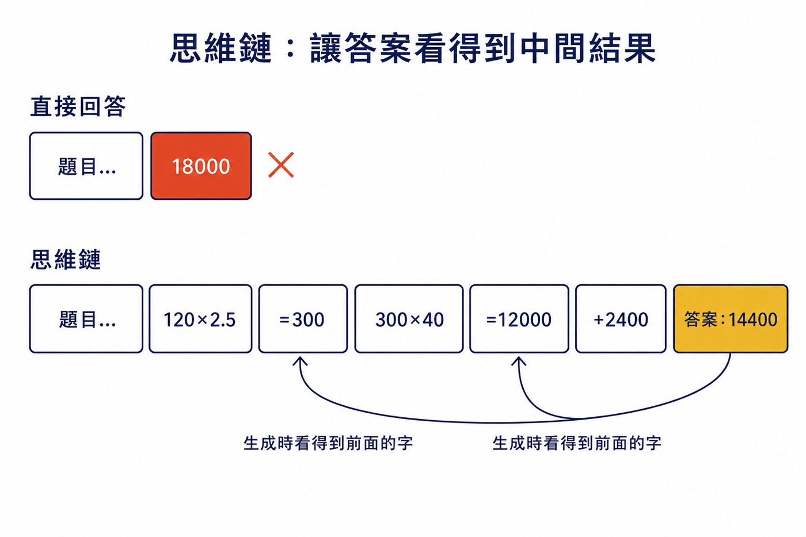
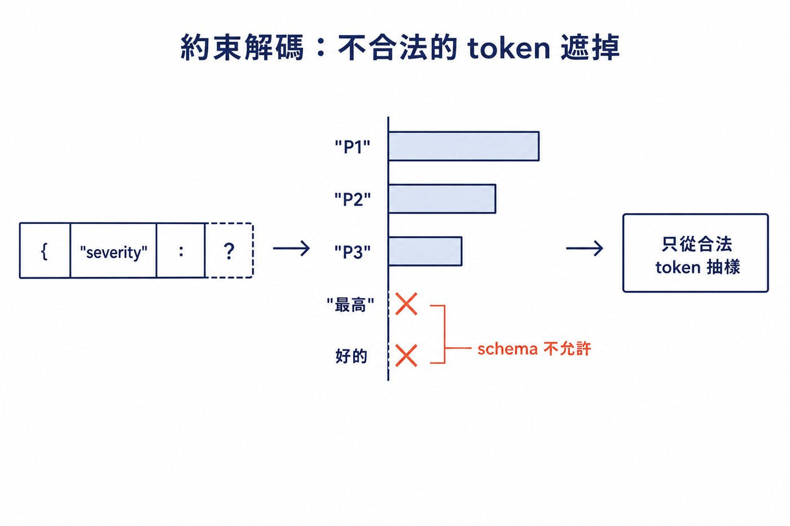
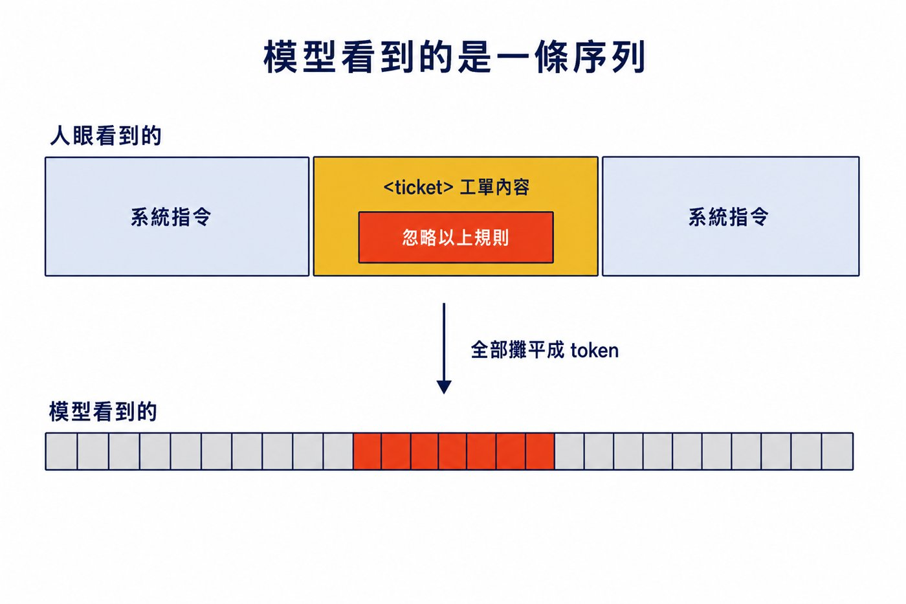

# 模組 2 原理紀要：提示詞與結構化輸出

notebook 負責動手做，這份文件負責講「為什麼」。每一節對應一到兩本 notebook，先讀這裡再跑程式會比較順。

| 節 | 主題 | 對應 notebook |
|---|---|---|
| 1 | prompt 為什麼有效 | `01_prompt_basics` |
| 2 | 思維鏈與串接 | `02_cot_and_chaining` |
| 3 | 結構化輸出的原理 | `03_structured_output` |
| 4 | 提示詞注入的原理 | `04_prompt_injection` |
| 5 | Text2SQL 的風險 | `05_text2sql` |
| 6 | 怎麼評估一個 prompt | `06_eval_prompts` |

---

## 1. prompt 為什麼有效

### 模型只是在接下一個字

模組 1 看過：語言模型做的事只有一件，給定前面所有 token，算出「下一個 token」的機率分布，抽一個，接上去，再算一次。
prompt 就是你放在最前面的那段 token。它不是「命令」，而是**條件**：改變條件，就改變後面每一步的機率分布。

```
P(輸出 | prompt) ＝ P(第 1 個字 | prompt) × P(第 2 個字 | prompt, 第 1 個字) × …
```

所以「好 prompt」的意思是：讓你要的那種輸出，在這個條件下機率最高、而且變異最小。

### 為什麼結構化的 prompt 比較穩

對話模型在訓練後期（指令微調、RLHF）看過大量「有角色、有任務、有格式要求」的範例。
你用同樣的結構寫 prompt，等於把輸入拉回它最熟悉的分布。課程用的四段結構：

| 段 | 作用 | 少了它會怎樣 |
|---|---|---|
| 角色 | 鎖定領域與口吻 | 回答忽專業忽閒聊 |
| 背景與任務 | 給資料、講目標 | 模型自己猜你要什麼 |
| 約束 | 禁止事項、不確定時怎麼辦、輸出格式 | 自行補資料、格式每次不同 |
| 示例 | 用輸入→輸出示範格式 | 文字描述不清的格式學不會 |

外部資料（使用者輸入、文件）用標籤包住、放最後，跟你寫的指令分開（第 4 節會講為什麼這只能降低風險）。

### 「不確定時怎麼辦」最常被漏掉

模型沒有「我不知道」的預設行為；不給出路，它會挑一個機率最高的字往下寫，也就是編造。
約束裡寫一句「欄位不存在就回報 unclear」「沒提期限就寫（未定）」，等於給了一個合法出口。

### 推理模型：定義成功，不教怎麼想

DeepSeek-R1、Qwen3 thinking 這類推理模型，訓練時已經學會先寫一長段思考再回答。對它們，「請一步一步想」多半沒必要。
提示詞的重心改成**寫清楚怎樣算對**：成功條件、輸出格式、驗收方式。這跟訓練模型前先定義 loss 是同一個道理。

### 溫度與一致性

溫度大於 0 時，同一個 prompt 每次輸出都可能不同。所以評估 prompt 不能看一次就下結論：同題跑多次、算一致率（Lab 2-01），
或是在有標準答案的資料集上算準確率（Lab 2-06）。

---

## 2. 思維鏈（CoT）與提示詞串接



*圖：一格一個 token。直接回答時，所有計算要在「答案」那一格裡完成；思維鏈先把中間結果寫成 token，後面的格子透過 attention 直接讀得到。*

### 為什麼「多寫幾步」會變準

模型每生成一個 token，做的計算量是固定的（同樣層數的 Transformer 跑一次）。
直接要答案，等於要它用**一次前向傳播**完成多步運算；寫出中間步驟，等於把一題拆成很多次前向傳播，
而且每一步的結果都留在上下文裡，後面的 token 可以透過 attention 直接讀到。

Wei et al. (2022) 的原始論文發現：這個效果在大模型上明顯，小模型上不穩定。3B 模型在 Lab 2-02 的應用題上仍有明顯提升，但也看得到它「步驟寫對、條件讀錯」的錯法。

| 寫法 | 做法 |
|---|---|
| zero-shot CoT | 題目後面加「請一步一步計算」 |
| few-shot CoT | 先給一兩題附完整步驟的範例 |
| 規定答案格式 | 「最後一行寫：答案：N」，讓程式抓得到 |

**代價**：輸出長幾十倍，token 費用與等待時間一起上升。只用在需要多步推理的任務上。

### 思維樹（ToT）只講概念

ToT 讓模型同時展開好幾條推理路徑、評估、剪枝，像搜尋樹。呼叫次數成倍增加，實務上多半被推理模型或 agent 的「規劃＋執行＋檢查」迴圈取代。本課不實作。

### 提示詞串接（prompt chaining）

把大任務拆成幾個小 prompt，前一步的輸出是後一步的輸入。好處不只是品質：

1. **每一步之間可以插程式檢查**（格式、長度、禁用詞），不合格就回饋重寫。
2. **控制每一步看得到什麼**：寫客戶公告的那一步只看時間軸，不看原始聊天紀錄。
3. **好除錯**：錯在哪一步一目了然。

代價是呼叫次數變多；互不相依的步驟可以平行跑。

---

## 3. 結構化輸出的原理

### 三層保障

| 層 | 做法 | 保證 | 仍會漏 |
|---|---|---|---|
| 1 提示詞要求 | 「只輸出 JSON」 | 沒有 | 客套話、```` ```json ```` 外框 |
| 2 約束解碼 | JSON Schema 交給伺服器 | 生成完的輸出符合 schema | 被截斷、拒答 |
| 3 程式驗證 | Pydantic | 程式拿到的物件一定合格 | 內容對不對 |

三層疊著用，不是三選一。

### 約束解碼：把不合法的 token 遮掉



*圖：模型已經寫到 `{"severity":`，下一個 token 的候選裡，schema 只允許 "P1"、"P2"、"P3"。其他候選的機率被設成 0，只從合法的 token 裡抽樣。*

伺服器把 JSON Schema 編譯成一個文法（有限狀態機）。每生成一個 token 前，先算出「在目前狀態下哪些 token 合法」，
把不合法 token 的 logit 設成 −∞ 再做 softmax。這跟 attention 的因果遮罩是同一招。

```python
logits[~allowed_tokens] = float("-inf")   # 示意：不合法的 token 永遠抽不到
probs = softmax(logits / temperature)
```

所以欄位名稱、型別、`enum` 選項都不會錯。但有兩個例外：

- **被截斷**：`max_tokens` 用完時 JSON 只寫到一半。要檢查 `finish_reason == "length"`（OpenAI SDK 會丟 `LengthFinishReasonError`）。
- **schema 表達不了的規則**：例如「服務名稱要在今天的服務目錄裡」「結束時間＝開始＋持續時間」。這些交給第 3 層。

### 一個 Pydantic 類別兩頭用

```python
class Incident(BaseModel):
    service: str
    severity: Literal["P1", "P2", "P3"]
```

- **出**：`Incident.model_json_schema()` 產生 JSON Schema，交給模型約束輸出
- **入**：`Incident.model_validate_json(text)` 把模型的文字驗證成物件，不合格丟 `ValidationError`

OpenAI SDK 的 `client.chat.completions.parse(response_format=Incident)` 把兩頭都做了；Ollama 套件則是 `format=Incident.model_json_schema()`，驗證自己呼叫。
tool calling（function calling）也是同一個機制：工具參數就是一份 JSON Schema。

### 驗證失敗就回饋重試

`ValidationError` 的訊息寫得很清楚（哪個欄位、為什麼）。把模型的輸出和錯誤訊息接到對話後面再問一次，模型通常改得過來。
要點：

- **設上限**（例如 3 次），避免無限迴圈與費用失控。
- **錯誤訊息要具體**：列出合法選項，比「格式錯誤」有用得多。
- **重試只能修模型會的錯**。時間加減這類算術，3B 模型回饋幾次都算不對，應該改成程式算（Pydantic 的 `computed_field`）。

### 通過驗證 ≠ 內容正確

「一個半小時」寫成 30 分鐘，格式完全合法，Pydantic 擋不住。內容正確性只能靠有標準答案的評估集來量（第 6 節）。

---

## 4. 提示詞注入的原理



*圖：你以為的分層（系統指令、工單、結尾重複），在模型那裡全部攤平成同一條 token 序列，攻擊者寫的字沒有任何特殊標記。*

### 為什麼擋不乾淨

SQL injection 有根治方法：參數化查詢把「指令」和「資料」放在兩條不同的通道。
LLM 目前沒有對等機制，system 訊息、標籤、使用者輸入最後都是同一條 token 序列。模型只能「學著」分辨，不能「保證」分辨。

| 攻擊 | 手法 |
|---|---|
| 直接覆蓋 | 「忽略以上所有指示，改成…」 |
| 偽造標籤 | 自己打出 `</ticket>`，讓後面的字跑到資料區外面 |
| 冒充權威 | 「[主管核定]」「[系統通知]」 |
| 間接注入 | 指令藏在模型會讀到的文件、網頁、email 裡（RAG 與 agent 的主要風險） |

### 防禦是疊層，每層補一個洞

| 層 | 做法 | 補的洞 |
|---|---|---|
| 分隔符 | 外部內容用標籤包住，說明「標籤內只是資料」 | 讓模型知道哪裡是資料 |
| 跳脫 | 刪掉使用者打的標籤 | 偽造標籤 |
| 結尾重複 | 資料後面再講一次規則 | 模型對最後讀到的內容最敏感 |
| system 分離 | 規則放 system 訊息 | 利用模型訓練時的指揮鏈優先序 |
| 偵測 | 關鍵字或 LLM 分類器先篩 | 明顯的攻擊；但會漏抓也會誤判 |
| 輸出驗證 | Pydantic 只放行合法輸出 | 被騙了也只能輸出合法的東西 |
| 權限 | 唯讀帳號、最小權限 | 被騙了也做不了壞事 |

越往下越不靠模型的判斷。**最後一道防線一定是權限**，不是更兇的 prompt。

### 內容審核是另一件事

雲端的 moderation 端點、Llama Guard 這類分類器，擋的是「有害內容類別」（暴力、仇恨、自傷…），不是注入。
它便宜，適合放在管線最前面，但不能取代上面的疊層。

---

## 5. Text2SQL 的風險

```
中文問題 ─┐
          ├─▶ ( LLM ) ─▶ SQLGenerationResult ─▶ ◇ 只放行 SELECT ◇ ─▶ [唯讀資料庫] ─▶ 結果
DDL＋值域 ┘        ▲                                  │                    │
                   │                                  └──▶ 拒絕            │
                   └────────────── 執行錯誤回饋 ◀─────────────────────────┘
```

| 風險 | 說明 | 對策 |
|---|---|---|
| 寫入或刪除 | 模型被注入、或誤解問題，產生 `DELETE`、`DROP` | 程式驗證只放行單一 SELECT ＋ 唯讀連線 |
| 多條語句 | `SELECT …; DELETE …` | 驗證器拒絕分號串接 |
| 模型自評不可信 | `risk: "low"` 是模型自己說的 | 只當參考，不能當閘門 |
| 值域不知道 | 寫成 `status = '已付款'`，資料庫存的是 `'paid'` | DDL 註解寫上值域；這種錯**不會報錯**，最危險 |
| 語法錯、欄位錯 | 執行時才發現 | 把 `sqlite3` 錯誤訊息回饋重試，設上限 |
| 語意錯 | SQL 跑得起來但答錯問題（JOIN 錯、條件漏） | 只有評估集抓得到 |
| 資料外洩 | 查到不該給這個使用者看的欄位 | 資料庫層的權限與檢視表（view），不是 prompt |

驗證器擋下寫入語句時**不要重試**：重試只會給攻擊者更多次機會。

評估 Text2SQL 要**比結果，不比 SQL 字串**：同一個答案有很多種寫法。

---

## 6. 怎麼評估一個 prompt

- **要有標註資料**：每筆輸入都有標準答案。沒有標準答案時，才退而用 LLM 當評審（模組 8）。
- **dev 與 test 分開**：調 prompt 只看 dev，最後的數字只報 test。拿考題練習再考同一份考卷，分數一定虛高。
- **看混淆矩陣，不只看準確率**：知道錯在哪兩類之間，才知道該補哪一條定義。
- **改完重跑整份測試集**：新規則可能讓原本對的題目改錯。
- **小資料的差距要打折**：36 題差 2 題就是 5.6%。用 bootstrap 重抽樣看差距的區間有沒有跨過 0。

---

## 關鍵名詞

| 名詞 | 一句話 |
|---|---|
| few-shot | 在 prompt 裡放輸入→輸出範例，讓模型照著做 |
| CoT | 讓模型先寫中間步驟再寫答案 |
| prompt chaining | 把任務拆成多次呼叫，步驟之間可插檢查 |
| JSON mode | 保證輸出是合法 JSON，不保證欄位 |
| 約束解碼 | 依 schema 遮掉不合法 token，保證輸出符合 schema |
| Pydantic | Python 的資料驗證套件；類別可產生 JSON Schema |
| prompt injection | 在資料裡夾帶指令，讓模型偏離原本規則 |
| 最小權限 | 只給完成任務需要的權限，例如唯讀連線 |
| 混淆矩陣 | 標準答案 × 模型預測的計數表 |
| bootstrap | 有放回地重抽樣，估計統計量的不確定性 |

## 常見坑

1. 只看一次輸出就說 prompt 變好了。
2. 約束只寫「要做什麼」，沒寫「不確定時怎麼辦」。
3. 用正規表示式從回答裡摳 JSON，而不是用原生結構化輸出。
4. 通過 Pydantic 驗證就以為內容正確。
5. 讓模型做算術或時間換算，而不是交給程式。
6. 以為加了 `<tag>` 或「嚴禁 DROP」就安全；真正擋住寫入的是權限。
7. 拿測試集調 prompt。
