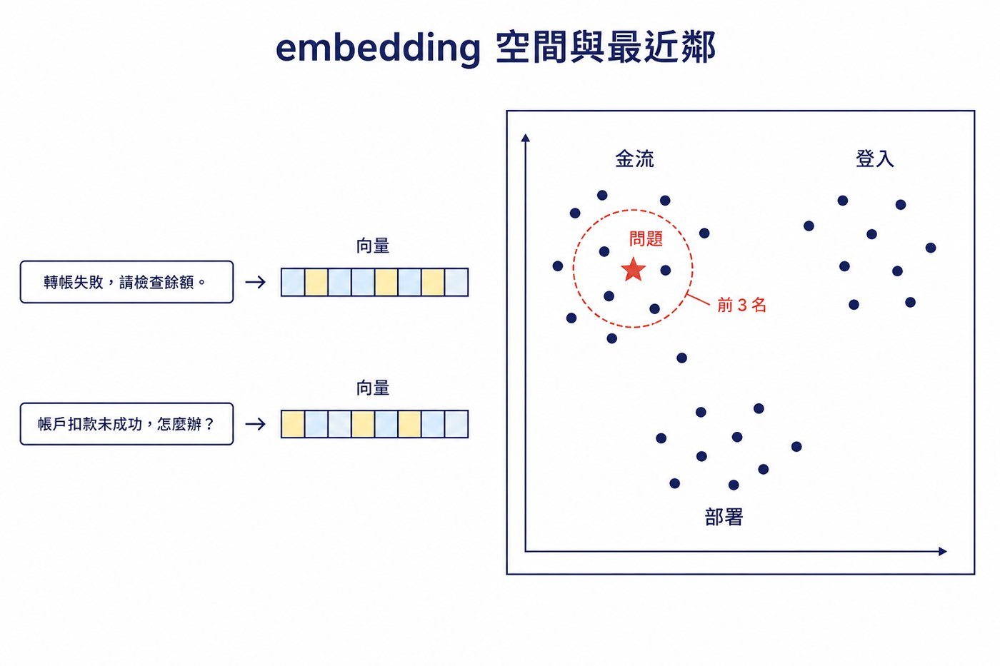
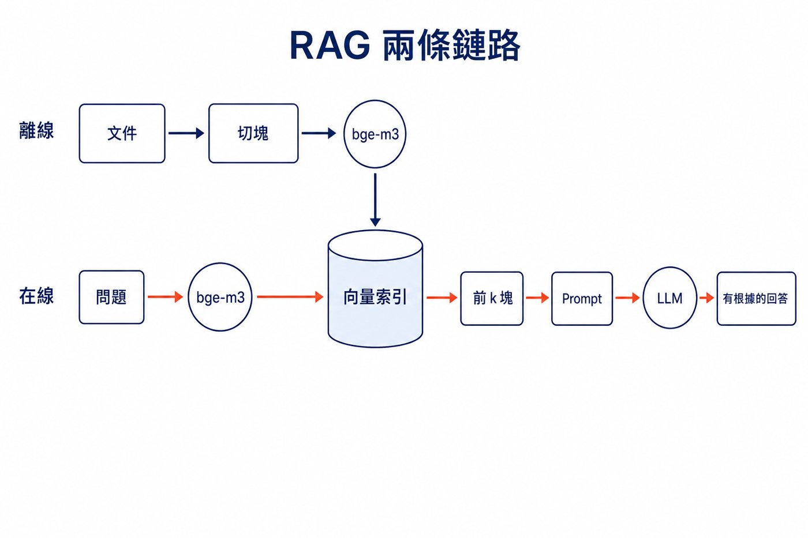
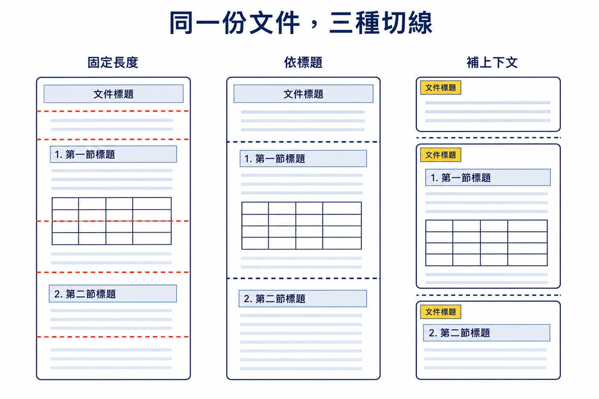
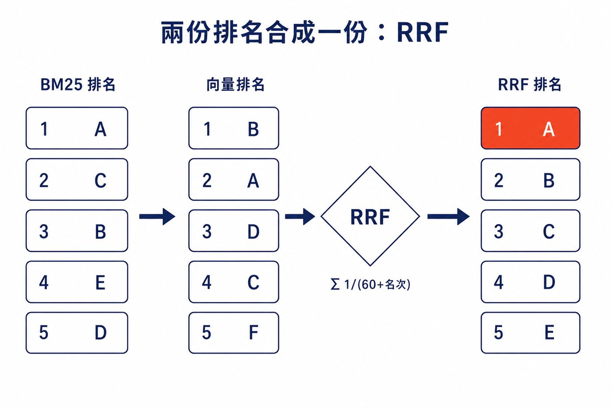
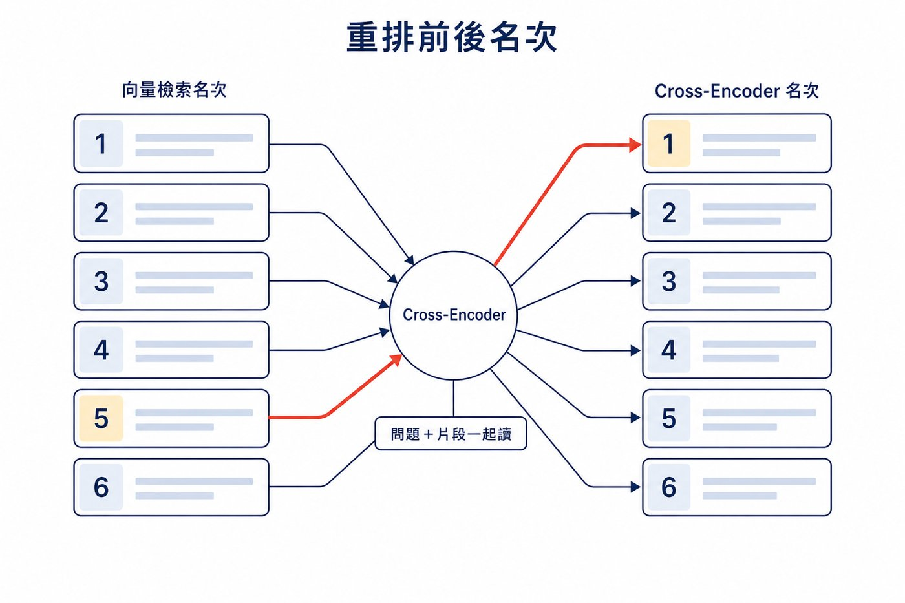
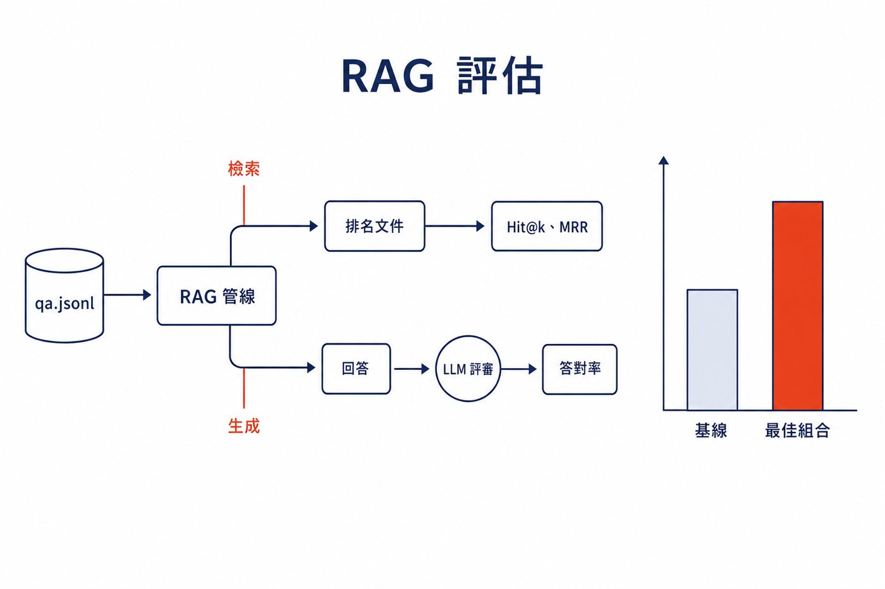
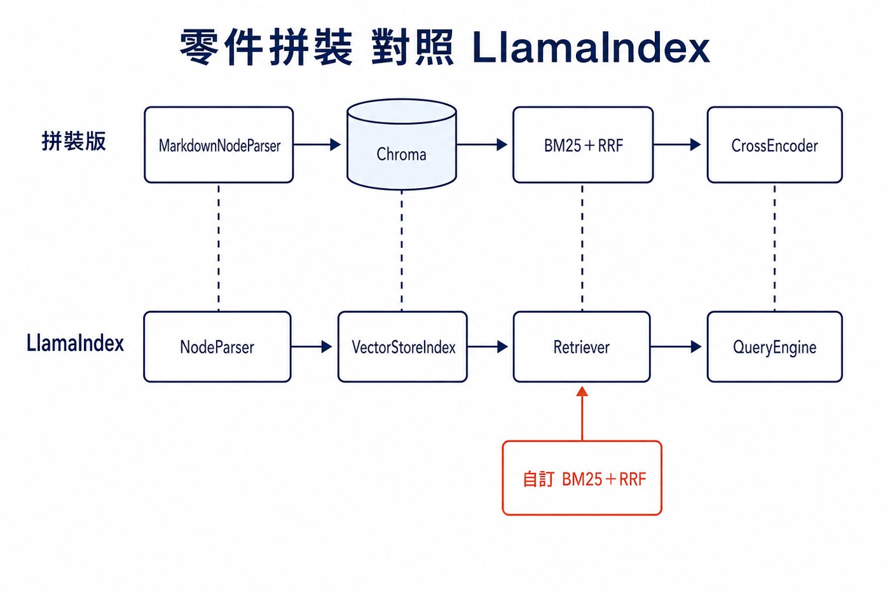
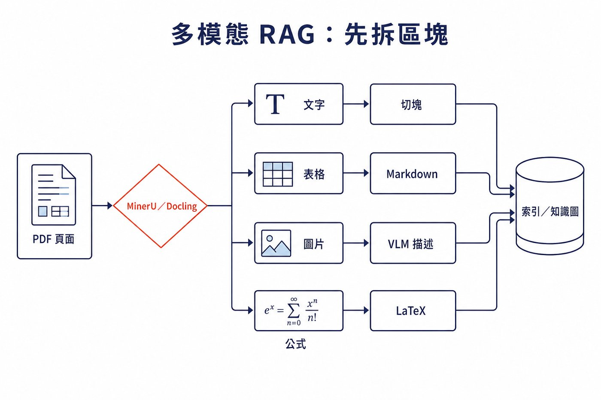

# 模組 3 原理紀要：RAG 檢索增強生成

notebook 負責動手，這份文件負責講「為什麼」。每節最後標出對應的 notebook。

## 1. 為什麼需要 RAG，以及 embedding 是什麼

LLM 只會根據訓練時看過的文字猜下一個字。公司內部的錯誤碼、事故、流程它沒看過，問了也不會說「不知道」，而是編一個看起來合理的答案（幻覺）。

要讓模型知道新知識，有兩條路：

| | 改權重（微調，模組 6） | 改輸入（RAG） |
|---|---|---|
| 做法 | 用公司文件繼續訓練 | 問問題時把相關文件塞進 prompt |
| 文件更新 | 要重訓 | 下次檢索就拿到新的 |
| 可追溯 | 不知道答案從哪來 | 可以標出來源文件 |
| 適合 | 改語氣、格式、領域用語 | 事實性知識、常變動的資料 |

RAG 的關鍵是「找到相關的段落」，靠的是 **embedding**：一個模型把一段文字變成固定長度的向量（bge-m3 是 1024 維）。
它跟 CNN 倒數第二層的特徵向量是同一個概念：意思相近的文字，向量也相近。



相似度用 **cosine**（夾角）量：

```
cosine(a, b) = a·b / (|a| |b|)      先把每個向量除以自己的長度，cosine 就只剩內積
```

有一個重要的盲區：**相似不等於相關**。`TP-4012 可以重試嗎？` 和 `TP-4021 可以重試嗎？` 只差兩個數字，向量幾乎一樣，但它們是完全不同的錯誤。
這是後面要加關鍵字檢索與重排序的原因。

→ `01_embeddings.ipynb`

## 2. RAG 的兩條鏈路與向量資料庫



- **離線**（文件更新時跑一次）：載入文件 → 切塊 → 轉向量 → 存進向量庫。
- **在線**（每個問題跑一次）：問題轉向量 → 找最近的 k 塊 → 組 prompt（規則＋片段＋問題）→ LLM 回答。

prompt 至少要有三條規則：只根據參考資料回答、找不到就說不知道、標出來源。

**向量資料庫**做三件事：存向量、找最近鄰、依 metadata 過濾。本課用 Chroma（`pip install` 就能用、可存記憶體或資料夾）。
找最近鄰在資料量大時用近似演算法（HNSW），用一點點準確度換大量速度。

metadata 過濾很實用：真實文件庫一定有**舊版文件**，舊版跟新版「很像」，向量分不出來；建索引時標上 `status`，查詢時用 `where` 排除。

→ `02_first_rag.ipynb`

## 3. 分塊（chunking）

整份文件太長、雜訊太多，要切成小塊再檢索。切在哪裡，決定找不找得到。



| 切法 | 做法 | 優點 | 缺點 |
|---|---|---|---|
| 固定長度 | 每 N 個 token 切一刀，相鄰重疊一點 | 最簡單 | 切斷句子與表格 |
| 依結構 | 依 Markdown 標題、段落切 | 一塊一個主題 | 長短不一 |
| 語義切分 | 相鄰句子向量差太多就切 | 適合沒結構的長文 | 多一輪 embedding |
| 代理切分 | 請 LLM 判斷每段是否獨立 | 最「懂內容」 | 慢、貴、不穩定 |
| contextual | 每塊前面補文件標題／摘要 | 孤立段落有主詞 | 同系列文件會更像 |

contextual chunking 不是穩賺：在本課語料上，補標題讓**向量檢索**更分不清新舊版文件（標題幾乎一樣），卻讓**關鍵字檢索**拿到服務名稱而變好。
任何「最佳實踐」都要用自己的題庫量過。

→ `03_chunking.ipynb`

## 4. 混合檢索：BM25 ＋ 向量，用 RRF 合併

**BM25** 是傳統搜尋引擎的關鍵字打分：查詢詞在這塊出現幾次、這個詞在全部文件裡多稀有（越稀有越值錢）、這塊多長（太長的打折）。
中文沒有空白，要先斷詞（jieba）；錯誤碼、指令要整段保留，否則 `TP-4021` 會被拆成 `TP`、`-`、`4021`。

| | BM25（稀疏） | 向量（稠密） |
|---|---|---|
| 擅長 | 錯誤碼、型號、指令、專有名詞 | 換句話說、口語描述、跨語言 |
| 盲區 | 同義詞（「扣兩次」對不到「重複扣款」） | 長得很像的代碼、精確數字 |

兩路的分數尺度不同（BM25 0～30、cosine 0～1），不能直接相加。**RRF（Reciprocal Rank Fusion）** 只看名次：

```
RRF(d) = Σ_每一路  1 / (60 + d 在這一路的名次)
```



在兩路都排前面的文件會勝出。RRF 不保證每題都更好（兩路都錯時救不回來），它換來的是比較少大翻車。
RRF 只有 5 行，套件也大多沒有獨立提供，所以本課自己寫；LlamaIndex 的 `QueryFusionRetriever(mode="reciprocal_rerank")` 結果相同。

→ `04_hybrid_rrf.ipynb`

## 5. 重排序與查詢處理

**雙塔（bi-encoder）vs cross-encoder**

```
雙塔：   問題 ─▶ [模型] ─▶ 向量 ┐
                                 ├─ cosine        快：文件向量可以事先算好
         段落 ─▶ [模型] ─▶ 向量 ┘

cross：  [問題 + 段落] ─▶ [模型] ─▶ 相關分數       準：兩邊的字可以互相 attend；慢：每一對都要跑
```

所以實務上是**兩階段**：混合檢索便宜地撈 20～50 塊（召回），cross-encoder 挑前 3～5 塊（精排）。
本課用 `cross-encoder/mmarco-mMiniLMv2-L12-H384-v1`（多語言、約 470MB、CPU 可跑）。重排分數也可以設門檻，把明顯無關的段落丟掉，避免雜訊塞滿 prompt。



**查詢端的處理**

| 方法 | 做法 | 什麼時候有用 |
|---|---|---|
| 查詢改寫 | LLM 把口語問題改成幾個術語查詢，各自檢索再 RRF | 使用者用語和文件用語差很多 |
| HyDE | LLM 先編一段「假答案」，用假答案去做向量檢索 | 問題很短、embedding 模型較弱 |
| 文件轉問答 | 離線時請 LLM 為每段寫幾個可能的問題，一起建索引 | 使用者習慣用問句搜尋 |
| small-to-big | 小塊（一行）建索引，命中後回傳所屬的整節 | 需要精準命中又要完整上下文（表格列＋表頭） |

改寫與 HyDE 都靠 LLM 的知識；小模型不懂你公司的系統時，編出來的東西反而會把檢索帶偏（本課實測 HyDE 讓語意題變差）。

→ `05_rerank_and_query.ipynb`

## 6. 評估

沒有評估，每個「優化」都只是感覺。準備一份題庫：問題、標準答案、應該命中的文件 id。

| 指標 | 量什麼 | 怎麼算 |
|---|---|---|
| Hit@k | 前 k 名有沒有命中標準文件 | 命中 1、沒中 0，取平均 |
| MRR | 正確文件排多前面 | 第一個命中名次的倒數，取平均 |
| 答對率（規則） | 回答有沒有包含標準答案的關鍵事實 | 抽出代碼、數字、指令，出現一半以上算對 |
| 答對率（LLM 評審） | 回答在語意上對不對 | 另一次 LLM 呼叫比對標準答案 |



兩個重要習慣：

1. **錯誤歸因**：每題都問「前 k 名有沒有命中」與「答對沒有」。命中卻答錯是生成的錯（換模型、改 prompt）；沒命中是檢索的錯（先修檢索）。
2. **評審也會錯**：規則看不懂語意，LLM 評審有雜訊；本課實測 3B 模型當評審常把答對的判錯、把「資料中沒有」判對。兩種意見互相對照，不一致的題目拿出來人工看；正式專案用更強的模型當評審（模組 8）。

Ragas 等套件的 context precision／recall 是在**沒有**標準文件時用 LLM 猜相關性；有標註時，Hit@k、MRR 更直接。

→ `06_rag_eval.ipynb`（Lab 3）

## 7. 框架：LlamaIndex 與零件拼裝

LlamaIndex 把整條 RAG 包成四個物件：

```
Document（文字＋metadata） ─▶ Node（切好的塊） ─▶ VectorStoreIndex ─▶ QueryEngine（檢索＋組 prompt＋生成）
```

它內建的 metadata 會跟著文字一起 embed（可用 `excluded_embed_metadata_keys` 排除），這就是 contextual chunking。
擴充點：自訂 `BaseRetriever`（例如接 BM25）、`QueryFusionRetriever`（RRF）、node postprocessor（例如 `SentenceTransformerRerank`）。



要注意的預設值：預設切塊器是 `SentenceSplitter`（不會依標題切）、預設 prompt 是英文、預設 LLM 會去找 OpenAI。

選擇原則：要快速做出可用版本、要接多種資料來源 → 框架；要客製每一步、要除錯、要包成 agent 的工具 → 零件拼裝。兩者在本課語料上的檢索分數相近。

→ `07_llamaindex.ipynb`

## 8. PDF 解析

PDF 裡沒有「段落」或「表格」，只有「在某個座標畫某個字」。純文字抽取常見的壞法：

- 雙欄交錯：排版軟體一橫行一橫行寫入，左右欄的句子被接在一起。
- 表格攤平：一格一行，欄位關係只剩順序；空白儲存格消失後就對不上欄。
- 上標下標：`10²⁰` 變成 `1020`。
- 頁首頁尾、頁碼混進內文。

輕量修法（pymupdf）：用 `clip` 分欄讀、`find_tables().to_markdown()` 轉表格、`get_text("dict")` 區分文字與圖片區塊。

重型解析器（**MinerU**、Docling、olmocr）是一條模型管線：版面分析 → 區塊分類（標題／段落／表格／公式／圖片）→ 表格轉 HTML、公式轉 LaTeX、圖片另存 → 依閱讀順序輸出 Markdown 與區塊清單（MinerU 叫 `content_list.json`）。
代價是數 GB 模型、最好有 GPU、每頁數秒。

| 文件 | 建議 |
|---|---|
| 純文字、單欄 | pymupdf `get_text()` |
| 雙欄、少量格線表格 | pymupdf ＋ `clip`／`find_tables()` |
| 大量表格、公式、掃描檔 | MinerU 或 Docling |

不論哪一種，**解析放離線批次**，不放在問答路徑上。

→ `08_pdf_parsing.ipynb`（選讀）

## 9. 多模態 RAG 與 RAG-Anything（只做選型，不實作）

文件裡的表格、圖片、公式本身就是資訊。純文字 RAG 會在三個地方壞：解析時丟掉（圖裡的數字）、切塊時拆散（表格列與表頭分家）、檢索時對不上（問「哪個月事故最多」，答案在長條圖裡）。

多模態 RAG 的共同第一步是**把非文字區塊找出來**，再各自轉成可索引的形式：



[RAG-Anything](https://github.com/hkuds/rag-anything)（香港大學 HKUDS）是把這條路做完整的開源框架：

- 解析：預設用 MinerU（也可換 Docling）把文件拆成文字、圖片、表格、公式區塊。
- 理解：圖片交給視覺語言模型寫描述，表格與公式各有處理器。
- 索引：建在 LightRAG 之上，把各種區塊抽成實體與關係，組成**多模態知識圖**（例如「圖 3」這個節點連到它描述的服務與數字），檢索時同時用向量與圖。
- 適合：論文、財報、技術手冊這類圖表密集、需要跨區塊推理的文件。

**本課的判斷：不在 20 小時內實作。** 原因：

1. 解析器需要 GPU 與數 GB 模型，安裝依賴多、版本敏感，屬於維運重負擔，跟本課「理解 agent」的目標距離遠。
2. 它的核心概念本課都已拆開教過：版面區塊（`08_pdf_parsing`）、混合檢索與重排（`04`、`05`）、知識圖譜檢索（模組 4 GraphRAG）。
3. 本課語料（海風科技內部文件）是 Markdown，沒有圖表密集的 PDF，用不到它的長處。

什麼時候該考慮它：文件以 PDF 為主、圖表與表格承載關鍵數字、問題需要「看圖＋讀文」一起推理，而且團隊有 GPU 可以跑離線解析批次。

## 10. 常見坑

| 坑 | 症狀 | 解法 |
|---|---|---|
| 塞太多片段 | 回答被邊緣相關的內容帶偏 | 控制 Top-N（3～5），重排分數設門檻 |
| 舊版文件 | 向量把舊說明排第一 | metadata 標狀態，查詢時過濾 |
| 相近代碼 | `TP-4012` 被當成 `TP-4021` | 加 BM25，斷詞保留代碼；cross-encoder 重排 |
| 單語 embedding | 中文問題找不到英文文件 | 用多語言模型（bge-m3） |
| 只看平均分數 | 改了之後總分差不多，卻有幾題大翻車 | 逐題列出翻盤的題目 |
| 解析在問答路徑上 | 每次提問都要等解析 | 解析與建索引放離線批次 |

## 11. 面試常考

- **BM25 與向量檢索各有什麼不足？怎麼互補？** BM25 只看字面，換句話說就找不到；向量看語意，但分不清長得很像的代碼與精確數字。兩路各撈一份，用 RRF 依名次合併，再用 cross-encoder 重排。
- **父文檔檢索（small-to-big）怎麼兼顧命中精度與上下文完整？** 用小塊建索引，向量比較專一、容易精準命中；命中後回傳它所屬的大段落或整節給 LLM，生成時上下文完整。
- **cross-encoder 為什麼比 embedding 準，又為什麼不能直接拿來檢索？** 它把問題和段落一起讀，能做逐字比對；但每一對都要跑一次模型，無法事先算好，只適合在召回後的少量候選上用。
