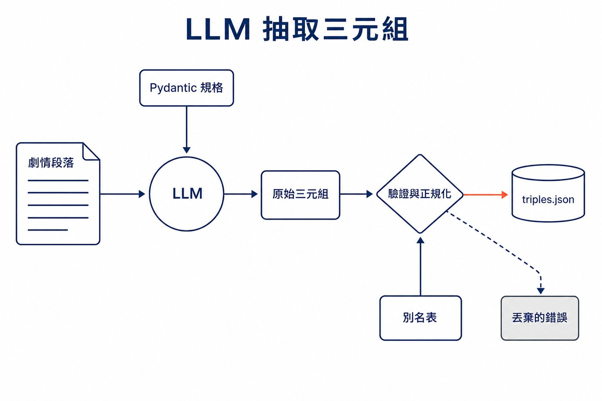
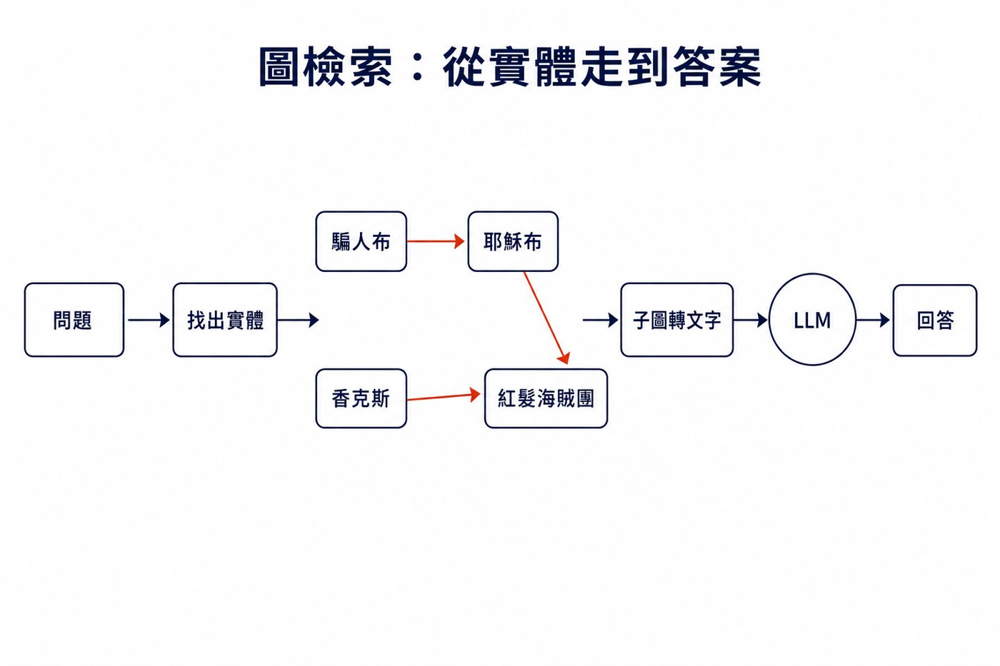

# 模組 4 原理紀要：知識圖譜與 GraphRAG

> 先讀這份，再開 `01_extract_triples.ipynb`。notebook 直接用 Pydantic、networkx、Neo4j 做事；
> 這裡講清楚「為什麼要把文字變成圖」「圖檢索在走什麼」「什麼時候值得這麼麻煩」。

## 1. 為什麼向量 RAG 不夠

模組 3 的向量 RAG：把文件切塊、算向量，問題進來就撈「長得最像」的幾塊。它很擅長「答案就寫在某一段裡」的問題。
但有兩種題它常常答不好：

| 題型 | 例子 | 向量 RAG 卡在哪 |
|---|---|---|
| **多跳題** | 「騙人布的父親所在海賊團的船長是誰？」 | 答案要串三段：騙人布的父親是耶穌布、耶穌布在紅髮海賊團、紅髮海賊團的船長是香克斯。最後那段完全沒提到騙人布，跟問題「不像」，排不進前幾名 |
| **全貌題** | 「故事裡有哪幾股勢力？」 | 答案不在任何一段裡，要看完全部再彙總 |

圖的想法是：**先把文字裡的「誰跟誰有什麼關係」抽出來存成結構**，問問題時沿著關係走，中間那幾段長得像不像問題就不重要了。

```
向量 RAG：問題 ──比相似度──▶ 最像的 k 段原文 ──▶ LLM
圖檢索：  問題 ──找實體──▶ 圖上的起點 ──沿著邊走 k 步──▶ 子圖念成句子 ──▶ LLM
```

## 2. 知識圖譜與三元組

**知識圖譜**＝節點（實體）＋有方向、有型別的邊（關係）。最小的單位是一條**三元組**：

```
(主體,   關係,        客體)
(魯夫,   CAPTAIN_OF,  草帽海賊團)
(騙人布, HAS_FATHER,  耶穌布)
```



*圖：段落交給 LLM，Pydantic 規格限制它能輸出的格式；抽出的三元組先經過驗證與正規化（別名表在這裡合併稱呼），錯的丟掉，對的才存進 triples.json。*

這門課的圖譜只有 8 種關係、5 種節點類型（schema）：

```
(:Person)-[:CAPTAIN_OF | MEMBER_OF]->(:Crew)
(:Person)-[:OWNS]->(:Treasure)
(:Person)-[:DREAMS_OF]->(:Dream)
(:Person)-[:FROM]->(:Place)
(:Person)-[:HAS_FATHER | BROTHER_OF | DEFEATED]->(:Person)
```

**為什麼要先定 schema？** 不給規格的話，模型這段寫「是船長」、那段寫「擔任」「帶領」，圖裡每種寫法都是不同的邊，查詢時對不起來。
用 Pydantic 把關係寫成 `Literal[...]`，交給模型做受限輸出，等於把「開放式生成」變成「從固定類別裡挑」。
但受限輸出只保證**格式**對，不保證**內容**對：方向反、關係標錯、客體不是實體都還會發生。所以要拿人工標註的標準答案量 precision／recall。

| 指標 | 白話 |
|---|---|
| precision | 模型抽出來的，有幾成是對的 |
| recall | 該抽的，模型抽到了幾成 |

## 3. 實體正規化：同一個東西只能有一個節點

同一個人在不同段落有不同叫法：「魯夫」「蒙其·D·魯夫」「草帽小子」。不合併的話，圖會裂成好幾座孤島，多跳查詢走到一半就斷了。

```
合併前：  蒙其·D·魯夫 ─CAPTAIN_OF→ 草帽海賊團       草帽小子 ─FROM→ 風車村      （兩座孤島）
合併後：  魯夫 ─CAPTAIN_OF→ 草帽海賊團
          魯夫 ─FROM→ 風車村                                                    （連在一起）
```

找別名的常見流程：**字串規則或向量找候選 → 人（或 LLM）裁決 → 寫進別名表 → 合併**。
最重要的一點：**名字像不代表是同一個東西。** 本課語料刻意埋了幾個陷阱：

| 候選 | 該不該合併 | 原因 |
|---|---|---|
| 「人人果實」↔「人人果實．幻獸種．模型『尼卡』」 | 不該 | 一個是喬巴的果實，一個是魯夫的果實；名字互相包含純屬巧合 |
| 「巨兵海賊團」↔「新巨兵海賊團」 | 不該 | 前者是東利、布洛基的老海賊團，後者是海爾丁重組的 |
| 「草帽」↔「草帽海賊團」 | 不該 | 一個是帽子，一個是海賊團 |
| 艾斯、薩波都「擁有燒燒果實」 | 兩條邊指向同一個節點才對 | 艾斯死後果實重新出現，被薩波吃下 |
| 「羅傑」↔「哥爾·D·羅傑」 | 該 | 同一個人的簡稱與全名 |

自動規則（「互相包含就合併」）會把前三個全部合錯，所以別名表最後一定由人拍板。評分時也一樣：「客體互相包含就算對」會把「魯夫擁有人人果實」判成對的。

## 4. 圖檢索：從問題走到答案



*圖：先在問題裡找出實體（騙人布），再沿著朱紅色的邊走：騙人布 → 父親耶穌布 → 紅髮海賊團 ← 船長香克斯；走到的子圖轉成文字，交給 LLM 回答。*

三個步驟：

1. **找起點（entity linking）**：問題裡出現了哪個節點的名字或別名。小圖用字串比對就夠；大圖會用向量比對實體描述（投影片「Local Search 實體入口」）。要小心短名字被長名字蓋住：問「白鬍子海賊團」時，「白鬍子」不算。
2. **沿著邊走（多跳）**：從起點一圈一圈往外，這就是廣度優先搜尋（BFS）。走 1 步叫一跳，走 k 步叫 k 跳。networkx 的 `ego_graph`、`bfs_layers`、`shortest_path` 都是現成的。
3. **子圖念成句子**：`(騙人布, HAS_FATHER, 耶穌布)` 寫成「騙人布的父親是耶穌布」，小模型讀句子比讀符號準。

整個流程模型只出場一次（最後組答案），中間「找誰、走哪」都是確定的程式，可以重跑、可以除錯。

## 5. 超級節點：一個大團體把整張圖拉進來

有些節點連著一大堆邊（「草帽海賊團」連著十個船員）。BFS 一碰到它，下一步就把所有成員、再下一步把所有成員的果實、夢想、故鄉都拉進來。

```
騙人布 ─1─▶ 草帽海賊團 ─2─▶ 魯夫、索隆、娜美、香吉士、喬巴、羅賓……（全部展開）
                         ─3─▶ 每個人的果實、夢想、故鄉……              → 子圖≈整張圖
```

塞整張圖給 LLM，等於回到「把全部文件塞進 prompt」：貴、慢，而且小模型會被無關的事實干擾。
所以一定要有**展開規則**。本課用的規則是「走到海賊團，只往它的船長走」，其他常見做法：限制每個節點最多展開幾條邊、只走特定關係、依相關性排序後截斷。

## 6. Cypher 與圖資料庫

networkx 適合小圖與理解，資料一大（幾百萬節點）、多人同時查詢，就需要圖資料庫。Neo4j 的查詢語言 Cypher 用 ASCII 畫圖的方式寫查詢：

```cypher
MATCH (p:Person {name: '騙人布'})-[:HAS_FATHER]->(f)-[:MEMBER_OF]->(c:Crew)<-[:CAPTAIN_OF]-(cap)
RETURN cap.name
```

| Cypher | 意思 |
|---|---|
| `(p:Person)` | 一個標籤是 Person 的節點，叫它 p |
| `-[:HAS_FATHER]->` | 一條有方向的 HAS_FATHER 邊 |
| `MERGE` | 有就用、沒有才建，匯入時避免重複節點 |
| `shortestPath(...)` | 兩點間最短的路 |

讓 LLM 寫 Cypher（Text2Cypher）很方便，但要守三件事：擋掉寫入語句、用唯讀交易執行、查詢出錯時把錯誤訊息回饋給模型重試。`03_neo4j_cypher.ipynb` 會做這三件事。

## 7. GraphRAG vs 向量 RAG：何時用哪個

| 問題長什麼樣 | 建議 | 原因 |
|---|---|---|
| 答案寫在某一段裡，問法跟原文像（「索隆的夢想」） | 向量 | 便宜、不用建圖，單跳表現已經很好 |
| 要串好幾個實體（「A 的 B 的 C」） | 圖 | 沿著邊走，中間的段落不必「長得像問題」 |
| 問的是 schema 沒有的細節（職位、外號、場景描述） | 向量 | 圖只存你定義過的關係，其他資訊在抽取時就丟了 |
| 要看全貌（「故事裡有哪幾股勢力」） | GraphRAG Global Search | 要先分群、寫社群報告再彙總 |
| 資料常改、沒人維護 schema | 向量 | 建圖要抽取、正規化、人工校對，維護成本高 |

實務上最常見的是**兩個一起用**：圖負責找到「相關的是誰」，再把這些實體出現的原文段落一起撈出來（投影片「Local Search」）。
「GraphRAG」這個詞有兩派：一派是本課做的「知識圖譜＋圖檢索」，另一派是 Microsoft GraphRAG 的「LLM 建圖＋社群摘要＋Global Search」。讀文章時先分清楚是哪一派。

## 8. 名詞對照

| 名詞 | 白話 |
|---|---|
| 知識圖譜 | 節點＋有型別的邊，存「誰跟誰有什麼關係」 |
| 三元組 | (主體, 關係, 客體)，圖的最小單位 |
| schema | 允許哪些節點類型、哪些關係、方向怎麼走 |
| 實體正規化 | 把同一個東西的不同叫法合併成一個節點 |
| entity linking | 在問題裡找出對應到圖上哪個節點 |
| 多跳（multi-hop） | 答案要沿著好幾條邊才走得到 |
| BFS | 從起點一圈一圈往外走的搜尋 |
| 超級節點（hub） | 連著大量邊的節點，一碰到就讓子圖爆炸 |
| Cypher | Neo4j 的查詢語言，用 `()-[]->()` 畫出要找的形狀 |
| Text2Cypher | 讓 LLM 把自然語言問題翻成 Cypher |

## 9. 常見坑

1. **不定 schema 就叫模型抽**：關係名稱五花八門，圖查不起來。
2. **以為受限輸出就等於正確**：格式對了，方向和內容照樣會錯。用標準答案量，不要用眼睛抽查。
3. **用「互相包含」自動合併別名**：人人果實和尼卡、巨兵和新巨兵都會被合錯。候選可以自動找，合併要人拍板。
4. **關係標籤會壓縮語意**：schema 只有 8 種關係，很多細節只能硬塞進最接近的那一種。例如波妮與大熊其實是養父女，標準答案裡仍記成 `HAS_FATHER`；東利、布洛基是巨兵海賊團的**前代**船長，也記成 `CAPTAIN_OF`。圖上看不出「養父」「前代」這些差別，問到就會答錯。schema 太少會失去細節，太多又讓模型難抽、人難標，要依問題取捨。
5. **沒有展開規則**：碰到超級節點，子圖變成整張圖。
6. **以為圖什麼都知道**：schema 沒涵蓋的事（例如「娜美在船上負責什麼」，本課沒有職位關係），圖一個字都答不出來。
7. **只看最後的正確率**：要把「檢索有沒有撈到答案」和「模型有沒有答對」分開量，才知道該修哪一段（`04_graph_vs_vector.ipynb`）。
8. **讓 LLM 寫的 Cypher 直接執行**：可能有 `DELETE`、`SET`。一定要擋寫入、用唯讀交易。

## 10. 接下來

| notebook | 用上這份的哪一段 |
|---|---|
| `01_extract_triples.ipynb` | §2～3：Pydantic 受限輸出抽三元組、量 precision／recall、別名正規化與陷阱 |
| `02_graph_networkx.ipynb` | §4～5：networkx 建圖、`ego_graph`／`shortest_path`／`bfs_layers` 多跳、超級節點展開規則 |
| `03_neo4j_cypher.ipynb` | §6：匯入 Neo4j、Cypher 多跳、Text2Cypher 的三道防線 |
| `04_graph_vs_vector.ipynb` | §7：同一組題目比向量檢索與圖檢索，拆開量檢索與生成 |
