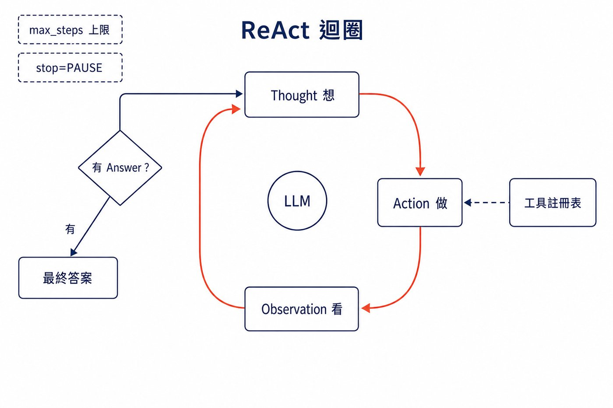
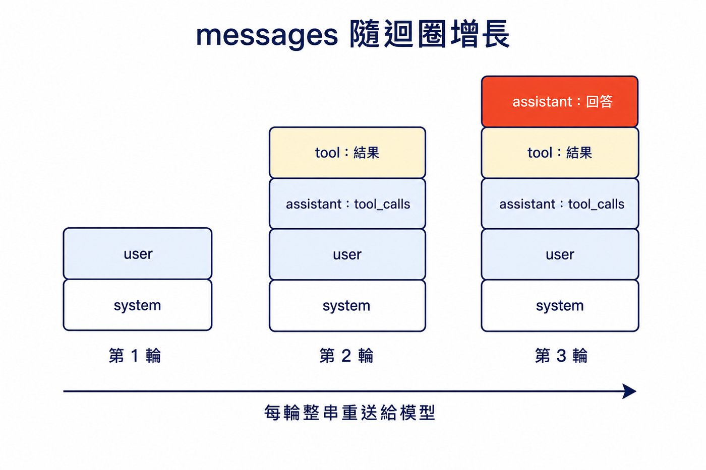
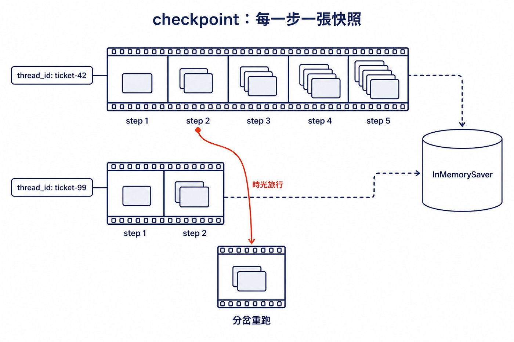
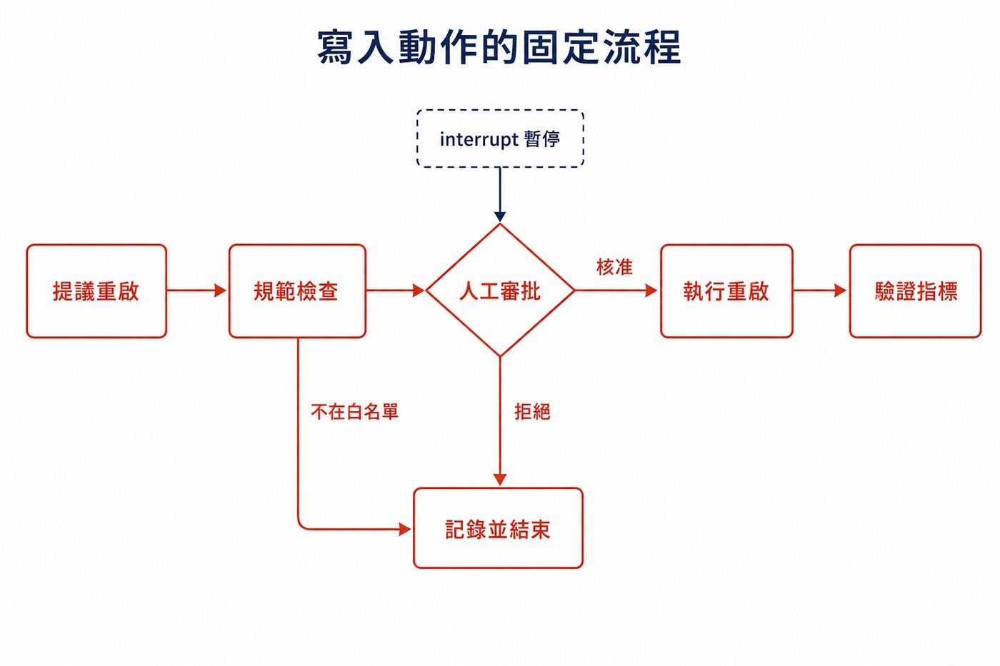
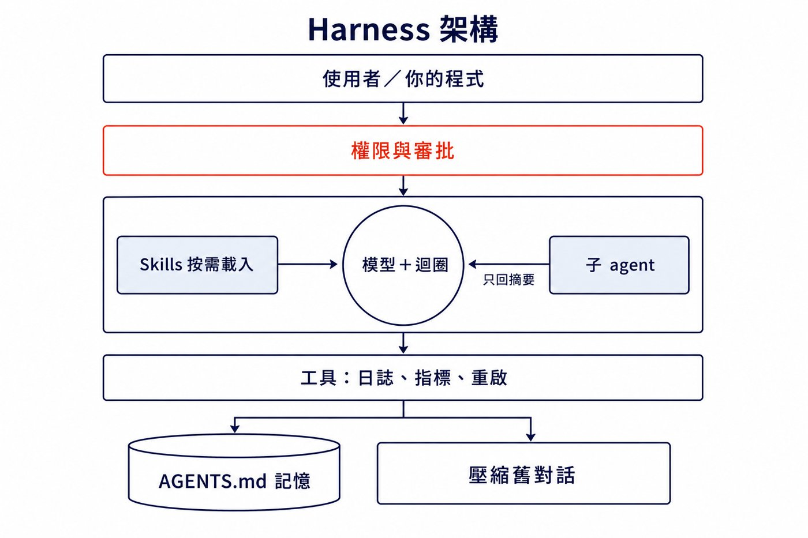
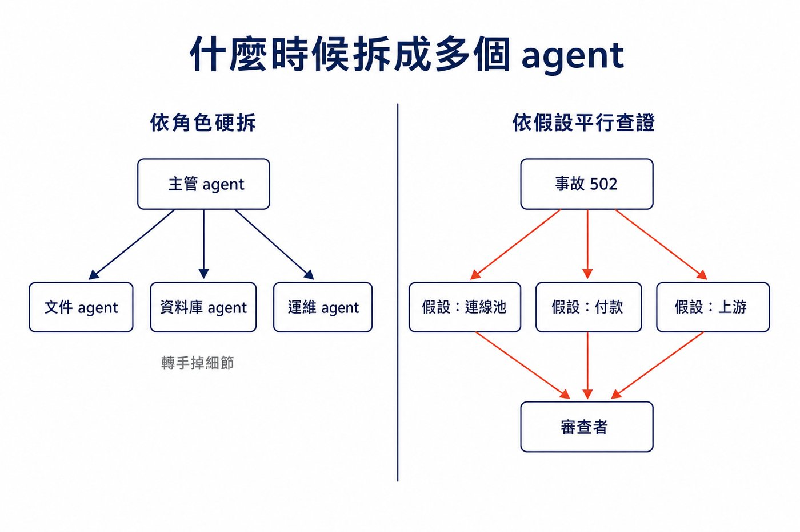
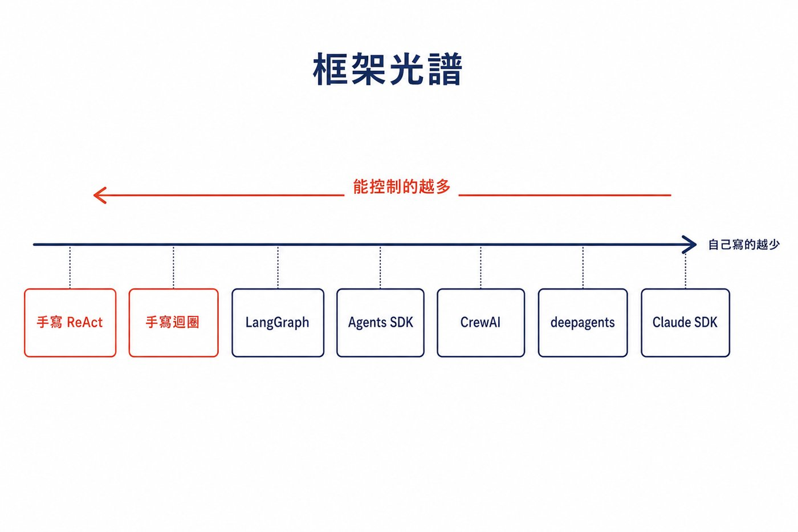

# 模組 5 原理紀要：Agent、狀態圖與 Harness

先讀這份，再開 notebook。這裡只講「為什麼」和「是什麼」；動手的部分在 notebook 裡完成。
01、02 兩本例外：agent 迴圈短到可以自己寫，自己寫一次最能看懂，所以這兩本保留手寫。

對應投影片：「從 f(x) 到迴圈」「ReAct 迴圈」「Workflow 還是 Agent」「50 行手寫 agent」「為什麼需要狀態圖」「StateGraph 三要素」「Reducer 合併規則」「Checkpointer 與 thread」「時光旅行與分岔」「人在回路 HITL 流程」「Harness 是什麼」「子 agent 隔離 context」「多 agent 的 token 代價」「通用 Agent 加 Skills」「什麼時候切多個 agent」「流程圖外殼＋harness 核心」

全模組用同一個情境：虛構公司「晨光外送」14:00 起下單一直 502，值班 agent 要查日誌、查指標、查 runbook，必要時要求重啟服務。

---

## 1. 從 f(x) 到迴圈

你熟悉的模型是一個函式：輸入 x，輸出 y，呼叫一次就結束。LLM 單獨使用時也是這樣：給一串 messages，回一段文字。

agent 多了一個迴圈：模型的輸出不一定是答案，也可能是「我要用某個工具」。程式去執行工具，把結果接回 messages，再呼叫一次模型，直到它說「好了」。

```
  f(x)：      問題 ──▶ 模型 ──▶ 答案

  agent：     問題 ──▶ 模型 ──▶ 要工具？ ──否──▶ 答案
                        ▲          │ 是
                        │          ▼
                        └──── 執行工具，結果接回 messages
```

**agent＝模型＋迴圈＋工具。** 模型只負責「決定下一步」，真正執行工具的永遠是你的程式。所以 agent 能做什麼，取決於你給了它哪些工具，跟模型多聰明無關。

## 2. ReAct：只靠 prompt 的 agent



ReAct（Reason＋Act，2022）出現在 function calling 之前。做法是用 prompt 規定模型照固定格式說話：

```
Thought: 我要先看 order-api 的錯誤日誌
Action: read_logs: order-api ERROR
PAUSE
```

程式用正規表示式抓出 `Action`，執行工具，再把結果用 `Observation: …` 送回去。出現 `Answer:` 就結束。

只靠文字格式很脆弱，所以要加四道防護：

| 防護 | 防什麼 |
|---|---|
| `stop=["PAUSE", "Observation:"]` | 模型自己編 Observation（小模型很常見） |
| 解析失敗時回一句錯誤當 Observation | 格式跑掉時讓模型自己修正，而不是程式當掉 |
| 工具註冊表查不到就拒絕 | 模型想呼叫不存在的工具（例如重啟） |
| `max_steps` | 模型永遠不收尾，一直花錢 |

## 3. Function calling：把解析交給 API



現在的模型都訓練過 tool calling：你在請求裡附上工具清單（JSON Schema），模型回一個結構化的 `tool_calls`，不用再解析文字。
一輪的 messages 長這樣：

```
system → user → assistant(tool_calls) → tool(結果) → assistant(tool_calls) → tool → … → assistant(答案)
```

幾個要點：

- **工具說明書就是 prompt。** 模型只看得到工具的名稱、說明和參數 schema。說明寫得爛，模型就亂用。參數用 Pydantic 定義，同一份定義既產生 schema、也驗證模型給的參數。
- **每一輪都重送整串 messages。** 模型沒有記憶，agent 的「記憶」就是這一串。所以 prompt tokens 一輪比一輪多，工具的回傳要短。
- **錯誤也要回給模型。** 參數驗證失敗、工具丟例外，都包成 `role: tool` 的文字送回去，讓模型決定下一步。
- **Workflow 還是 agent？** 步驟固定的工作（查日誌→查指標→算倍數）寫成固定程式就好，便宜又可預測；要「看了結果才知道下一步」的工作才需要 agent。

## 4. 狀態圖與 checkpoint

02 的 while 迴圈其實是一台狀態機。拆開來看有四樣東西：

```python
state = {"messages": [...]}                         # 狀態：一個 dict
NODES = {"agent": call_model, "tools": run_tool}    # 節點：吃狀態、回傳要更新的欄位
EDGES = {"START": "agent", "agent": route, "tools": "agent"}  # 邊：字串是固定邊，函式是條件邊
snapshots.append(copy.deepcopy(state))              # 每走一步存一份：最陽春的 checkpoint
```

執行器只做三件事：跑節點、把更新**合併**進狀態、照邊走到下一個節點。LangGraph 就是把這台機器做成正式的套件：

| 手寫 | LangGraph |
|---|---|
| 狀態 dict | `TypedDict` 定義的 State |
| 合併規則（messages 要追加） | reducer：`Annotated[list, add_messages]`、`operator.add` |
| 節點、邊 | `add_node`、`add_edge`、`add_conditional_edges` |
| `snapshots` | checkpointer（`InMemorySaver`、正式環境用 `PostgresSaver`） |
| `max_steps` | `recursion_limit` |



- **Reducer**：兩個節點都更新同一個欄位時，要追加還是覆蓋。沒寫 reducer 就是覆蓋，平行節點的結果會互相蓋掉。
- **thread_id**：checkpointer 用它區分不同對話。同一個 thread 才讀得到前文；換一個 thread 就是全新的對話。
- **時光旅行**：每一步都有快照，可以拿某張快照的 `checkpoint_id` 從那裡重跑，或先用 `update_state` 改掉狀態再分岔。出錯時可以回到出錯前一步重試。

## 5. 人在回路：寫入動作走固定流程



查日誌錯了頂多浪費時間；重啟錯了服務，線上就出事。寫入動作的安全不能靠 prompt 拜託模型自律，要靠**程式結構**：

```
提議（模型） → 規範檢查（程式） → 人工審批（人） → 執行 → 驗證（看指標）
```

LangGraph 的做法：

- 審批節點呼叫 `interrupt(要給人看的內容)`。圖在這裡暫停、存好 checkpoint，`invoke` 直接回傳。
- 人決定後，用**同一個 thread_id** 送 `Command(resume=決定)`。`interrupt()` 的回傳值就是這個決定。
- 節點可以回傳 `Command(goto="execute")` 自己決定下一步。

兩個最常踩的坑：

1. **恢復時節點從頭重跑。** `interrupt()` 之前的程式碼會執行兩次。寄信、寫稽核紀錄這類副作用要放在別的節點。
2. **不要用裸的 `try/except` 包住 `interrupt()`。** 它靠拋出特殊例外來暫停，被接住就停不下來。

高階框架都有同樣的東西：deepagents 的 `interrupt_on`、OpenAI Agents SDK 的 `needs_approval`、Claude Agent SDK 的 `can_use_tool`。底層概念相同：**模型只能提議，執行權在程式與人手上。**

## 6. Harness：一個 agent 的整套配備



Claude Code、Codex、Deep Agents 長得都一樣：**一個迴圈，外掛配齊。** 要加能力，就加一格外掛，而不是再加一個 agent。

| 外掛 | 做什麼 | 解決什麼問題 |
|---|---|---|
| **Skills** | 一個資料夾一份 `SKILL.md`，開頭 frontmatter 寫 `name`、`description` | system prompt 只放目錄，用到才讀全文（progressive disclosure）；skill 有 50 個也不會撐爆 prompt |
| **子 agent 當工具** | 主 agent 呼叫 `task(問題)`，裡面開一個全新的迴圈、只給唯讀工具、只回最後一則訊息 | 讀一大堆日誌的細節留在子 agent 的 context 裡，主 agent 只收摘要 |
| **檔案記憶** | `AGENTS.md`（Claude Code 是 `CLAUDE.md`）每次啟動讀進 system prompt | 跨次保存的慣例；人可以直接改檔案，agent 也可以自己寫回去 |
| **壓縮（compaction）** | context 快滿時，把舊對話換成一段摘要，原文存到檔案 | 長任務不會因為 context 滿了而中斷 |
| **工具／MCP** | 外部系統的標準接頭 | 換系統不用改 agent |
| **權限與 hooks** | 工具執行前後插手：允許、拒絕、改參數、寫稽核 | 危險動作先停下來等人；不靠模型自律 |

progressive disclosure 的示意：

```
system prompt 裡：                       用到時才讀：
## Skills                                /skills/ops-runbook/SKILL.md
- ops-runbook：502、連線池用盡的排查步驟   ──▶  1. read_logs(level="ERROR") …
- incident-report：寫事故報告                    2. query_metrics …
```

用框架要注意一件事：**框架的 prompt 是為大模型設計的。** deepagents 預設送出約兩萬字（檔案工具說明、skills 與 memory 的英文使用指南），超過本機 `qwen2.5:3b` 的 4096 context。接小模型時要先看它送了什麼，再用正式的擴充點（HarnessProfile、同名 middleware）瘦身。

## 7. 什麼時候切多個 agent



**先用一個 agent。** 有證據才拆，而且按下面四個理由拆，不按職能拆：

| 值得拆的理由 | 例子 |
|---|---|
| 隔離 context | 要讀一大堆東西，交給子 agent 讀完只回摘要 |
| 平行查證 | 每個懷疑的原因開一個唯讀子 agent，同時跑 |
| 寫的和審的分開 | 產出的 agent 不該自己打分數；審查者只挑證據的毛病 |
| 權限或組織邊界 | 不同部門的資料與權限不能共用 |

反模式是「主管 agent → 文件 agent／資料庫 agent／運維 agent」。「502 是不是資料庫連線池滿了？」這個問題同時橫跨文件、指標、日誌，每轉一次手細節就掉一點，主管看不到原始資料只能相信摘要。
多 agent 也一定比較貴：每多一個 agent 就多一份 system prompt 和好幾輪請求。官方文件引用的數字是單一 agent 的 3～15 倍；09 本機實測也是將近 10 倍。

## 8. 流程圖外殼＋harness 核心

企業系統裡兩種東西並存：

```
 觸發（告警、工單） ──▶ [ harness agent：調查、草擬處理方案 ] ──▶ 審批 ──▶ 執行 ──▶ 驗證、回寫
 └───────────── LangGraph 固定圖（每次走一樣的路）─────────────────────────────────────┘
                         只有中間這一格交給模型決定怎麼走
```

- 步驟寫得出來的（觸發、審批、執行、驗證）寫成固定圖：可預測、可稽核、可恢復。
- 查不完的部分（看哪些日誌、懷疑哪個服務）交給一個 harness agent。
- agent 包成後端服務；系統功能（日誌、監控、服務控制）做成 MCP server 或工具。

## 9. 框架選型



所有框架底下都是第 1 節那個迴圈，差別在誰寫迴圈、內建了哪些外掛、你還能控制多少：

| 寫法 | 你寫的 | 框架給的 | 適合 |
|---|---|---|---|
| 手寫 ReAct／tool calling | 全部 | 無 | 學原理、小而固定的工具集、只有小模型 |
| LangGraph | 節點與邊 | 狀態、checkpoint、interrupt、時光旅行 | 固定流程、審批、可恢復的長流程 |
| deepagents | 工具、skills、設定 | 完整 harness（底層是 LangGraph） | 調查型任務的 harness 核心 |
| OpenAI Agents SDK | Agent 設定、工具 | Runner、guardrail、審批、agent 當工具 | OpenAI 生態、要 guardrail |
| Claude Agent SDK | 設定、權限回呼、hooks、MCP 工具 | 整個 Claude Code harness | 通用 agent；綁定 Claude 模型 |
| CrewAI | 角色、任務 | 任務排程、平行任務 | 確定要多 agent 時快速搭 |

## 10. 常見的坑

| 症狀 | 原因 | 修法 |
|---|---|---|
| 模型反覆呼叫同一個工具停不下來 | 工具回傳格式不符預期，或 prompt 被截斷 | `recursion_limit`／`max_steps`；檢查實際送出的 prompt |
| 回答說「已重啟」，但其實沒有呼叫工具 | 小模型一次記不住多步任務，會編造執行結果 | 看 trace，不要只看最後回答；一次交代一件事 |
| 回答寫「根據手冊」，但沒有呼叫檢索工具 | 模型憑記憶回答 | system prompt 明講必查；不能漏的步驟寫進固定流程 |
| 並行節點的結果互相覆蓋 | 狀態欄位沒有 reducer | `Annotated[list, operator.add]` |
| 審批後副作用發生兩次 | 恢復時節點從頭重跑 | 副作用移到審批之後的節點 |
| 框架 agent 在小模型上答非所問 | 框架預設 prompt 超過 context，被截斷 | 量請求大小；拿掉用不到的內建工具、縮短 prompt 模板 |
