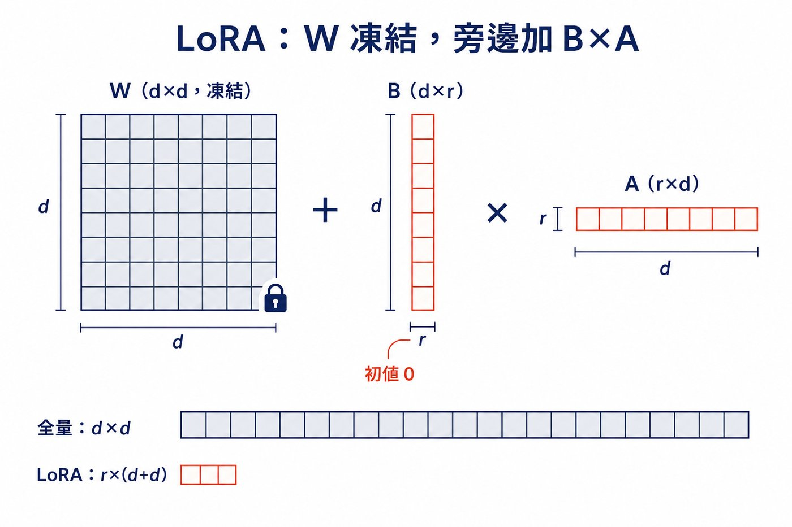
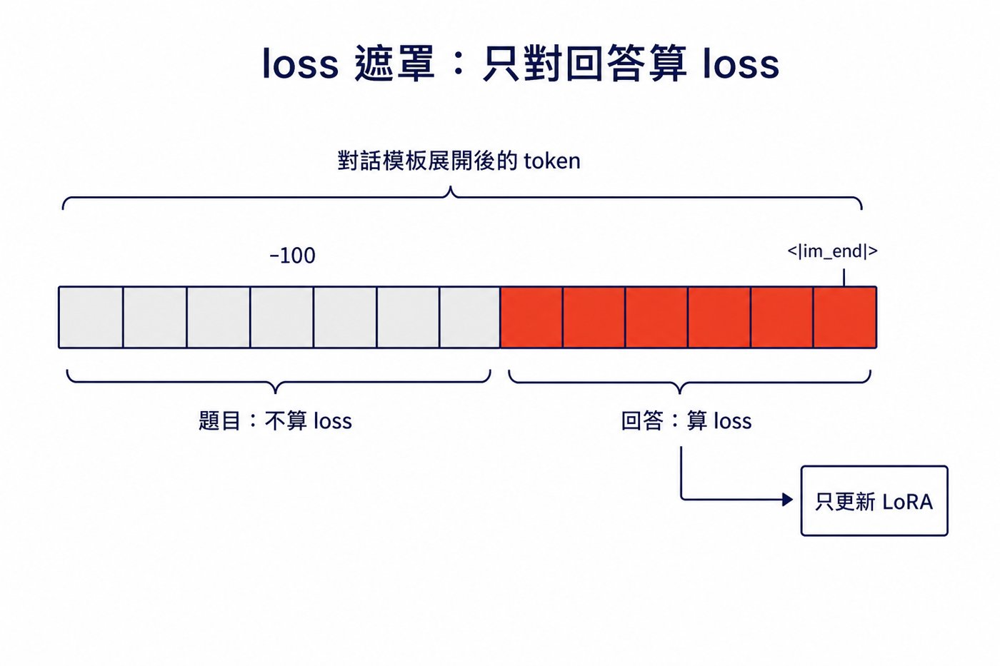
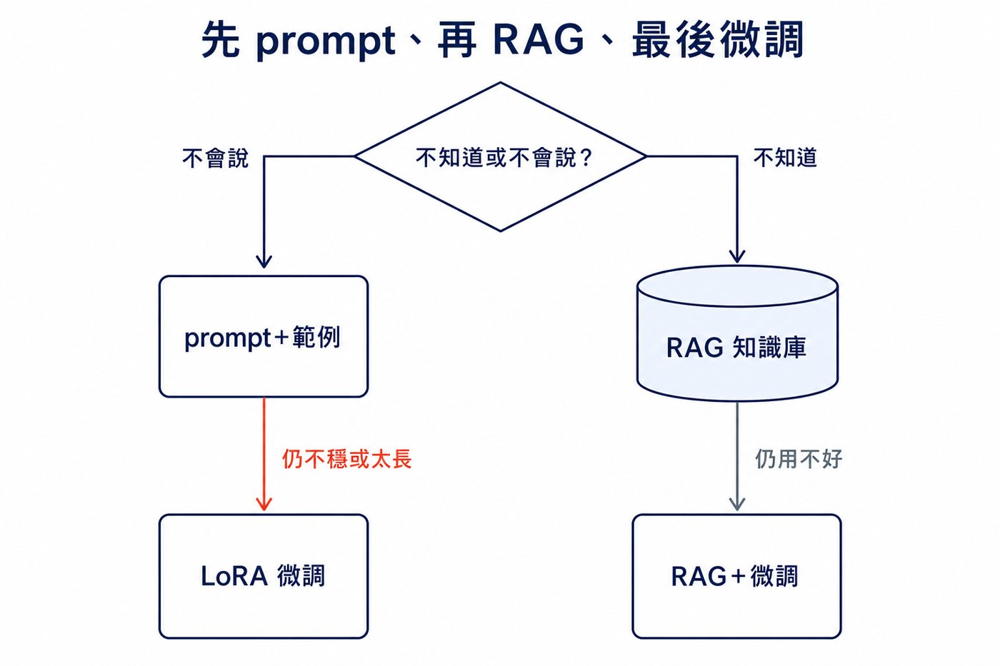

# 模組 6 原理紀要：LoRA 微調

先讀這份，再開 notebook。這裡只講「為什麼」和「是什麼」，動手的部分都在 notebook 裡用 PEFT 完成。

對應投影片：「微調是什麼」「遷移學習到 LLM 微調」「Prompt、RAG、微調怎麼選」「LoRA：W 凍結，旁路 B·A」「LoRA 可訓練參數量」「LoRA 對比全量微調」「對話模板與 loss 遮罩」「訓練／驗證 loss 與過擬合」「合併權重與 QLoRA 匯出」「LoRA 學得少也忘得少」「微調踩坑：症狀、原因、修法」

---

## 1. 為什麼需要微調

你在影像分類做過遷移學習：拿 ImageNet 預訓練的 backbone，凍結大部分層，只訓練最後一層去分你的類別。
LLM 微調是同一件事，只是規模不同：

| | 影像遷移學習 | LLM 微調 |
|---|---|---|
| 預訓練學到的 | 邊緣、紋理、物體形狀 | 語言、常識、寫程式、照指令回答 |
| 你想要的改變 | 換成你的類別 | 換成你的**說話方式**：固定格式、固定話術、領域術語 |
| 只訓練最後一層夠嗎 | 通常夠 | 不夠：格式與語氣分散在每一層 |
| 全部參數一起訓練 | 可以 | 很貴：0.5B 模型就要十幾 GB 的梯度與優化器狀態 |

LoRA 解決的就是最後一列：**不動原本的權重，只在每一層旁邊加一點點可訓練的參數。**

## 2. 核心原理：W 凍結，旁邊加 B×A

一個 Linear 層做的事是 `h = W·x`，W 是 d×k 的大矩陣。微調等於要找一個改變量 ΔW，讓 `h = (W + ΔW)·x`。

LoRA 的假設：**微調需要的 ΔW 是低秩的**。新任務跟原本的能力只差「少數幾個方向」，不需要重寫整個矩陣。
所以不直接學 ΔW，而是把它拆成兩個細長矩陣相乘：



*圖：左邊灰色大方陣是凍結的 W；右邊朱紅的 B（d×r，細長、初值 0）乘 A（r×d，扁長）也得到 d×d 的形狀，但只要存兩條細長矩陣。下方兩條長度對照全量與 LoRA 要訓練的參數量。*

前向傳播變成兩條路相加：

```
           ┌──────────────────┐
  x ──┬──► │  W（凍結，不訓練） │ ──────────────┐
      │    └──────────────────┘               ▼
      │                                      (+) ──► 輸出 h
      │    ┌────────┐   ┌────────┐            ▲
      └──► │ A: r×k │ ─►│ B: d×r │ ─► × alpha/r
           └────────┘   └────────┘
```

寫成程式只有一行重點（示意，不是完整實作）：

```python
h = x @ W.T + (x @ A.T @ B.T) * (alpha / r)   # W 不給梯度，只有 A、B 會更新
```

三個設計細節：

1. **B 初始化成 0。** 一開始旁路輸出 0，包上 LoRA 的模型跟原模型**完全一樣**。微調從原模型出發，而不是從被隨機雜訊破壞過的模型出發。A 則隨機初始化，不然梯度永遠是 0。
2. **r（rank）決定容量。** 旁路最多只能表達 rank r 的改變。如果真正需要的改變超過 r，loss 會卡在一個降不下去的高度；不是訓練不夠久，是裝不下。實務上 r = 8、16 通常就夠用。
3. **alpha / r 是縮放係數。** 換 r 的時候，旁路輸出的大小不會跟著亂跳，學習率不用重調。課綱建議 r = 8、alpha = 16，也就是 scaling = 2。

## 3. 參數量算式

一個 d×k 的矩陣：

| | 要訓練的參數 |
|---|---|
| 全量微調 | `d × k` |
| LoRA | `r × (d + k)` |

矩陣大小從「乘」變成「加」。以 Qwen2.5-0.5B 的 attention 投影層（896×896）為例：

| r | LoRA 參數 | 佔全量（802,816）的比例 |
|---|---|---|
| 1 | 1,792 | 0.22% |
| 8 | 14,336 | 1.79% |
| 16 | 28,672 | 3.57% |
| 64 | 114,688 | 14.29% |

```
  全量（896×896）  ████████████████████████████████████████  802,816
  LoRA r=8        █                                            14,336
```

整個模型套在 q/k/v/o 與 MLP 的 gate/up/down 七種投影上，r = 8 時大約是全模型的 0.9%
（Lab 6-01 會用 `print_trainable_parameters()` 印出實際數字）。

省下的不只是參數，主要是**記憶體**：Adam 對每個可訓練參數要多存兩份狀態，還要存梯度；凍結的參數這些都不用。這就是 16GB 顯卡也能微調 LLM 的原因。

**QLoRA** 再往前一步：把凍結的 W 用 4-bit 存，A、B 仍用 16/32-bit 訓練。基座記憶體再省約四分之三，代價是速度慢一點、多一點量化誤差。本模組的 0.5B 模型用 bf16 就放得下，所以不用 4-bit。

## 4. 合併：推論時零額外成本

訓練完，把 `B·A × alpha/r` 直接加回 W：

```
W_new = W + (B @ A) * (alpha / r)
```

得到的是一個普通的 Linear，不知道 LoRA 的推論引擎（llama.cpp、Ollama）也能直接用，而且推論時不用再多算一條旁路。PEFT 的 `merge_and_unload()` 就是對每一層做這件事。

不合併也有好處：基座只載一份，adapter（幾 MB 到幾十 MB）可以依任務隨時切換。

## 5. 訓練資料與 loss 遮罩

微調資料是一段段對話，兩種常見格式：

```json
// messages（ShareGPT 系）
{"messages": [{"role": "user", "content": "<症狀>"},
              {"role": "assistant", "content": "可能原因：…\n第一步檢查：`…`"}]}

// Alpaca
{"instruction": "根據症狀回答原因與指令", "input": "<症狀>", "output": "可能原因：…"}
```

模型不認得 role，它只看一長串文字。**對話模板**（chat template）把對話展開成模型訓練時用的格式，例如 Qwen 的 `<|im_start|>user … <|im_end|>`，還會自動補一段預設 system prompt。

訓練目標仍然是「猜下一個 token」，但只對**回答**算 loss：



*圖：對話展開後的一長條 token。灰色題目部分的 label 是 -100，不算 loss；朱紅的回答（含 `<|im_end|>`）才算，梯度只更新 LoRA。*

- 題目部分的 label 設成 `-100`，PyTorch 的 cross entropy 會跳過。
- 結尾的 `<|im_end|>` 一定要算：模型要學會**什麼時候停**。
- 推論時用的模板必須跟訓練時**一模一樣**（包括預設 system prompt），否則模型看到的是陌生格式。

## 6. 看 loss 曲線挑 checkpoint

- **訓練 loss** 一路往下，代表模型越來越會背訓練集。
- **驗證 loss**（用訓練時沒看過的說法）降到某處就停住，之後開始往上：過擬合開始了。
- 用驗證 loss 最低的那個 checkpoint，不是最後一步。

驗證集要真的「沒看過」：本模組的驗證、測試集用的是不同的症狀說法與服務名稱，否則驗證 loss 只是在量背誦能力。

## 7. 什麼時候不該微調



*圖：先判斷問題是「不知道」（缺知識，走 RAG）還是「不會說」（格式、語氣，先寫 prompt）。prompt 仍不穩或太長，才進到 LoRA 微調。成本由低到高：prompt < RAG < 微調。*

| 情況 | 先選 | 理由 |
|---|---|---|
| 知識常變（工單、文件、價格） | RAG | 改資料不用重訓，回答可以附出處 |
| 輸出格式、語氣要固定 | prompt，不夠再微調 | 先試最便宜的 |
| 每次都要帶一大段固定說明 | 微調 | 把說明「燒進」權重，每次請求省下幾百個 token |
| 要換成更小、更便宜的模型 | 微調 | 小模型照長 prompt 做事的能力弱 |
| 需要可追溯、可稽核的答案 | RAG | 微調後的知識藏在權重裡，說不出來源 |

一句話：**微調教的是「怎麼說」，不是「知道什麼」**。它買到的主要是成本（小模型、短 prompt、低延遲），不是正確率。Lab 6-03 會用數字驗證這件事。

## 8. 常見坑

| 症狀 | 原因 | 修法 |
|---|---|---|
| 微調後連一般問題都用任務格式回答、或不斷重複 | 災難性遺忘：只用單一任務資料訓練 | 降 epoch、降學習率；混入約 15% 通用對話資料；或推論時卸下 adapter |
| loss 不降或亂跳 | 資料的角色標記跟模型的對話模板對不上 | 一律用 `tokenizer.apply_chat_template`，先 decode 一筆看清楚 |
| 微調後回答停不下來 | `<|im_end|>` 沒有算 loss，或推論沒設 stop | 檢查 loss 遮罩；Modelfile 加 `PARAMETER stop` |
| 匯出到 Ollama 後效果變差 | Modelfile 的 TEMPLATE／SYSTEM 跟訓練時不同；或量化誤差 | 從訓練用的模板推出 Modelfile；量化後用同一份測試集再測一次 |
| 格式全對，內容卻錯 | 訓練資料沒涵蓋這種說法；小模型照抄錯名稱 | 增加資料多樣性；執行指令前一定要審批（模組 5） |
| 驗證 loss 很漂亮，上線卻不準 | 驗證集跟訓練集太像，量到的是背誦 | 驗證／測試集換說法、換實體名稱 |

## 關鍵名詞

| 名詞 | 一句話 |
|---|---|
| 全量微調（full fine-tuning） | 所有權重都更新 |
| PEFT | 參數高效微調的總稱，也是 Hugging Face 的套件名；LoRA 是其中一種 |
| LoRA | 凍結 W，在旁邊學一個低秩的 `B·A` |
| rank r | 旁路的寬度，決定容量與參數量 |
| alpha | 縮放係數，旁路輸出乘上 `alpha / r` |
| adapter | 存下來的 A、B 權重，只有幾 MB 到幾十 MB |
| QLoRA | 基座用 4-bit 存，再加 LoRA |
| merge | 把 `B·A × alpha/r` 加回 W，變回普通模型 |
| chat template | 把 messages 展開成模型看得懂的字串的規則 |
| GGUF | llama.cpp／Ollama 用的模型檔格式，可以順便量化 |
