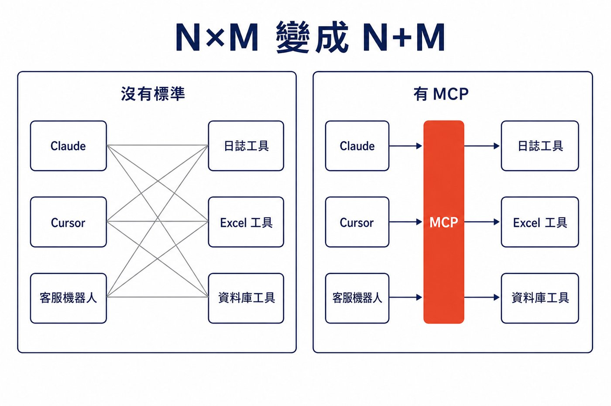
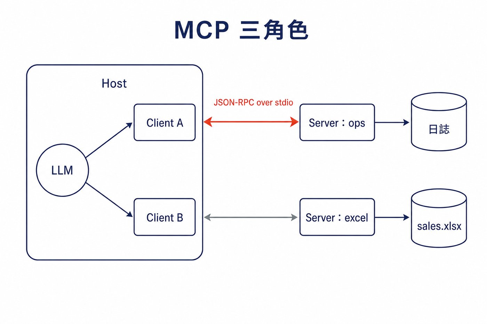
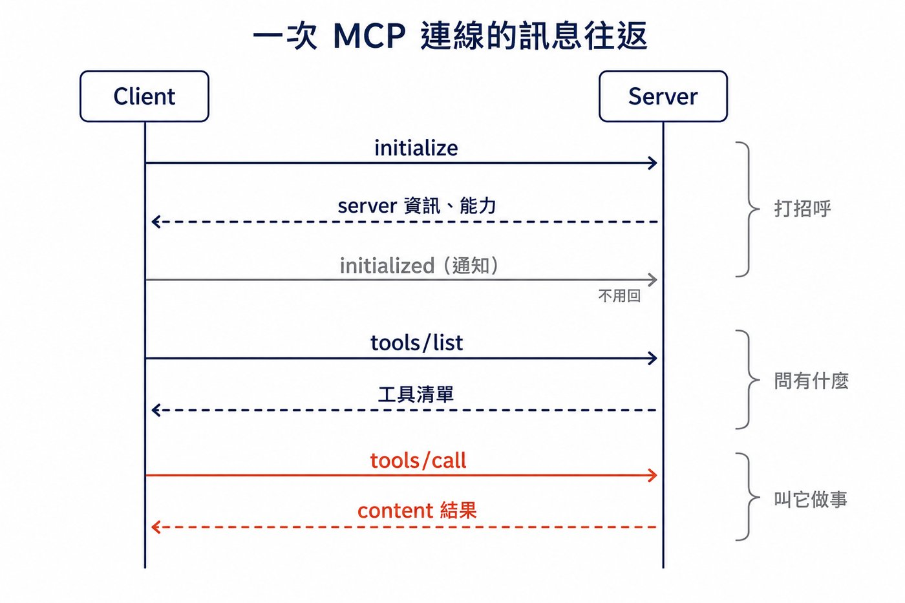
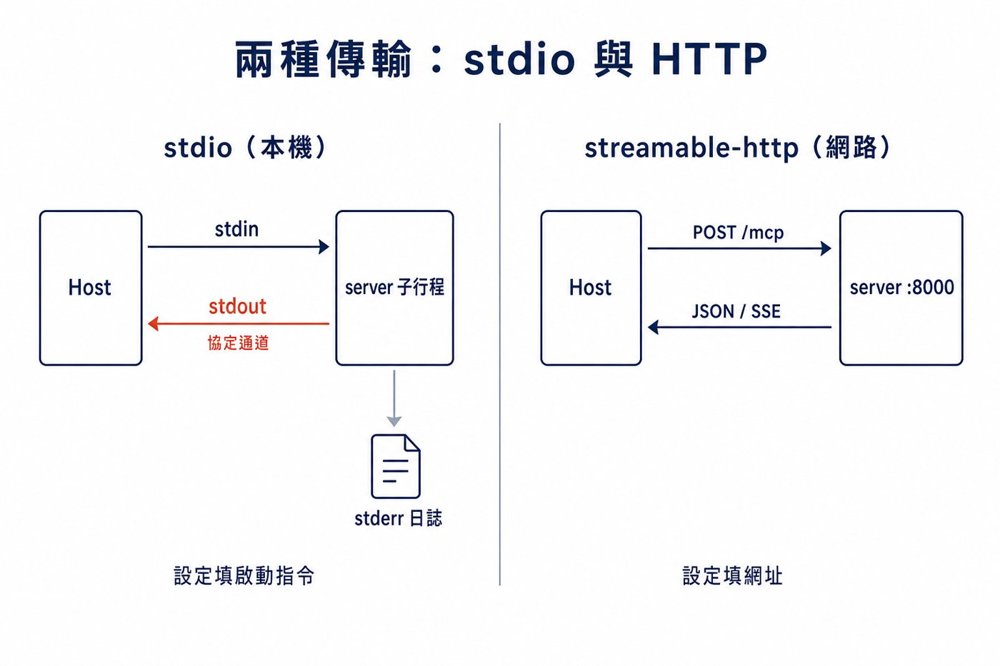

# 模組 7 原理紀要：MCP 是什麼、底層長什麼樣

> 先讀這份，再開 `01_mcp_client.ipynb`。notebook 直接用官方 `mcp` SDK 做事；
> 這裡把「為什麼要有 MCP」「它底層傳的是什麼」講清楚，讓你在 notebook 裡看到 `list_tools()`、`call_tool()` 時知道背後發生什麼事。

## 1. 為什麼需要 MCP：N×M 轉接問題

你寫了一個查服務狀態的函式，想讓模型呼叫它。模組 5 學過：要把函式的名稱、說明、參數格式交給模型。
問題是每家的格式都不一樣：

```python
openai    = {"type": "function", "function": {"name": ..., "description": ..., "parameters": schema}}
anthropic = {"name": ..., "description": ..., "input_schema": schema}
gemini    = {"function_declarations": [{"name": ..., "description": ..., "parameters": schema}]}
```

核心資訊（名稱、說明、JSON Schema）完全相同，只是外面那層包裝不同。模型回傳「我要呼叫工具」的格式也各不相同。
這還只是模型 API；真正的痛在 app 端：Claude Desktop、Cursor、公司的客服機器人，各有各的外掛機制。



*圖：左邊沒有標準，3 個 app × 3 個工具要 9 份轉接；右邊有了 MCP，每邊只接一次，共 3＋3 份。*

- 沒有標準：N 個 app、M 個工具，每一對都要一份轉接，共 N×M 份。8 個 app、20 個工具就是 160 份。
- 有共同協定：每個工具寫一次 server（M 份），每個 app 寫一次 client（N 份），共 N+M＝28 份。

這跟 USB 出現之前一樣：每台印表機配一條專用線。MCP（Model Context Protocol）就是在定插頭的形狀。

## 2. 三個角色：Host、Client、Server



*圖：外框是 Host；LLM 不直接碰 Server，而是經過 Client，每個 Client 只連一個 Server。朱紅那條就是 `01_mcp_client.ipynb` 要走的路。*

- **Host**：使用者打開的應用程式，裡面有模型，負責決定要不要真的執行工具、要不要先問使用者。
- **Client**：Host 裡「跟一個 server 講話」的連線物件，一個 client 只連一個 server。
- **Server**：把能力包起來的小程式。它不知道對面是哪家模型，只回答「我有什麼」「幫你做這件事」。

**模型本身不直接碰 server。** 模型說「我想呼叫某工具」，Host 透過 Client 去叫，拿到結果再交回給模型。
所以安全關卡（白名單、審批）可以放在 Host／Client 這一側，見 `03_mcp_in_practice.ipynb`。

## 3. Server 能提供的三種東西（原語）

| 原語 | 誰決定什麼時候用 | 例子 |
|---|---|---|
| Tools（工具） | **模型** | `query(sheet, group_by)`、`get_service_status(service)` |
| Resources（資源） | **應用程式** | 值班手冊、Excel 的資料地圖 `excel://schema`，通常在對話開始前塞進 context |
| Prompts（提示詞模板） | **使用者** | 像斜線指令，使用者主動挑一個模板 |

`02_excel_agent.ipynb` 會親眼看到差別：小模型不知道工作表名稱時會亂猜；應用程式先把 Resource 裡的資料地圖放進 context，它就猜對了。

## 4. 底層訊息：JSON-RPC 2.0

MCP 的每一則訊息都是 JSON-RPC 2.0，只有三種：

| 種類 | 長相 | 對方要不要回 |
|---|---|---|
| 請求（request） | 有 `id`、`method`、`params` | 一定要回 |
| 回應（response） | 帶同一個 `id`，裡面是 `result` 或 `error` | — |
| 通知（notification） | 沒有 `id` | 不用回 |

一次工具呼叫的往返長這樣：

```json
→ {"jsonrpc":"2.0","id":3,"method":"tools/call","params":{"name":"get_service_status","arguments":{"service":"payment"}}}
← {"jsonrpc":"2.0","id":3,"result":{"content":[{"type":"text","text":"{\"service\": \"payment\", \"state\": \"degraded\", …}"}]}}
→ {"jsonrpc":"2.0","method":"notifications/initialized"}
```

`id` 的用途：client 可以連送好幾個請求，回應的順序不一定一樣，靠 `id` 對回是哪一題的答案。
呼叫不存在的工具時，server 回的是 `error` 而不是 `result`，行程不會掛掉。

### 一次連線的固定流程



*圖：時間由上往下。實線是請求、虛線是回應；灰色的 `initialized` 是通知，沒有回應。*

打招呼 → 問有什麼 → 叫它做事。官方 SDK 的 `ClientSession` 幫你做的就是：配 `id`、版本協商、把回應轉成 Python 物件。
server 端的 `FastMCP` 則是從函式的型別註記產生 `inputSchema`、在邊界驗證參數。

### SDK 幫你做掉的事

| 你在 notebook 寫的 | SDK 在底層做的 |
|---|---|
| `stdio_client(params)` | 開子行程，把 stdin/stdout 接成兩條管線 |
| `await session.initialize()` | 送 `initialize`、比對協定版本、送 `initialized` 通知 |
| `await session.list_tools()` | 送 `tools/list`，把回應轉成 `Tool` 物件（含 `inputSchema`） |
| `await session.call_tool(name, args)` | 送 `tools/call`，依 `id` 等到對應的回應 |
| `@mcp.tool()` 裝飾一個函式 | 用函式名稱當工具名、docstring 當說明、型別註記產生 JSON Schema |
| 型別寫 `Literal[...]`、`Field(ge=1, le=20)` | 變成 schema 的 `enum`、上下限，模型亂填參數會在 server 邊界被擋下 |

所以 notebook 裡不需要手寫任何 JSON-RPC。想看底層長相時，讀 server 的 stderr 日誌或把 `list_tools()` 的結果印出來就夠了。

### MCP 跟 function calling 是什麼關係

兩者常被混在一起，其實是上下兩層：

```
模型 ──(function calling：模型說「我要呼叫 X，參數是…」)──▶ Host
Host ──(MCP：Host 找到 X 在哪支 server，替模型去叫)────────▶ Server
```

- **function calling** 是模型 API 的功能：你把工具清單交給模型，模型回一個「想呼叫哪個工具、參數是什麼」的結構。模組 5 寫的迴圈就是這一層。
- **MCP** 是 Host 跟工具之間的協定：工具清單從哪裡來、呼叫要送去哪裡。
- 接起來的方法只有一步：把 MCP 的 `inputSchema` 放進 OpenAI 格式的 `parameters`。`01_mcp_client.ipynb` 會做這件事，迴圈本身一行都不用改。

## 5. 兩種傳輸：stdio 與 streamable-http

訊息內容一樣，差在走哪條路。



*圖：左邊 stdio 的 stdout 就是協定通道（朱紅），日誌要走 stderr；右邊 HTTP 的設定從「啟動指令」變成「網址」。*

| | stdio | streamable-http |
|---|---|---|
| 怎麼連 | Host 開一個子行程，接上 stdin/stdout | Host 連一個網址，例如 `http://127.0.0.1:8000/mcp` |
| 設定檔要寫 | `command`、`args`、`env` | `url` |
| 適合 | Claude Code、Cursor、Claude Desktop 等本機 app | 網頁型、跑在容器或遠端的 Host，多人共用 |
| 速度 | 兩條管線，往返約 1 毫秒 | 走網路 |
| 安全 | 只有本機使用者能用 | 對外開放就要另外處理認證 |

server 程式本身不用改，只換最後一行：`mcp.run()`（預設 stdio）或 `mcp.run(transport="streamable-http")`。

## 6. 最重要的坑：stdio server 裡不能亂 print

stdio 的規則是：**server 從 stdin 讀一行 JSON，往 stdout 寫一行 JSON。** stdout 就是協定通道。

```
你在 server 裡加了：print("debug: 收到", method)

Client 讀到的第一行： debug: 收到 initialize      ← 不是 JSON
                      → JSONDecodeError，連線當場壞掉
Host 顯示的錯誤：     「連線逾時」或「解析錯誤」  ← 完全看不出是 print 造成的
```

修法：stdio server 裡不留任何 `print()`，除錯一律用 `logging`。`logging` 預設寫 stderr，那是另一條管線，Host 通常會把它存成日誌檔。
`print(..., file=sys.stderr)` 也可以，但不如 `logging` 好管理。

## 7. 名詞對照

| 名詞 | 白話 |
|---|---|
| MCP（Model Context Protocol） | 讓 app 和工具之間說同一種話的協定 |
| Host | 使用者打開的 app，裡面有模型 |
| Client | Host 裡連一個 server 的連線物件 |
| Server | 包好能力、等人呼叫的小程式 |
| JSON-RPC 2.0 | 「請求／回應／通知」三種 JSON 訊息的規格 |
| `inputSchema` | 工具參數的 JSON Schema；放進 OpenAI 格式的 `parameters` 就能直接用 |
| stdio | 用子行程的標準輸入輸出傳訊息 |
| streamable-http | 用 HTTP 傳訊息，可搭配 SSE 串流 |
| `readOnlyHint` | server 自稱「這個工具只讀不寫」的標記，Host 可參考但無法驗證 |
| FastMCP | 官方 Python SDK 裡寫 server 的高階介面（1.x：`mcp.server.fastmcp`） |

## 8. 常見坑

1. **server 裡有 `print()`**：把協定通道弄髒，Host 只會說連不上。改用 `logging`。
2. **設定檔寫相對路徑**：Host 的工作目錄不是你的專案資料夾，`servers/x.py` 找不到。一律寫絕對路徑（`03` 會重現這個坑）。
3. **Host 沒帶到環境變數**：從 GUI 啟動的 app 不一定有你終端機裡的 `PATH` 和金鑰，要寫進設定的 `env`。
4. **Docker 裡的 `localhost`**：容器裡的 `localhost` 是容器自己。連本機的 HTTP server 要用 `host.docker.internal`。
5. **把 `readOnlyHint` 當防線**：它只是 server 自己說的話。真正的唯讀要靠 server 的實作（白名單路徑、不提供寫入工具），加上 client 端的白名單與寫入前審批。
6. **把第三方 server 當成安全的**：裝之前先看它能讀哪些路徑、有沒有寫入或刪除的工具、會不會連外網。

## 9. 接下來

| notebook | 用上這份的哪一段 |
|---|---|
| `01_mcp_client.ipynb` | §2 三角色、§4 連線流程：用 SDK 的 `ClientSession` 連 server，再把工具接上本地模型 |
| `02_excel_agent.ipynb` | §3 Tools 與 Resources 的差別 |
| `03_mcp_in_practice.ipynb` | §5 兩種傳輸、§8 常見坑：各家 Host 設定、白名單與審批 |
