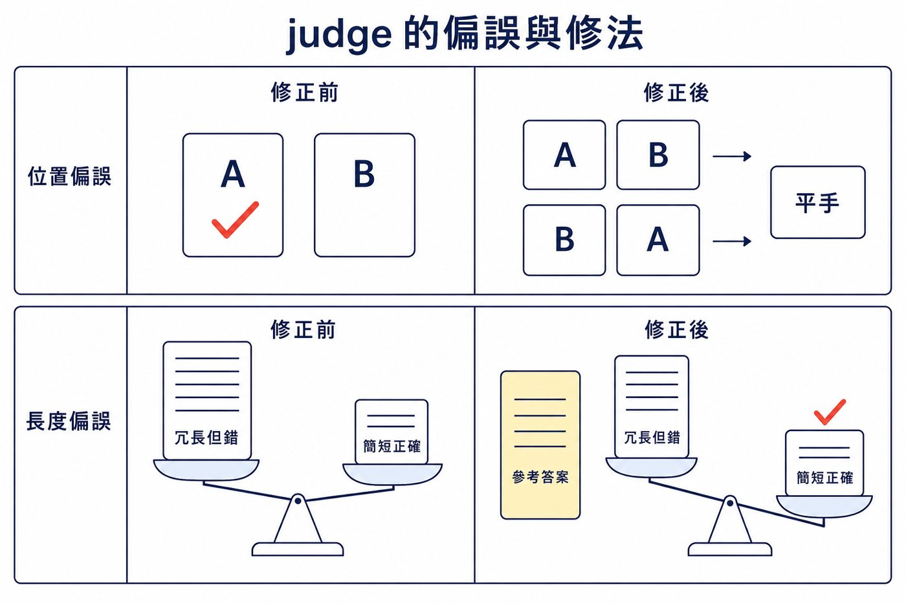
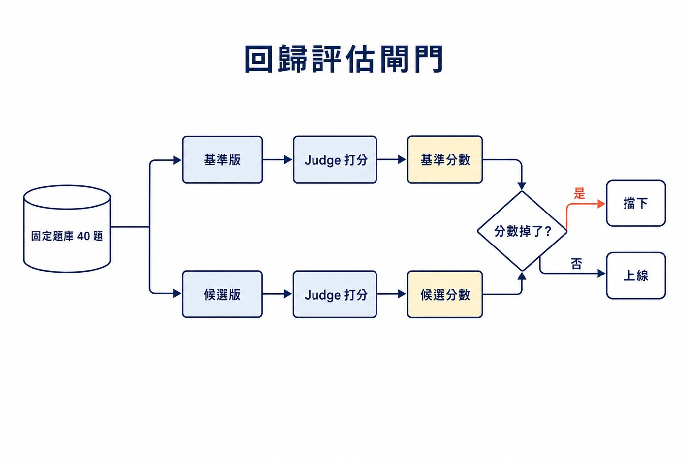
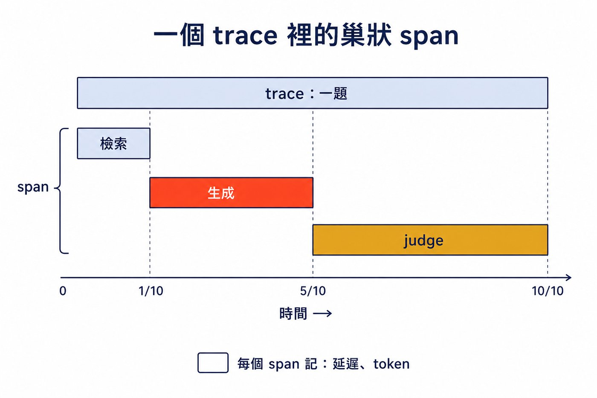

# 模組 8 原理紀要：評估、trace 與可觀測性

notebook 用 Opik、Langfuse 這些套件做事；這份文件講它們底下在做什麼。
先讀一遍再開 notebook，遇到看不懂的名詞再回來查。

---

## 1. 為什麼 LLM 應用需要「評估」

訓練模型時，你有驗證集和 loss 曲線：改了超參數，看驗證 loss 有沒有變好。
LLM 應用上線後沒有 loss，只有「使用者說答錯了」。評估就是替 LLM 應用補一份驗證集：

```
  深度學習                    LLM 應用
  ─────────                  ─────────
  驗證集（x, y）        ←→    評估集（問題, 參考答案, 標籤）
  評估指標（accuracy）  ←→    評分器（程式規則 / LLM 評審 / 人工）
  新 checkpoint 不能變差 ←→   新 prompt / 參數不能比基準版差（回歸評估）
```

評分器有三種，由便宜到貴：

| 評分器 | 例子 | 適合 | 不適合 |
|---|---|---|---|
| 程式規則 | 是不是合法 JSON、有沒有某個數字、字串相似度 | 格式、必須出現的關鍵資訊 | 判斷意思對不對 |
| LLM 評審（LLM-as-a-judge） | 讓模型讀參考答案後打分 | 大量、開放式回答 | 自己也會錯，要先校準 |
| 人工 | 專家標 pass／fail＋理由 | 校準 LLM 評審、抽查 | 量大時太貴 |

實務上三種疊著用：規則當否決票、LLM 評審做大量評分、人工校準 LLM 評審。

---

## 2. LLM 評審（judge）的組成

一個 judge prompt 有四個零件：

```
  ┌─ 參考答案 ───── 沒有它，judge 不知道什麼是對的，只能看表面（長度、語氣）
  ├─ 評分量表 ───── 每個分數寫清楚定義：5 = 關鍵事實全對 … 1 = 編造
  ├─ 先寫理由 ───── 輸出欄位 reason 放在 score 前面，像讓模型先算再答
  └─ 結構化輸出 ─── 用 Pydantic 定義欄位，SDK 保證拿回來的是合法物件
```

結構化輸出的示意（notebook 裡就是這樣用）：

```python
class Verdict(BaseModel):
    reason: str
    score: int = Field(ge=1, le=5)
resp = client.chat.completions.parse(model=..., messages=..., response_format=Verdict)
```

### judge 的偏誤



*圖：上排位置偏誤——內容一樣的 A、B，judge 總是選 A；正反各問一次後判成平手。下排長度偏誤——沒有參考答案時天平倒向「冗長但錯」，放上參考答案後才倒向「簡短正確」。*

| 偏誤 | 現象 | 修法 |
|---|---|---|
| 位置偏誤 | 兩兩比較時，偏好先出現（或後出現）的那個 | 正反各問一次，兩次都選同一份內容才算贏，否則平手 |
| 長度偏誤 | 長、客氣、像官方說明的回答分數比較高，就算是錯的 | 給參考答案、量表寫明長度不加分、附一個「長但錯」的範例 |
| 自我偏好 | 模型給自己產生的回答比較高分 | 受測模型和 judge 用不同模型 |

位置偏誤的判讀：

```
  原順序： A=回答甲  B=回答乙   → judge 選 A
  對調後： A=回答乙  B=回答甲   → judge 又選 A
                                  ↑ 兩次都選「A 這個位置」，不是選內容 → 位置偏誤
```

小模型（例如本課的 3B）還有一個毛病：**會漏看數字**。prompt 寫得再清楚，它也可能說「關鍵事實一致」卻沒發現 7 和 3 不同。
能用程式檢查的就別交給 LLM：本模組的 judge 加了一條規則「參考答案裡的數字，回答都要出現」，當否決票。

---

## 3. judge 本身也要被評估：校準

judge 就是一個二元分類器，人工標註是 ground truth：

```
                 judge 說 pass     judge 說 fail
  人工說 pass        TP               FN（好的被攔下）
  人工說 fail        FP（壞的被放行）  TN

  TPR = TP / (TP + FN)    好的有多少被判 pass
  TNR = TN / (TN + FP)    壞的有多少被抓出來
```

- 類別不平衡時不要只看一致率：全部判 fail，TNR 是 100%、TPR 是 0%，一致率卻可能很高。這跟深度學習裡不能只看 accuracy 是同一件事。
- FP（壞的被放行）對產品最危險：分數會虛胖。
- 校準流程：人工標一小批（例如 10～30 筆，含理由）→ 算一致率、TPR、TNR → 讀不一致那幾筆的理由 → 改 judge prompt 或加規則 → 再算一次。
- **用來校準的樣本不能拿來當 prompt 範例**，否則就像拿測試集調超參數。

---

## 4. 回歸評估



*圖：題庫和 judge 都不動，只換受測系統；兩邊分數進同一個閘門，掉分就走朱紅色那條路被擋下。*

- 題庫、judge 都固定，只換受測系統；基準版的結果存檔，不用每次重跑。
- 題目要有**標籤**（數字題、條件題、資料外的題目…），分組看才知道哪一類退步。只看總分會漏：一個「更親切」的 prompt 可能總分不變，卻讓「資料裡沒有的題目」全部開始編答案。
- judge 有雜訊，同一份資料重跑可能差 1～2 題，門檻要留容許值；但對最不能接受的錯（例如編造），容許值設 0。
- 寫成 pytest 放進 CI，每次改 prompt 或參數都自動跑。

---

## 5. trace、span、generation

一次請求從進來到回答，中間經過好幾步。trace 就是把每一步記下來：



*圖：最上面一條是整個 trace（一題）；底下三個 span 依時間接力，長度就是延遲。生成和 judge 是大頭，檢索只佔一小段。每個 span 另外記 token 數。*

| 名詞 | 意思 |
|---|---|
| trace | 一次請求的全部步驟，用 trace id 串起來 |
| span（observation） | 其中一步：開始時間、結束時間、輸入、輸出、父節點 |
| generation | 一種特別的 span：一次 LLM 呼叫，多記模型名、參數、token 數 |
| session／thread | 多回合對話，用 session id 把幾個 trace 串起來 |
| score／feedback | 掛在 trace 上的分數（judge、人工、使用者按讚） |

自己做最小版本只要一個 context manager：進入時記時間，離開時寫一行 JSONL。

```python
@contextmanager
def span(trace_id, step, input_):
    t0 = time.perf_counter(); rec = {"trace_id": trace_id, "step": step, "input": input_[:40]}
    try: yield rec
    finally: rec["latency_ms"] = (time.perf_counter() - t0) * 1000; f.write(json.dumps(rec) + "\n")
```

可觀測性平台做的是同一件事，再加上：span 之間的父子關係（畫成樹和瀑布圖）、完整保存輸入輸出、成本換算、
分數篩選、標註佇列、團隊共享連結。

有了 trace，錯誤分析才有東西看：一題答錯，先看檢索有沒有撈到正解文件——沒撈到就修檢索，撈到了還答錯就修生成。

### 延遲要看分布

平均值會被少數特別慢的請求拖著走。上線看 p50（一般使用者的體驗）和 p95（最慢那 5% 的體驗）。
本機有其他程式搶 GPU 時，p95 會被拉長，這只有 trace 看得出來。

### OpenTelemetry（OTel）

業界通用的 trace 標準。Langfuse 3 版之後的 SDK 整個建在 OTel 上：每個 observation 就是一個 OTel span，
平台的欄位只是一堆有命名規則的屬性（例如 `langfuse.observation.usage_details`）。好處是**可攜**：同一批 span 換個 exporter 就能送到別的後端。

---

## 6. 指標怎麼選

| 指標 | 類型 | 量什麼 | 注意 |
|---|---|---|---|
| Hit@k、MRR | 規則 | 檢索有沒有把正解文件排進前 k 名 | 需要每題的正解文件 id |
| 字串相似度（Levenshtein、BLEU、ROUGE） | 規則 | 字面像不像 | 開放式回答時跟「對不對」關係很弱 |
| 關鍵數字比對 | 規則 | 參考答案的數字有沒有出現 | 「半年」對「6 個月」會誤殺，只當否決票 |
| Hallucination／Faithfulness | LLM | 回答有沒有超出提供的資料 | 現成 prompt 多為英文、針對大模型 |
| Answer relevance | LLM | 有沒有回答到問題 | 不檢查對錯 |
| 自寫 judge（對照參考答案） | LLM | 你最在意的業務規則 | 要自己校準 |
| 延遲 p50／p95、每題 token | 量測 | 速度與成本 | 從 trace 算 |

原則：**先做錯誤分析再決定指標**。先讀 30 筆左右的失敗 trace、把錯誤分類，再針對最常見的錯誤寫評分器，而不是先想像一堆指標。

---

## 7. Langfuse 與 Opik 怎麼選

兩者都開源、都能自架、都同時做 trace 和評估；差在重心。

| | Langfuse | Opik | LangSmith（對照） |
|---|---|---|---|
| 重心 | trace、prompt 管理 | 評估指標、實驗 | LangChain 生態全套 |
| 授權 | MIT（`ee/` 除外） | Apache 2.0 | 閉源 SaaS |
| 自架 | Docker compose | Docker compose | 限 Enterprise |
| 打點寫法 | `start_as_current_observation`、`@observe` | `@opik.track` | `@traceable` |
| 內建指標 | 少，主要靠你送分數 | 多（規則型＋LLM 型，經 LiteLLM 可接本地模型） | 有 |
| 底層 | OpenTelemetry | 自有格式，也收 OTel | 自有格式，也收 OTel |

一句話：**trace 與 prompt 管理為主、要自架，選 Langfuse；要現成的評估指標、想在 notebook 或 CI 直接算分，選 Opik；團隊已經全用 LangChain，選 LangSmith。**
另外，Langfuse 在 2026-01 被 ClickHouse 收購（官方承諾維持 MIT）。這兩年可觀測性工具收購頻繁，用 OTel 打點能降低被單一廠商綁住的風險。

### 新舊 SDK 寫法（Langfuse）

網路上很多範例是舊版，貼進新版會直接報錯：

| 用途 | v2（已移除） | 本課使用的 5.x |
|---|---|---|
| 開一個 trace | `lf.trace(name=...)` | `lf.start_as_current_observation(name=..., as_type="span")` |
| 記一次 LLM 呼叫 | `trace.generation(...)` | `lf.start_as_current_observation(..., as_type="generation")` |
| 設 trace 屬性 | `trace.update(user_id=...)` | `with propagate_attributes(session_id=..., tags=...)` |
| 寫分數 | `lf.score(...)` | `lf.score_current_trace(...)`、`lf.create_score(...)` |

---

## 8. 把評估結果寫成履歷與面試回答

一句好履歷＝**做了什麼＋對照基準＋量化結果＋怎麼驗證**。

```
  改寫前：熟悉 LangChain，會調用 OpenAI API
  改寫後：建立 40 題固定評估集與 LLM 評審（與 10 筆人工標註一致率 X%），
          以 pytest 閘門攔下一次讓資料外問題拒答率由 Y% 掉到 Z% 的 prompt 改版
```

- 數字一律從實驗結果檔自動帶入，不手抄；讓 LLM 潤稿後，用程式檢查每個數字都追得回出處。
- 課綱與投影片「履歷改寫前後」的 68%→91%、55%→80% 等是**範本數字**，不是實測，只能當句型。
- 面試三心法：講得出**限制**（幻覺、評審偏誤、題庫太小）、講得出**結構**（系統怎麼分層、每層負責什麼）、講得出**數字**（指標、基準、量法）。

---

## 常見坑

- judge 和受測系統用同一個模型（自我偏好）。本模組為了全程本地而接受，要明講。
- 沒有參考答案就叫 judge 打分，結果分數跟長度走。
- 只看一致率、不看 TPR／TNR。
- 拿校準樣本當 judge prompt 的範例。
- 回歸門檻只看總分，沒有按題型設。
- trace 只記成功的請求；出錯的那一步沒寫進去，最需要看的反而沒有。
- 履歷寫了範本數字，面試被追問「怎麼量的」答不出來。
