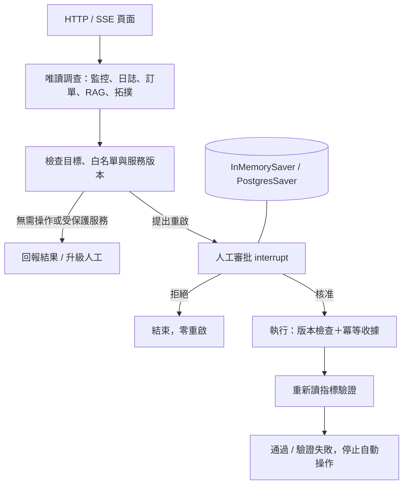

# 晨光外送 · 值班助理

把日誌、指標、訂單與 runbook 接成一次調查，再由人核准修復。
本專案整合 M2／M3／M4／M5／M7／M8 的能力，提供可執行的教學閉環。

**所有重啟均作用於 SQLite 模擬服務，不會呼叫 Docker、shell 或真實線上服務。**

## 先跑起來

在倉庫根目錄執行，需 Python 3.11+ 與 [uv](https://docs.astral.sh/uv/)。

```bash
uv sync --locked --group flagship --group dev
export PYTHONPATH="$PWD/projects/incident-autonomous-agent"
uv run --no-sync python -m oncall_agent serve
```

開啟 <http://127.0.0.1:8000>，選 `order-db-proxy`，按「開始調查」。
畫面會停在待審批；填寫審批者後核准，才會執行模擬重啟並顯示驗證結果。
也可拒絕，確認沒有寫入發生。服務啟動預設不需要 Ollama、Docker 或金鑰。

若已有 `.env` 設定 live 模式，可用下列指令明確指定 demo：

```bash
ONCALL_MODE=demo ONCALL_CHECKPOINT=memory uv run --no-sync python -m oncall_agent serve
```

命令列互動示範使用隔離資料，執行中會等待你按 Enter 核准：

```bash
uv run --no-sync python -m oncall_agent demo
```

Windows PowerShell 的路徑設定：`$env:PYTHONPATH="$PWD/projects/incident-autonomous-agent"`。

## 兩種執行模式

| 能力 | `demo`（預設） | `live` |
|---|---|---|
| 調查 | 固定規則＋平行唯讀證據收集 | Deep Agents＋3 個 skills＋唯讀假設子 agent |
| 日誌、監控、訂單 | 直接讀模擬資料 | 真正透過 stdio MCP 讀同一份模擬資料 |
| 混合檢索 | 離線 LSA dense＋BM25＋RRF | Ollama embedding＋Chroma＋BM25＋RRF |
| Dense 失敗 | — | 降級 BM25，結果註明備援 |
| 拓撲 | 本地 JSON | Neo4j 查詢；未設定、無資料或連線失敗時用本地 JSON |
| 審批與修復 | LangGraph interrupt → execute → verify | 同一套固定圖，模型不能繞過 |
| 服務操作 | SQLite 模擬重啟 | SQLite 模擬重啟 |
| 檢查點 | 預設 InMemorySaver，可改 PostgreSQL | 建議使用 PostgresSaver |

離線 LSA 是以本專案小型語料建立的語義空間，適合免下載示範；不等同大型 embedding 模型的檢索品質。Demo 結果也不代表 LLM 調查能力。

## 流程與邊界



- 只允許 `order-db-proxy`、`notification` 重啟；`payment-api`、`order-api` 交由人工。
- 服務已健康時不提重啟。LLM 的 target 必須與調查服務相符，否則阻擋。
- 審批綁定事件的 `action_id`；拒絕、重複審批、目標不符都不執行。
- 審批後檢查服務 revision。若另一事件已修復，舊審批不會再重啟。
- 狀態更新與操作收據在同一個 SQLite 交易，checkpoint 重試也不會重複操作。
- 驗證必須同時滿足 `healthy`、`p95_ms < 1000`、`error_rate < 0.05`。
- SQL 使用 AST、SQLite 唯讀連線、資料表／函式 authorizer 與執行步數上限，只接受單一 `SELECT` 查 `orders`，最多100筆。
- Deep Agents 的檔案是 checkpoint 內的虛擬檔案，不掛載主機檔案系統，也不提供 shell 或服務寫入工具。
- 所有 graph invocation 明確設定 `recursion_limit`，模型每次呼叫有 timeout。

## PostgreSQL：關掉程序後繼續審批

先複製根目錄 `.env.example` 為 `.env`（已有設定請保留），填寫 `POSTGRES_PASSWORD`，再啟動服務：

```bash
docker compose --env-file .env -f projects/incident-autonomous-agent/docker-compose.yml up -d --wait postgres
```

在 `.env` 設定以下欄位；URL 的密碼須 percent encode，且與 Compose 設定一致：

```dotenv
ONCALL_CHECKPOINT=postgres
ONCALL_DATABASE_URL=postgresql://agent:<URL-encoded-password>@127.0.0.1:55432/agent
```

重新啟動服務，開始事件，保存畫面上的事件 ID。在待審狀態停止並重啟應用程式後，使用「恢復待審事件」貼上 ID，再核准或拒絕。
SQLite 模擬服務和操作收據保存在 `ONCALL_DATA_DIR`（預設倉庫根目錄 `.oncall-data/`），重啟時需使用同一目錄。
`InMemorySaver` 只適合單次示範，程序結束後無法恢復事件。

## Live：接上 Ollama、Deep Agents 與 MCP

先啟動 Ollama，下載本機模型：

```bash
ollama pull qwen2.5:3b
ollama pull bge-m3
```

在 `.env` 設定：

```dotenv
ONCALL_MODE=live
ONCALL_CHECKPOINT=postgres
ONCALL_DATABASE_URL=postgresql://agent:<URL-encoded-password>@127.0.0.1:55432/agent
ONCALL_API_TOKEN=<自行產生的隨機-token>
LOCAL_BASE_URL=http://localhost:11434/v1
ONCALL_MODEL=qwen2.5:3b
EMBED_MODEL=bge-m3
```

啟動同一個 `serve` 指令，於頁面填入 API Token。Live 模式缺少 token 時拒絕啟動。
模型須支援工具呼叫與 JSON schema；小模型可能無法完成調查，失敗時不會自動放行操作。
LangGraph 的工具型結構化回應若沒有返回結果，會改用模型供應商的 JSON schema 重新整理證據；校驗仍失敗就停止。

要啟用 Neo4j，填寫 `NEO4J_PASSWORD`、`ONCALL_NEO4J_URI=bolt://127.0.0.1:57687`，然後：

```bash
docker compose --env-file .env -f projects/incident-autonomous-agent/docker-compose.yml --profile graph up -d
uv run --no-sync python -m oncall_agent seed-topology
```

`seed-topology` 是一次性的教學資料初始化。執行時請確認資料庫已可連線；Agent 執行期間只查詢拓撲。
LangSmith 追蹤可透過 `.env.example` 的 `LANGSMITH_*` 欄位選擇啟用，預設關閉。

## API

設定 token 後，所有 `/api` 請求使用 `Authorization: Bearer <token>`；`/`、`/health` 不需 token。
`reviewer` 是示範用審批標籤，不是企業身分驗證。

| 方法與路徑 | 用途 |
|---|---|
| `POST /api/incidents` | JSON `{ "service": "order-db-proxy", "question": "下單 502" }`，調查至待審／結束 |
| `POST /api/incidents/stream` | 同樣輸入，輸出 SSE `incident`、`step`、`state`；失敗時 `failure` |
| `GET /api/incidents/{id}` | 讀取 checkpoint、證據與待審操作 |
| `POST /api/incidents/{id}/decision` | `{ "action_id": "事件 ID", "approved": true, "reviewer": "姓名" }` |
| `GET /health` | 模式與 checkpoint 類型 |

SSE 提供執行階段與結果，不輸出模型隱藏推理。Bearer token 僅存在頁面記憶體，不存瀏覽器 storage。

## 測試與評估

於倉庫根目錄執行：

```bash
uv run --no-sync pytest -q projects/incident-autonomous-agent/tests
uv run --no-sync python eval_benchmarks/evaluate_incident_agent.py
```

一般測試會實際啟動 stdio MCP 子程序，驗證審批、拒絕、白名單、併發重複核准、過期審批、SQL 邊界、HTTP/SSE、修復失敗與 checkpoint 恢復。
實際 PostgreSQL 測試需先在環境設定 `ONCALL_TEST_POSTGRES`，指向**隔離測試資料庫**；測試會建立 checkpoint 資料表。再執行同一個 pytest 指令。
另設 `ONCALL_TEST_LIVE=1` 可測真正的 Ollama／MCP／Chroma／PostgreSQL 整合；需要上述模型已下載。

[已存評估報告](../../eval_benchmarks/results/incident-demo.json)記錄六個固定情境及四筆檢索：情境通過率、核准前寫入數、Hit@3 與 MRR@3。這些是小型教學回歸資料，不是線上事故成功率或模型排名。

## 使用限制與下一步

這是可執行的教學參考實作，預設僅綁定 `127.0.0.1`，單程序、單 worker。
事件執行以程序內鎖串行化，唯讀證據可平行取得；不支援多 worker 的分散式審批協調。
瀏覽器 SSE 以每個 graph 節點為單位更新，模型推理期間可能等待一段時間。
尚未接企業 SSO／RBAC、真實監控與變更系統；接入真實寫入前應改用具授權檢查與冪等機制的受控執行端。
所有故障資料及訂單均為合成資料。保留 `.oncall-data/` 可延續服務狀態；需要重置時先停機，再改用新的空資料目錄，不要刪除正在使用的資料庫。
